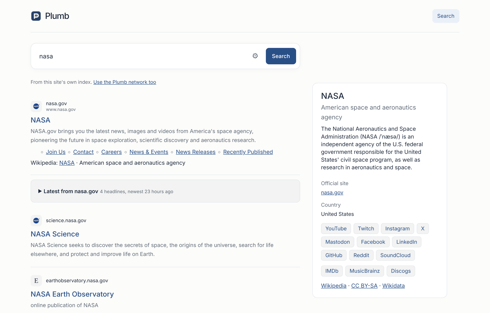
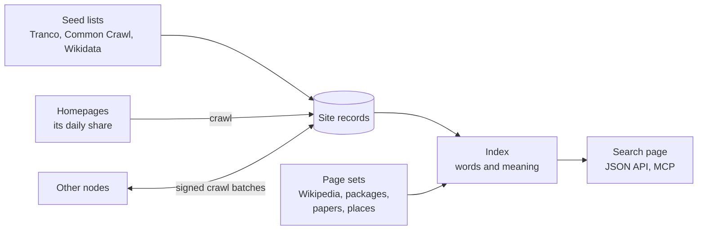

# Plumb Search

A free, open-source web search engine that anyone can run. Plumb answers from its own index, not by scraping Google or Bing, so it needs no API key and has no quota. It speaks MCP and SearXNG's JSON API, so AI apps and local models can search with it too. Nodes share their crawling over a peer-to-peer network, so no one has to crawl the whole web alone.

[](https://github.com/SueHeir/plumb-search/actions/workflows/ci.yml)
[](https://github.com/SueHeir/plumb-search/releases)
[](#license)

**[Search at plumbsearch.org](https://plumbsearch.org)** · [Run your own node](docs/running-a-node.md) · [Documentation](docs/README.md) · [How search is doing](docs/search-quality.md)



## Use it

| From | How |
| --- | --- |
| A browser | Search at [plumbsearch.org](https://plumbsearch.org), or add `https://plumbsearch.org/search?q=%s` as your browser's search engine |
| Claude Code and other MCP apps | `claude mcp add --transport http plumb https://plumbsearch.org/mcp` ([MCP tools](docs/mcp.md)) |
| Apps that take a SearXNG address | `https://plumbsearch.org`, which answers `/search?q=...&format=json` ([setup for each app](docs/local-llms.md)) |
| Zotero | The [Zotero plugin](zotero/README.md) adds the papers, books and pages you find to your library |
| Your own code | `/api/search?q=...` on any node returns JSON ([the API](docs/searching.md)) |

plumbsearch.org keeps no access log, and its results pages load nothing from other servers: Plumb serves site icons itself and draws maps from coordinates.

## Run your own node

Your own node keeps your searches, history and settings on your machine. A new node copies the best sites of a node it trusts (plumbsearch.org by default), is searchable within minutes, and then crawls its share of the web. No port forwarding is needed.

| On | Do this |
| --- | --- |
| A server or homelab | `docker compose up -d` in a clone of this repository, then open port 8080 ([Docker](docs/docker.md)) |
| A desktop or laptop | Install the app from the [releases page](https://github.com/SueHeir/plumb-search/releases); search opens at http://127.0.0.1:7586 ([desktop app](docs/desktop.md)) |
| Anything with Rust | `cargo build --release -p plumb-node`, then `./target/release/plumb run --data plumb-data --network` and open http://127.0.0.1:8080 ([running a node](docs/running-a-node.md)) |

## What it finds

- **The official site first.** Names count for more than text, so look-alike sites stuffed with a brand's words stay below the real one.
- **Pages from open page sets** next to sites: Wikipedia, GitHub, Stack Overflow and other Stack Exchange sites, software packages, books, papers and podcasts ([page sets](docs/pages.md)).
- **Places** from OpenStreetMap for searches like "pizza in denver", with a small map ([places](docs/places.md)).
- **Answers and context**: sums, conversions and the time somewhere, an info box about what the search names, links to a site's key pages, and recent headlines from its feed ([news](docs/news.md)).
- **Search by meaning**, so "electric car maker" finds sites that never use those words (on in the Docker image and the desktop app).
- **Private search** at `/private`, where the browser ranks results itself and the node never sees the query ([private search](docs/private-search.md)).
- **Plugins** that add results from other sources, run in a WebAssembly sandbox ([plugins](docs/plugins.md)).

Plumb indexes sites, not every page: for each site it keeps names, the homepage's title, description and key terms, the words other sites link to it with, and Wikidata's facts. That keeps a node small enough for an ordinary computer, and it is why a blog post or forum thread deep inside a site is harder to find than with a full-text engine.

## How it works



Each day every node is given a random share of all sites to crawl. It signs what it saw and passes it on, and other nodes take a crawl in only when they can check it. A search is answered from the node's own index: candidates matched by words and by meaning, put in order by a small ranking model, with answers, page-set results and places alongside.

[The architecture](docs/architecture.md) shows the crates and what runs inside a node, [how search works](docs/search.md) covers matching and ranking, and [the network](docs/network.md) covers sharing, trust and network search.

## How search is doing

<picture>
  <source media="(prefers-color-scheme: dark)" srcset="docs/search-quality/mean-grade-dark.svg">
  
</picture>

Measured on 1,000 real searches graded 0 to 3, in run 5 on 2026-10-14 (build [`11bab11`](https://github.com/SueHeir/plumb-search/commit/11bab11)):

| | |
| --- | ---: |
| Mean grade | **2.06** of 3 |
| Known right answer at #1 | **75%** of 464 |
| Known right answer in the top 3 | **84%** |
| Median time per search | **0.50 s** |

Plumb is good at finding a thing by its name and weaker when a search describes it in other words. [How search is doing](docs/search-quality.md) has every run, each kind of search and where it falls short.

## Documentation

| For | Read |
| --- | --- |
| Searching | [Using search](docs/searching.md) · [Private search](docs/private-search.md) · [Places](docs/places.md) · [Headlines](docs/news.md) |
| AI apps | [MCP server](docs/mcp.md) · [Local models and AI apps](docs/local-llms.md) |
| Running a node | [Running a node](docs/running-a-node.md) · [Docker](docs/docker.md) · [Desktop app](docs/desktop.md) · [Remote control](docs/remote-control-security.md) · [Plugins](docs/plugins.md) |
| How it works | [Architecture](docs/architecture.md) · [Search and ranking](docs/search.md) · [The network](docs/network.md) · [Page sets](docs/pages.md) |
| The code | A README in [each crate](docs/architecture.md#the-crates) · [Evals](eval/README.md) · [How search is doing](docs/search-quality.md) |

[docs/README.md](docs/README.md) lists every page.

## Contributing

Issues and pull requests are welcome: [CONTRIBUTING.md](CONTRIBUTING.md) has the details, and [SECURITY.md](SECURITY.md) says how to report a security problem. Before opening a pull request, run:

```sh
cargo fmt --all --check
cargo clippy --workspace --exclude plumb-desktop --all-targets -- -D warnings
cargo test --workspace --exclude plumb-desktop
```

## Data sources

Plumb is built from open data. Nodes keep titles, short descriptions and counts, not whole pages.

| Source | What Plumb takes from it | License |
| --- | --- | --- |
| [Wikipedia](https://en.wikipedia.org/) (English) | Article titles and short descriptions, from Wikimedia's dumps; page views | Text [CC BY-SA 4.0](https://creativecommons.org/licenses/by-sa/4.0/); page views CC0 |
| [Wikidata](https://www.wikidata.org/) | Official websites, names, countries, kinds of site, descriptions and official profiles | [CC0](https://creativecommons.org/publicdomain/zero/1.0/) |
| [Stack Overflow](https://stackoverflow.com/) and other [Stack Exchange](https://stackexchange.com/) sites | Question titles, tags and views, from Stack Exchange's data dump | [CC BY-SA 4.0](https://creativecommons.org/licenses/by-sa/4.0/) |
| [ecosyste.ms](https://packages.ecosyste.ms/) | Package names, versions, licenses and links for eight registries | [CC BY-SA 4.0](https://creativecommons.org/licenses/by-sa/4.0/) |
| [OpenStreetMap](https://www.openstreetmap.org/copyright) | Places; © OpenStreetMap contributors | [ODbL](https://opendatacommons.org/licenses/odbl/) |
| [OpenAlex](https://openalex.org/) | The most cited papers, and where each can be read free (from [Unpaywall](https://unpaywall.org/)'s data and [arXiv](https://arxiv.org/)) | [CC0](https://creativecommons.org/publicdomain/zero/1.0/) |
| [CORE](https://core.ac.uk/) | Where papers OpenAlex knows no free copy of can be read free, from university repositories (optional, with a CORE API key) | [CORE's terms](https://core.ac.uk/terms) |
| [Open Library](https://openlibrary.org/) | The most read books | [CC0](https://creativecommons.org/publicdomain/zero/1.0/) |
| [Podcast Index](https://podcastindex.org/) | Titles, authors, categories and popularity of the most popular podcasts | Free for any use |
| [GitHub](https://github.com/) | Names, descriptions and stars of public repositories, from its API | [GitHub's terms](https://docs.github.com/en/site-policy/github-terms/github-terms-of-service) |
| [Tranco](https://tranco-list.eu/) | The top million sites, for first ranks | See its site |
| [Common Crawl](https://commoncrawl.org/) | Web graph domain ranks; optionally titles and link text from WAT files | [Terms of use](https://commoncrawl.org/terms-of-use) |
| [The Block List Project](https://github.com/blocklistproject/Lists) | The adult sites list for safe search | Public domain ([Unlicense](https://unlicense.org/)) |
| [European Central Bank](https://www.ecb.europa.eu/stats/policy_and_exchange_rates/euro_reference_exchange_rates/html/index.en.html) | Daily euro reference rates for currency conversions | Free to reuse with the source named |
| [Open-Meteo](https://open-meteo.com/) | Weather forecasts for weather answers | CC BY 4.0, free without a key for non-commercial use |
| [BAAI/bge-small-en-v1.5](https://huggingface.co/BAAI/bge-small-en-v1.5) | The embedding model for search by meaning | MIT |
| [EmbeddingGemma 2](https://huggingface.co/google/embeddinggemma-2) | The many-language model search by meaning can run instead (`--meaning-model gemma`) | See its model card |

Site titles, descriptions and icons come from the sites' own homepages. The info box credits Wikipedia under each description it takes from an article, and lists of places credit OpenStreetMap.

## License

Licensed under either of

- Apache License, Version 2.0 ([LICENSE-APACHE](LICENSE-APACHE))
- MIT license ([LICENSE-MIT](LICENSE-MIT))

at your option.

Unless you explicitly state otherwise, any contribution intentionally submitted for inclusion in the work by you, as defined in the Apache-2.0 license, shall be dual licensed as above, without any additional terms or conditions.
