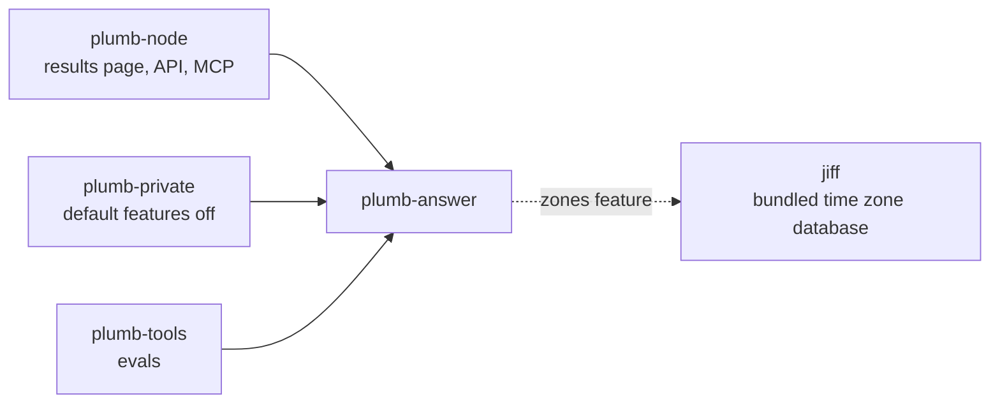
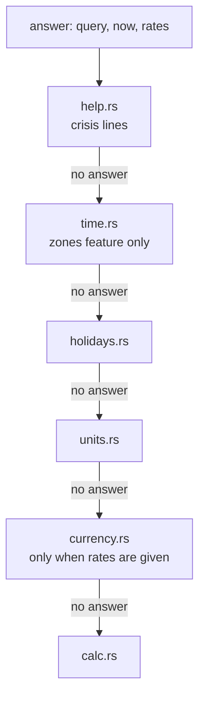

# plumb-answer

Instant answers: what a query asks that can be worked out from the query alone, shown above the results. Sums, unit and currency conversions, the time in a place, the date of a holiday, where to get help in a crisis, and the wording of weather answers. The node, the browser's private search and the evals all call it.

Part of [Plumb Search](../../README.md). See [the architecture](../../docs/architecture.md) for how the crates fit together.

## Where it fits



plumb-answer depends on no other Plumb crate.

## What is in it

| Module | Kind | Examples |
| --- | --- | --- |
| [calc.rs](src/calc.rs) | `Calculation` | `12 * (3 + 4)`, `sqrt(2)`, `15% of 80`, `5!`, "log base 2 of 8", "3/8 as a decimal" |
| [units.rs](src/units.rs) | `Conversion` | `10 km in miles`, `100 f to c`, `1 1/2 cups to ml`, `5'10 in cm`, `180 cm in feet and inches` |
| [currency.rs](src/currency.rs) | `Currency` | `100 usd to eur`, from rates the caller passes |
| [time.rs](src/time.rs), [places.rs](src/places.rs), [zones.rs](src/zones.rs) | `Time` | `time in tokyo`, `what time is it in paris`, `3pm est to pst` (feature `zones`) |
| [holidays.rs](src/holidays.rs) | `Date` | `when is thanksgiving 2026`, `easter 2027`, `how many days until christmas` |
| [help.rs](src/help.rs) | `Help` | "depression help", "suicide hotline", "988" |
| [weather.rs](src/weather.rs) | `Weather` | `weather in denver`, `denver weather tomorrow`, "clima en madrid" (reading and wording only) |
| [format.rs](src/format.rs) | | `format_number`: numbers as people read them |
| [lib.rs](src/lib.rs) | | `answer`, `may_need_rates`, `Answer`, `Kind` |

`Kind` also names `Fact` ("capital of australia") and `Definition` ("what is a manatee"). plumb-node works those out from its page sets; they are listed here so every answer has the same shape.

## How it works

Nothing here reads the network, the clock or the computer's settings. The caller passes the current time (`now`, Unix seconds) and the currency rates it has, so the same code gives the same answer on a node and in the browser. The time zone database is compiled in (jiff's `tzdb-bundle-always`), so time answers do not depend on what the computer has installed.

`answer` first turns full-width letters and digits into ASCII ("１＋１" is `1+1`), and gives no answer to an empty query or one longer than 120 characters. Then it asks each kind in turn and returns the first answer:



Each kind is careful to leave ordinary searches alone, since a wrong answer above the results is worse than none:

- **Sums** need the whole query to read as one, with at least one operation, so "2024" and "f1" stay searches. Numbers joined by `/` or `-` without spaces ("9/11", "24/7", "1-800-273-8255", "2024-10-13") are left alone.
- **Conversions** cover length, mass, volume, temperature, area, speed, time, data, energy, pressure and power. Amounts may be written as recipes and heights are (`½ cup`, `5' 10"`). A few symbols are read by their case: "mW" is a milliwatt and "MW" a megawatt, "Gb" a gigabit and "GB" a gigabyte.
- **Currency** uses the European Central Bank's euro reference rates (`Rates`, read by `Rates::parse_ecb`), about 30 currencies, published each working day. `may_need_rates` tells the caller whether a query might be a conversion, so it fetches rates only then.
- **The time** comes from a built-in list of cities, countries (one zone each; a country with several gets its capital's), US states, Canadian provinces, Australian states and zone names ("pacific", "est"). For a town not in the list, the caller looks the town up and calls `time_in_town`. [zones.rs](src/zones.rs) then works out the clock from where the town is: its country's, or its state's in the US, Canada and Australia when all of it keeps one time. Where a country keeps several, the town takes the zone of the nearest city only when every city keeping another time is at least three times farther, so a town near a line between two clocks gets no answer rather than a wrong one.
- **Holidays** are fixed dates, a weekday of a month ("the fourth Thursday in November") or so many days from Easter, Western or Orthodox. A day named alone ("thanksgiving") is a search, not a question: it gets an answer only with a year or words that ask when. Days set by a lunar calendar (Ramadan, Diwali, Lunar New Year) are left to the results.
- **Help** comes first of all. A query with crisis words or phrases gets the lines: 988 in the US and Canada, 116 123 in the UK and Ireland, and findahelpline.com elsewhere.

### What the node fetches

The node fetches the data that answers need and this crate does not; the request carries nothing of the query.

| Data | From | When | Set in |
| --- | --- | --- | --- |
| Currency rates | `ECB_RATES_URL` (the ECB's `eurofxref-daily.xml`) | When `may_need_rates` says a query may need them; fetched again after 6 hours, or 10 minutes after a failed fetch, when older rates are used meanwhile; a page waits at most 4 seconds | plumb-node [web/answers.rs](../plumb-node/src/web/answers.rs) |
| Forecasts | Open-Meteo (`api.open-meteo.com/v1/forecast`), sent only the town's coordinates rounded to about a kilometre | When a query asks for the weather; fetched again after 30 minutes, or 5 minutes after a failed fetch; up to 2,000 places kept; a page waits at most 3 seconds | plumb-node [web/weather.rs](../plumb-node/src/web/weather.rs) |

For weather, `weather::asked` reads the question, the node finds the place in its own places (or the town the searcher gave on the About you page) and fetches the forecast, and `weather::answer` words it, crediting `weather::SOURCE` ("Open-Meteo.com (CC BY 4.0)").

The node also uses an answer's `Kind` to list first the sites that do such a job (plumb-node's [sources.rs](../plumb-node/src/sources.rs)), so a change to what gets an answer can move results. Run the evals for such a change; [docs/search-quality.md](../../docs/search-quality.md) says how.

### The `zones` feature

On by default. It adds the time answers ([time.rs](src/time.rs), [places.rs](src/places.rs), [zones.rs](src/zones.rs)) and jiff with its bundled time zone database, which is most of the crate's size. plumb-private depends on plumb-answer with `default-features = false` to keep the browser's WebAssembly small: private search answers sums, conversions, holidays and help, but not the time in a place. It passes no rates either, so it gives no currency answers.

## Using it

- `answer(query, now, rates) -> Option<Answer>`: the instant answer, if any. `Answer` has `kind`, `question` (as understood), `answer` and an optional `note`.
- `may_need_rates(query)`: whether to fetch rates before calling `answer`.
- `Rates::parse_ecb(xml)` and `ECB_RATES_URL`.
- `asked_town(query)`, `time_in_town(&Town, now)` (feature `zones`).
- `weather::asked(query)`, `weather::answer(asked, place, forecast, fahrenheit)`.
- `format_number(x, digits)`.

## Tests

```sh
cargo test -p plumb-answer
```

The WebAssembly build of plumb-private ([CONTRIBUTING.md](../../CONTRIBUTING.md)) compiles the crate without `zones`. Tests sit in a `#[cfg(test)]` module at the end of each file. `plain_searches_get_no_answer` in [lib.rs](src/lib.rs) lists searches that must stay searches ("9/11", "24/7", "covid-19", "the time machine"); add to it when a new answer could catch ordinary queries.
