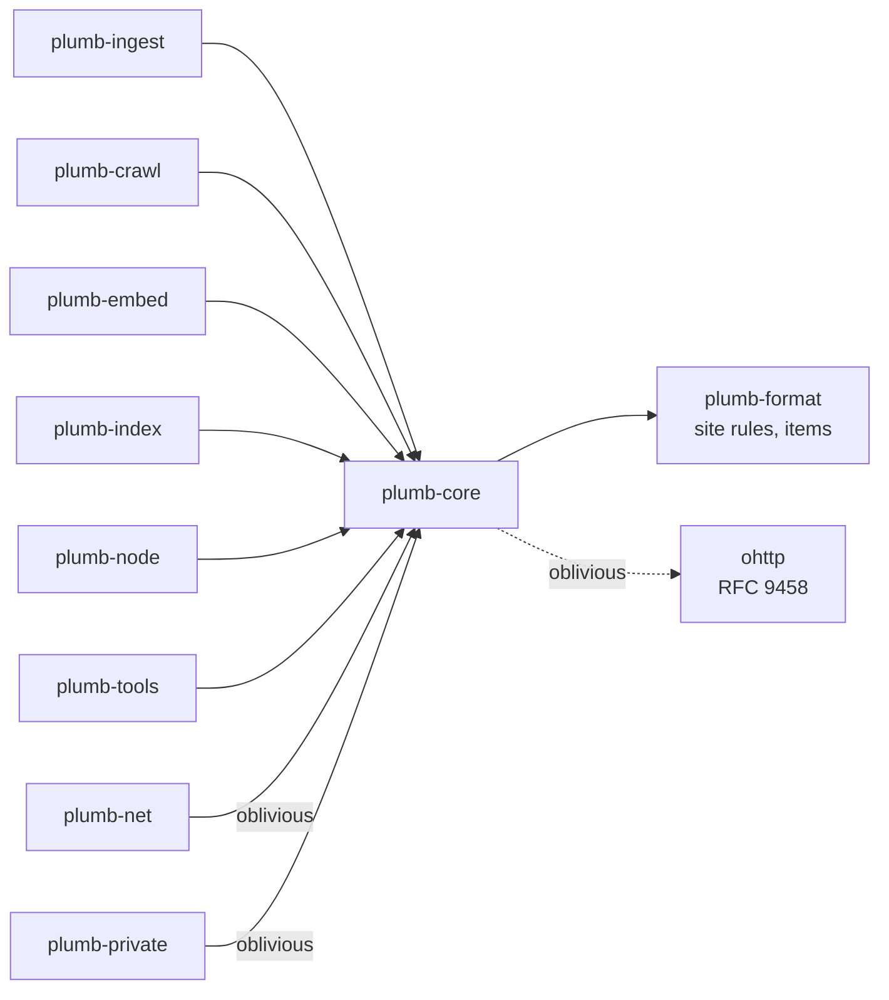

# plumb-core

The types and helpers every other Plumb crate shares: a site as an item of Plumb's data format (`site`) and a node's sites together (`Sites`), text normalization, domain and site helpers, the popularity prior, bucket keys, the node's lock and storage helpers, and the small tables behind page sets and instant answers. It has no async runtime and no network client, so the browser's private search compiles it to WebAssembly.

Part of [Plumb Search](../../README.md). See [the architecture](../../docs/architecture.md) for how the crates fit together.

- [Where it fits](#where-it-fits)
- [What is in it](#what-is-in-it)
- [How it works](#how-it-works)
- [Using it](#using-it)
- [Tests](#tests)

## Where it fits

Every crate that touches sites depends on it. Two of them turn on the `oblivious` feature.



plumb-e2e uses it in its tests too. The only Plumb crate plumb-core depends on is [plumb-format](../plumb-format/README.md), for its site rules and for sites as items.

## What is in it

**Sites, names and text**

| Module | What it does |
| --- | --- |
| [lib.rs](src/lib.rs) | `Signals`, `LinkText`, `Redirect`, the values a site's parts are read as and set from; `link_score`; domain helpers (`registrable_domain`, `canonical_domain`, `host_of`, `is_homepage_path`); text helpers (`normalize_text`, `joined`, `site_language`, `unmangled`); `read_jsonl` and `write_jsonl` |
| [site.rs](src/site.rs) | A site's stored item, read and set a part at a time (`signals`, `crawl_marks`, `link_texts` and the rest). Merging (`merge`, `merge_shared`), cleaning (`clean`), gone sites, bot checks, the item it sends (`to_item`) and takes in (`from_sent`), the line crawl batches carry (`to_line`, `from_line`), its country (`site_country`) and adult level |
| [sites.rs](src/sites.rs) | `Sites`: sites' stored items by domain, merged on insert (`upsert`, `upsert_shared`, `update`, `split_subdomain_sites`, `take_back_official_site`, `into_sorted`). Each site is held as its stored line with its link score, read when asked for (`get`, `iter`) and written again when it changes, so a set takes little more memory than the lines it holds. `SiteList`: sites in order, as lines written as they are, and `lines_by_link_score`, the set's lines in that order without moving them, which compaction writes; and `sort_by_link_score` for items |
| [site_item.rs](src/site_item.rs) | The rules a site's item keeps, kind `site`: the fields of a set of sites (`site_fields`), what makes text and addresses fit for an item, and reading a line's domain and crawl time without reading it whole (`crawl_of_line`) |
| [subsites.rs](src/subsites.rs) | Subdomains that are sites of their own (`SUBDOMAIN_SITES`, `UMBRELLA_DOMAINS`), the built-in site rules with the Public Suffix List in [data/](data/public_suffix_list.dat), and `use_site_rules` to swap in signed ones |
| [keys.rs](src/keys.rs) | Bucket keys: how a search asks for sites without saying what it looks for |
| [kinds.rs](src/kinds.rs) | Kinds of site from Wikidata ("bank", "airline"), plurals and generic kinds |
| [country.rs](src/country.rs) | Which country a site belongs to (`site_country`, `tld_country`) and the country setting's choices |
| [key_pages.rs](src/key_pages.rs) | A site's key pages ("sitelinks": sign in, docs, pricing) picked from its homepage links |
| [site_search.rs](src/site_search.rs) | Links into a site's own search (`{searchTerms}` templates) |
| [bot_check.rs](src/bot_check.rs) | Telling bot checks, error pages and parked domains apart from homepages |
| [sign_in.rs](src/sign_in.rs) | Telling sign-in pages apart, and whether a query names a site by its label |
| [simhash.rs](src/simhash.rs) | SimHash fingerprints for spotting near-copies of a page |
| [safe.rs](src/safe.rs) | Safe search: `adult_level` of a site, and parsing the adult blocklist |
| [language_words.rs](src/language_words.rs) | The language of Latin-letter text, told by its common words |
| [operators.rs](src/operators.rs) | Search operators: `site:`, `"exact words"`, `-word` |

**Page sets and answers**

| Module | What it does |
| --- | --- |
| [article.rs](src/article.rs) | Single pages next to sites (Wikipedia articles and the like) and their tab-separated file format |
| [profiles.rs](src/profiles.rs) | Official profiles and listings (YouTube channel, IMDb page) built from Wikidata identifiers |
| [facts.rs](src/facts.rs) | Wikidata facts on an article's profiles line, and reading a fact question ("capital of australia") |
| [packages.rs](src/packages.rs) | Software packages on eight registries: item ids, install commands, package queries |
| [papers.rs](src/papers.rs), [paper_query.rs](src/paper_query.rs) | Bounded paper metadata and date limits for paper searches |
| [docs.rs](src/docs.rs) | The documentation sites of the `docs` page set and how a docs page's title is read |
| [stack_exchange.rs](src/stack_exchange.rs) | The Stack Exchange sites of the `stackexchange` page set |
| [films.rs](src/films.rs) | The words a film or TV show is described with |
| [place.rs](src/place.rs) | Places from OpenStreetMap: the record, its file format, ranks and distances |
| [news.rs](src/news.rs) | Recent headlines from sites' feeds: `Headline`, caps and merging |

**Node plumbing**

| Module | What it does |
| --- | --- |
| [locks.rs](src/locks.rs) | `Locked` and `RwLocked`: take a std lock whatever happened to its last holder |
| [storage.rs](src/storage.rs) | The storage budget and the write helpers that charge it |
| [stored.rs](src/stored.rs) | A site as a node keeps it on disk (records file, journal, inbox, bucket table): every read and write of those goes through `read_item`, `write_item`, `item_as_line`, `head` and `stored::item`, so their shape can change in one place. A line is the site's stored item, written as it is; versions up to 0.4 wrote a record's JSON, which is still read, so a file can hold both. `record_json` is the record's JSON of a line, which `/plumb/fill/1` sends. [stored/old_record.rs](src/stored/old_record.rs) holds that old record, serde only, until the last reader and writer of it go |
| [oblivious.rs](src/oblivious.rs) | The asker's half of sealed bucket requests (feature `oblivious`) |

## How it works

### A site

Plumb keeps one item of kind `site` per site ([site.rs](src/site.rs)), its id the registrable domain in lowercase ASCII (punycode for international names). It holds:

- **Page fields** from the latest homepage crawl: `url`, `title`, `about` (the description), `text`, `lang`, and the fields `headings`, `terms` and `search_url`; key pages and the sites it links to are its edges (`key_page`, `links_to`).
- **Names**: `names` and the field `link_texts` (the words other sites link to it with).
- **What Wikidata and Wikipedia say**: the field `wikidata` (country, what it is about, whether it is an official site, sitelinks), `kinds`, `intro`, and `summary` for a well-known site with no words of its own.
- **Signals**: the field `ranks` (Tranco, harmonic centrality, PageRank), the weight (linking domains), and `fact_checks`; `signals` reads them all together.
- **Crawl bookkeeping**: the fields `crawled`, `crawl` (last try, failures since a success, when it was found gone), `crawl_version` and `redirect`.
- **`icon` and `news`**, which only travel between nodes and are never kept in a records file.

Each part is read and set by a function of its own in `site` (`title` is the item's, `crawl_marks`, `set_crawl_marks`, `link_texts`, `set_link_texts` and the rest), so no caller writes a field's JSON. Lists are capped: `MAX_LINK_TEXTS` (32), `MAX_ALIASES` (16), `MAX_HEADINGS` (8) of at most `MAX_HEADING_WORDS` (60) words, `MAX_TERMS` (100), `MAX_LINKS_TO` (50), `MAX_KINDS` (6), `MAX_KEY_PAGES` (6), and `MAX_TEXT_CHARS` (300) per title, description, name or link text.

> [!IMPORTANT]
> Sites travel between nodes in crawl batches, and released nodes read them. A new field must be optional and left out when empty, so older nodes keep reading sites from newer ones.

### Merging sites

`Sites` keeps a node's sites by domain. `Sites::upsert` makes the domain canonical (`canonical_domain`), drops page fields read off a bot check, and merges into any site already there with `site::merge`:

| Part | Rule |
| --- | --- |
| Page fields | From the site crawled more recently; the older one only fills gaps |
| Ranks | Best (lowest) wins |
| Linking domains, sitelinks | Larger count wins (sources overlap, so adding would double count) |
| Official site | OR-ed |
| Link texts, names, kinds | Unioned; link texts by their sets of linking sites |
| Last try | Later wins, with the failure count of that attempt |
| Redirect | Kept only while no successful crawl came after it |
| A gone site | Takes only ranks and crawl marks until a newer crawl reaches the site |

`Sites::upsert_shared` merges a crawl another node shared with `site::merge_shared`: a part the shared crawl leaves empty (it carries no search box, and page text only from trusted crawlers) keeps what this node has.

Link texts count each linking site once. `LinkText::linkers` is a 64-bit set with one bit per linking site (`linker_bit`, FNV-1a with a splitmix64 finish, the same on every machine), so merging is a bitwise OR and a site seen twice never counts twice. `linker_count` estimates the count by linear counting: exact for one site, within about 10% up to 100, and `MAX_LINKER_ESTIMATE` (300) once all 64 bits are set.

### The popularity prior

`link_score` gives each site a prior from 0 to 1 from its signals alone. `sort_by_link_score` and `Sites::into_sorted` order by it, the seed builder keeps the best sites by it, and the index stores it with each site for ranking.

```text
rank   = best of the Tranco, harmonic and PageRank ranks, as 1 - ln(rank) / ln(1e8)
         (rank 1 is 1.0, rank 1,000 about 0.63, rank 1,000,000 0.25)
links  = ln(1 + linking_domains) / ln(1 + 1e5), at most 1
score  = 0.75 * rank + 0.25 * links
       + 0.15 + 0.05 * known_share(sitelinks)   when Wikidata lists it as an official site
       + FACT_WEIGHT * fact_trust               (FACT_WEIGHT = 0.1, fact_trust from -1 to 1)
       clamped to 0..1
```

`known_share` grows on a log scale to 1 at 200 Wikipedia articles. `fact_trust` is 0 until a site has `MIN_FACT_CHECKS` (5) checked facts, and its accuracy is pulled toward `FACT_PRIOR` (0.97) by `FACT_PRIOR_CHECKS` (10).

### Text, domains and sites

`normalize_text` is the one normalization every searcher uses (index, network search, private search), so queries and records always meet: lowercase, letters and digits only, apostrophes and combining marks dropped, and runs of one-letter tokens joined (`U.S. Bank` is `us bank`). `joined` drops the spaces too, so "us bank" meets the domain label `usbank`.

`registrable_domain` turns a URL or host into the site it belongs to: the registrable domain by the Public Suffix List (`news.bbc.co.uk` is `bbc.co.uk`), except for the subdomains in [subsites.rs](src/subsites.rs) that are sites of their own (`news.ycombinator.com`, `dmv.ca.gov`). The lists are [plumb-format](../plumb-format/README.md) site rules (`built_in_rules`), applied by its `SiteRules`. A node may install other rules once at start with `use_site_rules`; plumb-node does this with the signed site rules set. `host_of` refuses IP addresses, user info and schemes other than http and https.

### Bucket keys

[keys.rs](src/keys.rs) lets a search ask other nodes, or a browser ask a node, for sites without sending the query. Every name a site goes by (domain label, title and its parts, aliases, its top `KEY_LINK_TEXTS` link texts) gives keys: each word and the whole name joined. `site_keys` gives the keys of a site's stored item, which a node's index build files its buckets by. A key falls in one of `BUCKETS` (16,384) buckets by `bucket_of`, a SHA-256 under `plumb-bucket-v1\0`. A node keeps the best `KEY_CAP` (32) sites of every key. A search fetches `BUCKETS_PER_SEARCH` (4) buckets, its own padded with random ones (`pick_buckets`), then keeps the sites that `site_matches` its keys and ranks them itself. `piece_of` cuts each bucket into `PIECES_PER_BUCKET` (4) pieces for private retrieval. `slim_site` and `lean_site` cut a site's item down to what a bucket answer or a PIR table needs.

> [!WARNING]
> `bucket_of` and `piece_of` must give the same numbers on every node, in every browser and in every version. Changing them splits the network. The test `buckets_never_change` pins them.

### Locks

`Locked::locked`, `RwLocked::read_locked` and `RwLocked::write_locked` take a std lock even when a thread panicked while holding it: the node's locks guard caches, queues and state that stay usable after such a panic. Node code takes std locks only this way, never with `.lock().unwrap()` ([conventions.rs](../plumb-tools/tests/conventions.rs) counts those). Never hold a std lock across `.await`, nor hold one that async code needs while doing file I/O.

### Storage

`StorageBudget` is the ledger of a node's data folder. `StorageBudget::open` counts the bytes of every file in the folder at start; after that each write reserves room, then commits the bytes it measured. The node setting `storage_limit_mb` is a target, not a wall: past it, `StorageStatus::backpressure` turns on, crawls pause and trims run, but no write is refused. `recount_if_due` recounts the folder at most every 300 seconds, at the node's maintenance checkpoints. A file that is unlinked while a reader still maps it stays charged (`reader_held_bytes`) until the last reader lets go.

| Helper | What it does |
| --- | --- |
| `write_atomic(dest, part, bytes, budget, modified)` | Writes `part`, syncs it, renames it over `dest`, charges the new file and credits the old one |
| `write_atomic_private(dest, part, bytes, budget)` | The same with file mode 0600 on Unix, for keys and other secrets |
| `replace_file(part, dest, budget)` | Renames a finished file into place and retires the old one |
| `remove_file(path, budget)` | Deletes a file and credits its bytes |
| `create_directory(path, budget)` | Creates a directory and its parents under the budget's lock |
| `BudgetFile`, `AdmittedWriter`, `StageLifecycle`, `StageGuard` | Streaming and staged writes (index builds) that charge as they write and clean up a failed stage |

Node code writes files through these helpers, never with `fs::write`, `fs::rename` or `File::create`, so writes are atomic and counted.

### The `oblivious` feature

Off by default. It adds [oblivious.rs](src/oblivious.rs), the asker's half of sealed bucket requests: checking a node's signed key (`SignedKeys`, signed under `plumb-oblivious-keys-v1\0`, used for `KEY_LIFETIME`, 24 hours), sealing a request to it with RFC 9458's HPKE encapsulation, and opening the answer. What is sealed is a serde value as CBOR, padded so every request is `REQUEST_SIZE` (64 bytes) and every answer at least `MIN_RESPONSE_SIZE` (4 KiB). The relay never sees what is asked and the answering node never sees who asks.

plumb-net turns it on and adds the relay and the answering side; plumb-private turns it on for the browser's WebAssembly client. It lives here because it needs nothing from libp2p beyond node keys. A WebAssembly build needs `getrandom` 0.4 with its `wasm_js` feature turned on in the WASM crate. [docs/private-search.md](../../docs/private-search.md) describes the exchange.

## Using it

- `site::new`, `add_alias`, `add_kind`, `add_link_text`, `merge`; `Sites::upsert`, `upsert_shared`, `into_sorted`.
- `link_score`, `sort_by_link_score`.
- `normalize_text`, `joined`, `registrable_domain`, `canonical_domain`, `is_homepage_path`, `is_useful_anchor`.
- `keys::site_keys`, `keys::query_keys`, `keys::pick_buckets`, `keys::bucket_of`.
- `locks::{Locked, RwLocked}`; `storage::{StorageBudget, write_atomic, write_atomic_private, replace_file, remove_file, create_directory}`.
- `read_jsonl` and `write_jsonl` for one JSON value per line.

## Tests

```sh
cargo test -p plumb-core
cargo test -p plumb-core --features oblivious
```

Tests sit in a `#[cfg(test)]` module at the end of each file. Notable ones: the merge rules in [lib.rs](src/lib.rs) (`merge_keeps_best_signals_and_fresh_pages`, `a_shared_crawl_updates_the_page_but_keeps_what_it_leaves_out`, `a_gone_site_stays_small_until_a_later_crawl_reaches_it`), `buckets_never_change` and `pieces_never_change_and_stay_in_their_bucket` in [keys.rs](src/keys.rs), and the budget rules in [storage.rs](src/storage.rs) (`reservations_past_the_limit_pause_but_are_not_refused`).
