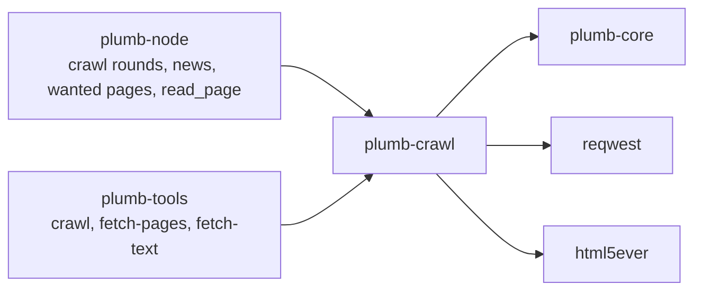
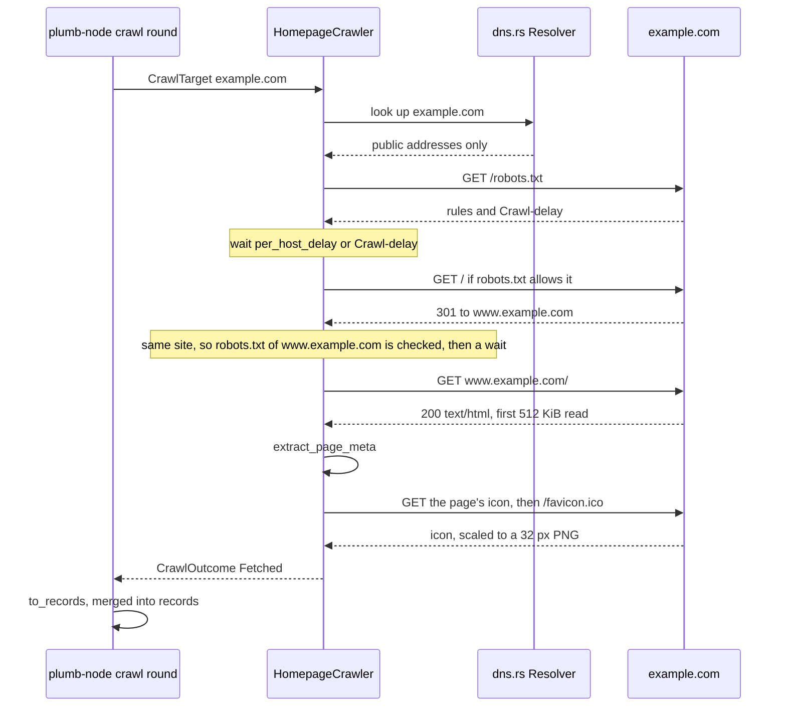

# plumb-crawl

The crawler: it fetches one homepage per site, after robots.txt, and reads the site's names, text and links into site records. It also reads sites' feeds, follows a site's links toward the inner pages a node's searches want, and reads single pages as text for AI assistants. plumb-node runs it in its crawl rounds; plumb-tools uses it to crawl by hand and to build page sets.

Part of [Plumb Search](../../README.md). See [the architecture](../../docs/architecture.md) for how the crates fit together.

- [Where it fits](#where-it-fits)
- [What is in it](#what-is-in-it)
- [How it works](#how-it-works)
- [Using it](#using-it)
- [Tests](#tests)

## Where it fits



## What is in it

**Fetching**

| Module | What it does |
| --- | --- |
| [crawl.rs](src/crawl.rs) | `HomepageCrawler` and `Visit`: robots.txt for every origin, per-host delays, redirects one hop at a time, fallback URLs, size and time limits; `check_feeds`, `fetch_site_icons`, `build_client` |
| [dns.rs](src/dns.rs) | `Resolver`: looks up host names, a few at a time, and drops every address that is not on the public internet |
| [follow.rs](src/follow.rs) | `follow_links`: from a homepage, follows the links with a search's words a few hops into the site |
| [read.rs](src/read.rs) | `PageReader`: reads one page as text with a little Markdown, for an AI assistant; nothing is kept |

**Reading pages**

| Module | What it does |
| --- | --- |
| [extract.rs](src/extract.rs) | `extract_page_meta`: names, headings, visible text, key pages, search form, icons, feed and links, from a stream of HTML tokens |
| [extract/rich.rs](src/extract/rich.rs) | Extra passages and symbols from documentation pages (`InnerPageExtraction::Docs`), for page sets |
| [boilerplate.rs](src/boilerplate.rs) | Tells a block of text that says something from cookie notices, menus of links and "Learn more" buttons |
| [structured.rs](src/structured.rs) | The names a homepage gives its own site in schema.org JSON-LD |
| [terms.rs](src/terms.rs) | `pick_terms`: the words a page stresses, picked with YAKE |
| [charset.rs](src/charset.rs) | Decodes a page in the charset it is written in |
| [icon.rs](src/icon.rs) | `normalize_icon`: any icon file as a 32 by 32 pixel PNG |
| [feed.rs](src/feed.rs) | `read_feed`: the titles, links and dates of a feed's posts of the last week |

**Records and settings**

| Module | What it does |
| --- | --- |
| [records.rs](src/records.rs) | `to_records`: crawl results as plumb-core `SiteRecord`s; `CRAWL_VERSION`, `REREAD_BELOW` |
| [lib.rs](src/lib.rs) | `CrawlConfig`, `CrawlTarget`, `PageMeta`, `CrawlOutcome`, the user agents |
| [test_alloc.rs](src/test_alloc.rs) | Test builds only: an allocator that counts a thread's heap, so tests can hold parsing to a memory budget |

## How it works

### One homepage crawl

`HomepageCrawler` keeps `CrawlConfig::concurrency` targets in flight and returns each result as it finishes, so a site that never answers holds one slot, not the crawl. For one target it does this:



1. **robots.txt** is asked of every origin (scheme, host and port) before the first request to it, as RFC 9309 scopes it. A 2xx is parsed up to 500 KiB and obeyed for the product token `PlumbSearch`. A 4xx other than 429 means no rules. A 5xx, a 429 or no answer means the site is not crawled. A file whose `$` rules would take more than 16 MiB to compile (`MAX_ROBOTS_REGEX_BYTES`) is not parsed and the site is not crawled either.
2. **Delays.** A request waits until `per_host_delay` (1 second) has passed since that host last answered, or the robots.txt `Crawl-delay` when that is longer, up to `MAX_CRAWL_DELAY` (30 seconds).
3. **Redirects** are followed by the crawler itself, up to `max_redirects` (5), and only while they stay on the site: the same host or the same registrable domain. Each hop is checked against its origin's robots.txt, so a redirect into a disallowed path is never requested. A redirect to another site ends the crawl as `OffsiteRedirect`, without requesting it.
4. **The page** must be a 2xx and HTML (or of no stated type). At most `max_bytes` (512 KiB) are read, decoded in the page's charset and read by `extract_page_meta`. A bot check standing in for the homepage (Cloudflare's "Just a moment...") is reported as `BotCheck` and nothing on it is kept.
5. **The icon**, when `fetch_icons` is on: up to `MAX_ICON_TRIES` (3) files, the icons the page links to and then `/favicon.ico`, each allowed by robots.txt and read up to 256 KiB, until one decodes.

When the start URL (`https://<domain>/`) gets no answer at all, the crawler tries the URL the site was last reached at, then the `www.` host, then plain http. Any answer, an HTTP error included, is final. Every target has `target_deadline` (120 seconds) for all its requests and waits, and an error never stops the crawl: it becomes that target's `CrawlOutcome::Failed`, with `network` set when no usable answer came back, so the node can try it again sooner.

The crawl fetches nothing else. Feeds are checked by a separate node job through `check_feeds`, and inner pages only by `follow_links`.

### What a page yields

`extract_page_meta` reads the page as a stream of tags and text with html5ever's tokenizer and never builds a tree, so hostile markup costs memory in proportion to its length. It stops reading after 2 seconds (`READ_TIME_LIMIT`), which only markup built to be slow reaches.

| `PageMeta` field | From | Goes to |
| --- | --- | --- |
| `title` | The first `<title>` outside SVG and MathML | `title` |
| `description` | `<meta name="description">`, else `og:description` | `description` |
| `site_name`, `structured_names` | `og:site_name`, and the `name`, `alternateName` and `legalName` of JSON-LD `WebSite` and `Organization` items about this site, at most 4 | `aliases` |
| `headings` | Visible `<h1>` and `<h2>`, at most 8 and 60 words in all | `headings` |
| `body_text` | Visible text without scripts, menus, headers, footers, forms, headings and boilerplate, cut to `MAX_BODY_WORDS` (100) words | `body_text` |
| `terms` | `pick_terms` over the title, description, headings and first `MAX_PAGE_TEXT_WORDS` (1,000) words: `TERM_WORDS` (30) words | `terms` |
| `key_pages` | Links to the site's own pages, picked by plumb-core's `pick_key_pages`, at most 6 | `key_pages` |
| `search_url` | The first GET form with a search box that submits to the same site | `search_url` |
| `language` | `<html lang>`, then Content-Language metadata, then `og:locale` | `language` |
| `links` | Links to other registrable domains, at most `MAX_OUT_LINKS` (500), with their text (or an image's `alt`, `aria-label` or `title`) | `links_to` (at most 50), and link text on the sites they point to |
| `feed` | The first `<link rel="alternate">` to an RSS or Atom feed | The node's news watcher |
| `icons` | `<link rel="icon">` and Apple touch icons, best first, at most 3, no SVG | The icon fetch |

A byte order mark decides the charset. Without one, a page that is valid UTF-8 is read as UTF-8 whatever the server says, and any other page in the charset its `Content-Type` header or its first 1,024 bytes declare. Boilerplate is judged a block at a time (the text between two elements that start a new line), after the rules used to clean the C4 corpus, kept conservative so brief facts stay.

`to_records` turns results into records: one per fetched homepage, stamped with `crawled_at` and `crawl_version`, and one per linked domain, carrying the texts of links to its front page and `signals.linking_domains`. Link text counts once per linking site, only on links to a front page (text on a deeper link names that page), and never when generic ("click here", "official website"). A domain seen only as a link target gets a record of its own, which is how a node discovers new sites. An `OffsiteRedirect` marks the domain with a `Redirect` and adds an empty record for where it points.

### Staying off private networks

Plumb runs on home servers, so a hostile domain whose DNS points at `192.168.1.1` or a cloud metadata address must not get a node to fetch pages on its operator's network. `Resolver` in [dns.rs](src/dns.rs) drops every address that is not globally routable (IANA's special-purpose ranges: loopback, private, link-local, CGNAT, documentation, multicast and the rest) before reqwest connects, and fails the lookup when none is left. reqwest connects only to the addresses it returns, so a second DNS answer cannot slip a private address past the check. Hosts written as IP addresses are not looked up, so the crawler checks those itself before each request, redirects included.

The crawler connects to sites directly and ignores `HTTP_PROXY` and the like, since a proxy would look names up itself. `use_system_proxy` turns a proxy on and `allow_private_addresses` lets an intranet be crawled on purpose; both are off by default.

> [!IMPORTANT]
> A server-side fetch of any URL that a caller, a page or a plugin chose must go through this resolver: build its client with `build_client` from a `CrawlConfig`, or use `PageReader`. A plain reqwest client connects wherever DNS says.

A node's plugins fetch from the hosts their `plugin.json` names, which may be the owner's own machines, so their clients use `Resolver::for_named_hosts`: a local name (one label such as `nas`, a suffix the public suffix list doesn't know such as `media.lan`, or `home.arpa`) resolves wherever it points, and a name on the web only to public addresses, so its DNS can't point it at the owner's network.

`Resolver` also lets only `dns_lookups` (32) lookups run at once, since a burst of hundreds makes home routers fail many of them, and tries a lookup that failed for the time being once more after a second.

### Crawl versions

Every record a crawl writes carries `crawl_version`, set to `CRAWL_VERSION` (2): version 1 added the search terms, version 2 leaves boilerplate out of the body text. Raise it when a change to what crawls read makes sites read before worth reading again. Nodes crawl sites last read by a version below `REREAD_BELOW` (1) ahead of their turn, best link score first; the rest get the new reading when they come due, about once a month. `REREAD_BELOW` stays at 1 for now: raising it makes an upgraded node read every site it has again at once, and makes a fresher crawl by a trusted older crawler look due again on every newer node.

### User agents

| Constant | Value | Sent by |
| --- | --- | --- |
| `USER_AGENT` | `PlumbSearch/<version> (+https://github.com/SueHeir/plumb-search)` | Homepage crawls, icons, feeds, followed links |
| `ROBOTS_TOKEN` | `PlumbSearch` | Matched against robots.txt `User-agent` lines, by product token, so `PlumbSearch/1.0` counts too |
| `READ_USER_AGENT` | `plumb-mcp/<version> (+https://github.com/SueHeir/plumb-search)` | `PageReader`, which reads a page a person's assistant asked for, as a browser would, without asking robots.txt |

### Limits

| Setting | Default | Set by |
| --- | --- | --- |
| Fetches in flight | 16 | `CrawlConfig::concurrency` (the node sets its own) |
| Time per request | 15 s | `CrawlConfig::timeout` |
| Time per target | 120 s | `CrawlConfig::target_deadline` |
| Page size read | 512 KiB | `CrawlConfig::max_bytes` |
| Feed size read | 2 MiB | `FEED_MAX_BYTES` |
| Page reader | 20 s, 3 MiB, 8 redirects | `ReadConfig` |

## Using it

- `HomepageCrawler::new(cfg)`, then `push(targets)` and `next().await` until it returns `None`; `to_records(&results)` for the records.
- `extract_page_meta(&url, html)` reads one page; `extract_inner_page_meta` with `InnerPageExtraction::Docs` keeps more of a documentation page.
- `check_feeds(targets, &cfg)` for each site's recent headlines, asking only for a feed changed since its last `ETag` or `Last-Modified`.
- `follow_links(targets, &cfg, &allowed)` for the inner pages searches want; `allowed` is the caller's check (the node's denylist).
- `fetch_site_icons(targets, &cfg)` for sites crawled without an icon.
- `PageReader::new(ReadConfig)` and `read(address).await`, for the MCP `read_page` tool. The node turns on `web_ports_only` (ports 80 and 443) for readers other people can use.

How a node chooses which sites to crawl, and when they are due again, is plumb-node's [crawl.rs](../plumb-node/src/crawl.rs).

## Tests

```sh
cargo test -p plumb-crawl
```

Tests sit in a `#[cfg(test)]` module in each file, and [follow/tests.rs](src/follow/tests.rs) for `follow_links`. The crawl tests serve sites from axum on 127.0.0.1, with `allow_private_addresses` on so the crawler may reach them, and record every request. Notable ones:

- `obeys_robots_txt`, `each_origin_is_checked_against_its_own_robots_txt`, `redirects_into_disallowed_paths_are_never_requested` and `waits_between_robots_txt_and_the_page` in [crawl.rs](src/crawl.rs).
- `private_addresses_are_refused_unless_allowed` and `private_ip_addresses_are_never_requested` in [crawl.rs](src/crawl.rs), and `refuses_private_networks_and_reads_pages` in [read.rs](src/read.rs).
- `hostile_markup_takes_linear_time_and_memory` in [extract.rs](src/extract.rs) and `robots_txt_parsing_is_bounded` in [crawl.rs](src/crawl.rs), which measure memory with [test_alloc.rs](src/test_alloc.rs). The crate's dev-dependencies turn on regex-automata's DFAs, as the node's build does, so the robots.txt memory test measures what the node runs.
