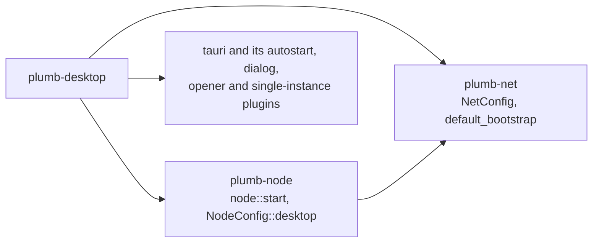
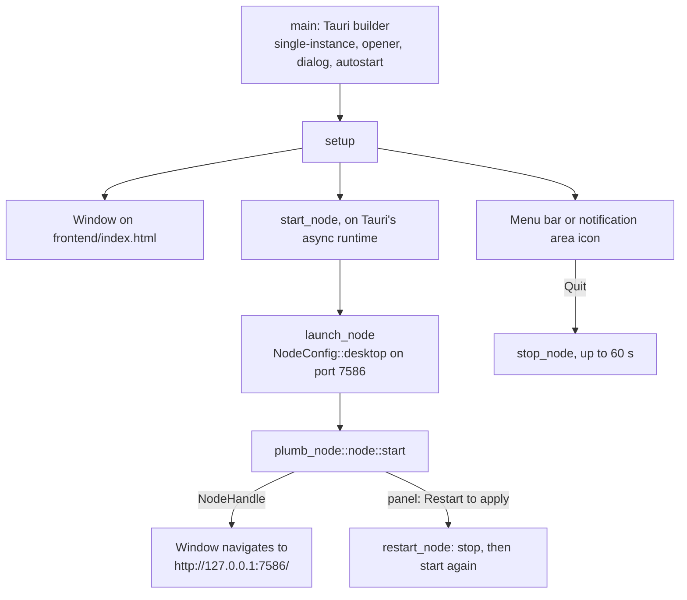

# plumb-desktop

The Plumb Search desktop app: a [Tauri](https://v2.tauri.app) window around a Plumb node that runs inside the app's own process. This README is for contributors; [docs/desktop.md](../../docs/desktop.md) is the user's guide, with installers, first launch and where the app keeps its data.

Part of [Plumb Search](../../README.md). See [the architecture](../../docs/architecture.md) for how the crates fit together.

## Where it fits



Nothing depends on this crate. It is left out of the workspace's `default-members`, so a plain `cargo build` or `cargo test` at the root skips it: it needs GUI libraries (WebKitGTK on Linux).

## What is in it

| Path | What it is |
| --- | --- |
| [src/main.rs](src/main.rs) | The app: the window, the menu bar or notification area icon, starting, restarting and stopping the node, and where each link may open |
| [src/logging.rs](src/logging.rs) | The log: stderr and `plumb.log` in the app's log folder |
| [frontend/](frontend) | The one bundled page, `index.html` with `brand.svg`: "Starting..." while the node starts |
| [tauri.conf.json](tauri.conf.json) | Product name, identifier `io.github.sueheir.plumbsearch`, the bundled page's Content-Security-Policy, installer settings and icons |
| [icons/](icons) | Every platform's icons, generated from `app-icon.svg` |
| [app-icon.svg](app-icon.svg) | The icon's source |
| [examples/render_icon.rs](examples/render_icon.rs) | Renders `app-icon.svg` to the 1024x1024 PNG that `cargo tauri icon` takes |
| [build.rs](build.rs) | `tauri_build::build()` |

## How it works



**The node runs in-process.** `launch_node` takes the data folder from `PLUMB_DESKTOP_DATA_DIR` or the app's data folder, builds a `NodeConfig::desktop` (plumb-node's desktop defaults, such as 250,000 sites rather than a server's 1,000,000, search history, search by meaning and managing other nodes), and calls `plumb_node::node::start` on Tauri's async runtime. The node binds `127.0.0.1:7586` (`PORT`; 7586 spells PLUM on a phone keypad), so a browser search engine set up as `http://127.0.0.1:7586/search?q=%s` keeps working from one launch to the next. When something else has the port, the node takes a free one and a dialog says so. A node that cannot start shows a dialog with the error, the data folder and the log file, and the app quits.

**It joins the network like any home node** (`network_config`): it listens on TCP and QUIC ports the system picks, for IPv4 and IPv6, joins through `plumb_net::default_bootstrap` (the relay on plumbsearch.org), and runs background bucket rounds every 30 minutes (`DESKTOP_ROUND_EVERY`) rather than a server's 10. The panel's "Join the Plumb network" setting turns this off and on.

**The window shows only the node's own pages.** `destination` decides where each navigation goes:

| Destination | Goes to |
| --- | --- |
| The node's home and search pages (`/`, `/search`, `/network`, `/private`), `/go`, its history, about, welcome, link, feedback and tuning pages, `/plugins/act`, and the panel (`/app` and below) | The window |
| Any other page of the node (`/api/...`), and every other web page | The default browser |
| The node's `/add-to-firefox` page | Firefox, or the default browser without it |
| `file:`, `data:`, `javascript:` and other schemes | Nowhere |

Links that ask for a new window open in the browser too. The app defines no Tauri commands and grants no capabilities, so the node's pages cannot call into the app, and the opener plugin's script click handler is off. The webview keeps its cache and storage in `webview/` in the app's cache folder, apart from the node's data.

**Closing the window keeps the node running**, so searches from the browser keep working. The icon's menu has **Open Plumb Search**, **Start at login** and **Quit Plumb Search**; the first close says where the app went. Started at login (with `--at-login`), the app opens no window. A second launch only brings the running app's window to the front.

**Quitting stops the node first.** Quitting from the menu, closing the window when there is no icon, Ctrl-C or SIGTERM holds the exit while the node shuts down, for up to 60 seconds (`STOP_TIMEOUT`), then exits. A second stop signal exits at once. Exiting early is safe: the node writes its files atomically and clears unfinished work when it starts.

**Logging** ([logging.rs](src/logging.rs)): `tracing` output goes to stderr and to `plumb.log` in the app's log folder, filtered by `RUST_LOG` or plumb-node's `DEFAULT_LOG_FILTER`. Each start moves the previous log to `plumb.log.1`. Lines logged before the file opens are kept in memory, up to 64 KB, and written to it first. Panics are logged too. Release builds on Windows have no console, so the file is the only log there.

## Build and run

Install the prerequisites in [docs/desktop.md](../../docs/desktop.md) (the Tauri CLI, and WebKitGTK on Linux), then build private search's WebAssembly first, so the node embeds it ([plumb-private](../plumb-private/README.md)):

```sh
rustup target add wasm32-unknown-unknown
cargo install wasm-bindgen-cli --version 0.2.108 --locked
cargo build --locked -p plumb-private --target wasm32-unknown-unknown --profile wasm
wasm-bindgen --target web --no-typescript --out-dir target/private \
    target/wasm32-unknown-unknown/wasm/plumb_private.wasm
```

Then, from `crates/plumb-desktop`:

```sh
cargo tauri dev     # build and run, with the log in the terminal
cargo tauri build   # build the installers into <repository>/target/release/bundle/
```

Set `PLUMB_DESKTOP_DATA_DIR` to a separate folder to keep a development node's data apart from an installed app's. Quit the installed app before `cargo tauri dev`: the two are the same app to the system, and a second launch only brings the first one's window up.

To change the icon, edit `app-icon.svg`, then:

```sh
cargo run --example render_icon   # app-icon.svg -> app-icon.png
cargo tauri icon app-icon.png     # -> icons/
```

## Tests and CI

```sh
cargo clippy -p plumb-desktop --all-targets -- -D warnings
cargo test -p plumb-desktop
```

The tests in [main.rs](src/main.rs) cover where each kind of link opens, the start failure message, the network settings and the port check; those in [logging.rs](src/logging.rs) cover the log file's rotation and early lines.

CI's `desktop` job ([ci.yml](../../.github/workflows/ci.yml)) runs both on every pull request and push to main. The [Desktop workflow](../../.github/workflows/desktop.yml) builds the installers (Linux `.deb`, `.rpm` and AppImage; Windows NSIS and MSI; one macOS `.dmg` for Apple silicon and Intel) for pull requests that change this crate, by hand, and for `v*` tags, which also attach them to a draft release.
