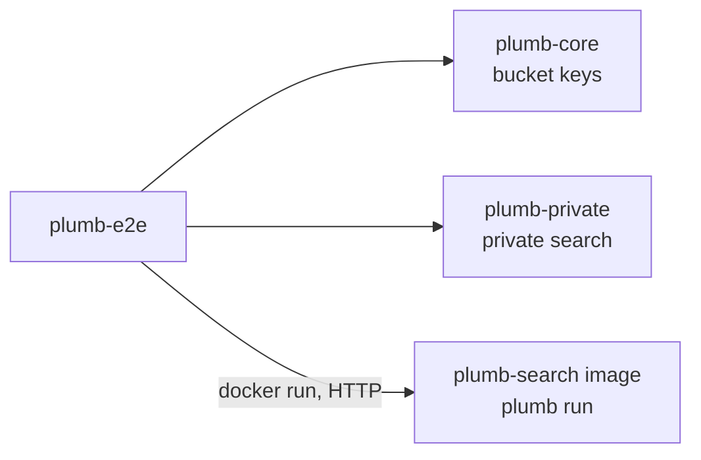

# plumb-e2e

End-to-end tests of the packaged node: they run the Plumb Search Docker image the way people do, kill containers in the middle of their work, start them again on the same volume, and connect two nodes to each other. Contributors who change the [Dockerfile](../../Dockerfile), the node's setup or the network run them.

Part of [Plumb Search](../../README.md). See [the architecture](../../docs/architecture.md) for how the crates fit together.

## Where it fits



The tests drive the image through the `docker` command and the node's HTTP API. They link plumb-core and plumb-private only to search a node's buckets the way the private search page does.

## What is in it

| File | What it does |
| --- | --- |
| [src/lib.rs](src/lib.rs) | Helpers: `Node` (a data volume and, while it runs, a container serving on a free port of 127.0.0.1), `Network` (a Docker network), `docker`, `unique` names, `wait_for` on `/api/status`, `search`, and a plain HTTP client |
| [tests/docker.rs](tests/docker.rs) | The two tests below |

Containers, volumes and networks get names starting `plumb-e2e-<pid>-`, so test runs do not collide, and are removed when a test ends, with each container's log printed.

## The tests

| Test | What it checks |
| --- | --- |
| `setup_survives_being_killed` | A node killed with SIGKILL during setup, again once it can search, and (with real data) during its crawl, picks up where it was each time and ends searchable: `wikipedia`, `github` and `youtube` find their sites first, by normal and by private search, and `/private` is built into the image. When setup has finished, a clean stop and start rebuilds nothing and leaves no `.part`, `.tmp` or `.staging` files |
| `two_nodes_exchange_crawls_and_searches` | Two nodes on one Docker network, the second given the first's address, connect, and each answers the other's network searches (`/api/network/search`). With real data each also publishes its crawl and receives the other's |

Each test runs in one of two modes:

| Mode | Data |
| --- | --- |
| Fixtures (the default) | The nodes are seeded from [fixtures/](../../fixtures) with `plumb ingest` and never reach the internet |
| Real data, `PLUMB_E2E_REAL=1` | The nodes download the real seed data and the embedding model and crawl real homepages, as a node does on its first start |

The second test keeps the nodes off the real Plumb network (`--no-default-bootstrap`, `--no-default-trust`) and lets them search each other as strangers (`--search-from anyone`), adding each flag only when the image's `plumb run --help` lists it.

## Running them

The tests are `#[ignore]`d, since they need Docker and an image. Build the image, then name it in `PLUMB_E2E_IMAGE`:

```sh
docker build -t plumb-search:e2e .
PLUMB_E2E_IMAGE=plumb-search:e2e cargo test -p plumb-e2e -- --ignored --test-threads 1
```

One test, with real data:

```sh
PLUMB_E2E_IMAGE=plumb-search:e2e PLUMB_E2E_REAL=1 \
    cargo test -p plumb-e2e --test docker -- --ignored --exact --nocapture setup_survives_being_killed
```

With real data the tests wait up to an hour for a node's setup to finish.

## CI

The [End to end workflow](../../.github/workflows/e2e.yml) runs after every push to `main`, nightly, by hand, and on pull requests that change the `Dockerfile`, `.dockerignore`, this crate or the workflow. Each of the two tests is a job of its own: it builds the image for linux/amd64 (with the cache of `main`'s image builds), then runs the test with the fixtures and again with real data. The real run depends on outside sites answering, so the workflow is not a required check.
