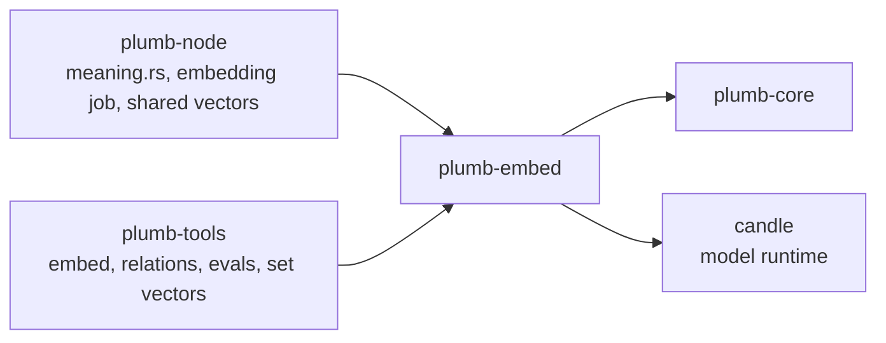
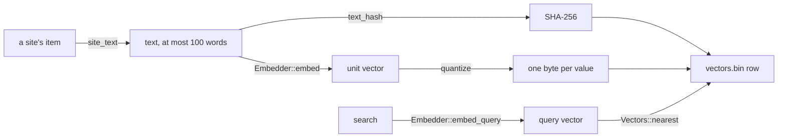

# plumb-embed

Search by meaning: each site's text as a short list of numbers, so a search that describes a site ("electric car maker") finds it without sharing its words. The crate builds the text, runs the model and keeps the vectors file, and makes sure every node gets the same bytes for the same site. plumb-node uses it when search by meaning is on; plumb-tools uses it to make vectors and in evals.

Part of [Plumb Search](../../README.md). See [the architecture](../../docs/architecture.md) for how the crates fit together.

- [Where it fits](#where-it-fits)
- [What is in it](#what-is-in-it)
- [How it works](#how-it-works)
- [Using it](#using-it)
- [Tests](#tests)

## Where it fits



## What is in it

| Module | What it does |
| --- | --- |
| [text.rs](src/text.rs) | `site_text`: the text of a site (its stored item) that is embedded, and its `text_hash`; `page_text`, the same for a page |
| [model.rs](src/model.rs) | `Embedder`: loads a model directory and turns text into a vector; bge-small-en-v1.5 runs here; `quantize`, `model_id` |
| [gemma.rs](src/gemma.rs) | EmbeddingGemma 2 run from its GGUF file, the way llama.cpp runs it |
| [server.rs](src/server.rs) | A model run by an outside embedding server, for trying models out |
| [vectors.rs](src/vectors.rs) | `Vectors`: every site's vector in one file, read in place; `nearest`, `cosine` |

## How it works



### The models

`Embedder::load(dir)` looks at what the directory holds: `model.gguf` means EmbeddingGemma 2, `embedding-server.json` means a server, and otherwise it loads bge-small's files.

| Model | Files | In a node | Vector | Used for |
| --- | --- | --- | --- | --- |
| bge-small-en-v1.5 (`MODEL_NAME`) | `config.json`, `tokenizer.json`, `model.safetensors` (`MODEL_FILES`), from `MODEL_BASE_URL` | `DIR/model`, about 130 MB | 384 values: the output for the first token, scaled to length 1 | The default, `--meaning-model small`: English. Reads at most `MAX_TOKENS` (256) tokens. |
| EmbeddingGemma 2 | `model.gguf` (Q8_0) and `tokenizer.json` (`GEMMA_DOWNLOADS`) | `DIR/model-gemma` | The first `GEMMA_DIM` (256) of its 768 values, which the model is trained to allow | `--meaning-model gemma`: many languages. Reads at most `GEMMA_MAX_TOKENS` (512) tokens, after `GEMMA_TEXT_PREFIX` for sites and `GEMMA_QUERY_PREFIX` for searches. |
| An embedding server | `embedding-server.json` (`SERVER_FILE`) | Not used by default | As the server gives it, cut to `dim` | Trying models Plumb cannot run itself, in evals |

A node searches by meaning when that is turned on: with `--search-by-meaning` (the Docker image passes it) or in the node's settings. plumb-node's [meaning.rs](../plumb-node/src/meaning.rs) loads the model and answers searches with it. With bge-small, a search is embedded after BGE's instruction for search queries, as the model was trained (`Embedder::takes_query_instruction`). The pinned English model cannot read every language: `Embedder::reads` says no for a text a third or more of whose tokens are unknown to it, or half or more unknown or spelled out letter by letter, and the node then searches that query by its words only.

[server.rs](src/server.rs) lets a model directory name a server that answers OpenAI's `/v1/embeddings` (llama.cpp's `llama-server --embedding`, Ollama, LM Studio) over plain `http://`:

```json
{"url": "http://127.0.0.1:8090/v1/embeddings", "model": "embeddinggemma-2",
 "dim": 256, "query_prefix": "task: search result | query: ",
 "text_prefix": "title: none | text: "}
```

`dim`, the prefixes and `text_words` (words of a site's text given to the model) are optional. A server's vectors are not pinned the way Plumb's own are, so they are for evals, unless `same_as` names a directory of the EmbeddingGemma files the server runs too: the vectors then carry that model's id and a node running it in Plumb uses and shares them.

### The text of a site

`site_text` joins, in this order: the site's names, its homepage title and description, what Wikidata and Wikipedia say it is (`about`, `intro`), a one-sentence `summary` only for a site with none of those, the `MAX_LINK_TEXTS` (5) words other sites link to it with most, its homepage headings and the start of its body text. Each part is put in Unicode NFC with its whitespace collapsed, a part equal to an earlier one (ignoring case) is left out, the parts are joined by ". ", and the text is cut at `MAX_TEXT_WORDS` (100) words. A server may take more words (`text_words`).

### The same bytes on every node

Nodes hand vectors to each other, so a node that turns search by meaning on need not embed millions of sites itself. That only works if two nodes get the same vector for the same site, so three things are pinned:

- **The text.** `site_text` gives the same text, byte for byte, from the same site. Each vector is stored with the SHA-256 of its text (`text_hash`), and a node keeps a vector from elsewhere only when that hash matches its own text for the site (plumb-node's [shared_vectors.rs](../plumb-node/src/node/shared_vectors.rs)).
- **The model.** A `ModelId` is the SHA-256 of the SHA-256s of the model's files (for Gemma, also of `GEMMA_DIM` and the two prefixes, which change the vectors too). A vectors file names its model, and vectors of different models never mix.
- **The output.** Each value of the unit vector is rounded to one byte, `round(x * 127)` (`quantize`), which absorbs last-bit differences between CPUs. The model runs one text at a time, never in padded batches, so a site's vector does not depend on which sites were embedded with it.

A change to any of these (the parts of `site_text`, their order, the word limit, a prefix, the rounding) changes every vector, and nodes would stop agreeing. Treat it like a change of model.

### The vectors file

A node keeps its vectors in `vectors.bin` (`VECTORS_FILE_NAME`) in its data directory. Numbers are little-endian:

| Part | Bytes |
| --- | --- |
| Magic `PLUMBVEC` | 8 |
| Version, 1 | 4 (u32) |
| `ModelId` | 32 |
| Values per vector, `dim` | 4 (u32) |
| Number of rows | 4 (u32) |
| Each row: domain length, domain, text hash, `dim` values | 1 + length + 32 + `dim` (i8) |

A row takes about 430 bytes for a typical domain with bge-small's 384 values. When a file holds two rows for one domain, the later one counts.

On Unix the file is mapped into memory (memmap2) and read in place, not copied: its pages are the system's to drop when memory runs short and to read again when a search needs them. Besides the file, `Vectors` keeps each row's place, its length and a table to find it by domain (about 20 bytes a site), and the rows set since the file was loaded. `save_shared` writes a new file and maps it, so those rows stop taking memory of their own. Mapping is safe because a vectors file is never changed in place: it is written to `vectors.bin.part` and renamed over the old one. On other systems the file is read into memory.

`Vectors::nearest` compares the query with every row, using integer dot products (with AVX2 where the CPU has it), and keeps the `k` closest; ties go to the alphabetically first domain. `Vectors::for_each_in` reads a file one row at a time, for jobs that must not hold it all.

## Using it

- `Embedder::load(dir)`, then `embed(text)` for a site and `embed_query(query)` for a search; `id()`, `dim()`, `text_words()`, `reads(text)`.
- `site_text(&site)` (or `site_text_words` with another word limit), of a site's stored item as plumb-core's `site` module reads it, and `text_hash(&text)`. `page_text(title, about, snippet, words)` joins a page's parts the same way; only plumb-tools' `embed-pages` uses it so far.
- `Vectors::new(model, dim)`, `insert`, `get`, `retain`, `nearest`, `closeness`; `load`, `read_header`, `for_each_in`, `save`, `save_shared_with_budget` (charged to the node's storage budget).
- `cosine(a, b)` on two quantized vectors.

Commands: `plumb run --search-by-meaning [--meaning-model gemma]` on a node, and `plumb-tools embed` to make vectors for a records file by hand.

## Tests

```sh
cargo test -p plumb-embed
```

Tests sit in a `#[cfg(test)]` module in each file and need no download: `write_test_model` writes a tiny BERT model with a vocabulary of a few words, and `write_test_gemma` a tiny Gemma. `the_same_text_gives_the_same_bytes` in [model.rs](src/model.rs), `site_text_is_fixed_and_short` in [text.rs](src/text.rs) and `nearest_sites_come_first_and_files_round_trip` in [vectors.rs](src/vectors.rs) pin the behavior above.

`the_real_gemma_matches_llama_cpp` in [gemma.rs](src/gemma.rs) checks the real model against llama.cpp. It is ignored by default; point `PLUMB_EG2_DIR` at a directory with the model files and a `reference.jsonl` of llama-server's tokens and vectors, then run:

```sh
cargo test --release -p plumb-embed llama_cpp -- --ignored
```
