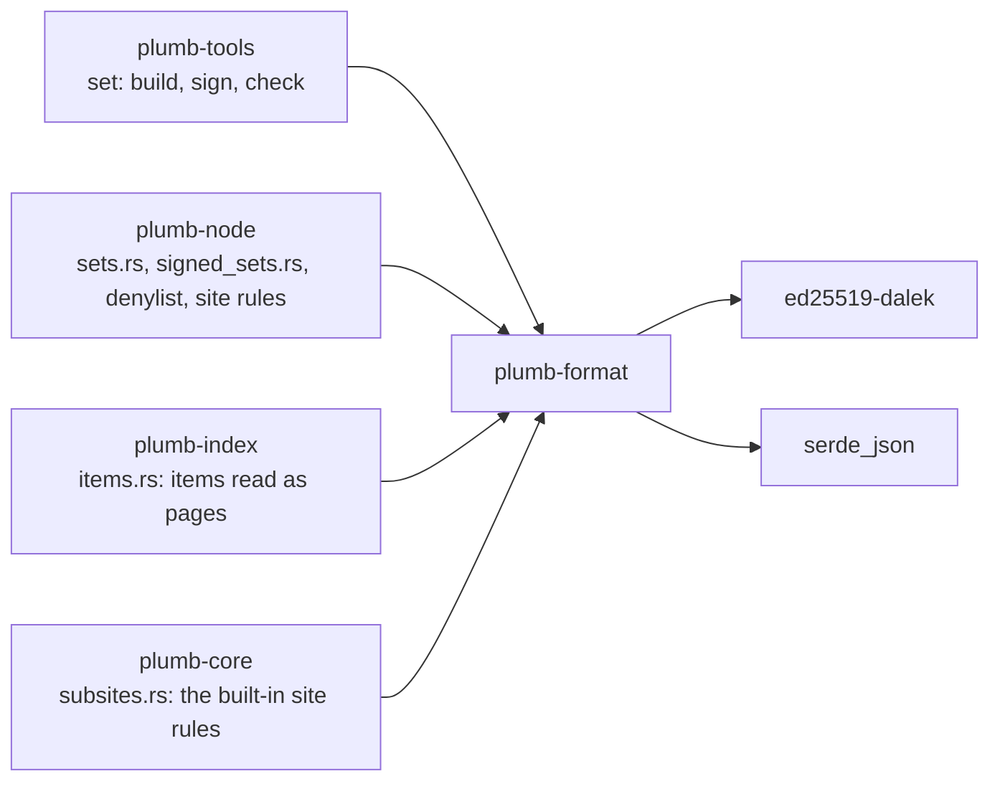
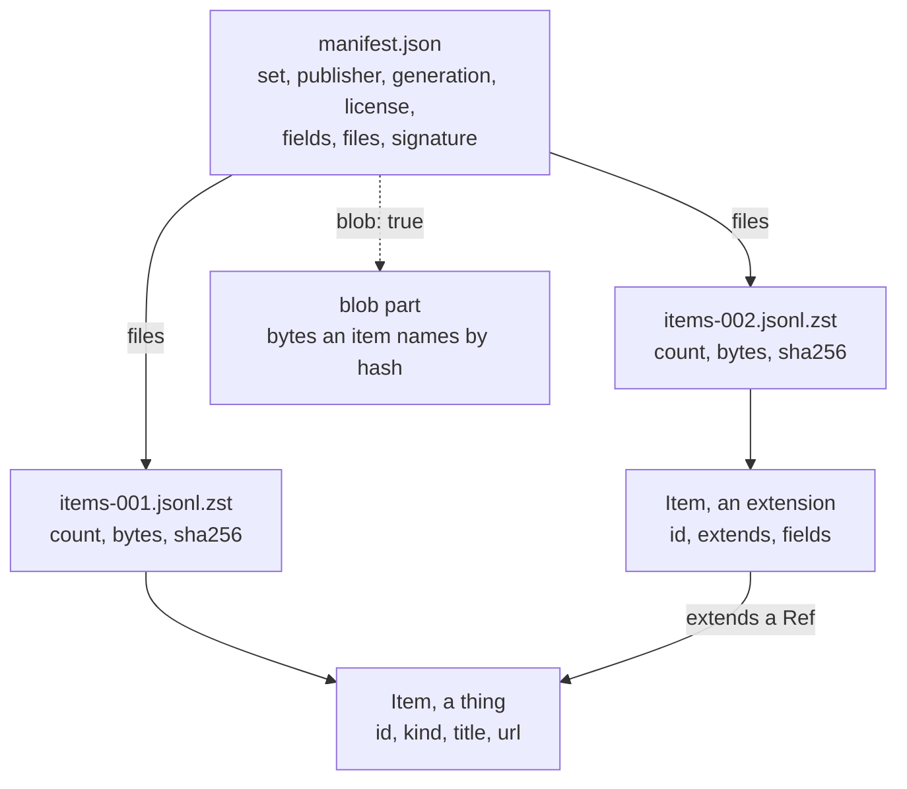

# plumb-format

The data format nodes, set builders and plugins exchange, version `plumb-set/1`: items, the refs that join them, canonical URLs, values, site rules, the denylist, key notes, and the signed manifest that describes a set. This page is for anyone who builds a set, reads one, or changes this crate.

Part of [Plumb Search](../../README.md). See [the architecture](../../docs/architecture.md) for how the crates fit together, and [Signed sets](../../docs/network.md#signed-sets) for how nodes pass sets around.

> [!IMPORTANT]
> Released nodes read this format, so it stays as it is for a long time. It only gains optional keys that older nodes skip: never rename, remove or change the meaning of a key, a ref scheme, a field type or a URL rule. Every change to this crate gets a second reviewer who reads the diff before it merges.

- [Where it fits](#where-it-fits)
- [What is in it](#what-is-in-it)
- [How it works](#how-it-works)
- [Keeping it compatible](#keeping-it-compatible)
- [Using it](#using-it)
- [Tests](#tests)

## Where it fits



plumb-format depends on no other Plumb crate. It never names a source, a site or a kind, except `deny` and `site-rule`, the two kinds a node applies itself.

## What is in it

| Module | What it does |
| --- | --- |
| [item.rs](src/item.rs) | `Item`, the one record every set is made of, with `Edge`, `Vector` and tombstones (`Deleted`) |
| [manifest.rs](src/manifest.rs) | `Manifest`, `FilePart` and `FieldSpec`: one signed file per set generation |
| [sign.rs](src/sign.rs) | Ed25519 signing and checking of manifests; `PublicKey` |
| [canonical.rs](src/canonical.rs) | `canonical_json`: RFC 8785 canonical JSON, what a signature covers |
| [notes.rs](src/notes.rs) | Key notes: `delegate`, `handover` and `revoke` |
| [refs.rs](src/refs.rs) | `Ref`: how one item names another (`wd:`, `site:`, `url:`, `id:`, `item:`, `blob:`) |
| [urls.rs](src/urls.rs) | The canonical URL (`url/1`) and the match key that says two URLs are one page |
| [value.rs](src/value.rs) | The nine field types and the formats of dates, places, languages and text |
| [deny.rs](src/deny.rs) | The denylist: entries, targets, and how a node looks things up in it |
| [sites.rs](src/sites.rs) | Site rules: which site a host is on (public suffixes, subsites, umbrellas) |

## How it works

### A set

A set is named `<scope>/<name>` (`plumb/wikipedia-en`) and is known by that name together with its publisher's key. Each generation of a set is a folder: a small signed `manifest.json` and its parts. `plumb-tools set` writes the parts as `items-001.jsonl.zst` and on, one item per line, most weighted first.



The manifest says everything a node needs to decide on, check, index and show a set without code for its kind:

- **Who and when**: `publisher`, optional `signed_by` with its `delegation`, `generation` (a UTC timestamp), `prev`, `every`.
- **Whether it may travel**: `license` (an SPDX expression; a set without one is never passed on) and `labels` (a set labeled `personal` is never shared, `Manifest::may_share`).
- **The parts**: `files`, each a `FilePart` with its item `count`, stored `bytes` and the SHA-256 of the file as stored. A part with `blob: true` holds bytes, not items, and the manifest must then require `blob-parts`.
- **The fields**: `fields` declares each field once, with a `FieldType`, whether it is a list, a unit, the Wikidata property it means (`same_as`), and its roles (`search:name`, `search:about`, `search:body`, `filter`, `show`, `answer`). Fields of two sets are the same thing only when both name the same property.
- **Layers**: `extends` lists the ref schemes a layer's items extend, and `aligned` names the one base set whose parts it lines up with.
- **What to understand**: `requires` lists features a node must understand. A node skips a set that requires anything outside `UNDERSTOOD` (today only `blob-parts`), except a denylist, which it applies as far as it understands it.

`Manifest::from_signed_json(text, now)` checks the signature, the manifest's rules, a delegation when the signer is not the publisher, and that the generation is not dated more than `MAX_AHEAD_SECONDS` (one day) after `now`. `Manifest::trusted` then checks the publisher against the key the node trusts, following handovers and refusing revoked signers. The trust is in the file, not in whoever sent it, so any node can pass a set along.

### Items

An `Item` is either a **thing**, which stands on its own with a `kind` and usually a `title` and `url` (an article, a crawled homepage, a package), or an **extension**, which names another item with `extends` and adds names, labels, fields, edges or vectors to it. A set of extensions is a layer. This is a thing and a layer entry that extends it, from the crate's tests:

```json
{"id": "4689264", "kind": "article", "title": "Australia",
 "url": "https://en.wikipedia.org/wiki/Australia", "ids": {"wd": "Q408"},
 "about": "country in Oceania", "weight": 1234.0, "lang": "en"}
{"id": "Q408", "extends": "wd:Q408",
 "fields": {"capital": {"v": "Canberra", "src": "wd:Q3114"}}}
```

A key is fixed in `Item` only when the core or a safety rule reads it, so a publisher cannot rename a field to get around the denylist, safe search, the license rule or the `personal` label. Everything else goes in `fields`, typed by the manifest. Keys this version does not know are kept in `other` and passed on as they came.

`Item::check` enforces the rules every item keeps: a non-empty id of at most `MAX_ID_BYTES` (256) bytes without control characters, a kind for things, no title or URL on an extension, canonical http or https URLs, well-formed dates, ids and language tags, text in Unicode NFC, `text` of at most `MAX_TEXT_CHARS` (1,000), at most `MAX_EDGES` (100) edges and `MAX_VECTORS` (4) vectors, and at most `MAX_ITEM_BYTES` (16 KiB) of JSON in all. `Manifest::check_item` adds the field types and the schemes a layer may extend.

A `Vector` names its model and the SHA-256 of the text it was made from (`of`), and holds one signed byte per value in base64. `Item::is_current` ignores a vector whose text has changed since.

### Refs, URLs and values

| Ref | Names |
| --- | --- |
| `wd:Q408` | Every item about that Wikidata item (`Q`, `P` or `L` ids) |
| `site:python.org` | A site, by its domain |
| `url:https://docs.python.org/3/` | A page, by its canonical URL |
| `id:doi:10.1000/xyz` | A thing by an outside id, `<namespace>:<value>` |
| `item:<publisher>/<set>/<id>` | Exactly one item of one set, each part percent-encoded |
| `blob:sha256-<hex>` | Bytes in a node's blob store, by their hash |

The schemes are a closed list; a new one goes behind a manifest's `requires`.

The **canonical URL** (`url/1`, `canonical_url`) is what items store: the URL as a browser parses it, http or https only, no user info, a lowercase IDNA host, no default port or fragment, dot segments resolved, and percent-encoding made regular. The **match key** (`match_key`) is looser, for deciding that two URLs are one result and for the denylist: it drops the scheme, a leading `www.`, a trailing `/`, and the tracking parameters in `TRACKING_PARAMS` (`utm_*`, `fbclid`, `gclid` and others), and sorts the rest.

Values follow [value.rs](src/value.rs): dates in ISO 8601 UTC as precise as known (`2024`, `2024-05-17`), places with named axes (`{"lat": ..., "lon": ...}`), text in NFC without control characters but newlines, languages as BCP 47 tags. Any field value may be wrapped to say when and where it holds: `{"v": 31000000, "as_of": "2024", "src": "wd:Q408"}`. The nine field types are `text`, `keyword`, `number`, `bool`, `date`, `geo`, `url`, `ref` and `object`.

### Signing

A manifest is signed with Ed25519 over the bytes `plumb-set/1\0` followed by its canonical JSON without the `signature` key. Key notes are signed the same way under `plumb-note/1\0`, so a note never passes for a manifest or a manifest for a note, and neither passes for a crawl batch (`plumb-batch-v1\0`). Keys and signatures are unpadded base64url; keys are written `ed25519:<key>`.

`canonical_json` is RFC 8785 (JCS): no whitespace, object keys sorted by their UTF-16 code units, strings escaped as JavaScript's `JSON.stringify` does, and numbers written as JavaScript writes them (`1`, not `1.0`). Key order and spacing in the file do not matter; any change to a value breaks the signature.

| Note | Says | Signed by |
| --- | --- | --- |
| `delegate` | `key` may sign the sets in `sets` until `until` | The publisher |
| `handover` | `key` publishes from now on in place of `by` | The old key |
| `revoke` | Manifests signed by `key` are no longer taken | `key` itself, or the publisher that delegated to it |

A key that hands over to two different keys hands over to neither: only a stolen key would sign both, so a node then takes nothing from that line of keys.

### The denylist

A denylist is a set whose only kind is `deny`, and each entry is one of its items:

```json
{"id": "2026-10-12-0001", "kind": "deny", "target": "url-sha256:9f2c...",
 "category": "csam", "where": ["*"], "added": "2026-10-12"}
```

| Target | Takes off |
| --- | --- |
| `url:<canonical URL>` | One page |
| `url-sha256:<hex>` | One page, by the SHA-256 of its match key, so the list never spells out the address |
| `prefix:<canonical URL>` | That page and every page under its path |
| `site:<domain>` | Every page on that domain or a name under it |
| `item:<publisher>/<set>/<id>` | One item of one set |
| `publisher:<key>` | Everything that key publishes or signs |

`Denylist` looks up two keys for every URL, its match key and its match key without the query, so `?x=1` does not get past an entry for a page. A node applies every entry it understands; an entry with a newer target or a later URL rule is passed over alone, never the whole list, so a list cannot fail open by growing. A node's owner can turn the project's list off (`Switch::Off`), but its `csam` entries stay on, and a `csam` entry may only name one page by its hash. `where` is read and kept, but every entry applies everywhere for now.

### Site rules

A set whose only kind is `site-rule` says which site a host is on, so the lists can change without a release. Each rule is an item whose id is the rule: `suffix:co.uk`, `suffix:*.ck`, `suffix:!www.ck`, `subsite:news.ycombinator.com`, `umbrella:ca.gov`, `not-site:www`. The longest matching suffix wins, an exception beats any other rule, and a name no rule covers has its last label as its suffix, as the Public Suffix List's own algorithm says. `SiteRules::site_of` applies them, to [plumb-core](../plumb-core/README.md)'s built-in rules too, and plumb-node installs a signed set's in their place.

## Keeping it compatible

A change must keep these, or released nodes misread sets:

- **Only optional keys are added**, and older nodes skip them. Unknown keys stay in `other` and are passed on, so an older node never drops what a newer one wrote.
- **Closed lists grow only behind `requires`**: ref schemes, field types and features. A node skips a set it cannot read rather than misreading it, and refuses a key note of a kind it does not know rather than reading half of it.
- **`url/1` never changes.** A different rule is `url/2`, named in the entries hashed with it.
- **Signed bytes come out the same on every node.** Signatures cover `canonical_json`, so it and the signing contexts must give byte-for-byte identical output everywhere.
- **The denylist fails closed.** Whatever an entry adds, a node that cannot read it still applies the rest.

## Using it

- Reading a set: `Manifest::from_signed_json`, `Manifest::trusted`, `Manifest::check_item`, `Manifest::not_understood`.
- Writing one: `sign::sign`, `notes::sign_note`, `canonical::canonical_json`, `Item::check`.
- URLs: `urls::canonical_url`, `urls::match_key`, `urls::url_sha256`, `urls::url_sha256_any_query`.
- The denylist: `Denylist::new(Switch)`, `Denylist::add_items`, `Denylist::denies`, `Denylist::denies_url`.
- Site rules: `SiteRules::add_items`, `SiteRules::site_of`, `sites::read_suffix_list`.

`plumb-tools set` is the command line for sets: `new-key`, `from-pages`, `page-sets`, `denylist`, `deny-entry`, `site-rules`, `adult-sites`, `site-grades`, `map`, `vectors`, `note`, `sign` and `check`. Signing is a step someone takes on purpose; no build signs anything.

## Tests

```sh
cargo test -p plumb-format
```

Tests sit in a `#[cfg(test)]` module at the end of each file, plus a doc test for `canonical_url`. Notable ones: `numbers_as_javascript_writes_them` and `keys_sort_by_utf16` in [canonical.rs](src/canonical.rs), `key_order_and_spacing_do_not_matter` and `any_change_breaks_it` in [sign.rs](src/sign.rs), `unknown_keys_pass_through` in [item.rs](src/item.rs), `delegated_signing` and `a_handover_moves_trust_to_the_new_key` in [manifest.rs](src/manifest.rs), and `what_it_cannot_read_never_stops_the_rest` and `a_list_turned_off_keeps_its_csam_entries` in [deny.rs](src/deny.rs).
