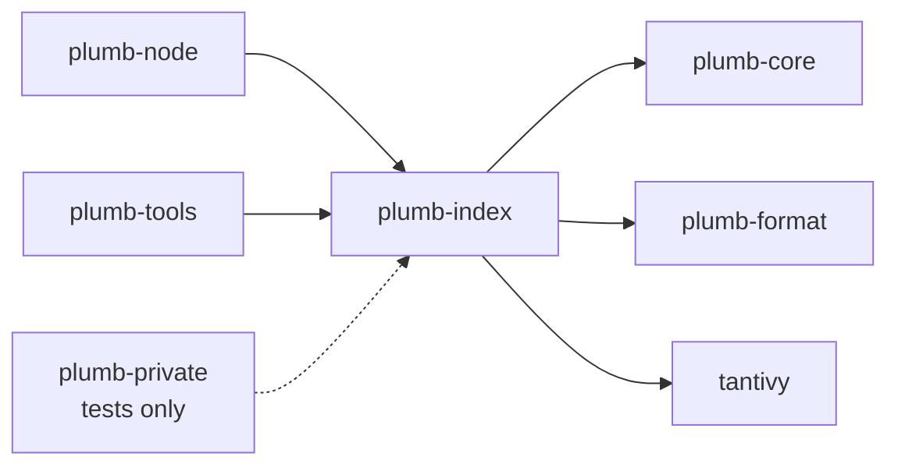
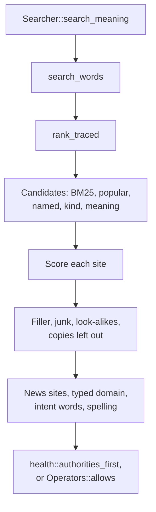

# plumb-index

The search side of Plumb: a Tantivy index over sites and the ranking that puts the right site first, plus the page sets' index, the places index, spelling correction and the learned ranking model. plumb-node searches with it; plumb-tools builds indexes, measures them and trains the model.

Part of [Plumb Search](../../README.md). See [the architecture](../../docs/architecture.md) for how the crates fit together, and [How search works](../../docs/search.md) for the whole path of a search through a node.

## Contents

- [Where it fits](#where-it-fits)
- [What is in it](#what-is-in-it)
- [How it works](#how-it-works)
- [Using it](#using-it)
- [Tests](#tests)

## Where it fits



- [plumb-core](../plumb-core/README.md) gives it the site record, text normalization, `link_score`, search operators, safe search levels and places.
- [plumb-format](../plumb-format/README.md) gives it the signed set items that page sets arrive as ([items.rs](src/items.rs)).
- [plumb-node](../plumb-node/README.md) opens the indexes it builds and searches them for every query.
- [plumb-tools](../plumb-tools/README.md) builds indexes by hand, searches them from the command line, runs the evals and trains the learned model.
- [plumb-private](../plumb-private/README.md) ranks in the browser with its own copy of the formula, since Tantivy does not build for WebAssembly; it uses this crate only in tests, to check both rank alike.

## What is in it

About 43,000 lines, tests included.

### The site index

| Module | What it does |
| --- | --- |
| [lib.rs](src/lib.rs) | `Searcher`, `Hit`, `SearchResults`, `SearchOptions`, the `Meaning` trait, and `RankConfig` with every ranking knob and its default |
| [schema.rs](src/schema.rs) | the index's fields and how a site's stored item becomes a document |
| [analysis.rs](src/analysis.rs) | the text analyzers shared by indexing and querying |
| [indexing.rs](src/indexing.rs) | `build_index` and `IndexBuild`: one document per site from its stored item, items of a domain merged, redirecting domains folded in |
| [replace.rs](src/replace.rs) | swaps a new index directory in without ever leaving it missing or half built |
| [storage.rs](src/storage.rs) | counts what index builds and merges write against a node's storage budget |

### Searching and ranking sites

| Module | What it does |
| --- | --- |
| [search.rs](src/search.rs) | the entry points (`Searcher::search` and on): operators, intent words, typed domains, the typo check, site search links |
| [query.rs](src/query.rs) | the query parsed into terms, and the Tantivy query with each field's boost |
| [names.rs](src/names.rs) | which site a query names: label, official and linked names, typed host name, kind |
| [rank.rs](src/rank.rs) | gathering candidates and scoring them with the blended formula |
| [query_evidence.rs](src/query_evidence.rs) | `CandidateEvidence`: how a site matched, kept apart from its score |
| [candidates.rs](src/candidates.rs) | `Searcher::candidate_signals`: a query's deep candidates with each field's word counts and lengths, for `plumb-tools eval --candidates-out`; nodes never call it |
| [hits.rs](src/hits.rs) | tidying the list: copies and look-alikes out, a suggested or docs site moved up, untitled sites down |
| [junk.rs](src/junk.rs) | sites left out unless the query names them: pill shops, sign-in pages, gambling spam, parked domains, abuse contacts |
| [language.rs](src/language.rs) | whether a query is written in another language than the one chosen |
| [topics.rs](src/topics.rs) | searches for the news itself ("world news") |
| [health.rs](src/health.rs) | health authorities first for medical searches, and source quality |
| [states.rs](src/states.rs) | towns and counties with namesakes elsewhere: the one meant first |

### Spelling

| Module | What it does |
| --- | --- |
| [spell.rs](src/spell.rs) | typo correction of names and words |
| [spell_model.rs](src/spell_model.rs) | the error model and word-pair model learned from the index's own words, saved next to the index as `spelling.bin` |

### Pages, places and the learned ranking

| Module | What it does |
| --- | --- |
| [pages.rs](src/pages.rs) | the page index: `Page`, `PageHit`, `PlacedPage`, `PageSearcher`, and the page score |
| [pages/building.rs](src/pages/building.rs) | `build_page_index` from page sets' items |
| [pages/stored.rs](src/pages/stored.rs) | what the index keeps of each page, its item (`SetItem`), and reading the page back from it |
| [pages/page.rs](src/pages/page.rs) | reading each set's rows as pages (`Page::from_set`) |
| [pages/search.rs](src/pages/search.rs), [pages/scoring.rs](src/pages/scoring.rs) | searching pages, entities, definitions and songs, and scoring them |
| [pages/placing.rs](src/pages/placing.rs) | `place_pages`: where each page goes among the sites, and `keep_page_rules` |
| [pages/sites.rs](src/pages/sites.rs), [pages/named_site.rs](src/pages/named_site.rs) | pages and the sites they are about; the inner page a query names with its site |
| [pages/docs.rs](src/pages/docs.rs), [pages/papers.rs](src/pages/papers.rs), [pages/records.rs](src/pages/records.rs), [pages/repos.rs](src/pages/repos.rs) | documentation pages, papers, records named by identifier ("rfc 3339"), repositories |
| [items.rs](src/items.rs) | data format items read back as pages |
| [page_items.rs](src/page_items.rs) | pages written as items (`page_item`), for `plumb-tools set from-pages` and the page index |
| [places.rs](src/places.rs) | the places index: `parse_place_query`, `PlaceSearcher`, `build_place_index` |
| [learned.rs](src/learned.rs), [learned/net.rs](src/learned/net.rs) | the learned ranking: features, trees or a small net, `reorder` and `reorder_sites` |
| [learned_model.json](src/learned_model.json) | the built-in model nodes use |
| [learned_sites_model.json](src/learned_sites_model.json) | the built-in model for the first 100 sites, before pages are placed, trained on 100 site rows per test search and the graded sites of other searches |

## How it works

### Three indexes

Each index lives in its own directory and is built the same way: in a hidden staging directory next to the target, then swapped in with two renames once complete ([replace.rs](src/replace.rs)). A failed build leaves the old index in place. A directory is only replaced when it is missing, empty or an index (it holds a `.plumb-index` marker, or only Tantivy's files), so a wrong path never deletes other data.

| Index | Built by | Searched by | One document per |
| --- | --- | --- | --- |
| Sites | `build_index`, `IndexBuild` | `Searcher` | registrable domain |
| Pages | `pages::build_page_index` | `pages::PageSearcher` | page of a page set |
| Places | `places::build_place_index` | `places::PlaceSearcher` | place |

`build_index` takes the sites as a node stores them, their stored items (`plumb_core::site`). It makes each domain canonical, merges items of the same domain with `site::merge`, folds domains that redirect into their target (their names become the target's), and skips invalid or gone sites. The writer uses a 200 MB heap (`WRITER_HEAP_BYTES`) and merges once at the end into one segment. The spelling model is built in the same pass. `IndexBuild` takes sites one at a time, for a node that streams its records file instead of holding it.

All text, at index and at query time, goes through `plumb_core::normalize_text` and is then ASCII-folded, so `U.S. Bank`, `us bank` and `US BANK` are the same query.

### A site search



`rank_traced` in [rank.rs](src/rank.rs) gives each candidate

```text
score = alpha * prior + trust * ((1 - alpha) * text_score + name_bonus) + country_bonus
```

where the prior is the site's `link_score`, the text score is BM25 normalized over the candidates (blended with closeness in meaning when a `Meaning` is given), the name bonus rewards a site the query starts by naming, and trust guards "brand plus more words" queries against look-alikes. [How search works](../../docs/search.md#scoring-sites) explains each part and its knob. The crate documentation in [lib.rs](src/lib.rs) does too, with examples.

`Searcher::candidate_pool` returns where the candidates came from, for `plumb-tools eval --recall`.

### Pages and the learned order

The page index is searched next to the sites: a page is found by name (some kinds also by the words of their title, tags, description or lead; see [Page sets](../../docs/pages.md#how-pages-are-searched-and-shown)), and scored by how well the query names it and how much it is read. `place_pages` decides for each page whether it goes under a site it is about, before a site, or after the sites. The caller runs these steps (plumb-node in `node/pages.rs`, plumb-tools in `eval.rs`). Keep the two in step, or the evals measure something the node does not serve.

`learned::reorder` then reorders the first 10 rows (`LEARNED_ROWS`) with the built-in model. With `RankConfig::learned_sites` on (off by default: the Batch evals found it no better on a node) and a `Meaning`, unless the query asks only for the news, `Searcher::search_meaning` first has the site model reorder the first 100 sites (`LEARNED_SITES`), under the same rules and two of its own (a site lacking some of the query's words can't pass one that has them all but no vector, and a site the query names, by its name, domain label or an alias, ends no lower than it was), before anything else moves them, and the learned order then only places pages among the sites (`learned::reorder_results` with `SearchResults::sites_ordered`): it was trained on the hand-made order, and moving the site model's sites again undid much of its work. That way a site the blend found but listed far down can come up: the first 10 rows never hold it. It is trained the same way, on deeper rows (`eval --limit 100 --features-out`, `train-rank --rows 100`), and on the graded sites of the searches the first model learned from, so that it doesn't push a site that matches the search well below a bigger one that matches it less. The model is gradient-boosted trees trained with LambdaMART by `plumb-tools train-rank`; [learned/net.rs](src/learned/net.rs) is a small neural ranker the same command can train instead.

### Invariants

- **Scores go down the list.** Callers sort by score after this crate (a browser's own likes, network results merged in), so every step that moves a hit (the learned order, a suggested site moved second, health sources) trades scores so the order survives a sort.
- **The model matches the features.** `learned_model.json` names the features it was trained on, and `Model::from_json` refuses a model whose features are not the first of `FEATURES`, in order. Add a feature at the end; renaming, reordering or removing one means training the model again.
- **The browser ranks alike.** [plumb-private's rank.rs](../plumb-private/src/rank.rs) copies the formula and constants. A change to either needs the same change there; its tests compare the two.
- **Ranking refactors change nothing.** A refactor must leave eval results identical on the same index. A change that moves results goes through the evals in [eval/](../../eval/README.md).
- **The page index version.** Change `pages::PAGE_INDEX_VERSION` when the page index's fields or analysis change, or what it keeps of a page. A node names its page index by a key that includes it, so a new version makes nodes build the page index again.
- **The JSON shape.** `Hit`, `PlacedPage` and `SearchResults` are serialized into `/api/search`, which the Zotero plugin reads (`assembled.rows`, `pages`, `hits`). Keep them readable by it, or change both.
- **A `Searcher` sees the index it opened.** After a rebuild, open a new one.

## Using it

```rust
use plumb_index::{build_index, RankConfig, SearchOptions, Searcher};

let sites: Vec<plumb_format::Item> = read_sites()?; // as `plumb_core::stored::read_item` reads them
build_index(&dir, &sites)?;
let searcher = Searcher::open(&dir)?;
let results = searcher.search_full("us bank", 10, &RankConfig::default(), &SearchOptions::default())?;
for hit in &results.hits {
    println!("{} {:.3}", hit.domain, hit.score);
}
```

| Entry point | Use |
| --- | --- |
| `build_index`, `IndexBuild` | build the site index from sites' stored items in memory or one at a time |
| `Searcher::open`, `search`, `search_full` | search the site index |
| `Searcher::search_meaning` | search with closeness in meaning from a `Meaning` (plumb-node's `meaning.rs` implements it) |
| `Searcher::candidate_pool` | the candidates a query ranks, by source |
| `Searcher::candidate_signals` | a query's deep candidates and their raw match signals, for designing the first stage offline |
| `RankConfig` | every ranking knob; plumb-node's experiments and `plumb-tools eval --rank` take it as JSON |
| `pages::build_page_index`, `pages::PageSearcher` | build and search the page index |
| `pages::place_pages`, `place_operator_pages`, `add_named_site`, `lift_named_sites` | list pages among the sites |
| `places::build_place_index`, `places::PlaceSearcher`, `parse_place_query` | build and search the places index |
| `learned::reorder_results`, `learned::reorder`, `learned::Model::builtin` | the learned order |
| `learned::reorder_sites`, `learned::Model::sites` | the learned order of the first 100 sites (`RankConfig::learned_sites`) |
| `health::sources_lead` | a health source the query names, first again after the learned order |
| `remove_build_leftovers` | clear a crashed build's staging directories at start |

Commands built on it:

```sh
plumb-tools index --records records.jsonl --index DIR   # build a site index
plumb-tools search --index DIR us bank                   # search it
plumb-tools spelling --index DIR                         # what the spelling model learned
plumb-tools eval --index DIR --queries eval/brand_queries.tsv
plumb serve --index DIR                                  # the search page and JSON API over an index
```

## Tests

```sh
cargo test -p plumb-index
```

| Where | What |
| --- | --- |
| [src/tests/](src/tests/mod.rs) | the site ranking, one file per part: brands and copies, building, candidates, junk, kinds and filters, link names, meaning, names, ranking, semantic retention, spelling, subject evidence, unspaced queries |
| [src/pages/tests/](src/pages/tests/mod.rs) | the page index: articles, docs, finding, media, named sites, papers and entities, placing, records, repositories, subpages and packages |
| [src/places/tests.rs](src/places/tests.rs) | the places index and place queries |
| [learned.rs](src/learned.rs), [health.rs](src/health.rs) | tests in the module |
| [tests/fixtures/short-docs.tsv](tests/fixtures/short-docs.tsv) | a small docs page set, also used by plumb-node's tests |
| [src/tests/golden.rs](src/tests/golden.rs), [golden.txt](src/tests/golden.txt) | the golden file: each site's document, spelling texts and bucket keys for a fixed set of sites, written once and checked by every build since; plumb-node checks its build's buckets of the same sites |

Most tests build a small index from records written in the test (as their stored items), search it and check the order. [examples/boilerplate_retrieval.rs](examples/boilerplate_retrieval.rs) compares retrieval on probe pages without embeddings: it takes a queries JSON file as its argument and the probe JSONL on standard input.
