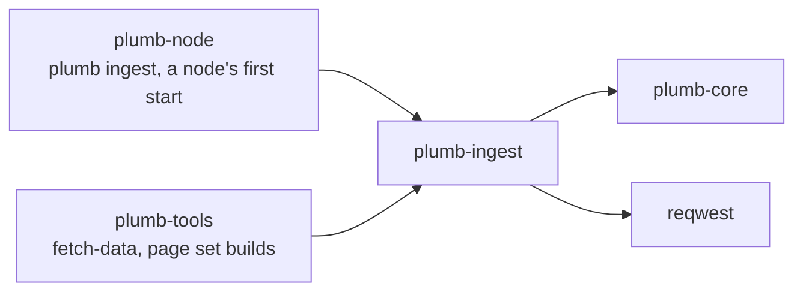
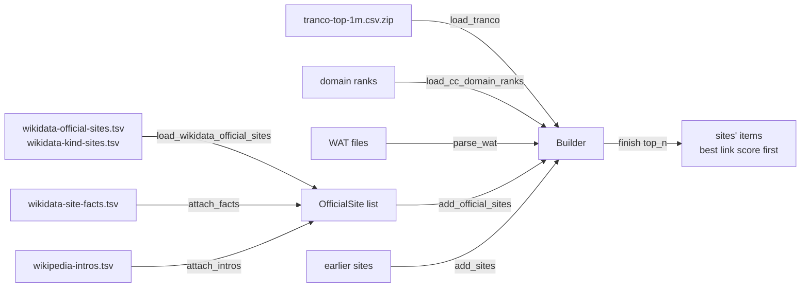

# plumb-ingest

Loads the public datasets that seed a Plumb index (Tranco, Common Crawl's ranks and WAT files, Wikidata's official websites and facts, Wikipedia's first sentences) and folds them into sites, each the site's stored item (plumb-core's `site` module). It also downloads them. A node fetches and folds the seed when it first starts; after that its sites grow mostly from its own crawls.

Part of [Plumb Search](../../README.md). See [the architecture](../../docs/architecture.md) for how the crates fit together.

- [Where it fits](#where-it-fits)
- [What is in it](#what-is-in-it)
- [How it works](#how-it-works)
- [Using it](#using-it)
- [Tests](#tests)

## Where it fits



## What is in it

| Module | What it does |
| --- | --- |
| [lib.rs](src/lib.rs) | `open_maybe_gz` (plain or gzipped, multi-member included) and a line reader that skips lines over 1 MiB without holding them |
| [tranco.rs](src/tranco.rs) | `load_tranco`: the Tranco top million, from the `.zip` as served, a `.csv` or a `.csv.gz` |
| [ccranks.rs](src/ccranks.rs) | `load_cc_domain_ranks`: Common Crawl's domain-level harmonic centrality and PageRank positions |
| [wat.rs](src/wat.rs) | `parse_wat` and `WarcReader`: homepage fields and link text from Common Crawl WAT files; `WatWriter` writes test fixtures in the same layout |
| [wikidata.rs](src/wikidata.rs) | `OfficialSite` and `load_wikidata_official_sites`: Wikidata "official website" (P856) claims |
| [kind_sites.rs](src/kind_sites.rs) | Official websites of kinds people look for by name (banks, credit unions, airlines, universities, agencies), however few Wikipedia articles they have |
| [facts.rs](src/facts.rs) | Country, kinds, other English names, description and sitelinks of the organizations behind official websites |
| [intros.rs](src/intros.rs) | The first sentences of the English Wikipedia articles about the best-known of them |
| [builder.rs](src/builder.rs) | `Builder`: folds every source into one plumb-core `Sites` and keeps the best sites |
| [download.rs](src/download.rs), [download/](src/download/) | Downloads: Tranco, Common Crawl ranks (whole or the top rows), Wikidata queries with pacing and retries, resumable files |
| [storage.rs](src/storage.rs) | Charges a node's seed downloads to its storage budget (`with_budget`) |

## How it works

### The sources

| Source | File | What a site's item gets |
| --- | --- | --- |
| [Tranco](https://tranco-list.eu/) top 1M | `tranco-top-1m.csv.zip` | `ranks.tranco` |
| [Common Crawl web graph](https://commoncrawl.org/web-graphs) domain ranks | `<release>-domain-ranks.txt.gz` | `ranks.harmonic`, `ranks.pagerank` |
| Common Crawl WAT files | `*.wat.gz`, downloaded by you | Homepage `url`, `title`, description (`about`), `og:site_name` as one of its `names`, `link_texts`, linking sites (`weight`) |
| Wikidata official websites (P856) | `wikidata-official-sites.tsv` (`item`, `label`, `website`) | `wikidata.official_site`, the item's label as one of its `names` |
| Wikidata sites by kind | `wikidata-kind-sites.tsv`, same format | More official websites, of the kinds in `KIND_LABELS` |
| Wikidata facts | `wikidata-site-facts.tsv` | `wikidata.country` (P17), `kinds` (P31 and P452), other names, `wikidata.about`, `wikidata.sitelinks` |
| Wikipedia intros | `wikipedia-intros.tsv` (`item`, `intro`) | `intro` for the `INTRO_ITEMS` (20,000) best-known items |

The loaders read plain or gzipped files (`open_maybe_gz`), skip rows they cannot read rather than failing the file, and reduce each host to its registrable domain with plumb-core's `registrable_domain`, so `www.usbank.com` and `usbank.com` land on one site.

### Folding them into sites



`Builder` holds a plumb-core `Sites`, the sites' items by domain as a node holds them (each as its stored line), and each `add_*` call merges into it, so sources can come in any order. Names and kinds are added as the seed has them, with their whitespace collapsed, as records added them:

- **Ranks** keep the best (lowest) rank a domain has. Entries without a valid registrable domain or with rank 0 are dropped.
- **WAT data** carries no crawl time, so its homepage fields only fill fields that are still empty. Link text comes only from links to a site's front page (text on a deeper link names the page, not the site), counted once per linking site, and generic texts ("click here", "official website") are dropped. A domain seen only as a link target gets a site of its own, which is how WAT files discover sites the rank lists lack.
- **Official websites** count only when the claim is on the domain's own front page (`OfficialSite::is_root_homepage`): `https://www.ox.ac.uk/` makes `ox.ac.uk` Oxford's site, while a college on a subdomain or a band at `linktr.ee/...` grants nothing to the parent. An inner page counts when no item claims the front page and the item's names name the domain. A front page claimed by more than five items is a shared host and is skipped, unless one item owns it. When several items claim a front page, one with three times the sitelinks of each other gives the country, kinds, description and intro; otherwise only the country and kinds they share count.
- **`finish(top_n)`** gives each subdomain site (`news.ycombinator.com`) the ranks of its parent domain, which the rank lists only know, then keeps the `top_n` sites with the best `link_score`, best first, as a plumb-core `SiteList` of their stored lines.

> [!NOTE]
> The builder holds every site in memory, those it knows only the ranks of as their ranks and the others as their stored lines. Common Crawl's ranks file lists over 100 million domains, and each million rows read takes about 0.9 GB until the sites are written, so `load_cc_domain_ranks` stops at `DEFAULT_CC_RANKS_LIMIT` (1,000,000) rows unless given a limit, and `plumb ingest` reads twice `--top` rows unless `--limit-per-source` says otherwise.

### Downloads

[download.rs](src/download.rs) fetches the seed for `plumb-tools fetch-data --dir DIR` and for a node on its first start. Every request sends `USER_AGENT` (`PlumbSearch/<version> (+https://github.com/SueHeir/plumb-search)`) and asks for no compression, so files are stored as served. Connecting may take 30 seconds and each read 120 seconds, with no overall limit, since dataset files can be gigabytes.

- **Files** go to a `.part` file renamed when complete, and a download that breaks off carries on from where it stopped when the server allows it (`download_to_file`).
- **Common Crawl ranks** files are gigabytes long. `download_cc_domain_ranks_top` keeps the header and the first rows, then drops the connection, so a node downloads only the start of the file.
- **Wikidata's official websites** are asked of QLever's copy of Wikidata first (`QLEVER_WIKIDATA_URL`), which lists them all in one query. When it fails, Wikidata's own query service is asked one band of sitelink counts at a time, from 25 sitelinks up (`ENDPOINT_MIN_SITELINKS`; the mirror goes down to `DEFAULT_MIN_SITELINKS`, 3). `WikidataPacing` waits 5 seconds between bands and 30 seconds, doubling, before asking a busy band again. Bands already saved are kept, so a later download goes on from them.
- **Facts** are asked by item: `MIRROR_FACTS_BATCH` (20,000) ids per query at the mirror, and `FACTS_BATCH` (2,000) at Wikidata's endpoint, since one query over every item runs past its 60-second limit. Each batch is added to `wikidata-site-facts.tsv.partial` as it comes in, so a download that stops part way goes on from there.
- **Intros** take two steps: Wikidata's query service gives each item's English article title, 2,000 items at a time, and Wikipedia's API the start of each article, 20 at a time.

A node keeps seed files saved within the last week (`SEED_MAX_AGE` in plumb-node) and fetches only what is missing or stale. Only the Tranco list and Common Crawl's ranks are required; Wikidata's official websites, kind sites, facts and intros help, and a node carries on without them. `plumb-tools fetch-data` does the same with `--keep-days`.

## Using it

- `Builder::new`, `add_tranco`, `add_cc_ranks`, `add_wat`, `add_official_sites`, `add_sites`, `finish`.
- Loaders: `load_tranco`, `load_cc_domain_ranks`, `parse_wat` into a `WatExtract`, `load_wikidata_official_sites`, `load_site_facts` with `attach_facts`, `load_intros` with `attach_intros`.
- Downloads: `download::http_client`, `download::download_tranco`, `download::download_to_file`, `download::download_cc_domain_ranks_top`, `download::download_wikidata_official_sites_with`, `facts::download_site_facts_with`, `kind_sites::download_kind_sites`, `intros::download_wikipedia_intros`.
- `open_maybe_gz` and `WarcReader`, which plumb-tools also uses to read other dumps.

`plumb ingest` (in plumb-node) runs the builder over files you name; [docs/running-a-node.md](../../docs/running-a-node.md) covers building an index by hand.

## Tests

```sh
cargo test -p plumb-ingest
```

Tests sit in a `#[cfg(test)]` module in each file, and the download tests in `tests.rs` files under [src/download/](src/download/), which serve answers from a local server rather than the real hosts. The builder's rules for official websites are pinned in [builder.rs](src/builder.rs), and the WAT reader's in [wat.rs](src/wat.rs). [fixtures/](../../fixtures/README.md) at the repository root holds a small made-up seed in the real formats for tests elsewhere in the workspace.
