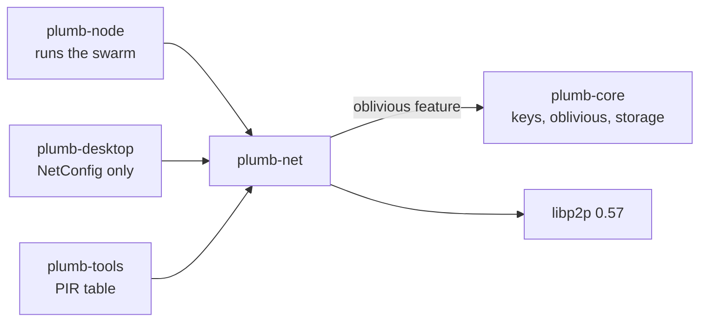
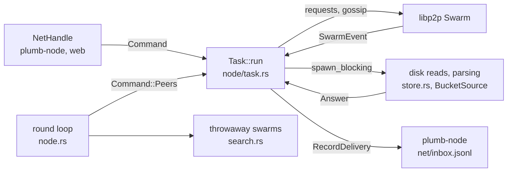

# plumb-net

The peer-to-peer side of a Plumb node: one libp2p swarm that shares signed crawl batches, decides which other nodes' crawls to believe, makes and answers network searches without sending the query, relays sealed requests, and carries signed sets, popularity reports, leads and crawl credits. plumb-node starts it and drives it through a `NetHandle`.

Part of [Plumb Search](../../README.md). See [the architecture](../../docs/architecture.md) for how the crates fit together, and [the network design](../../docs/network.md) for what travels between nodes, the trust rules and every limit.

- [Where it fits](#where-it-fits)
- [What is in it](#what-is-in-it)
- [How it works](#how-it-works)
- [Using it](#using-it)
- [Tests](#tests)

## Where it fits



plumb-node runs the swarm and answers other nodes from its index through `BucketSource`. plumb-desktop builds the `NetConfig` its node runs with. plumb-tools reads `bucket::BUCKETS` and `hash::Hash` for its offline PIR table. Besides libp2p, the crate uses `sta-rs` for popularity reports, `ohttp` for sealing requests and `voprf` for blind tokens. It does not depend on plumb-format: it carries signed set manifests and parts as bytes, and plumb-node checks them.

## What is in it

**The swarm**

| Module | What it does |
| --- | --- |
| [node.rs](src/node.rs) | `start`, `NetConfig` and its defaults, `NetStatus`, the serving and fetching limits, the background round loop |
| [node/task.rs](src/node/task.rs) | The swarm task: commands from handles, `Answer`s from blocking work, swarm events, the one-minute maintenance tick |
| [node/swarm.rs](src/node/swarm.rs) | Building the swarm: transports, behaviors, per-protocol size caps, connection and relay limits |
| [node/handle.rs](src/node/handle.rs) | The `NetHandle` methods the rest of the program calls |
| [node/batches.rs](src/node/batches.rs) | Publishing, hearing of, fetching and holding batches; `RecordDelivery` of agreed sites, as their stored items |
| [node/answering.rs](src/node/answering.rs) | Answering bucket and sealed requests, relaying, and who may search this node |
| [node/serving.rs](src/node/serving.rs) | Serving fills, page files, signed sets and profiles, a few at a time |
| [node/gossip.rs](src/node/gossip.rs) | Popularity reports and leads, over gossip and by asking |
| [node/tokens.rs](src/node/tokens.rs) | Credits and tokens: who may ask what, and collecting tokens from others |
| [proto.rs](src/proto.rs) | Protocol and topic names, request and response types |
| [joining.rs](src/joining.rs) | `DEFAULT_BOOTSTRAP`, `PeerView` and `JoinProblem`: how a node joins and what it says about its connections |
| [throwaway.rs](src/throwaway.rs) | Throwaway identities: a new key and swarm for one request |

**Crawl sharing**

| Module | What it does |
| --- | --- |
| [assign.rs](src/assign.rs) | Which sites a node may crawl each day (`is_assigned`, `MAX_SHARE_PPM`), and slices for `--crawl-any-site` groups |
| [batch.rs](src/batch.rs) | Signed batches of sites' items: `check`, `accept_batch`, `accept_trusted_batch`, `mostly_kept`, `RecordProof` |
| [hash.rs](src/hash.rs) | SHA-256 and the Merkle tree over a batch's records |
| [store.rs](src/store.rs) | Batches held on disk, pruning, proofs for search answers, `CrawlerView` |
| [agree.rs](src/agree.rs) | Agreement between crawlers: quorum, vouching, disputes and rechecks |
| [fill.rs](src/fill.rs) | `/plumb/fill/1`: a trusted node's crawled sites, best-ranked first; `accept_record`, the checks on a site from elsewhere, which reading the set of sites shares |

**Network search**

| Module | What it does |
| --- | --- |
| [bucket.rs](src/bucket.rs) | `BucketSource`, and `BucketTable` and `BucketWriter` for the bucket table on disk, written from sites' stored items |
| [search.rs](src/search.rs) | Asking for buckets under throwaway identities, hedging, checking answers, `NetSearch` |
| [oblivious.rs](src/oblivious.rs) | Sealed requests through a relay over `/plumb/oblivious/2`: signed keys and padding |
| [rounds.rs](src/rounds.rs) | Scheduled background rounds and the queue of buckets they fetch |
| [cache.rs](src/cache.rs) | The bucket cache that searches read |
| [scope.rs](src/scope.rs) | `SearchScope`: which nodes a search asks |
| [allowance.rs](src/allowance.rs) | Free answers per source, per minute and per day |
| [credits.rs](src/credits.rs) | The credits ledger, blind tokens (VOPRF) and the wallet |

**Data and other messages**

| Module | What it does |
| --- | --- |
| [sets.rs](src/sets.rs) | `/plumb/sets/1`: signed set manifests and parts, from any node |
| [pages.rs](src/pages.rs) | `/plumb/pages/1`: page set files, from trusted nodes |
| [popularity.rs](src/popularity.rs) | Threshold-encrypted popularity reports (STARLite) and `PopularityTable` |
| [reports.rs](src/reports.rs) | The reports a node holds: this week's and last week's |
| [leads.rs](src/leads.rs) | Signed leads, their word keys and the lead store |
| [storage.rs](src/storage.rs) | Re-exports plumb-core's storage budget |

## How it works

### One swarm on one task

`start` loads or creates the node key (`node.key` in `NetConfig::dir`), opens the report and lead stores on a blocking thread, builds the swarm and spawns `Task::run`. It returns a `NetHandle` and a receiver of `RecordDelivery`: the sites agreement released, as a `SiteList` of their stored items, each delivery with a storage reservation and an acknowledgment. plumb-node saves them to its inbox and calls `acknowledge()`. Deliveries not acknowledged are sent again after a restart, without awarding credits twice.



The task answers every peer, so it never waits on disk, a slow lock or a whole-batch parse. Such work goes to `spawn_blocking`, and the result comes back to the task as an `Answer`: a stored batch, an answer for a bucket, batch, report, fill, pages, sets or profile request, a recount, or a sealed reply. `NetHandle` methods send a `Command` to the task and wait on a oneshot reply.

Every minute the task dials more nodes while it has fewer than `TARGET_PEERS` (8), saves the credits ledger and tops up tokens. Every 5 minutes it refreshes Kademlia, and every `RELIST_MINUTES` (30) it asks connected nodes again for recent batch headers and leads. Every hour it prunes batches (on a blocking thread), agreement, reports and leads.

### Searches go out on other swarms

The node's own swarm never asks for a bucket. Each bucket request goes out from a throwaway swarm ([throwaway.rs](src/throwaway.rs)) with a new key, sealed to the answering node's key and passed on by a relay picked at random ([oblivious.rs](src/oblivious.rs)). The node's swarm only answers `/plumb/bucket/2` and `/plumb/oblivious/2`, and only when `NetConfig::answer_searches` is on.

With rounds on (`NetConfig::round_every`, `ROUND_EVERY` 10 minutes by default), `NetHandle::search` reads only the bucket cache and queues the bucket numbers it lacks. A separate loop in [node.rs](src/node.rs) sends a round of exactly `BUCKETS_PER_SEARCH` (4) buckets at each slot, whether anyone searched or not. With `round_every` set to `None` (`--round-minutes 0`), a search asks the network at once. See [cache-first-search.md](../../docs/cache-first-search.md).

### Trust

`NetConfig::trusted_peers` (by default `DEFAULT_TRUSTED_PEERS`, the plumbsearch.org node) changes what a node takes:

- A trusted crawler's batches are taken whole (`accept_trusted_batch`) and at once. Everyone else's go through `accept_batch` and wait in [agree.rs](src/agree.rs) for a second crawler that counts.
- Fills (`/plumb/fill/1`) and page set files (`/plumb/pages/1`) carry no signature per record, so they are asked only of trusted nodes.
- Signed sets need no trust in the sender: plumb-node checks each manifest's signature and each part's hash.
- `SearchScope` limits which nodes searches and lead listings use: trusted ones, those and the nodes they trust (the default), or anyone.

### Invariants a change must keep

- **Released nodes read every message.** Add only optional fields (`#[serde(default)]`) that older nodes skip. Do not rename a protocol, topic or field; a new kind of message gets a new protocol name, and a message whose shape changes a new version, which older nodes neither ask nor answer (batches and bucket answers went to `/2` at v0.4.0, when their sites became items). Requests and responses are CBOR, gossip messages are JSON.
- **Signed bytes do not move.** A batch header is signed over fixed-width fields after the context `plumb-batch-v2\0` (`v1` before v0.4.0), and its Merkle leaves are the record lines, each a site's item, exactly as sent. A lead is signed over length-prefixed fields after `plumb-lead-v1\0`. Changing either breaks every signature already made, so it takes a new context.
- **Shared hashes are part of the protocol.** Assignment (`plumb-assign-v1\0`), buckets (`plumb-bucket-v1\0`, in plumb-core), crawl-group slices (`plumb-slice-v1\0`) and lead word keys (`plumb-lead-word-v1\0`) must come out the same on every node.
- **Sizes are capped before decoding.** Each protocol's codec has a request and response cap in [node/swarm.rs](src/node/swarm.rs), records are at most `MAX_RECORD_BYTES` (16 KiB), and lists and stores have counts per peer.
- **Nothing is passed on unchecked.** Gossipsub runs in strict mode with manual validation, so a batch header, report or lead is forwarded only after the task accepted it. A batch that names a site the node's denylist takes off is not relayed (`BucketSource::denies`).
- **No disk work on the swarm task.** Hand it to `spawn_blocking` and take the result back as an `Answer`.

Changes to this crate get a second reviewer before they merge (see [CLAUDE.md](../../CLAUDE.md)).

## Using it

| Entry point | What it is for |
| --- | --- |
| `start(config, source)` | Joins the network; returns the `NetHandle` and the `RecordDelivery` receiver |
| `NetConfig::new(dir)` | Defaults: port 4001 over TCP and QUIC, UPnP and mDNS on, answer searches, follow crawls, trust the plumbsearch.org node, friends-of-friends scope, rounds every 10 minutes, keep batches 35 days |
| `NetHandle::publish` | Signs and announces a batch of this node's crawls |
| `NetHandle::search` | A network search: candidate sites, checked, for the caller to rank |
| `NetHandle::status` | `NetStatus`, shown under `network` in `GET /api/status` |
| `NetHandle::is_assigned`, `crawl_group`, `owns_slice`, `rechecks` | What the crawler should fetch |
| `NetHandle::fill`, `pages_chunk`, `ask_sets`, `ask_profile` | Asking other nodes for sites, page files, signed sets and profiles |
| `NetHandle::send_report`, `popularity`, `share_lead`, `leads` | Popularity reports and leads |
| `NetHandle::oblivious_keys`, `oblivious_forward` | Let the web front end relay sealed requests from the browser's private search |
| `BucketSource` | What plumb-node implements to answer: buckets, ranked sites, the denylist, icons, page files, sets, profiles |
| `BucketTable`, `BucketWriter` | The bucket table written next to each index (`records.dat`, `records.idx`, `buckets.idx`, `buckets.dat`) |

## Tests

```sh
cargo test -p plumb-net
```

- Unit tests sit beside the code in each module: Merkle proofs, tampered and re-dated batches, unassigned homepages, agreement and vouching, sealing and padding, tokens, the cache and the round queue.
- [node/tests.rs](src/node/tests.rs) tests the swarm task.
- [tests/network.rs](tests/network.rs) runs several nodes on one machine: batches spreading and searches through a relay, sealed bucket requests, popularity reports, credits and tokens, rounds sent without searches, filling only from trusted nodes, search scopes, leads, and catching up after slow delivery.
- `cargo run --locked -p plumb-net --example privacy_review` runs the offline demonstrations behind [the privacy review](../../docs/reviews/privacy-security.md) ([examples/privacy_review.rs](examples/privacy_review.rs)).
