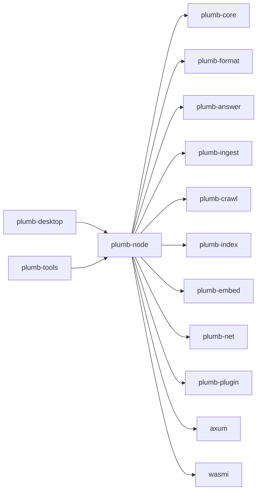
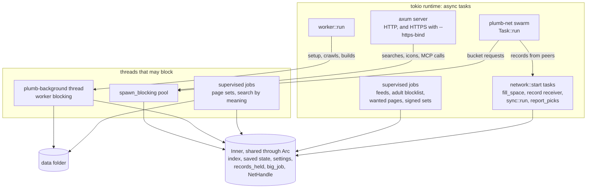

# plumb-node

The Plumb Search node: the `plumb` binary, the long-running node behind `plumb run`, and its web server. Operators run it; the desktop app embeds it; `plumb-tools` reuses its crawl, records and search code.

Part of [Plumb Search](../../README.md). See [the architecture](../../docs/architecture.md) for how the crates fit together, and [running a node](../../docs/running-a-node.md) for the operator's guide.

- [Where it fits](#where-it-fits)
- [What is in it](#what-is-in-it)
- [How it works](#how-it-works): [the runtime](#the-runtime), [starting and stopping](#starting-and-stopping), [the worker](#the-worker), [background jobs](#background-jobs), [the data folder](#the-data-folder), [the web layer](#the-web-layer)
- [Rules a change must keep](#rules-a-change-must-keep)
- [Entry points](#entry-points)
- [Tests](#tests)

## Where it fits



## What is in it

| Module | What it does |
| --- | --- |
| **Commands** | |
| [main.rs](src/main.rs), [lib.rs](src/lib.rs) | Parses the command line and runs one subcommand; logging, glibc allocator settings, atomic records writes |
| [cli.rs](src/cli.rs) | Every subcommand and flag (clap): `run`, `ingest`, `serve`, `remote-control`, `experiments`, `click-labels`, `mcp`, `try-plugin`, `healthcheck`, `build-info` |
| [run.rs](src/run.rs) | `plumb run`: flags to a `NodeConfig`, stop on Ctrl-C or SIGTERM; `plumb remote-control` |
| [ingest.rs](src/ingest.rs) | `plumb ingest`: folds seed files and earlier records files into one records file, as sites' stored items |
| [limits.rs](src/limits.rs), [build_info.rs](src/build_info.rs) | Raises the open-file limit; the version and Git revision built in |
| **The long-running node** | |
| [node.rs](src/node.rs) | `NodeConfig`, `NodeSettings`, `Status`, `start`, `NodeHandle`, `supervise` and the shared state `Inner` |
| [node/worker.rs](src/node/worker.rs) | Setup, crawl rounds, index builds and the refresh schedule, with retries |
| [node/store.rs](src/node/store.rs) | Data folder paths, the folder lock, `state.json`, numbered index folders |
| [node/round.rs](src/node/round.rs), [node/schedule.rs](src/node/schedule.rs) | The slim view of each site a crawl round holds, read off its stored item; workload presets and crawl hours |
| [node/network.rs](src/node/network.rs) | Joining plumb-net: the records inbox, buckets, popularity, `--publish-records` |
| [node/fill.rs](src/node/fill.rs), [node/site_set.rs](src/node/site_set.rs), [node/trim.rs](src/node/trim.rs) | Filling free space from the set of sites or trusted nodes (and first setup from them); fetching the parts of the set it reads; staying under the storage limit |
| [node/pages.rs](src/node/pages.rs), [node/places.rs](src/node/places.rs), [node/newer.rs](src/node/newer.rs) | Page set and places files and their indexes; newer files from trusted nodes |
| [node/signed_sets.rs](src/node/signed_sets.rs), [node/denylist.rs](src/node/denylist.rs), [node/adult.rs](src/node/adult.rs), [node/grades.rs](src/node/grades.rs) | Signed sets taken from the network; the project's denylist, applied to sites' stored items as an index is built and to records kept or passed on; the adult blocklist; the site grades searches push spam down by, the set's and those AI apps gave (`grade_site`) |
| [node/embedding.rs](src/node/embedding.rs), [node/shared_vectors.rs](src/node/shared_vectors.rs) | Search by meaning: the model, embedding after each build, vectors from other nodes |
| [node/news.rs](src/node/news.rs), [node/wanted_pages.rs](src/node/wanted_pages.rs), [node/tuning.rs](src/node/tuning.rs) | Feed checks; following links toward the pages searches and AI apps (`fetch_pages`) wanted; what apps asked, for `node_tuning` |
| [node/features.rs](src/node/features.rs), [node/backup.rs](src/node/backup.rs), [node/control.rs](src/node/control.rs), [node/journal.rs](src/node/journal.rs) | `features.json`; backups; the remote control token; the activity log |
| **Records and crawling** | |
| [records.rs](src/records.rs), [outline.rs](src/outline.rs) | `records.jsonl` and its journal, loaded whole as sites' stored items and compacted from them; reading it a site at a time and building an index, buckets and feeds from each site's stored item that way |
| [crawl.rs](src/crawl.rs), [dead.rs](src/dead.rs), [icons.rs](src/icons.rs) | Which homepages a round fetches and how results merge (shared with `plumb-tools crawl`): a crawl's results are sites' stored items, which the journal's changes carry and the crawls shared with the network are signed from; dead sites; site icons |
| [sets.rs](src/sets.rs), [site_rules.rs](src/site_rules.rs) | Checking and reading `plumb-format` sets; signed site rules |
| **Search features** | |
| [meaning.rs](src/meaning.rs) | Search by meaning: models, vectors files, query embedding |
| [pages.rs](src/pages.rs), [places.rs](src/places.rs), [map/](src/map/mod.rs) | Page sets; places; the base map (PMTiles, vector tiles, SVG drawing) |
| [news.rs](src/news.rs), [wanted_pages.rs](src/wanted_pages.rs) | Recent headlines; inner pages found for this node's searches, or that AI apps asked for |
| [sources.rs](src/sources.rs), [websearch.rs](src/websearch.rs), [country.rs](src/country.rs), [assembly.rs](src/assembly.rs) | Sites for tool searches ("weather"); web search links and bangs; home country; rules shared by MCP and the web |
| [plugins.rs](src/plugins.rs) | The plugin host: loads `plugins/`, runs each plugin in a wasmi sandbox; `plumb try-plugin` |
| **Each searcher's data** | |
| [history.rs](src/history.rs), [about.rs](src/about.rs), [learn.rs](src/learn.rs), [clicks.rs](src/clicks.rs) | Search history per browser; About you; learning from clicks and edits; position bias and `plumb click-labels` |
| [sync.rs](src/sync.rs) | Profiles shared between browsers and nodes with link codes, over `/plumb/profile/1` |
| [findings.rs](src/findings.rs), [experiments.rs](src/experiments.rs) | What AI agents report through MCP; ranking experiments from `experiments.json` |
| **Web and MCP** | |
| [web.rs](src/web.rs) | The router, `plumb serve`, shutdown signals |
| [web/search.rs](src/web/search.rs), [results.rs](src/web/results.rs), [hit.rs](src/web/hit.rs), [answers.rs](src/web/answers.rs), [places.rs](src/web/places.rs), [weather.rs](src/web/weather.rs) | The results page: own and network results, pages, places, instant answers, info box |
| [web/api.rs](src/web/api.rs), [searxng.rs](src/web/searxng.rs), [backend.rs](src/web/backend.rs) | JSON API, SearXNG-format results; the `SearchBackend` and `StatusSource` traits |
| [web/panel.rs](src/web/panel.rs), [panel/](src/web/panel/view.rs), [setup.rs](src/web/setup.rs), [control.rs](src/web/control.rs), [nodes.rs](src/web/nodes.rs) | The panel at `/app`; the remote control API; controlling other nodes |
| [web/private.rs](src/web/private.rs), [relay.rs](src/web/relay.rs) | Private search page and buckets; relaying sealed bucket requests |
| [web/history.rs](src/web/history.rs), [link.rs](src/web/link.rs), [tune.rs](src/web/tune.rs), [welcome.rs](src/web/welcome.rs) | History, link codes, tuning and About you pages |
| [web/html.rs](src/web/html.rs), [home.rs](src/web/home.rs), [params.rs](src/web/params.rs) | Page frame, escaping, links; home and setup pages; search parameters |
| [mcp.rs](src/mcp.rs), [mcp/](src/mcp/tools.rs), [web/mcp.rs](src/web/mcp.rs) | The MCP server and its tools, including those that improve search for the node's owner ([mcp/manage.rs](src/mcp/manage.rs)); `POST /mcp`; `plumb mcp` over stdio |

## How it works

### The runtime

A node is one tokio runtime. Async tasks wait; anything that blocks (disk, parsing a whole file, an index build, a search) runs on threads made for it, and everything shares one `Inner` behind an `Arc`.



`Inner` holds the index being searched (`RwLock<Option<Arc<ServingIndex>>>`), the saved state and settings, the page, place and meaning indexes, the denylist, the activity log, the storage budget and the network handle. Two mutexes keep memory in check: `hold_records()` is held while the whole records file is in memory or being folded, and `one_big_job()` lets one job that takes about a gigabyte run at a time.

### Starting and stopping

`node::start(config)`:

1. Applies `features.json` over the flags ([node/features.rs](src/node/features.rs)), then turns off what `--crawl-only` cannot use.
2. On a blocking thread, creates and locks the data folder (`node.lock`), removes leftovers of interrupted work, finishes a pending backup restore, loads the site rules and `state.json`, and opens the newest index that opens. Older ones, and newer ones that do not open, are deleted; a broken index marks the records for a rebuild.
3. Binds the web address, opens the storage budget, loads the denylist, starts the server (and the HTTPS listener).
4. Starts the jobs searches need while the node joins the network, joins it (`network::start`), then starts the worker and the other jobs.

`NodeHandle::shutdown` gives open requests 10 seconds, waits for the worker and jobs to reach a safe point (an index build under way finishes first), stops the network and releases the lock. `plumb run` exits at once on a second Ctrl-C: files on disk are always whole.

### The worker

[`worker::run`](src/node/worker.rs) looks at what is on disk and in `state.json` and does the next piece of work, so the same loop resumes after a restart:

1. No `records.jsonl`: set up, from a trusted node's best sites or else the Tranco list, and put a first index in service.
2. Fold in records other nodes sent (`net/inbox.jsonl`); over the storage limit, drop the least useful sites; enough records from the network rebuild the index.
3. No index, or one older than the records: build one (`build_from_file`, streaming the records).
4. The rest of the seed data missing and a try due: download it and fold it in (after the first crawl).
5. Paused (owner, crawl hours, a limit reached): idle until the pause ends.
6. Homepages left in the round: crawl them in batches, appending to the journal, then rebuild.
7. A refresh due or asked for: start a round. Otherwise idle until the next one.

Folds, crawls and index builds run through `blocking()`, on a `plumb-background` thread at a lower priority than searches; downloads stay async. A failure is shown in the status and tried again after 10 minutes, doubling up to 6 hours.

### Background jobs

| Job | Module | Runs on | What it does |
| --- | --- | --- | --- |
| page sets | [node/pages.rs](src/node/pages.rs) | blocking | Takes set files from trusted nodes, builds the page and place indexes, keeps the map |
| search by meaning | [node/embedding.rs](src/node/embedding.rs) | blocking | Downloads the model, takes or makes site vectors after each build |
| checking feeds | [node/news.rs](src/node/news.rs) | async | Checks due RSS and Atom feeds, shares new headlines |
| the adult blocklist | [node/adult.rs](src/node/adult.rs) | async | Keeps the list fresh, from a trusted node or its host |
| following links for searches | [node/wanted_pages.rs](src/node/wanted_pages.rs) | async | Fetches inner pages searches and AI apps wanted; forgets old ones |
| signed sets | [node/signed_sets.rs](src/node/signed_sets.rs) | async | Every 6 hours, fetches newer signed sets and checks them |

Each starts through `supervise`, which restarts a job that panics after 60 seconds, doubling up to an hour. A `--crawl-only` node runs only the last two. In the network, `network::start` also spawns the receiver of other nodes' records and, as the settings ask, filling free space, profile sync, popularity reports and `--publish-records`.

### The data folder

Everything a node keeps is under `--data DIR`. Paths are defined in [node/store.rs](src/node/store.rs) unless noted.

| Path | What it holds |
| --- | --- |
| `node.lock` | Locked while a node runs, so two never share a folder |
| `state.json` | Progress that survives restarts: homepages left, last refresh, downloads counted |
| `settings.json` | The panel's settings (`NodeSettings`) |
| `site-grades.json` | The grades AI apps gave sites with `grade_site`, by site ([node/grades.rs](src/node/grades.rs)) |
| `features.json` | The panel's optional features, applied at start ([node/features.rs](src/node/features.rs)) |
| `records.jsonl`, `records.jsonl.journal` | Every known site, one JSON line each, its stored item (`plumb_core::stored`; lines versions up to 0.4 wrote hold the record's JSON and are read as well); crawl results not yet folded in ([records.rs](src/records.rs)) |
| `seed/` | First-start downloads: Tranco, Wikidata, Wikipedia intros, Common Crawl ranks |
| `indexes/NNNNNN/` | Numbered search indexes, the newest that opens is searched; `buckets/` inside for the network and private search |
| `icons/xx/<domain>.png` | Site icons for results pages ([icons.rs](src/icons.rs)) |
| `net/` | The network side: `node.key`, `batches/`, `credits/`, `reports/`, `bucket-cache/`, `inbox.jsonl`, `fill.json`, `picks.json`, `published.json`, `leads.jsonl`, `friends.json`, `popularity.json`, `search-scope` |
| `sets/<scope>/<name>/` | Signed sets taken from the network ([node/signed_sets.rs](src/node/signed_sets.rs)), and the parts of `plumb/sites` filling reads ([node/site_set.rs](src/node/site_set.rs)) |
| `pages/sets/` | Page set files, `places.tsv.gz` and `map.pmtiles`, with `.prev` copies ([pages.rs](src/pages.rs)) |
| `pages/index-<key>/`, `pages/places-<key>/` | The page index and the place index |
| `safe/adult-domains.txt` | The adult blocklist ([node/adult.rs](src/node/adult.rs)) |
| `model/`, `model-gemma/`, `vectors.bin` | The embedding model and site vectors for search by meaning ([meaning.rs](src/meaning.rs)) |
| `news/` | `feeds.json`, `headlines.json`, `languages.json` ([news.rs](src/news.rs)) |
| `wanted/`, `asked/` | `sites.json`, `pages.json` and `index-N/` for the pages searches wanted, and for those AI apps asked for ([wanted_pages.rs](src/wanted_pages.rs)) |
| `history/` | Per browser `<id>.json`, `<id>.about.json`, `<id>.sync.json`; `positions.json`, `click-labels.json` ([history.rs](src/history.rs)) |
| `plugins/` | Installed plugins and `suggest.json` ([plugins.rs](src/plugins.rs)) |
| `findings.jsonl` | Findings AI agents reported ([findings.rs](src/findings.rs)) |
| `experiments.json`, `experiments-results.json` | Ranking experiments the owner sets up, and their counts ([experiments.rs](src/experiments.rs)) |
| `activity.jsonl` | The panel's activity log ([node/journal.rs](src/node/journal.rs)) |
| `backups/`, `restore-pending.json` | Backups made on the panel; a restore finished at the next start ([node/backup.rs](src/node/backup.rs)) |
| `remote-control.json`, `remote-control-cert.der`, `remote-control-key.der` | The remote control token's hash; the self-made HTTPS certificate ([node/control.rs](src/node/control.rs), [tls.rs](src/tls.rs)) |
| `remote-nodes.json` | Other nodes this panel controls ([web/nodes.rs](src/web/nodes.rs)) |

Records and state are replaced atomically. Each index build goes into a new numbered folder through a hidden staging folder; old ones are deleted once no search has them open.

### The web layer

[web.rs](src/web.rs) builds one axum router. `plumb serve` gets the search routes over an `IndexBackend`; a node also gets the node routes, with `Inner` as both `SearchBackend` and `StatusSource`. Until the first index is ready, `/` and `/search` show the setup page (reloading every 5 seconds) and `/api/search` answers 503.

| Route | Module | What it serves |
| --- | --- | --- |
| `GET /`, `GET /opensearch.xml` | [home.rs](src/web/home.rs) | Home page; OpenSearch description |
| `GET /search` | [search.rs](src/web/search.rs) | Results page; `format=json` answers in SearXNG's format ([searxng.rs](src/web/searxng.rs)) |
| `GET /api/search` | [api.rs](src/web/api.rs) | JSON results; `full=1` for the whole answer |
| `POST /api/websearch` | [searxng.rs](src/web/searxng.rs) | Open WebUI's external web search |
| `POST /mcp` | [mcp.rs](src/web/mcp.rs) | MCP over HTTP (`GET` and `DELETE` answer that it does not stream) |
| `POST /plugins/act`, `POST /api/plugins/act`, `GET /api/plugins/page` | [plugins.rs](src/web/plugins.rs) | Plugin buttons; what plugins say about a page |
| **Node only** | | |
| `GET /api/status`, `GET /api/recent` | [api.rs](src/web/api.rs) | The node's `Status` as JSON; the "Recent" block |
| `GET /network`, `GET /api/network/search` | [network.rs](src/web/network.rs), [api.rs](src/web/api.rs) | Network search page and JSON |
| `GET /go` | [go.rs](src/web/go.rs) | Notes the result opened, then redirects |
| `GET /app`; `POST /app/settings`, `/setup`, `/features`, `/plugins`, `/refresh`, `/network/retry`, `/pause`, `/retry`, `/backup`, `/backups/restore`, `/restore`, `/restart`, `/remote-control`; `GET /app/backups/{name}` | [panel.rs](src/web/panel.rs), [setup.rs](src/web/setup.rs) | The panel; changes only from this computer |
| `GET /add-to-firefox` | [panel.rs](src/web/panel.rs) | How to add Plumb to Firefox |
| `/app/nodes`, `/app/nodes/new`, `/app/nodes/{id}` and its `/settings`, `/features`, `/refresh`, `/network/retry`, `/pause`, `/retry`, `/remove` | [nodes.rs](src/web/nodes.rs) | Panels of other nodes this one controls |
| `GET /api/control`; `POST /api/control/settings`, `/features`, `/refresh`, `/reconnect`, `/retry` | [control.rs](src/web/control.rs) | Remote control API, with a bearer token |
| `GET /private`, `/private/{version}/{file}`, `/api/buckets`, `/api/buckets/{table}/{bucket}` | [private.rs](src/web/private.rs) | Private search page, its script and buckets |
| `GET /api/oblivious/targets`, `POST /api/oblivious/forward/{peer}` | [relay.rs](src/web/relay.rs) | Relaying sealed private search requests |
| `GET /history`; `POST /history/clear`, `/history/forget-clicks`, `/feedback` | [history.rs](src/web/history.rs) | Search history, edits of results |
| `GET /link`; `POST /link/new`, `/link/join`, `/link/stop` | [link.rs](src/web/link.rs) | Link codes for shared profiles |
| `GET /tune` | [tune.rs](src/web/tune.rs) | Tuning through a few searches |
| `GET`/`POST /about`, `GET`/`POST /welcome`, `POST /welcome/skip` | [welcome.rs](src/web/welcome.rs) | About you and the welcome page |

Searches run on the `spawn_blocking` pool. Every page is built with `format!` and `escape_html`, runs no script and loads nothing from other servers (the Content-Security-Policy in [web.rs](src/web.rs) allows neither).

## Rules a change must keep

These come from [CLAUDE.md](../../CLAUDE.md), which has the full list.

- **Locks.** Take std locks with `plumb_core::locks` (`locked()`, `read_locked()`, `write_locked()`), never hold one across `.await`, and never hold one async code or the network needs during file I/O, an fsync or a fold.
- **Blocking work.** Disk I/O, whole-file parsing and heavy CPU go in `spawn_blocking` or the worker's `blocking()`. The plumb-net swarm task never waits on disk or a slow lock.
- **Jobs.** Long-running jobs start through `supervise` and check `stopping()` or `check_stop()` in their loops. A job that takes a gigabyte or so holds `one_big_job()`, taken before `hold_records()`, never after, and says roughly how much memory it takes in its doc comment. Stream records (`build_from_file`, `for_each_record`) rather than holding two copies.
- **Files.** Write through `plumb_core::storage` (`write_atomic`, `write_atomic_private`, `replace_file`, `remove_file`, `create_directory`) so writes are atomic and charged to the storage budget. Read, append to or fold `records.jsonl` and its journal only under `hold_records()`.
- **Input.** Cap every peer message's size before decoding it, check before keeping or passing on, and fetch caller-chosen URLs only through plumb-crawl's resolver, which drops private addresses.
- **Output.** Everything shown or returned goes through the denylist (`StatusSource::denies`; for the sites other nodes answer a network search with, `StatusSource::allows_site`, before they are ranked). Links go through `safe_href` and `http_url`. Results pages send `Referrer-Policy: no-referrer`; the panel sends `same-origin`.
- **Size.** Functions under 150 lines, files under 3,000.

## Entry points

- `plumb_node::run(cli)`: runs one subcommand; `main.rs` is a thin wrapper.
- `node::start(NodeConfig) -> NodeHandle`, with `NodeConfig::server` and `NodeConfig::desktop` as defaults: the desktop app embeds a node this way. `NodeHandle` has `addr`, `status`, `refresh_now`, `restart_signal` and `shutdown`.
- `web::router`, `web::node_router_with`: the router over any `SearchBackend`, for tests and `plumb serve`.
- `crawl::{select_site_targets, crawl_rolling}`, `records::{load_sites, RecordStore}`, `outline`, `meaning`: used by `plumb-tools crawl`, `index` and `search`.
- `records::{load_sites, replace_sites}`, `outline::for_each_site`, `dead::find_dead`, `about::Topics`: used by the `plumb-tools` commands that read or rewrite a records file as sites' stored items (`summaries`, `terms`, `fetch-text`, `top-sites`, `link-rank`, `fact-trust`, `dead-sites`, `set sites`, `embed` with `meaning::embed_all`, and `index` for a file it merges).

## Tests

```sh
cargo test -p plumb-node
```

- [src/node/tests/](src/node/tests/mod.rs): whole nodes on a loopback port with a temporary data folder; seed data comes from the fixtures through a stand-in host, so nothing reaches the internet.
- [src/web/tests/](src/web/tests/mod.rs), [src/mcp/tests/](src/mcp/tests.rs): pages, the JSON API and the MCP tools, driven through the router.
- [tests/end_to_end.rs](tests/end_to_end.rs): runs the `plumb` binary over [fixtures/](../../fixtures) and drives the router with `tower`.
- Private search with its script built in: `PLUMB_PRIVATE_DIR=../../target/private cargo test -p plumb-node private`, after building it as [CONTRIBUTING.md](../../CONTRIBUTING.md) says.
- `a_build_of_the_golden_sites_makes_the_golden_buckets_and_feeds` ([outline.rs](src/outline.rs)) builds plumb-index's golden sites from a records file and checks the buckets and feeds against [outline_golden.txt](src/outline_golden.txt), written once and again when the bucket table's lines became stored items (only `records.dat` and `records.idx` changed, each line reading back as the record it was), and never to make a test pass.
- `exact_fold_rename_failure_preserves_inputs_and_charges_leftover_output` ([records.rs](src/records.rs)) fails when run as root.
- `cargo test -p plumb-tools --test conventions` counts what the rules above ask node code to avoid.
- `cargo run -p plumb-node --example ui_preview` shows the web pages with made-up results and no crawler.
