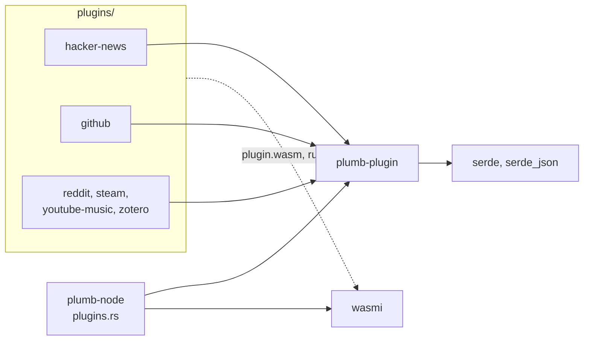
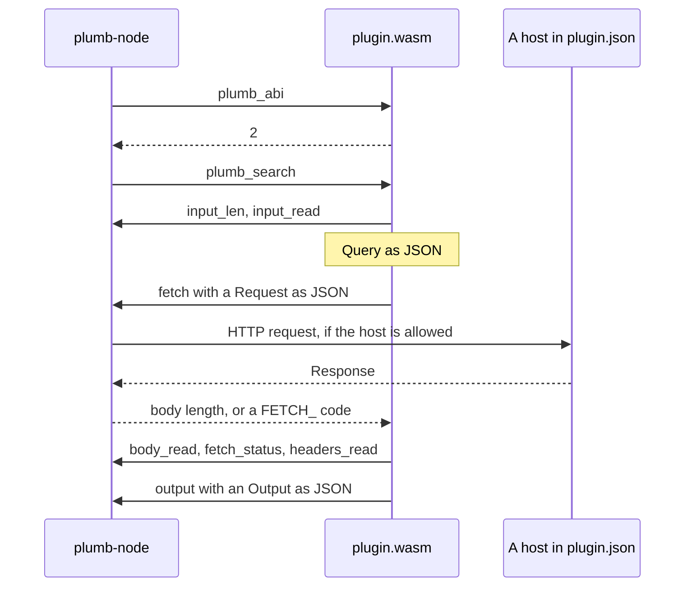

# plumb-plugin

The kit for writing Plumb Search plugins in Rust: the types a plugin and a node exchange, the calls a plugin makes to the node, and the macros that export a plugin's functions. Plugin authors depend on it, and so does plumb-node, which reads the same types on the host side.

Part of [Plumb Search](../../README.md). See [the architecture](../../docs/architecture.md) for how the crates fit together, and [docs/plugins.md](../../docs/plugins.md) for writing and installing plugins.

## Where it fits



A plugin compiles this crate into its `plugin.wasm`. The node links it natively and runs the plugin in [wasmi](https://github.com/wasmi-labs/wasmi) ([plugins.rs](../plumb-node/src/plugins.rs)).

## What is in it

Everything is in [lib.rs](src/lib.rs).

| Item | What it is |
| --- | --- |
| `plugin!(search)`, `plugin!(search, act)` | Exports `plumb_abi`, `plumb_search` and, with `act`, `plumb_act` |
| `annotate!(annotate)`, `annotate_only!(annotate)` | Exports `plumb_annotate`, beside `plugin!` or alone |
| `Query`, `About` | What a search hands a plugin: the search, its terms and keyword, safe search, language, `config.json`, what the search is about, and a page lookup's address |
| `Item`, `Action` | A result and a button on it, with builder methods |
| `ActInput` | What `act` gets: the pressed button's data and `config.json` |
| `Shown`, `ShownResult`, `Note` | The node's own results for `annotate`, and what it says about one |
| `Output` | What a plugin hands back: `results`, `notes`, `message` or `error` |
| `Request`, `Response`, `get` | HTTP requests to the plugin's hosts, through the node |
| `Error`, `fetch_error`, `FETCH_*` | Why a call found nothing, and the `fetch` codes behind it |
| `encode`, `log` | Percent-encoding for a query string, and a line for the node's log |
| `ABI` | The interface version, `2` |

## How it works

A plugin is a `cdylib` with no access to anything but the node. Every exchange is JSON in the plugin's memory:



- **The macros** wrap the author's functions. `run`, `run_act` and `run_annotate` read the input, call the function, and turn its `Ok` or `Err` into an `Output`, so an author writes plain `fn(&Query) -> Result<Vec<Item>, Error>` and never touches pointers.
- **Two `host` modules.** On `wasm32` the `host` module calls the node's imports from the `plumb` module (`input_len`, `input_read`, `fetch`, `fetch_status`, `body_read`, `headers_len`, `headers_read`, `output`, `log`). Everywhere else it is a stub: requests fail with "plugins fetch only inside a Plumb node" and `log` prints to stderr, so a plugin's own tests build and run with plain `cargo test`.
- **Optional fields stay out.** `Item`, `Note` and `About` skip empty optional fields when written, and default them when read, so an older plugin's answer reads on a newer node.

Invariants a change must keep:

- These types are the interface between plugins and every released node. Add fields only as optional ones (`#[serde(default)]`) that older plugins and nodes can skip.
- A node runs plugins of interface versions 1 to `ABI`. Raise `ABI` only when a plugin built with this crate could need something an older node does not give; the node then keeps running older plugins.
- The node refuses a module that imports anything outside the `plumb` functions listed above, so a new import is a new interface version, added on both sides at once ([plugins.rs](../plumb-node/src/plugins.rs) `IMPORTS` and `linker`).

## Using it

A plugin's `Cargo.toml`:

```toml
[lib]
crate-type = ["cdylib", "rlib"]

[dependencies]
plumb-plugin = { git = "https://github.com/SueHeir/plumb-search", tag = "v0.3.1" }
serde = { version = "1", features = ["derive"] }
serde_json = "1"
```

The smallest plugin:

```rust
use plumb_plugin::{encode, get, Error, Item, Query};

fn search(query: &Query) -> Result<Vec<Item>, Error> {
    let url = format!("https://api.example.org/search?q={}", encode(&query.terms));
    let found: Vec<(String, String)> = get(&url)?.json()?;
    Ok(found.into_iter().map(|(title, url)| Item::new(title, url)).collect())
}

plumb_plugin::plugin!(search);
```

Build it with `cargo build --release --target wasm32-unknown-unknown` and follow [Write a plugin](../../docs/plugins.md#write-a-plugin). The plugins in [plugins/](../../plugins) build from this workspace, as `cargo build --release -p plumb-plugin-hacker-news --target wasm32-unknown-unknown`.

## Tests

```sh
cargo test -p plumb-plugin
cargo clippy -p plumb-plugin -p plumb-plugin-hacker-news --target wasm32-unknown-unknown -- -D warnings
```

The tests in [lib.rs](src/lib.rs) check the JSON shapes, percent-encoding, cookies and status handling. The host side is tested in plumb-node: [plugins/tests.rs](../plumb-node/src/plugins/tests.rs) runs small WebAssembly text modules in the sandbox (hosts, fuel, limits, caching, buttons, mark-up), and [web/tests/plugins.rs](../plumb-node/src/web/tests/plugins.rs) checks what the results page and `/api/search` show.
