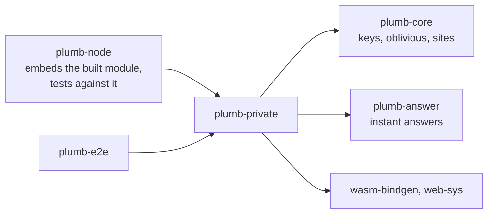
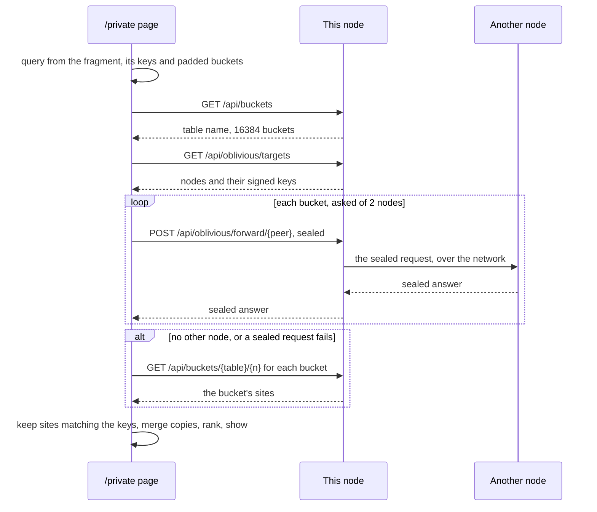

# plumb-private

The browser side of private search: Rust compiled to WebAssembly that a node's `/private` page loads. It works out which buckets of sites a search needs, fetches them, and ranks the sites in the browser, so the query never leaves it. Contributors to private search and anyone building the node with its private page need this crate; [docs/private-search.md](../../docs/private-search.md) is the user's view and says what the node can still learn.

Part of [Plumb Search](../../README.md). See [the architecture](../../docs/architecture.md) for how the crates fit together.

## Where it fits



plumb-node does not link this crate into the `plumb` binary: its [build.rs](../plumb-node/build.rs) embeds the finished WebAssembly and its JavaScript loader, and [web/private.rs](../plumb-node/src/web/private.rs) serves them. plumb-node and plumb-e2e use the native build in their tests.

## What is in it

| Module | What it does |
| --- | --- |
| [lib.rs](src/lib.rs) | `search` (keep the sites that match the query's keys, merge copies, rank), `read_bucket` (trimmed sites' items, or the trimmed records earlier versions served), `padding`, `safe_href`, `language_country`, `query_from_fragment`, `LIMIT` (10 results), `MAX_BUCKET_BYTES` (16 MiB) |
| [rank.rs](src/rank.rs) | `rank`: the node's ranking formula over a few hundred candidates, without Tantivy; `merge_copies`; `Options` (country, only that country, safe search, language) and `Ranked` |
| [sealed.rs](src/sealed.rs) | `seal` and `open`: bucket requests sealed to another node with Oblivious HTTP and sent through the page's own node |
| [browser.rs](src/browser.rs) | Only for `wasm32`: the page glue, from the search form to the list of results |
| [tests.rs](src/tests.rs) | Native tests, including agreement with plumb-index |

Everything but `browser.rs` is plain Rust and builds and tests natively.

## How it works



**The query stays in the page.** The page keeps the query in its fragment (`/private#q=us+bank`), which browsers never send. `browser::start` hooks the form; submitting puts the query in the fragment, and a `hashchange` runs the search. Only the words pick buckets ([`Operators::lookup_text`](../plumb-core/src/operators.rs)); operators such as `site:` narrow the ranked sites in the browser.

**Buckets.** [`plumb_core::keys::pick_buckets`](../plumb-core/src/keys.rs) turns the query into keys (the whole query joined and its words) and their buckets, padded with random ones to `BUCKETS_PER_SEARCH` (4) of `BUCKETS` (16,384). The page refuses a node whose bucket count differs. The padding comes from `padding`: SHA-256 of a secret and the query's keys, so the same search from the same browser asks for the same buckets and comparing two searches does not single out the real ones. The secret is 32 random bytes kept in local storage as `plumb-private-padding`; a browser without local storage gets a new one each page load.

**Sealed requests.** `fetch_sealed` asks the node for other nodes that answer bucket requests, checks each one's key is signed by it ([`plumb_core::oblivious`](../plumb-core/src/oblivious.rs)), shuffles them with the browser's cryptographic random numbers, and seals each bucket to two of them when there are two. The node relays the sealed bytes without seeing the bucket; the answering node sees the bucket but not who asked. `sealed::open` makes each domain canonical and drops a URL that is off its site's domain, as nodes do with each other's answers, and `merge_copies` keeps each site's less favorable popularity across copies, so one node cannot push a site up. Any failure falls back to fetching the buckets from the page's own node. The messages mirror `plumb_net::proto`'s `BucketRequest` and `BucketResponse`, since plumb-net does not build for WebAssembly.

**Ranking.** `rank` scores the candidates with the index's formula and defaults:

```text
score = alpha * link_score + trust * ((1 - alpha) * text_score + name_bonus) + country_bonus
```

The text match is simpler than the index's BM25: each query word scores the boost of every field it appears in, normalized over the candidates, and text is not ASCII-folded (`nestle` does not find `Nestlé`). Name matches, trust against look-alikes, kinds ("banks"), country, safe search and language work as in the index.

**Showing results.** Results are built from text nodes only. Each site shows its first letter rather than its icon, since fetching icons would tell the node which results the browser found. The instant answer comes from plumb-answer, built without time zones to keep the download small; currency conversions get none, since the page fetches no rates. The page's Content-Security-Policy lets it run only this site's scripts and WebAssembly and fetch only from this site.

Invariants a change must keep:

- The ranking constants equal `plumb_index::RankConfig::default()` (test `constants_match_the_index_defaults`), and first results agree with the index (`first_results_agree_with_the_index`). A change to the index's ranking changes this crate too.
- The sealed messages read and write as plumb-net's do: plumb-node's `the_browser_and_a_node_understand_each_other` ([web/relay.rs](../plumb-node/src/web/relay.rs)) checks it.
- `wasm-bindgen` is pinned to `=0.2.108`, and `wasm-bindgen-cli` must be that same version.

## Building it

The build uses the `wasm` profile from the root `Cargo.toml` (optimized for size, LTO, `panic = "abort"`, stripped), since every visitor downloads the module:

```sh
rustup target add wasm32-unknown-unknown
cargo install wasm-bindgen-cli --version 0.2.108 --locked
cargo build --locked -p plumb-private --target wasm32-unknown-unknown --profile wasm
wasm-bindgen --target web --no-typescript --out-dir target/private \
    target/wasm32-unknown-unknown/wasm/plumb_private.wasm
cargo build --release -p plumb-node
```

`wasm-bindgen` writes `plumb_private.js` and `plumb_private_bg.wasm` to `target/private/`. plumb-node's build script embeds them from there, or from the folder in `PLUMB_PRIVATE_DIR` (and fails the build when that is set but missing the files). Without them the node embeds empty files and `/private` says private search is not in this build. The node serves the files at `/private/{hash}/{file}`, under a hash of the build, so browsers cache them for good. The [Dockerfile](../../Dockerfile) and the desktop installers always build them.

## Tests

```sh
cargo test -p plumb-private
cargo clippy -p plumb-private --target wasm32-unknown-unknown -- -D warnings
```

The native tests in [tests.rs](src/tests.rs) build a small Tantivy index with plumb-index and check that private ranking agrees with it, plus safe search, language, operators, padding and bucket reading. To test the node with the page built in, build the module as above, then:

```sh
PLUMB_PRIVATE_DIR=../../target/private cargo test -p plumb-node private
```

The end-to-end tests ([plumb-e2e](../plumb-e2e/README.md)) search a running Docker node's buckets with this crate's code.
