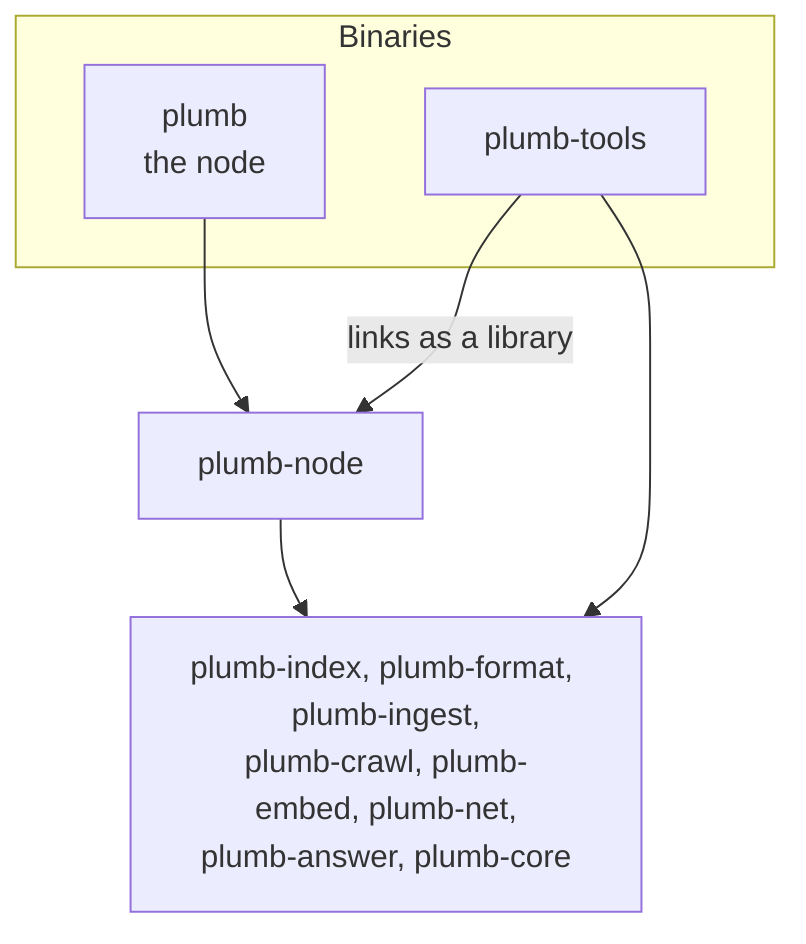
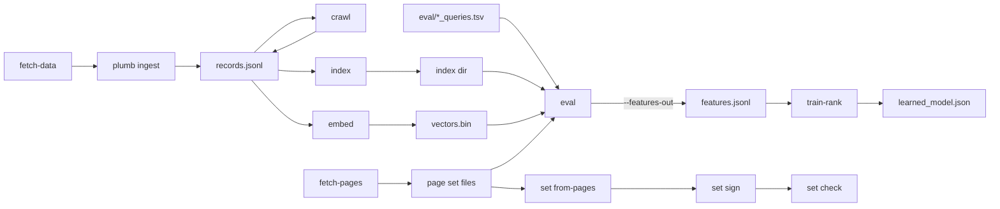

# plumb-tools

The second binary, `plumb-tools`: the commands a node never runs. Operators and contributors use it to build page sets and the map, write and sign sets, measure and train ranking, and look into a node's records and data.

Part of [Plumb Search](../../README.md). See [the architecture](../../docs/architecture.md) for how the crates fit together.

- [Where it fits](#where-it-fits)
- [Why a second binary](#why-a-second-binary)
- [Commands](#commands)
- [Workflows](#workflows)
- [What is in it](#what-is-in-it)
- [Research code and examples](#research-code-and-examples)
- [Tests](#tests)

## Where it fits



`plumb` is plumb-node's binary. `plumb-tools` links plumb-node and the crates under it, and nothing links `plumb-tools`.

## Why a second binary

The node is meant to stay small enough to read, so anything only an operator or an eval runs lives here instead (see [CLAUDE.md](../../CLAUDE.md#where-code-goes)).

- **It runs the node's own code.** Commands call plumb-node as a library, so what they build and measure is what a node serves: `index` builds with `plumb_node::outline::build_index`, `crawl` goes through `plumb_node::crawl`, `embed` through `plumb_node::meaning`, `dead-sites` through `plumb_node::dead`, and `set check` runs `plumb_node::sets::check_set`, the check a node makes before it takes a set.
- **It carries what a node does not need.** The dump readers (7z, bzip2, tar, SQLite, OpenStreetMap PBF), the cross-encoder reranker and the ranking trainer are only in this crate.
- **It is not in the Docker image.** The [Dockerfile](../../Dockerfile) builds `plumb` alone.

Build it from the workspace root:

```sh
cargo build --release -p plumb-tools    # target/release/plumb-tools
```

Every command lists its flags with `plumb-tools <command> --help`.

## Commands

Taken from [cli.rs](src/cli.rs). `plumb ingest`, which folds seed data into a records file, is a node command and lives in `plumb`.

| Group | Command | What it does |
| --- | --- | --- |
| Seed data and page sets | `fetch-data` | Download the seed datasets (Tranco, Common Crawl domain ranks, Wikidata's official websites and their facts, Wikipedia intros) and print the `plumb ingest` command to run next |
| | `fetch-pages` | Make a page set file: `--set wikipedia-en`, `github`, `stackoverflow`, `stackexchange`, `books`, `podcasts`, `music`, `films`, `papers`, `packages`, `docs`, `reference`, `subpages`, `places` or `wiktionary` |
| | `fetch-profiles` | Add official profiles (YouTube, X, app stores...) from Wikidata to a Wikipedia articles file, and write the items with profiles but no article as the `wikidata` set |
| | `fetch-facts` | Add Wikidata facts (capital, birth date, CEO...) to a Wikipedia articles file, for fact searches |
| | `fetch-leads` | Add each article's lead and other names from Wikimedia's search index dump |
| | `fetch-map` | Cut the map file (`map.pmtiles`) from a Protomaps basemap |
| A node's work by hand | `crawl` | Fetch the homepages of a records file's best-scored sites and merge what they say, as a node's crawl rounds do |
| | `index` | Build a node's search index from a records file |
| | `search` | Search an index from the command line (`--paper` for a page index of papers, `--places` for places) |
| | `spelling` | Show what an index's spelling model learned |
| | `embed` | Make each site's vector for search by meaning (the model downloads on first use) |
| Ranking | `eval` | Measure where the expected answers of test searches rank (see [eval/README.md](../../eval/README.md)) |
| | `check-labels` | Check that the pages a queries file expects are in the page sets |
| | `train-rank` | Train the learned ranking on what `eval --features-out` wrote, and measure it |
| Records and data | `storage` | Measure a node's storage and private-search bucket sizes, read-only |
| | `dead-sites` | Count the sites `plumb run --drop-dead-sites` would take out, read-only |
| | `top-sites` | How much of a records file the best sites take, and optionally a copy cut down to them |
| | `link-rank` | A PageRank of the sites in a records file from their homepages' links |
| | `fact-trust` | How often each site's pages state Wikidata's facts right, from Common Crawl's page text |
| | `summaries pick` | Write the best-scored sites with no text, for a language model to describe |
| | `summaries apply` | Write the sentences that came back into a copy of the records (see [tools/summaries](../../tools/summaries/README.md)) |
| Experiments | `fetch-text`, `terms` | Fetch homepages' visible text once, then try ways of picking each site's search terms |
| | `relations`, `relate` | Learn kinds of Wikidata facts as maps between article vectors, then follow or check a relation |
| | `embed-pages`, `page-meaning` | Make a vector for each page of a set that has a snippet (or every page, with `--without-snippet`), then measure which pages searches find by meaning; a node or `eval` takes the vectors with `--page-vectors` |
| Sets | `set new-key` | Make a set-signing key and print its public key |
| | `set from-pages` | Write a page set file as a set of items |
| | `set page-sets` | Write every page set a node holds as `plumb/<id>` sets |
| | `set denylist`, `set deny-entry` | Write a denylist set from an entries file; print one entry |
| | `set site-rules` | Write the rules that say which site a host is on, from the Public Suffix List, and list the hosts they move |
| | `set sites` | Write a node's records file as `plumb/sites`, the set other nodes set up and fill from |
| | `set adult-sites` | Write an adult blocklist as the layer that labels those sites `adult` |
| | `set map`, `set vectors` | Write the map file or a node's `vectors.bin` as a set |
| | `set sign` | Check every part and item of a set, then sign its manifest |
| | `set check` | Check a set as a node does before taking it |
| | `set note delegate`, `handover`, `revoke` | Sign a key note: let another key sign some sets for a while, name the next publishing key, or withdraw a key |

## Workflows



### Build an index from seed data and measure it

`plumb run --data DIR` does all of this by itself (see [running a node](../../docs/running-a-node.md)). By hand:

```sh
plumb-tools fetch-data --dir seed --cc-release cc-main-2025-26-nov-dec-jan
# fetch-data ends by printing the ingest command, such as:
plumb ingest --tranco seed/tranco-top-1m.csv.zip --wikidata seed/wikidata-official-sites.tsv \
  --top 1000000 --out seed/records.jsonl
plumb-tools crawl --records seed/records.jsonl --top 1000        # optional
plumb-tools index --records seed/records.jsonl --index seed/index
plumb-tools search --index seed/index us bank
plumb-tools eval --index seed/index --queries eval/brand_queries.tsv
```

Common Crawl release names are listed at [commoncrawl.org/web-graphs](https://commoncrawl.org/web-graphs); without `--cc-release` or `--cc-ranks-url`, fetch-data skips Common Crawl. Add `--pages FILE` to `eval` for the suites that expect pages, with files made by `fetch-pages`.

### Measure a ranking change

Tune on one half of the test searches, then check the other half once:

```sh
plumb-tools eval --index DIR --queries eval/brand_queries.tsv --queries eval/ai_queries.tsv \
  --half tune --rank '{"exact_label_bonus": 0.35}'
plumb-tools eval --index DIR --queries eval/brand_queries.tsv --queries eval/ai_queries.tsv \
  --half tune --sweep eval/sweeps/rank_knobs.tsv --ranks-out ranks.tsv
plumb-tools eval --index DIR --queries eval/brand_queries.tsv --queries eval/ai_queries.tsv \
  --half held-out --rank '{"exact_label_bonus": 0.35}'
```

`--rank` changes knobs of `plumb_index::RankConfig` and leaves the rest at their defaults. [eval/README.md](../../eval/README.md) covers the suites, every option and the reproducible report mode.

### Train the learned ranking

```sh
plumb-tools eval --index DIR --pages wikipedia-en.tsv.gz --queries eval/ai_queries.tsv \
  --queries eval/article_queries.tsv --features-out features.jsonl
plumb-tools train-rank --features features.jsonl --folds 5
plumb-tools train-rank --features features.jsonl --out crates/plumb-index/src/learned_model.json
plumb-tools train-rank --features features.jsonl --judge builtin
```

`train-rank` trains on the tune half (`--half`) and prints top-1, top-3 and MRR for each queries file and half, before and after. `--judge builtin` measures the model nodes use instead of training one. The model reads and moves each search's first 10 rows; `--rows N` trains and judges one that reads deeper, on features written with `eval --limit N`. The model itself is in [plumb-index](../plumb-index/src/learned.rs).

### Build and sign a set

```sh
plumb-tools set new-key --out set-signing.key           # prints ed25519:...
plumb-tools set from-pages --pages DATA/pages/sets/docs.tsv.gz --set docs --out out/docs
plumb-tools set sign out/docs --key set-signing.key
plumb-tools set check out/docs --publisher ed25519:...
```

A set is a folder: `manifest.json` and its parts, `items-001.jsonl.zst` and on, most weighted first. Every writer leaves the manifest unsigned; signing is a separate step someone takes on purpose. `new-key` never overwrites a file, and on Unix saves the key readable by its owner only. Pass `--prev TIMESTAMP` to `sign` when the set replaces a generation published before. How nodes find, check and take signed sets is in [the network design](../../docs/network.md#signed-sets).

## What is in it

Each command is a module with a `run` function; [lib.rs](src/lib.rs) dispatches to it after setting up the node's allocator and raising the open file limit.

| Module | What it does |
| --- | --- |
| [cli.rs](src/cli.rs) | The `clap` definitions; larger commands keep their arguments in their own module |
| [fetch.rs](src/fetch.rs) | `fetch-data`, `fetch-pages`, `fetch-profiles`, `fetch-facts`, `fetch-leads` |
| [fetch/site_pages.rs](src/fetch/site_pages.rs) | Fetches a site's inner pages from its sitemaps, politely, for `docs`, `reference` and `subpages` |
| [fetch/cache.rs](src/fetch/cache.rs), [fetch/publication.rs](src/fetch/publication.rs) | Inner-page caches, and set files written as generations that can be staged (`--stage-only`) and promoted later |
| [build/](src/build.rs) | One builder per page set source: Wikipedia dumps, GitHub, Stack Exchange, Open Library, Podcast Index, MusicBrainz, Wikidata films, OpenAlex and CORE, ecosyste.ms, docs and reference sitemaps, OpenStreetMap, Wiktionary |
| [reference_sites.rs](src/reference_sites.rs), [subpage_sites.rs](src/subpage_sites.rs) | The sites the `reference` and `subpages` sets fetch |
| [map_fetch.rs](src/map_fetch.rs) | `fetch-map`: cuts a Protomaps basemap, reading only the tiles kept |
| [crawl.rs](src/crawl.rs) | `crawl` |
| [search.rs](src/search.rs) | `index`, `search`, `spelling` |
| [embed.rs](src/embed.rs) | `embed` |
| [eval.rs](src/eval.rs) | `eval`: suites, sweeps, recall, features for training |
| [eval/contracts.rs](src/eval/contracts.rs) | `eval --report`: JSONL contracts and reproducible reports |
| [eval/rerank.rs](src/eval/rerank.rs) | A cross-encoder second pass, for `eval --rerank-model` |
| [eval_labels.rs](src/eval_labels.rs) | `check-labels` |
| [train_rank.rs](src/train_rank.rs), [train_rank/learn.rs](src/train_rank/learn.rs) | `train-rank`: LambdaMART trees, or a small neural ranker (`--learner net`) |
| [storage.rs](src/storage.rs), [dead_sites.rs](src/dead_sites.rs), [top_sites.rs](src/top_sites.rs) | Read-only looks at a node's data and records |
| [link_rank.rs](src/link_rank.rs) | `link-rank` |
| [fact_check.rs](src/fact_check.rs), [fact_trust.rs](src/fact_trust.rs) | Checking pages' statements against Wikidata (Knowledge-Based Trust) |
| [summaries.rs](src/summaries.rs), [terms.rs](src/terms.rs) | `summaries`, `fetch-text`, `terms` |
| [set.rs](src/set.rs) | `set`: writing, signing and checking sets in the [plumb-format](../plumb-format/README.md) data format |
| [page_items.rs](src/page_items.rs) | Today's page sets written as items of the data format |
| [site_rules.rs](src/site_rules.rs) | Site rules beyond the built-in lists, and the hosts a rules set would move |
| [relations.rs](src/relations.rs), [relations/maps.rs](src/relations/maps.rs) | `relations`, `relate` |
| [embed_pages.rs](src/embed_pages.rs) | `embed-pages`, `page-meaning`: page vectors keyed by URL, and how often the page a search wants is among the nearest |
| [pir/](src/pir/mod.rs) | The table a private information retrieval server would answer from |

Commands that only look leave their inputs as they are: `link-rank`, `top-sites` and `fact-trust` read a records file and its journal from a copy, and write anything they change to a new file. `fetch-pages --data DIR` writes into `DIR/pages/sets/`, where a running node picks the file up.

## Research code and examples

- **[pir/](src/pir/mod.rs)**: an authenticated table of fixed-size rows made from a node's buckets ([snapshot.rs](src/pir/snapshot.rs)), filled with cut-down records ([lean.rs](src/pir/lean.rs)) packed into nearly equal rows ([pieces.rs](src/pir/pieces.rs)). No command and no node uses it yet. The direction is in [cache-first search](../../docs/cache-first-search.md), and [tools/pir-probe](../../tools/pir-probe/README.md) times a PIR scheme on such rows.
- **[examples/pir_sizing.rs](examples/pir_sizing.rs)**: how big a PIR table of a node's buckets would be. `--build-lean OUT` builds the table, and `--probe-db VARIANT FILE` writes rows for `pir-probe --database`.

  ```sh
  cargo run --release -p plumb-tools --example pir_sizing -- DATA/indexes/ID/buckets
  ```

- **[examples/paper_consistency_canary.rs](examples/paper_consistency_canary.rs)**: an offline check of the papers set's arXiv repair. It reads a papers set file and a saved arXiv feed, writes a repaired copy and `report.json` into a new folder, and leaves both inputs as they were. The optional canary file lists papers that must come out right, as in [tests/fixtures/paper-canary.json](tests/fixtures/paper-canary.json).

  ```sh
  cargo run -p plumb-tools --example paper_consistency_canary -- papers.tsv.gz feed.xml out/ canary.json
  ```

## Tests

```sh
cargo test -p plumb-tools
```

| Test | What it checks |
| --- | --- |
| [tests/eval.rs](tests/eval.rs) | `index`, `search` and `eval` end to end over [fixtures/](../../fixtures/README.md), ingested as `plumb ingest` does |
| [tests/site_rules.rs](tests/site_rules.rs) | A node that takes a site rules set `set` wrote and signed works out sites by it |
| [tests/conventions.rs](tests/conventions.rs) | The node code's conventions (below) |
| `eval::tests::repository_query_files_are_valid` | Every `eval/*.tsv` suite and `fixtures/brand_queries.tsv` parses and is labeled the way results are keyed |
| `cli::tests::definitions_are_consistent` | The clap definitions hold together |

**The conventions test.** [tests/conventions.rs](tests/conventions.rs) reads the source of the crates `plumb` is built from (not tests, comments or strings) and counts what [CLAUDE.md](../../CLAUDE.md#how-node-code-is-written) asks node code to avoid:

| Count | What it is |
| --- | --- |
| `raw_locks` | `.lock().unwrap()` and the like, instead of `plumb_core::locks` |
| `direct_writes` | `fs::write`, `fs::rename` and `File::create` outside `plumb_core::storage` |
| `bare_spawns` | `tokio::spawn` in plumb-node, instead of `supervise` |
| `unwraps` | `.unwrap()` outside tests |
| `long_functions` | Functions over 150 lines, outside tests |
| `long_files` | Files over 3,000 lines, tests included |

Each limit in `LIMITS` is the count when it was set. The test fails when a count goes over its limit and prints a reminder when one goes under; the change that brings a count down lowers its limit too, so limits only go down. `cargo test -p plumb-tools --test conventions -- --nocapture` prints every count and names the long functions and files.

The Python checks of the eval scripts are in [eval/README.md](../../eval/README.md#tests).
