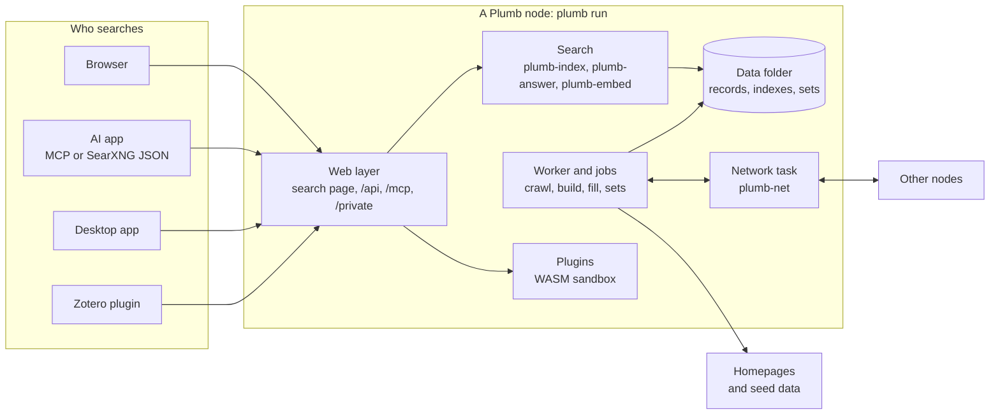
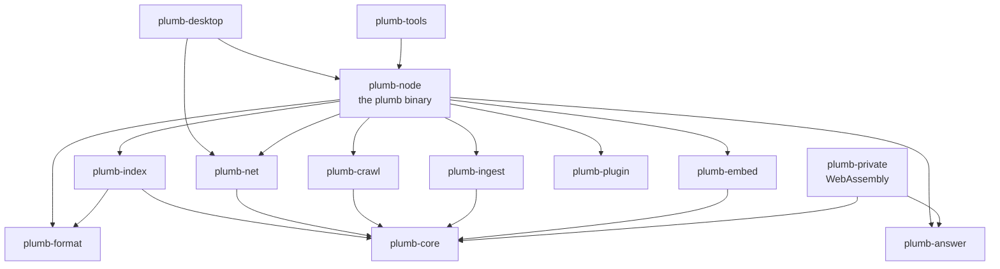
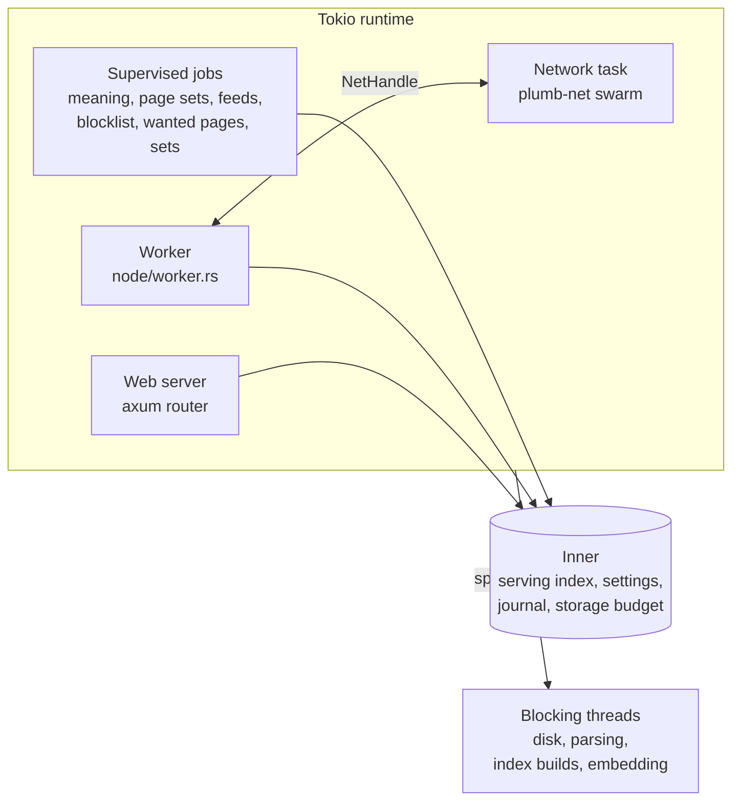
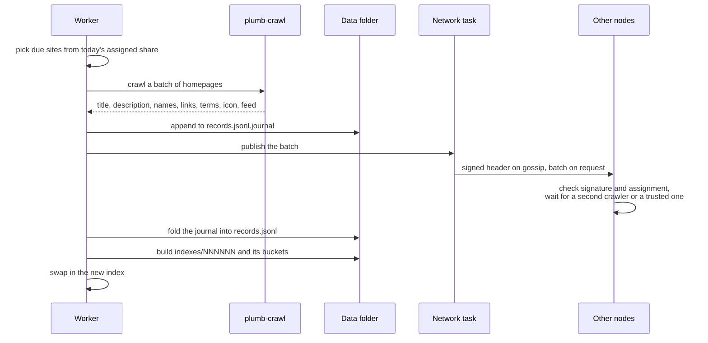
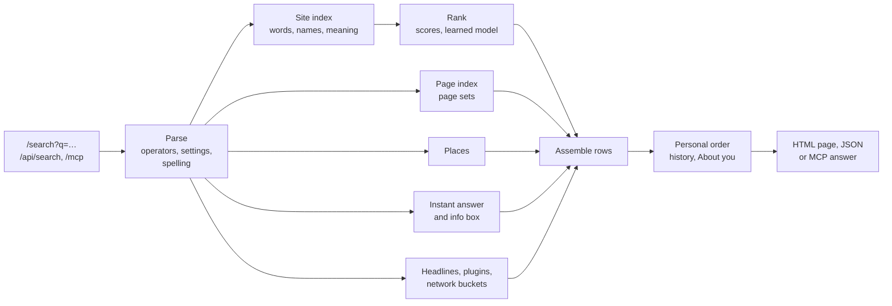

# Architecture

How Plumb Search is put together: the programs it ships, the crates they are built from, what runs inside a node, and how a crawl and a search travel through it. Read this first if you want to change the code. Each crate has its own README with the detail; this page is the map.

- [The big picture](#the-big-picture)
- [What ships](#what-ships)
- [The crates](#the-crates)
- [Inside a node](#inside-a-node)
- [Life of a crawl](#life-of-a-crawl)
- [Life of a search](#life-of-a-search)
- [Data on disk](#data-on-disk)
- [Design rules](#design-rules)
- [Where to start reading](#where-to-start-reading)

## The big picture

A **node** is one running `plumb run`. It keeps its own index of sites, pages and places, crawls homepages, and serves a search page, a JSON API and an MCP server. Nodes can join a peer-to-peer network to share crawls, project data and searches. plumbsearch.org is one such node with a public website in front of it.

Three ideas shape the design:

- **Sites, not every page.** For each site a node keeps its names, homepage title and description, key terms, the words other sites link to it with, and its Wikidata facts. Single pages come from open **page sets** (Wikipedia, GitHub, Stack Exchange, packages, books, papers and more), from inner pages a node's own searches asked for, and places from OpenStreetMap. That is what lets an ordinary computer hold a useful index. See [search.md](search.md).
- **Shared crawling, checked.** Each node crawls a random daily share of all sites, signs what it saw, and passes it on. Other nodes take a crawl in only when they can check it: a trusted crawler, or two crawlers that agree. See [network.md](network.md).
- **The searcher's data stays on the node.** History, About you and what clicks teach stay on the node that serves the browser. Network searches send hashed buckets, never the query, and pages load nothing from other servers. See [searching.md](searching.md#privacy) and [private-search.md](private-search.md).

## What ships

| What | Built from | Runs where |
| --- | --- | --- |
| `plumb`, the node | [plumb-node](../crates/plumb-node/README.md) and the crates it links | Servers, homelabs, the Docker image, inside the desktop app |
| `plumb-tools` | [plumb-tools](../crates/plumb-tools/README.md) | The machine that builds the project's data, and anyone measuring ranking. A node never runs it |
| Private search page | [plumb-private](../crates/plumb-private/README.md), compiled to WebAssembly | The searcher's browser, served by the node at `/private` |
| Desktop app | [plumb-desktop](../crates/plumb-desktop/README.md), a Tauri window | Windows, macOS and Linux, with the node in the same process |
| Plugins | [plumb-plugin](../crates/plumb-plugin/README.md) and [`plugins/`](../plugins) | Inside a node, in a WebAssembly sandbox, only where the owner installs them |
| Docker image | [`Dockerfile`](../Dockerfile): `plumb` with the private search page built in | `ghcr.io/sueheir/plumb-search`, see [docker.md](docker.md) |
| Zotero plugin | [`zotero/`](../zotero/README.md), JavaScript | Zotero, talking to a node's `/api/search` |
| plumbsearch.org | [`site/`](../site/README.md): Caddy in front of a node | The public server |

The node is kept small enough to read: anything only an operator or an eval needs lives in `plumb-tools` instead, so it never ships in the image.

## The crates

`plumb-tools` also links every crate `plumb-node` does. `plumb-e2e` tests the Docker image from outside and links only plumb-core and plumb-private.

| Crate | What it is |
| --- | --- |
| [plumb-core](../crates/plumb-core/README.md) | The site record, text normalization, domain helpers, the link score, bucket keys, and the shared lock and storage helpers |
| [plumb-format](../crates/plumb-format/README.md) | The `plumb-set/1` data format: items, refs, canonical URLs, the denylist and signed set manifests |
| [plumb-answer](../crates/plumb-answer/README.md) | Instant answers worked out from the query: sums, units, currencies, time, holidays, weather |
| [plumb-ingest](../crates/plumb-ingest/README.md) | Loads the seed data (Tranco, Common Crawl, Wikidata, Wikipedia) into site records |
| [plumb-crawl](../crates/plumb-crawl/README.md) | The polite homepage crawler and what it reads from a page |
| [plumb-index](../crates/plumb-index/README.md) | The Tantivy indexes of sites, pages and places, spelling, and ranking |
| [plumb-embed](../crates/plumb-embed/README.md) | Site text, the embedding model and the vectors file for search by meaning |
| [plumb-net](../crates/plumb-net/README.md) | The libp2p network: crawl batches, agreement, buckets and network search, signed sets, relaying |
| [plumb-plugin](../crates/plumb-plugin/README.md) | The kit for writing plugins in Rust |
| [plumb-node](../crates/plumb-node/README.md) | The `plumb` binary: the CLI, the long-running node, the web layer and MCP |
| [plumb-tools](../crates/plumb-tools/README.md) | The `plumb-tools` binary: set building and signing, fetchers, evals, ranking training |
| [plumb-private](../crates/plumb-private/README.md) | Private search in the browser |
| [plumb-desktop](../crates/plumb-desktop/README.md) | The desktop app |
| [plumb-e2e](../crates/plumb-e2e/README.md) | End-to-end tests of the Docker image |

## Inside a node

`plumb run` starts one Tokio runtime. Everything a node does runs on it as a few long-lived tasks that share one `Inner` (the node's state, in [`node.rs`](../crates/plumb-node/src/node.rs)):

**Startup**, in order (`start` in [`node.rs`](../crates/plumb-node/src/node.rs)): lock the data folder (`node.lock`), open the newest index that opens and remove leftovers of interrupted work, open the storage budget, load the denylist, start the web server, start the jobs searches need while the node joins the network (search by meaning and page sets), join the network, then start the worker and the remaining jobs. The page is served from the first moment; until an index exists it shows what the node is doing.

**The worker** ([`node/worker.rs`](../crates/plumb-node/src/node/worker.rs)) looks at what is on disk each turn and does the next piece of work, so a restart simply resumes:

1. No records: set up from a trusted node's sites, or else the Tranco list, and serve a quick first index.
2. Records other nodes sent waiting in `net/inbox.jsonl`: fold them in.
3. Over the storage limit, or topics changed: drop the least useful sites and rebuild.
4. No index, an index older than the records with no crawl round under way, or 2,000 records from other nodes since the last build (`REBUILD_AFTER_RECORDS`, at most every 30 minutes): build one.
5. Wikidata's official websites not fetched yet: fetch them and fold them in. After a quick start the first crawl goes first, so the node has something to share sooner.
6. Background updates off, outside the crawl hours, or a limit reached: wait.
7. Homepages left in a crawl round: crawl them, then rebuild.
8. A refresh due or asked for: start a round. Otherwise wait.

**Jobs** start through `supervise`, which starts a job again after it panics, waiting a minute at first and up to an hour as panics repeat. Each job checks `stopping()` in its loops. Jobs that can take a gigabyte or so of memory (page and place index builds, embedding rounds, taking another node's vectors) hold `one_big_job()` while they run, so a small server never runs two at once.

**The network task** is one libp2p swarm on its own task ([`plumb-net`](../crates/plumb-net/README.md)). It answers every peer, so it never waits on disk or a slow lock: such work goes to a blocking thread and comes back to the task as an `Answer`. The rest of the node talks to it through a `NetHandle`.

## Life of a crawl

- A crawl fetches the homepage, `robots.txt` and the site's icon, plus the feed of the best-ranked sites. It obeys robots.txt and refuses names that lead into private networks. Apart from crawls, a node follows a site's links a few hops toward inner pages its own searches wanted ([`wanted_pages.rs`](../crates/plumb-node/src/wanted_pages.rs)), fetched the same polite way.
- Results go to the journal as each batch finishes, so an interrupted crawl keeps what it fetched. The journal is folded into `records.jsonl` under `hold_records()`.
- Each index build writes a fresh numbered directory, opens it, and only then replaces the serving index. Searches already running finish on the old one.
- Another node's crawl counts only when its batch is signed by the crawler, the crawler was assigned that site that day, and a second crawler saw the same thing. Crawls from a node's trusted crawlers count at once. See [network.md](network.md#agreement-between-crawlers).

## Life of a search

The search page, `/api/search`, the SearXNG-style `/search?format=json` and the MCP `search` tool all go through the same assembly, so a person, a script and an AI app see the same results. Everything shown passes the denylist first. [search.md](search.md) follows one query through each step, including how ranking works and how to measure a change to it.

## Data on disk

Everything a node keeps is in its data folder (`--data`). The main parts:

| Path | What it holds |
| --- | --- |
| `records.jsonl` | One JSON line per site: what the node knows about it |
| `records.jsonl.journal` | Crawl results not yet folded into `records.jsonl` |
| `indexes/NNNNNN/` | The site index, with `buckets/` for other nodes' searches |
| `pages/` | Page set files and the page and place indexes |
| `sets/` | Signed sets taken from the network (`sets/plumb/<name>/`) |
| `net/` | The node key, signed batches, the inbox of other nodes' records, network state |
| `settings.json` | Settings changed on the panel |
| `model/`, `vectors.bin` | The embedding model and a vector of each site's text, for search by meaning |
| `icons/`, `news/`, `wanted/` | Site icons for results pages, recent headlines, inner pages searches wanted |
| `history/` | Search history and profiles, when the node keeps them |

The [plumb-node README](../crates/plumb-node/README.md) lists every file. Writes go through `plumb_core::storage`, so they are atomic and charged to the storage limit set on the panel.

## Design rules

The full list is in [CLAUDE.md](../CLAUDE.md), written for anyone (person or agent) changing node code. The reasons behind the main ones:

| Rule | Why |
| --- | --- |
| Std locks through `plumb_core::locks`, never held across `.await` or during file I/O | A tokio worker waiting on a lock stalls the searches on it, and a small server may have only two |
| Disk, parsing and heavy CPU in `spawn_blocking` | Async threads answer searches and peers |
| Long jobs through `supervise`, big ones under `one_big_job()` | A failed job restarts instead of ending silently, and three big jobs at once once ran plumbsearch.org out of memory |
| Files through `plumb_core::storage` | Atomic writes, and the storage limit stays honest |
| Cap sizes and counts before decoding anything from a peer, and check before keeping or passing on | One bad node must not cost the others memory or poison their index |
| Everything shown goes through the denylist | Takedowns apply everywhere at once |
| Pages built with `escape_html` and `safe_href`, no JavaScript, nothing from other servers | Searches stay private and pages stay safe |
| The wire and `plumb-format` only change in ways released nodes accept | Nodes upgrade at their own pace |
| Ranking changes go through the evals, and refactors leave frozen results identical | Results are the product |
| Functions under 150 lines, files under 3,000 | The node should stay small enough for one person, or one model, to read |

[`crates/plumb-tools/tests/conventions.rs`](../crates/plumb-tools/tests/conventions.rs) counts what node code should avoid and fails when a count goes up.

## Where to start reading

- **A search, end to end:** [`web/search.rs`](../crates/plumb-node/src/web/search.rs), then [`plumb-index`](../crates/plumb-index/README.md).
- **What a node does in the background:** [`node/worker.rs`](../crates/plumb-node/src/node/worker.rs) and `start_jobs` in [`node.rs`](../crates/plumb-node/src/node.rs).
- **What a homepage crawl reads:** [`plumb-crawl`](../crates/plumb-crawl/README.md).
- **What travels between nodes:** [`plumb-net`](../crates/plumb-net/README.md) and [network.md](network.md).
- **Every command:** `plumb --help` and `plumb-tools --help`, then [`cli.rs`](../crates/plumb-node/src/cli.rs) in each binary's crate.
