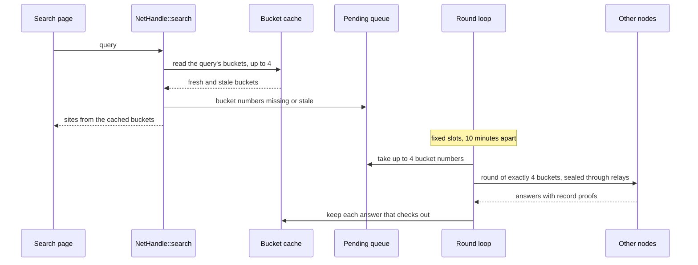

# Cache-first network search

How a node's network searches read a local bucket cache while scheduled background rounds fetch from other nodes, so that a search sends nothing at the moment someone searches. This page is for operators choosing `--round-minutes` and for contributors changing [rounds.rs](../crates/plumb-net/src/rounds.rs) or [cache.rs](../crates/plumb-net/src/cache.rs). Buckets, sealed relays and proofs are covered in [network.md](network.md#network-search).

## How a search and a round meet

With rounds on (the default), a network search never asks the network itself. It reads the cache and leaves a note of the buckets it lacked; the round loop fetches them at its next slot.

- **The search.** The query's keys pick up to 4 buckets, as in any network search. Buckets the cache holds are read and checked; the rest, and the stale ones, go into an in-memory queue as bucket numbers. The query itself is never stored. The queue holds at most 4,096 bucket numbers (`MAX_PENDING`), each once.
- **Waiting.** When the cache had nothing for the query and buckets are pending, the search waits until its deadline (4 seconds on the search page, `NETWORK_SEARCH_WAIT` in [web.rs](../crates/plumb-node/src/web.rs)) for a round to finish, then answers with what it has. It never starts a round, moves a deadline or uses up a later slot.
- **The round.** At each slot the loop takes up to 4 queued buckets and fills the round to exactly 4 with random buckets the cache does not hold fresh (`fill_round`), in random order. A round goes out even when nobody searched. Each bucket goes to 2 nodes in the search scope, sealed through relays, and the round waits up to 4 seconds (`ROUND_WAIT`) for answers.
- **Timing.** The first slot comes one interval after the node starts. A slot is skipped while the last round is still running, and missed slots are not made up, so there are no bursts. With no node to ask, the queue waits for the next slot. A bucket that still has no usable answer goes back to the end of the queue.
- **What the searcher sees.** The search page says when more results are waiting for the next background download, and when saved results may be out of date. `GET /api/network/search` counts `cached`, `pending` and `stale` buckets.

## Round settings

| Node | Rounds |
| --- | --- |
| `plumb run --network` and the Docker image | Every 10 minutes (`ROUND_EVERY`), about 150 a day |
| The desktop app | Every 30 minutes (`DESKTOP_ROUND_EVERY`), about 50 a day |
| `--round-minutes N` | Every N minutes |
| `--round-minutes 0` | Off: each search asks the network at once for the buckets it lacks, padded to 4 |

`GET /api/status` shows `network.rounds`: `every_secs`, `sent` and `answers`. It leaves out byte counts and searches, because the status page is public on a public node and they would hint at which buckets were fetched.

## What is cached

| | |
| --- | --- |
| Where | `DATA/net/bucket-cache/<bucket>.json`, one file per bucket |
| What | The whole bucket as each node answered it, with record proofs, and when it was fetched. Never a query or its results. |
| Which buckets | Those a search queued, the random ones that fill out a round, and those of searches with rounds off, all alike |
| Empty answers | Kept, so a search with no results does not fetch the same bucket again |
| No answer | Nothing is kept, and older data for that bucket stays |
| Fresh for | 12 hours (`FRESH_FOR`). After that a bucket is stale: still used and labeled, and queued for refresh. It survives restarts. |
| Limits | 4,096 buckets (`MAX_BUCKETS`, a quarter of the 16,384), 512 MiB in all (`MAX_CACHE_BYTES`), 16 MiB per bucket (`MAX_BUCKET_BYTES`). The oldest fetch goes first. |
| Proofs | Checked again at every read: keeping a bucket does not extend a signature's validity |
| Permissions | On Unix the folder is 0700 and its files 0600, because the set of buckets held can hint at interests |
| Emptied | When the node starts with a different search scope than the cache was filled under (`DATA/net/search-scope`) |

## What it hides, and what it does not

Rounds hide **when** a node's owner searches: with rounds on, a search sends nothing, and rounds of 4 buckets leave at fixed times whether or not anyone searched.

They do not hide:

- **The bucket numbers.** The answering node opens each sealed request and sees which bucket was asked for. Bucket hashes are public, so likely queries can be tested against the buckets seen; padding does not stop that.
- **Which buckets follow a search.** A queued bucket goes out in the next round, so the contents of rounds still depend on what was searched.
- **Traffic shape.** Answer size classes and which nodes are up still show.
- **A colluding relay and target.** Together they can tie an address to a bucket (see [network.md](network.md#network-search)).
- **Searches with `--round-minutes 0`**, which fetch at the moment of the search.
- **Searches on a node's own page.** A browser that searches a node sends its query to that node. Private search in the browser (`/private`) fetches its own buckets and is not scheduled by these rounds; see [private-search.md](private-search.md).

## Private information retrieval

PIR would hide even the bucket number from the answering node. No node runs it. plumb-tools' `pir` module ([pir/mod.rs](../crates/plumb-tools/src/pir/mod.rs)) builds an offline snapshot table of a node's buckets, one row per bucket, and [tools/pir-probe](../tools/pir-probe/README.md) measures single-server PIR on synthetic data ([measurements](reviews/measurements)). PIR would still not hide the asker's address, when it asks or how many requests it makes.

`plumb-tools storage --data DIR --json` measures a data folder without changing it, including the bucket tables' sizes and the padded row sizes a PIR table would need. See the [privacy review](reviews/privacy-security.md) for the evidence behind this page.
