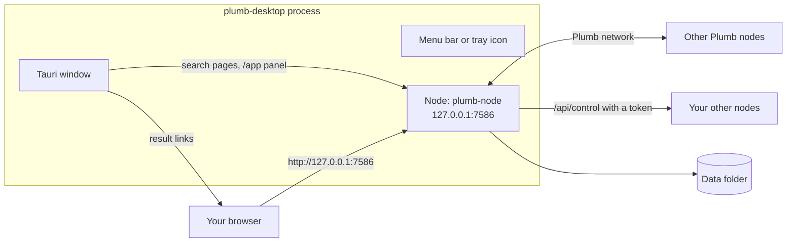

# The Plumb Search desktop app

The desktop app runs a Plumb Search node inside it and opens a window on its search page. Searches stay on your computer, and your browser can search it too, at `http://127.0.0.1:7586`. This page covers installing the app, what it does, where it keeps its data, controlling your other nodes from it, and building it from source.

- [Install](#install)
- [What the app does](#what-the-app-does)
- [First launch](#first-launch)
- [The panel](#the-panel)
- [Control your other nodes](#control-your-other-nodes)
- [Use Plumb as your browser's search engine](#use-plumb-as-your-browsers-search-engine)
- [Where data lives](#where-data-lives)
- [Troubleshooting](#troubleshooting)
- [Build it yourself](#build-it-yourself)

## Install

The installers for every release are on the [Releases page](https://github.com/SueHeir/plumb-search/releases/latest):

| System | Files |
| --- | --- |
| Windows (x64) | `plumb-search_<version>_x64-setup.exe`, `plumb-search_<version>_x64_en-US.msi` |
| macOS (Apple silicon and Intel) | `plumb-search_<version>_universal.dmg` |
| Linux (x86-64) | `plumb-search_<version>_amd64.deb`, `plumb-search-<version>-1.x86_64.rpm`, `plumb-search_<version>_amd64.AppImage` |

> [!NOTE]
> The installers are not code-signed, so each system warns you before it opens them the first time. The steps below say how to get past that. An app you build yourself opens without those warnings.

To update, install the new version over the old one; the data folder carries over.

### Windows

Run `plumb-search_<version>_x64-setup.exe`. It installs the app for your user account and needs no administrator rights. The `.msi` installs it for every user of the computer and asks for administrator rights; use one or the other.

Windows SmartScreen may stop the installer with "Windows protected your PC". Click **More info**, then **Run anyway**.

The app needs Microsoft Edge WebView2, which Windows 10 and 11 normally have; if it is missing, the installer downloads it. To uninstall, use **Settings > Apps > Installed apps > Plumb Search**.

### macOS

Open the `.dmg` and drag **Plumb Search** into **Applications**. The app is not notarized by Apple, so macOS refuses to open it the first time. Do one of these once:

- **macOS 14 and earlier:** in Finder, open **Applications**, right-click (or Control-click) **Plumb Search**, choose **Open**, then **Open** again.
- **macOS 15 and later:** open the app and click **Done** when macOS refuses. Then go to **System Settings > Privacy & Security**, scroll to the message about Plumb Search, click **Open Anyway** and confirm.
- **Any version, in Terminal:** remove the quarantine flag macOS put on the download. This also fixes "Plumb Search is damaged and can't be opened".

  ```sh
  xattr -dr com.apple.quarantine "/Applications/Plumb Search.app"
  ```

To uninstall, drag the app to the Trash, and delete the [data folder](#where-data-lives) if you no longer want the index.

### Linux

Each package adds **Plumb Search** to the application menu, and the command `plumb-desktop` starts it from a terminal.

- **Debian, Ubuntu and derivatives:** install the `.deb` with apt, which also installs the libraries it needs (WebKitGTK):

  ```sh
  sudo apt install ./plumb-search_<version>_amd64.deb
  ```

- **Fedora, RHEL, openSUSE:** install the `.rpm`. The package is not signed; if dnf refuses it, add `--nogpgcheck`.

  ```sh
  sudo dnf install ./plumb-search-<version>-1.x86_64.rpm
  ```

- **Any distribution:** the `.AppImage` runs without installing. Downloads lose their executable bit, so set it first. AppImages need FUSE 2; if it is missing (`libfuse.so.2` errors), install it (`libfuse2t64` on Ubuntu 24.04, `libfuse2` on older releases) or run the AppImage with `--appimage-extract-and-run`.

  ```sh
  chmod +x plumb-search_<version>_amd64.AppImage
  ./plumb-search_<version>_amd64.AppImage
  ```

Uninstall with `sudo apt remove plumb-search` or `sudo dnf remove plumb-search`, or delete the AppImage.

### Test builds

The **Desktop** workflow ([.github/workflows/desktop.yml](../.github/workflows/desktop.yml)) builds the installers for pull requests that change `crates/plumb-desktop`, for `v*` tags, and when run by hand (**Actions > Desktop > Run workflow**, then pick the branch). To get one, open the run's **Summary** page and download the artifact for your system (this needs a signed-in GitHub account), then unzip it:

| Artifact | Contents |
| --- | --- |
| `plumb-search-windows-x64` | the `.exe` and `.msi` |
| `plumb-search-macos-universal` | the `.dmg` |
| `plumb-search-linux-x86_64` | the `.deb`, `.rpm` and `.AppImage` |

A `v*` tag also attaches the installers and the third-party notices to a draft release. The installers take their version from `version` in the root `Cargo.toml`, and the workflow fails a tag that does not match it.

## What the app does

The app ([crates/plumb-desktop](../crates/plumb-desktop)) is a [Tauri](https://v2.tauri.app) window around a node that runs in the same process: the same node `plumb run` starts, with the desktop profile.



- **The window** shows the node's search page, private search, history, your search profile and the panel. Result links and other sites open in your usual browser. The window has its own search profile; [Your profile on other computers](searching.md#your-profile-on-other-computers) says how to share one with a browser. The app defines no commands and grants no capabilities, so no page in the window can call into the app.
- **The node** listens on `127.0.0.1:7586`, so other computers cannot reach it. When another program has that port, the app takes a free one and says so; a browser search engine set up with 7586 then gets no answer until the port is free and the app starts again.
- **Closing the window** keeps the app running, so your browser's searches keep working. It stays in the menu bar on macOS and in the notification area on Windows and Linux. The icon's menu has **Open Plumb Search**, **Start at login** and **Quit Plumb Search**. With **Start at login** checked, the app starts in the background when you log in, without opening its window. Starting the app again while it runs brings its window back, and so does clicking its Dock icon on macOS.
- **The network.** The app joins the Plumb network through plumbsearch.org, on ports the system picks, with no port to forward. The panel's Network & privacy section turns it off.

## First launch

The window shows "Starting..." and then the search page. **The first launch needs an internet connection.** The node sets up from the network: it takes the 50,000 best-known sites from a node it trusts (plumbsearch.org's by default), with their names, ranks and Wikidata facts, and search is ready within minutes. The panel's overview then offers **Set up my node**, which asks how much more of the network's crawls to keep on this computer:

| Choice | Storage limit | Holds about |
| --- | --- | --- |
| Small | 500 MB | 100,000 of the best-known sites and 100,000 Wikipedia articles |
| Medium (recommended) | 2 GB | 400,000 sites and a million Wikipedia articles |
| Large | 8 GB | 1.5 million sites and every Wikipedia article |
| Everything | none | what the network has, as far as memory allows |

Until you choose, the node takes in nothing more from the network, though its own crawling goes on. The choice is the storage limit on the Resources page, which changes it later. When no trusted node answers within two minutes, the node downloads public seed data instead (the Tranco list of popular sites, then Wikidata's official websites) and keeps the best 250,000 sites.

From then on it crawls 2,000 homepages, then 1,000 more every 12 hours while the app runs. Search by meaning is on: it downloads a small model (about 130 MB) and takes site vectors from a node it trusts, or builds them. Later launches open straight to search, from the index of last time; searching works offline, and only setup and crawling need the internet.

The app has no proxy setting and fetches homepages directly, so on a network that reaches the internet only through a proxy, its crawls fail and the panel says so. If the node cannot start at all, for example because its data folder is not writable or the disk is full, the app shows the reason, the data folder and the log file, then quits.

## The panel

**Settings** in the window opens the node's panel, the same one a [Docker](docker.md) node serves at `/app`:

| Section | What it has |
| --- | --- |
| Overview | Search readiness, crawl progress, storage, downloads and peers, with "Try again now" after a failure |
| Search & browser | Browser setup, search by meaning, private search, plugins |
| Resources | Background crawling, the daily download and storage limits, the workload, crawl hours and pausing |
| Network & privacy | Joining the network, bootstrap and trusted nodes, popularity sharing, crawl agreement, relays |
| AI & plugins | The node's MCP and SearXNG addresses ([mcp.md](mcp.md), [local-llms.md](local-llms.md)) and its plugins |
| Remote control | Letting the app on another computer control this node (not useful for the app's own node, which other computers cannot reach) |
| Activity | The node's log in plain sentences, newest first: the last 300 entries, kept in `activity.jsonl` |
| Backup | Save, download and restore backups |
| About | Version, data folder, diagnostics and source code |

**Resources.** The app starts with a download limit of 500 MB a day (UTC) and a storage limit of 2 GB. The Workload choice sets the pace and both limits at once: Light (4 homepages at a time, 100 MB a day, 1 GB of disk), Balanced (the defaults: 16 at a time, 500 MB, 2 GB), Full (32 at a time, no limits) or Custom. "Only crawl between" keeps crawling to some hours of the computer's clock; the Crawling card has "Pause for an hour", "Pause until tomorrow" (06:00) and "Resume now". Once a day's downloads reach the limit, crawling pauses until the next day; over the storage limit, the node makes room as [Filling free space](network.md#filling-free-space) describes. Resource changes apply at once.

**Features.** Feature changes (the network, search by meaning) are saved in `features.json` and apply when the node starts: use **Restart to apply** in the banner, which restarts the node without quitting the app. Closing the window does not apply them.

**Backups** hold what cannot be downloaded again: the settings, the node's network identity and crawl credits, and the remote control files. Sites and the index are left out, since the node rebuilds them. The newest 10 are kept in `backups/` in the data folder. Restoring first saves the current files as a backup marked `before-restore`, then restarts the node. Backups hold the node's keys, so keep them private.

## Control your other nodes

The panel is also the control center for your other nodes, such as a Docker container or a homelab server. **This computer** is the app's own node; **+ Connect to a node** adds another:

1. On that node, turn remote control on: in its own panel (on its computer), open **Remote control** and click **Turn on and make a token**, or run `plumb remote-control on` there (for Docker, see [Control it from the desktop app](docker.md#control-it-from-the-desktop-app)). You get a token, shown once, and the fingerprint of the node's HTTPS certificate.
2. For a node on another computer, have it serve HTTPS with `--https-bind 0.0.0.0:8443`: the app sends the token only over HTTPS to anything but this computer. A node on this computer can use plain `http://127.0.0.1:<port>`.
3. In the app, click **+ Connect to a node** and enter the node's address (such as `https://192.168.1.20:8443`), the token and the fingerprint, and optionally a name.

The node then has its own entry next to **This computer**, with the same sections. Its forms change that node: resource settings at once, features after that node restarts. If it cannot be reached, or its token was replaced, its page says why and offers to try again, connect with a new token or forget it. Connecting also makes the two nodes trust each other's crawls, from their next start. Tokens are kept in `remote-nodes.json` in the app's data folder, readable only by you, and the app's node makes the requests, so the window never sees them. [remote-control-security.md](remote-control-security.md) has the rules that keep this safe.

## Use Plumb as your browser's search engine

The panel's **Add to Firefox** button opens Firefox on a page with the two clicks it takes (Firefox lets no page add a search engine by itself); without Firefox, the page opens in the default browser. Any browser can add Plumb by hand with the address `http://127.0.0.1:7586/search?q=%s`. Searches reach Plumb only while the app runs. [Add Plumb to your browser](searching.md#add-plumb-to-your-browser) has the steps for each browser.

## Where data lives

The node keeps its downloads, records, index and settings in the app's data folder, which the storage limit on the Resources page keeps in check:

| System | Data folder |
| --- | --- |
| Linux | `~/.local/share/io.github.sueheir.plumbsearch` (or under `$XDG_DATA_HOME`) |
| macOS | `~/Library/Application Support/io.github.sueheir.plumbsearch` |
| Windows | `%APPDATA%\io.github.sueheir.plumbsearch` (`C:\Users\<you>\AppData\Roaming\...`) |

The folder has the same layout as any node's ([The data folder and backups](running-a-node.md#the-data-folder-and-backups)): `records.jsonl` holds everything the node has learned, `records.jsonl.journal` the crawl results not yet folded into it, `indexes/` the search index, `seed/` the first downloads, and `features.json`, `settings.json` and `remote-nodes.json` your choices. To back up the records, copy `records.jsonl` and its journal together, with the app quit, so they match.

The window's web view keeps a cache of its own in `webview` under the app's cache folder (`~/.cache/io.github.sueheir.plumbsearch` on Linux, `%LOCALAPPDATA%\io.github.sueheir.plumbsearch` on Windows).

To start over, quit the app and delete the data folder; the next launch sets everything up again. Uninstalling the app leaves these folders in place. For a separate test node, set `PLUMB_DESKTOP_DATA_DIR` to another folder before starting the app.

## Troubleshooting

The app writes a log of what it and its node do to `plumb.log` in its log folder. Each start moves the previous run's log to `plumb.log.1`, so when something goes wrong, send `plumb.log`, and `plumb.log.1` too if the app has been started again since.

| System | Log folder |
| --- | --- |
| Linux | `~/.local/share/io.github.sueheir.plumbsearch/logs` (or under `$XDG_DATA_HOME`) |
| macOS | `~/Library/Logs/io.github.sueheir.plumbsearch` (in Finder, **Go > Go to Folder**) |
| Windows | `%LOCALAPPDATA%\io.github.sueheir.plumbsearch\logs` |

- **Watch the log as it is written:** start the app from a terminal, `plumb-desktop` on Linux or `"/Applications/Plumb Search.app/Contents/MacOS/plumb-desktop"` on macOS. Set `RUST_LOG=debug` for more detail, in the terminal and the log file alike.
- **Blank or white window on Linux** (seen with some graphics drivers and in virtual machines): start the app with `WEBKIT_DISABLE_DMABUF_RENDERER=1 plumb-desktop`.
- **Quitting:** choose **Quit Plumb Search** from the icon in the menu bar or notification area (or **Quit** in the macOS app menu). The node stops at its next safe point; an index build under way is finished first, so the app may keep running for up to a minute. Its files are never left half-written.
- **No icon in the notification area on Linux:** GNOME shows such icons only with the AppIndicator extension, which Ubuntu includes. Without it, start the app again to bring its window back, and quit with `pkill plumb-desktop`, which stops the node cleanly too.

## Build it yourself

The app is the `plumb-desktop` crate. A plain `cargo build` or `cargo test` at the repository root leaves it out, since it needs GUI libraries; build it with `-p plumb-desktop` or with the Tauri CLI.

### Prerequisites

- Rust, from [rustup.rs](https://rustup.rs).
- The Tauri CLI, the version the release workflow uses: `cargo install tauri-cli --version 2.12.1 --locked`.
- **Linux:** a C toolchain and the WebKitGTK development files. On Debian and Ubuntu (the release build installs the last four on Ubuntu 22.04):

  ```sh
  sudo apt install build-essential pkg-config libwebkit2gtk-4.1-dev libappindicator3-dev librsvg2-dev patchelf
  ```

  On Fedora, `sudo dnf install webkit2gtk4.1-devel librsvg2-devel` and `sudo dnf group install c-development`; on Arch, `sudo pacman -S --needed base-devel webkit2gtk-4.1 librsvg`. Tauri's [prerequisites page](https://v2.tauri.app/start/prerequisites/) covers other distributions.
- **macOS:** the Xcode command line tools: `xcode-select --install`.
- **Windows:** the Microsoft C++ Build Tools with the "Desktop development with C++" workload, and WebView2. The TLS library's crypto code (aws-lc-sys) is assembled with [NASM](https://www.nasm.us); without NASM, set `AWS_LC_SYS_PREBUILT_NASM=1` to use the prebuilt objects it ships with (`$env:AWS_LC_SYS_PREBUILT_NASM = "1"` in PowerShell).

### Private search's WebAssembly first

Private search runs a WebAssembly module ([crates/plumb-private](../crates/plumb-private)) that the node embeds when it is compiled. Build it first, from the repository root, with the same `wasm-bindgen` version as the crate:

```sh
rustup target add wasm32-unknown-unknown
cargo install wasm-bindgen-cli --version 0.2.108 --locked
cargo build --locked -p plumb-private --target wasm32-unknown-unknown --profile wasm
wasm-bindgen --target web --no-typescript --out-dir target/private \
    target/wasm32-unknown-unknown/wasm/plumb_private.wasm
```

The node takes the files from `target/private/`, or from the folder in `PLUMB_PRIVATE_DIR`. Without them the app still builds, but without private search ([private-search.md](private-search.md)).

### Run and build

From `crates/plumb-desktop`:

```sh
cargo tauri dev     # build and run, with the log in the terminal
cargo tauri build   # build the installers into <repository>/target/release/bundle/
```

`cargo tauri build` makes every installer the system supports; `--bundles` picks some, as the release workflow does (`--bundles deb,rpm,appimage`, `--bundles nsis,msi`). For a Mac app that runs on both Apple silicon and Intel, add both Rust targets; the installer lands in `target/universal-apple-darwin/release/bundle/`:

```sh
rustup target add aarch64-apple-darwin x86_64-apple-darwin
cargo tauri build --target universal-apple-darwin --bundles app,dmg
```

To your system, a local build and an installed copy are the same app: they share the data folder, and starting one while the other runs only brings the running one's window to the front. Quit the installed app before `cargo tauri dev`.

On Windows, building the `.msi` runs the WiX toolset, which Tauri downloads the first time. If that step fails, check that the **VBSCRIPT** optional feature is enabled in Windows settings, or build only the NSIS installer with `--bundles nsis`.

To check the app's code as CI does: `cargo clippy -p plumb-desktop --all-targets -- -D warnings` and `cargo test -p plumb-desktop`.

### The app icon

The icon is drawn in `crates/plumb-desktop/app-icon.svg`. After changing it, render it to a 1024x1024 PNG and regenerate the platform icons in `icons/`:

```sh
cd crates/plumb-desktop
cargo run --example render_icon   # writes app-icon.png
cargo tauri icon app-icon.png
rm -r icons/android icons/ios      # mobile icons, not used
```

Keep `frontend/brand.svg` and `site/public/favicon.svg` in step with it. The node's search pages and OpenSearch description embed the generated `icons/32x32.png`.

### Preview the pages without a node

From the repository root, `cargo run -p plumb-node --example ui_preview` serves the real web routes at `http://127.0.0.1:54101/`, with a few made-up search results and a temporary data folder. It starts no crawler or network and never opens the app's data. Private search and connecting to other nodes need a real node.
