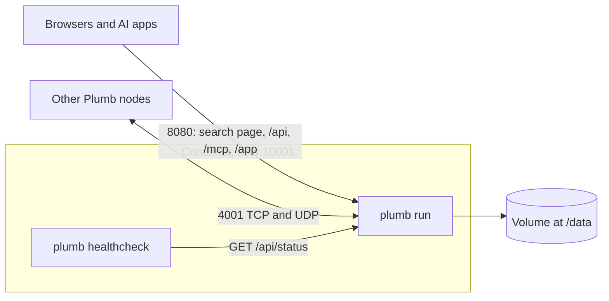

# Running Plumb Search with Docker

The Docker image runs a Plumb Search node on a server or homelab machine: the search page and its JSON API on port 8080, the Plumb network on port 4001, and everything it keeps in one volume at `/data`. This page covers running it, its settings, updates, backups, proxies and what it needs. For what a node does and every `plumb run` flag, see [running-a-node.md](running-a-node.md).

- [Quick start](#quick-start)
- [The image](#the-image)
- [First start](#first-start)
- [Ports and the network](#ports-and-the-network)
- [Settings](#settings)
- [Control it from the desktop app](#control-it-from-the-desktop-app)
- [Behind a reverse proxy or tunnel](#behind-a-reverse-proxy-or-tunnel)
- [Data and backups](#data-and-backups)
- [Updating](#updating)
- [Health checks](#health-checks)
- [Memory and disk](#memory-and-disk)
- [Building the image yourself](#building-the-image-yourself)

## Quick start

From a copy of this repository, or of just its [docker-compose.yml](../docker-compose.yml):

```sh
docker compose up -d
docker compose logs -f
```

Then open `http://<server>:8080` (`http://localhost:8080` on the same machine). Until the first index is ready, the page shows what the node is doing and how far it has got.

Without Compose:

```sh
docker run -d --name plumb --init --restart unless-stopped --stop-timeout 300 \
  -p 8080:8080 -p 4001:4001/tcp -p 4001:4001/udp \
  -v plumb-data:/data ghcr.io/sueheir/plumb-search:latest
```

`--stop-timeout 300` gives the node time to finish an index build when it is stopped (Compose sets the same with `stop_grace_period: 5m`). Stopping sooner is safe, but the build is lost and done again later.

The search page has no login: anyone who can reach the port can search. To use another port, change the number on the left (`"80:8080"`). To keep the page to the machine itself, for example behind a reverse proxy, publish it as `"127.0.0.1:8080:8080"`.

## The image

`ghcr.io/sueheir/plumb-search` is built from the [Dockerfile](../Dockerfile) for `linux/amd64` and `linux/arm64` (64-bit Raspberry Pi OS included).

| Tag | What it is |
| --- | --- |
| `latest` | The newest release |
| `0.3.1`, `0.3` | A release by version; from 1.0 on, the major version (`1`) too |
| `main` | The main branch, unreleased changes included |
| `sha-<commit>` | One build of one commit |



| | |
| --- | --- |
| Entry point | `plumb` |
| Default command | `run --data /data --bind 0.0.0.0:8080 --network --search-by-meaning` |
| User | `plumb`, uid and gid 10001 |
| Volume | `/data`, also the working directory |
| Ports | 8080 (web), 4001 TCP and UDP (network) |
| Health check | `plumb healthcheck` every 60 s |

The default command runs the server profile: it keeps 1,000,000 sites, crawls 10,000 homepages once the first index is built and 5,000 more every hour. `--network` joins the Plumb network; `--search-by-meaning` downloads a small embedding model (about 130 MB) so searches that describe a site ("electric car maker") find it.

## First start

A new node in the network sets up from the sites of a node it trusts (plumbsearch.org's by default): it takes the best 50,000 first, builds an index from them, and takes in the rest, up to `--sites`, in the background. When no trusted node answers within two minutes, or with `--seed-from-outside`, it downloads public seed data instead: the Tranco list of popular sites, then Wikidata's official websites (and Common Crawl ranks with `--cc-release`). Either way the container needs internet access.

If a download fails, the page shows the error and when the node will try again: after 10 minutes, then twice as long after each failure in a row, up to every 6 hours. `docker compose logs -f` shows the same.

## Ports and the network

| Port | What it is | Publish it? |
| --- | --- | --- |
| 8080 | The search page, `/api/...`, `/mcp` and the panel at `/app` | Yes, to reach the node |
| 4001 TCP and UDP | Node-to-node connections, set by `--p2p-port` | Optional |

The node joins the network by dialing out: it connects to the network's first nodes on plumbsearch.org, finds other nodes through them (and any on your own network by itself), crawls the share of sites the network assigns it, and shares those crawls, signed. Nothing needs forwarding on the router; other nodes reach it through a relay when they cannot reach it directly. Forwarding port 4001, TCP and UDP, to this machine lets them connect directly instead. [network.md](network.md) has how the network works.

Within a minute of starting, the log says `joined the Plumb network as 12D3Koo...`, and `http://<server>:8080/api/status` shows the node under `network`: its `peer_id`, `connected_peers` and the crawl batches it has published and received. If it cannot reach any node, `network.problem` says why. To keep a node to itself, leave `--network` out of its command.

## Settings

Settings are flags of `plumb run`. A command you set replaces the default one whole, so keep `--data /data` and `--bind 0.0.0.0:8080`, and `--network` and `--search-by-meaning` unless you want them off. In `docker-compose.yml`:

```yaml
services:
  plumb:
    command: ["run", "--data", "/data", "--bind", "0.0.0.0:8080", "--network", "--search-by-meaning", "--sites", "250000"]
```

Apply it with `docker compose up -d`. With `docker run`, put the command after the image name. `docker run --rm ghcr.io/sueheir/plumb-search:latest run --help` lists every flag, and [Flags](running-a-node.md#flags) explains them; these are the ones Docker users change most:

| Flag | Default | What it does |
| --- | --- | --- |
| `--sites N` | 1,000,000 | How many of the best-ranked sites to set up with. First start only. |
| `--profile desktop` | `server` | Smaller defaults: 250,000 sites, 2,000 homepages at first and 1,000 more every 12 hours |
| `--initial-crawl N` | 10,000 | Homepages to crawl once the first index is built; `0` for none |
| `--refresh-hours H` | 1 | Hours between refreshes, which crawl more homepages and rebuild the index |
| `--crawl-per-refresh N` | 5,000 | Homepages crawled per refresh |
| `--no-refresh` | | Keep the index as the initial crawl leaves it |
| `--seed-from-outside` | | Download the seed data even in the network. First start only. |
| `--cc-release NAME` | none | Also take ranks from a Common Crawl web graph release. First start only. |
| `--https-bind ADDR` | none | Also serve HTTPS, for [remote control](#control-it-from-the-desktop-app) |
| `--crawl-only` | | Crawl for the network and build no search index, for a small server nobody searches. Leave out `--search-by-meaning` with it. |
| `--blackhole` | | Collect all the data the network offers, for a server with disk and memory to spare |
| `--mcp-read-pages`, `--mcp-findings` | | Offer `read_page` or findings to MCP clients on other computers ([mcp.md](mcp.md#reading-pages)) |
| `--use-system-proxy` | | Crawl through the proxy in `HTTPS_PROXY` (see [below](#outgoing-proxy)) |
| `--p2p-port PORT` | 4001 | The network port; publish the same one |

"First start only" flags apply while `/data/records.jsonl` does not exist yet. To change them later, start over with an empty volume.

**The panel.** `/app` is the same panel as the desktop app's, with Overview, Search & browser, Resources, Network & privacy, AI & plugins, Remote control, Activity and About. It changes settings only from the computer the node runs on, and a browser reaching the container through Docker's port does not count as that, so in Docker the panel is read-only. To change what the panel would:

- control the node from the [desktop app](#control-it-from-the-desktop-app), whose forms change it;
- for features (network, search by meaning, trusted and bootstrap nodes), stop the node and write `/data/features.json`, which takes precedence over the feature flags at the next start. Its `bootstrap` list replaces the default one, so keep the network's first nodes in it:

  ```json
  {
    "network": true,
    "search_by_meaning": true,
    "bootstrap": [
      "/dns4/plumbsearch.org/tcp/4001/p2p/12D3KooWJ2UWUBsxmPfXTfHa8cBBmzifa6kj5pFZKfJXYNQyJ69a",
      "/ip4/198.211.114.63/tcp/4001/p2p/12D3KooWJ2UWUBsxmPfXTfHa8cBBmzifa6kj5pFZKfJXYNQyJ69a"
    ]
  }
  ```

  Delete the file to go back to the flags alone;
- for resource limits (storage, daily downloads, workload), stop the node and edit `/data/settings.json`, such as `"storage_limit_mb": 20000`.

**Logs.** The log goes to the container log at the `info` level. Set `RUST_LOG` to change that:

```yaml
    environment:
      RUST_LOG: debug
```

### Outgoing proxy

If the server reaches the internet only through a proxy, pass its address in the usual variables and add `--use-system-proxy` to the command:

```yaml
services:
  plumb:
    command: ["run", "--data", "/data", "--bind", "0.0.0.0:8080", "--network", "--search-by-meaning", "--use-system-proxy"]
    environment:
      HTTPS_PROXY: http://proxy.example.com:3128
      HTTP_PROXY: http://proxy.example.com:3128
```

`NO_PROXY` lists hosts to reach directly. The seed downloads use these variables in any case, but without `--use-system-proxy` the node fetches homepages directly, so behind such a proxy every crawl fails and `/api/status` says the network seems to be down. Through a proxy, the crawler cannot check that a site's name leads to a public address, so use a proxy that refuses private addresses, or one that reaches nothing you want kept private.

## Control it from the desktop app

The [desktop app](desktop.md) can show and change this node's settings: its forms change resource limits at once and save features for the next start (`docker compose restart`). [remote-control-security.md](remote-control-security.md) has how it is kept safe.

1. **Turn remote control on**, on the node's host. It prints a token, once, and the fingerprint of the node's HTTPS certificate:

   ```sh
   docker compose exec plumb plumb remote-control on   # with Compose
   docker exec plumb plumb remote-control on           # with docker run --name plumb
   ```

2. **From another computer, serve HTTPS.** The app sends the token only over HTTPS to anything but its own computer. Add `--https-bind 0.0.0.0:8443` to the command and publish the port (`-p 8443:8443`, or `"8443:8443"` under `ports`). The node makes its own certificate the first time and keeps it in `/data`. From the same computer as the container, skip this step and use `http://127.0.0.1:8080`.
3. **Connect.** In the app, choose **+ Connect to a node** and enter the address (such as `https://192.168.1.20:8443`), the token and the fingerprint. The app then trusts only that certificate at that address.

The token can read the node's status and change its settings, features and refreshes, nothing else. It works only from the host, local networks (Docker's own included) and Tailscale, straight to the node; requests from public addresses, and through a reverse proxy that adds a forwarding header, are refused. `plumb remote-control off` turns it off, `plumb remote-control status` says which it is and prints the fingerprint again, and `on` again replaces the token. Each takes effect at once.

## Behind a reverse proxy or tunnel

A few things are kept to the computer Plumb runs on: changing settings on the panel, plugin buttons, and the MCP tools that fetch or keep things for your AI apps (`read_page`, findings, and sharing findings with other nodes). Plumb counts a request as local only when all three hold:

- it connects from the machine itself (a loopback address such as `127.0.0.1` or `::1`),
- it was sent to a local name (`localhost` or a name under it, a `127.x.x.x` address or `[::1]`), and
- it has no `Forwarded`, `X-Forwarded-For` or `X-Real-IP` header.

A proxy or tunnel on the same machine passes the first test for everyone it lets in, so it must fail one of the other two:

- **Caddy and Traefik** add `X-Forwarded-For` and keep the original `Host` by themselves. Nothing to do.
- **nginx** does neither by default: `proxy_pass http://127.0.0.1:8080;` sends `Host: 127.0.0.1:8080` and no forwarding header, so every visitor looks like you. Add these lines (the browser search address needs `Host` and `X-Forwarded-Proto` anyway):

  ```nginx
  location / {
      proxy_pass http://127.0.0.1:8080;
      proxy_set_header Host $host;
      proxy_set_header X-Forwarded-For $proxy_add_x_forwarded_for;
      proxy_set_header X-Forwarded-Proto $scheme;
  }
  ```

- **Tunnels** (Cloudflare Tunnel, Tailscale Funnel, ngrok) need no port forwarded on the router, but they still put the node on the internet, and they run on the machine itself. Cloudflare Tunnel passes on the original `Host` and adds `X-Forwarded-For`, so it is safe as it comes, unless set to rewrite `Host` to `localhost` (its `httpHostHeader` setting). For others, run the check below.

To check, open `https://<your domain>/app` from another network, such as a phone off Wi-Fi: the settings must show as read-only. A node only your own computers reach, at home or over a VPN, is fine either way.

The search address the node offers browsers, for their list of search engines ([Add Plumb to your browser](searching.md#add-plumb-to-your-browser)), is built from the address the browser reached it at, so a proxy must pass on the original `Host`, and send `X-Forwarded-Proto: https` when it serves HTTPS. Remote control through a proxy is refused unless it was turned on with `--allow-public` ([remote-control-security.md](remote-control-security.md#who-may-use-the-token)).

## Data and backups

Everything is in the named volume `plumb-data`, mounted at `/data`. The main files:

| Path | What it holds |
| --- | --- |
| `records.jsonl` | Every site the node knows, one JSON line each |
| `records.jsonl.journal` | Crawl results not yet folded into `records.jsonl` |
| `indexes/000001/`, ... | Search index builds; the newest is searched |
| `seed/` | First-start downloads; may be deleted once `records.jsonl` exists |
| `net/` | The network side: the node's key (`node.key`), crawl credits, crawl batches |
| `settings.json`, `features.json` | Resource settings and feature choices |
| `remote-control.json`, `remote-control-*.der` | Remote control's token hash and HTTPS certificate |

[The data folder and backups](running-a-node.md#the-data-folder-and-backups) has the rest. **Mount the volume at `/data` itself**, not at an index directory or a file inside it: the node replaces those by renaming, and a mount point cannot be renamed.

To keep the data in a host directory instead, bind-mount it at `/data`, after giving the directory to the container's user:

```sh
mkdir plumb-data && sudo chown 10001:10001 plumb-data
```

```yaml
    volumes:
      - ./plumb-data:/data
```

**Backups.** What a node cannot download again is small: `settings.json`, `features.json`, its identity and crawl credits in `net/node.key` and `net/credits/`, and the remote control files. The sites and the index it rebuilds by itself, from the network or the seed data, which takes time. To keep the records too, copy the journal first and then `records.jsonl`, so a journal folded in between the two copies is not missed:

```sh
docker compose cp plumb:/data/net/node.key .
docker compose cp plumb:/data/net/credits .
docker compose cp plumb:/data/records.jsonl.journal .
docker compose cp plumb:/data/records.jsonl .
```

A node that starts with a `records.jsonl` in `/data` skips the seed downloads and reads a journal next to it, so the same files start a new installation. With `net/node.key` it is the same node in the network, so run only one copy. `docker compose down -v` deletes the container together with the volume and everything in it.

## Updating

```sh
docker compose pull
docker compose up -d
```

The data stays in the volume. Put a version tag in `docker-compose.yml` instead of `latest` to update only when you choose. `docker image prune` removes the images that were replaced.

With `docker run`, pull the image, then replace the container:

```sh
docker pull ghcr.io/sueheir/plumb-search:latest
docker stop plumb && docker rm plumb
docker run -d --name plumb ...   # the same command as before
```

## Health checks

`http://<server>:8080/api/status` reports what the node is doing as JSON (`phase` is `setting_up` or `ready`), which suits uptime monitors. The image's health check runs `plumb healthcheck` every 60 seconds (10 seconds to answer, after a 120-second start period). It asks `/api/status` on `127.0.0.1:8080` and succeeds while the node answers, setting up included, so `docker ps` shows the container as `healthy`. If your command binds another port, override the check:

```yaml
    healthcheck:
      test: ["CMD", "plumb", "healthcheck", "--url", "http://127.0.0.1:9090"]
```

## Memory and disk

These come from the estimates the node itself plans with ([node/fill.rs](../crates/plumb-node/src/node/fill.rs), [web/setup.rs](../crates/plumb-node/src/web/setup.rs)).

- **Memory.** Memory peaks while the node builds an index: a build of a million sites peaks at about 2.2 GB, and the node plans with 2.5 KB a site (`BUILD_BYTES_PER_SITE`) to leave room. Taking in sites from the network stops before a build would need more than half the machine's memory, or the container's memory limit when that is lower (`BUILD_MEMORY_PERCENT`): about 800,000 sites on a 4 GB server. With less memory, use a smaller `--sites` or `--profile desktop`. A `--crawl-only` node builds no index and needs about 500 bytes a site during a crawl round.
- **Disk.** A site takes about 5 KB of disk with its index entry and its vector for search by meaning, so a million sites take about 5 GB. The node writes a new index and a new `records.jsonl` before it deletes the old ones, so leave room for a second copy. A node in the network also keeps the crawl batches it sees for 35 days in `/data/net` (`--keep-batches-days`). A server has no storage limit by default; set `storage_limit_mb` (see [Settings](#settings)) to keep less.
- **CPU and bandwidth.** Index builds and crawls are bursts, and the node is idle between refreshes. `--refresh-hours` and `--crawl-per-refresh` set how much it crawls, and `download_limit_mb_per_day` in `settings.json` caps a day's downloads.

## Building the image yourself

From a checkout of the repository:

```sh
docker compose build    # or: docker build -t plumb-search .
```

Compose also builds the image when it cannot pull it. A local build is tagged `ghcr.io/sueheir/plumb-search:latest`, so a later `docker compose pull` replaces it with the published image.

The build needs BuildKit, the default builder since Docker 23. It compiles the dependencies in a layer of their own (with cargo-chef), so later builds recompile only the workspace's crates until `Cargo.lock` or a `Cargo.toml` changes. It also builds private search's WebAssembly and the third-party notices, which the image keeps in `/usr/share/doc/plumb-search/`. `--build-arg RUST_VERSION=1.99` pins the Rust toolchain; the default is the newest 1.x release.
