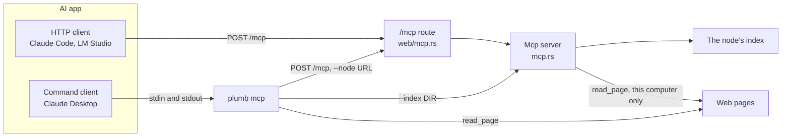
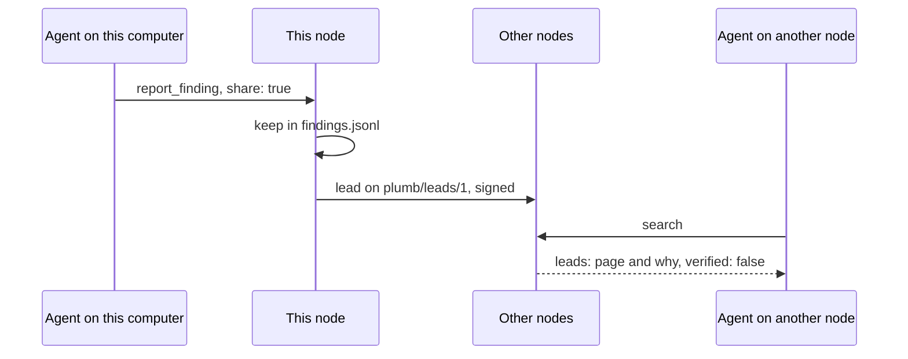

# Plumb for AI assistants (MCP)

Plumb answers AI assistants over the [Model Context Protocol](https://modelcontextprotocol.io): the real site for a name, whether an address is a look-alike, ordinary search results, package cards, Wikidata facts and, on your own computer, the text of a page. This page is for anyone adding Plumb to Claude or another MCP app, and for contributors changing the tools.

Every node serves MCP at `/mcp` on its web port: `https://plumbsearch.org/mcp`, `http://127.0.0.1:7586/mcp` for the [desktop app](desktop.md), `http://<server>:8080/mcp` for the [Docker image](docker.md). `plumb mcp` serves the same tools over stdin and stdout for apps that start a local command. Local AI apps (LM Studio, Open WebUI and others) have their own setup page: [local-llms.md](local-llms.md).

- [How it connects](#how-it-connects)
- [Set up](#set-up)
- [Tools](#tools)
- [Text or JSON answers](#text-or-json-answers)
- [Reading pages](#reading-pages)
- [Findings](#findings)
- [Sharing a finding with other nodes](#sharing-a-finding-with-other-nodes)
- [Limits](#limits)
- [Code and tests](#code-and-tests)

## How it connects



`plumb mcp` passes each message on to a node's `/mcp` (plumbsearch.org unless you give `--node`), or answers from an index on disk with `--index`. Either way it fetches pages for `read_page` itself, on your computer.

## Set up

### Claude Code

Pick the line for what you have on this computer.

| You have | Add Plumb with |
| --- | --- |
| The desktop app | `claude mcp add --transport http plumb http://127.0.0.1:7586/mcp` |
| The `plumb` command | `claude mcp add plumb -- plumb mcp` |
| A node in Docker | `claude mcp add plumb -- docker exec -i plumb plumb mcp --node http://127.0.0.1:8080` |
| None of them | `claude mcp add --transport http plumb https://plumbsearch.org/mcp` |

The first three offer `read_page` (see [Reading pages](#reading-pages)); plumbsearch.org does not. The Docker line assumes a container named `plumb`, as `docker run --name plumb` makes; under Compose, use the name `docker compose ps` shows. Running `plumb mcp` inside the container, rather than adding `http://<server>:8080/mcp`, makes its requests come from the node's own computer, so `report_finding` is offered too.

### Claude Desktop

With the `plumb` command installed, add it to `claude_desktop_config.json` (Settings, Developer, Edit Config) and restart Claude:

```json
{
  "mcpServers": {
    "plumb": {
      "command": "plumb",
      "args": ["mcp"]
    }
  }
}
```

Add `"--node", "http://127.0.0.1:7586"` to `args` to ask the desktop app's node, or `"--index", "/path/to/index"` to answer from an index on disk with no network at all. For a node in Docker on the same computer:

```json
{
  "mcpServers": {
    "plumb": {
      "command": "docker",
      "args": ["exec", "-i", "plumb", "plumb", "mcp", "--node", "http://127.0.0.1:8080"]
    }
  }
}
```

Plans with custom connectors can instead add `https://plumbsearch.org/mcp` under Settings, Connectors, Add custom connector. Connectors are reached from the internet, so give a public node's address there, not `127.0.0.1`.

### Other apps

Any MCP client that speaks Streamable HTTP can use a node's `/mcp` address, and any that starts local servers can run `plumb mcp`. Plain HTTP works too:

```sh
curl -s https://plumbsearch.org/mcp -H 'content-type: application/json' -d '{
  "jsonrpc": "2.0", "id": 1, "method": "tools/call",
  "params": { "name": "check_lookalike", "arguments": { "url": "paypal-login.us" } }
}'
```

### `plumb mcp` flags

| Flag | Default | What it does |
| --- | --- | --- |
| `--node URL` | `https://plumbsearch.org` | The node whose `/mcp` answers. |
| `--index DIR` | none | Answer from this index directory instead of a node. |
| `--country CODE` | none | Home country for answers from `--index`, such as `US`. |
| `--text-answers` | off | Answer with the short text alone (see [Text or JSON answers](#text-or-json-answers)). |

## Tools

The tools are defined in [mcp/tools.rs](../crates/plumb-node/src/mcp/tools.rs). They answer from the node's index, except `read_page`, which fetches a page, and `report_finding`, which keeps what an agent found. Where `read_page` is offered, `site_info` also reads the front page of a site the index has no title or description for, or the page or subdomain an address names. Every tool also takes an optional `country`: a two-letter code (`US`, `DE`) whose sites rank a little higher, or `any` for none. Without it the node's home country decides.

| Tool | Takes | Returns | Offered to |
| --- | --- | --- | --- |
| `official_site` | `name` ("PayPal", "chase login") | `domain`, `url`, `confidence` (`high`, `medium`, `low`), `why`, `alternatives`, `did_you_mean` | every client |
| `check_lookalike` | `url` (a URL or domain) | `verdict`, `lookalike` (true or false), `reasons`, and the site it `imitates` | every client |
| `search` | `query`; optional `limit`, `language`, `site`, `kind`, `after`, `before`, `order` | results and pages, with any instant answer, info box, package card, places and headlines | every client |
| `package` | `name` ("serde", "@types/node"); optional `registry` | the package's card: version and date, license, install command, docs, code | every client |
| `site_info` | `domain` | title, description, whether Wikidata lists it as official, how well known, country, pages about it | every client |
| `facts` | `subject` ("Australia"); optional `about` ("ceo"), `more_subjects` (up to 9) | Wikidata facts, each with its item and property to cite | every client |
| `read_page` | `url`; optional `start`, `max_chars`, `find`, `links`, `outline` | the page's text, or its headings | this computer (see [Reading pages](#reading-pages)) |
| `report_finding` | `query`, `url`, `why`, `answer`; optional `task`, `share`, `share_query` | that the finding was kept, and whether it was shared | this computer (see [Findings](#findings)) |

**`check_lookalike` verdicts.** `official` (Wikidata lists it), `known_site`, `little_known`, `lookalike` (the address borrows a far better-known site's name, or is a typo of it: `paypa1.com`, `wellsfargo.com.account-check.io`), `suspected` (another site's exact name on another ending or host, such as `paypal.co`, that Plumb can neither tie to that site's owner nor show to be an imitation) and `unknown` (Plumb does not have the site, which proves nothing). `lookalike` is `true` for both `lookalike` and `suspected`, so an app that checks it before entering credentials stops at either.

**`search`.** `limit` is 1 to 25; the default is 5, or 3 when the search has a direct answer such as a package card or an answer found before. `language` is a code such as `de` (default `en`), or `any`. `site` is one domain, the same as `site:` in the query. `kind` lists one kind of result alone, best first: `site` (sites without pages), `article` (Wikipedia), `question` (Stack Overflow and Stack Exchange), `package`, `repo` (GitHub), `book`, `paper` or `docs`. `after` and `before` (a year or `YYYY-MM-DD`) and `order` (`relevance` or `newest`) are for papers and need `kind` `paper` or none. The query takes the search page's operators (`site:github.com`, `"exact words"`, `-word`). On a node's own computer, `search` also lists answers found before and leads from other nodes (see [Findings](#findings)).

**`package`.** `registry` is one of `npm`, `pypi`, `crates`, `go`, `gem`, `composer`, `nuget` or `maven`. Cards come from the `packages` page set ([pages.md](pages.md#software-packages)).

**`facts`.** `about` narrows the answer to one kind: `capital`, `population`, `elevation`, `height`, `area`, `born`, `died`, `founded`, `founder`, `ceo`, `headquarters`, `currency`, `author`, `director`, `composer`, `creator`, `owner`, `birthplace`, `spouse`, `head-of-state`, `head-of-government`, `coordinates`, `atomic-number`, `orbital-period` or `radius`. Each answer has a `status`: `ok`, `unsupported_property`, `unresolved_entity`, `ambiguous_entity` (with up to 5 candidates to choose from) or `missing_enrichment` (the thing was found, but without the facts asked for). With `more_subjects`, the other answers follow in `more`, so a table of facts about several things takes one call.

## Text or JSON answers

Each tool answers twice: as short plain text, one line per result with its address, and as JSON in `structuredContent` for programs. Which one the model reads is up to the app, and some give it the JSON whenever there is any. The text is much shorter, and small local models have little room, so to have the model read the text alone:

- add `--text-answers` to `plumb mcp`, or
- add `?answers=text` to a node's address: `https://plumbsearch.org/mcp?answers=text` (quote it in a shell).

`?findings=off` (`http://127.0.0.1:7586/mcp?findings=off`) answers that client as if it were on another computer of a node without `--mcp-findings`: no findings or leads with search results, and no `report_finding`. It is for comparing an agent's searches with and without findings.

## Reading pages

`read_page` fetches a page from wherever it runs and returns its text, with headings, lists and tables marked in Markdown and menus, footers and scripts left out. It keeps nothing and adds nothing to the index. A long page comes in parts (`max_chars`, 200 to 30,000, default 6,000): the answer says where the next part starts (`next_start`), `find` jumps to the first place some words appear, and `outline` returns the page's headings with where each starts, so an agent can read only the section it needs. `links` lists the page's links too. Each answer carries `check_lookalike`'s verdict on where the page ended up.

It fetches pages the way the crawler does ([plumb-crawl's read.rs](../crates/plumb-crawl/src/read.rs)): host names must resolve to public addresses, and so must every redirect, so a page cannot send it to your router or a cloud metadata address. It reads HTML and text (plain text, Markdown, CSV, JSON), not PDFs or images, and reports a bot check ("Just a moment...") as an error rather than as the page.

**Who gets it.** Since a node fetches whatever it is asked to, it offers `read_page` only to AI apps on its own computer. A request counts as from this computer when all three hold:

- it connects from a loopback address (`127.0.0.1` or `::1`),
- it was sent to a local name (`localhost` or a name under it, a `127.x.x.x` address or `[::1]`), and
- it has no `Forwarded`, `X-Forwarded-For` or `X-Real-IP` header.

A reverse proxy on the same computer must therefore add one of those headers, as Caddy does, or everyone it passes on looks local; [Behind a reverse proxy or tunnel](docker.md#behind-a-reverse-proxy-or-tunnel) has the nginx lines. `plumb mcp` offers `read_page` whichever node it asks, because it fetches pages itself. Where the tool is not offered, `search` tells agents to open the page they need instead of naming a tool they lack.

For a home server whose AI apps run on other computers, start the node with `--mcp-read-pages` to offer `read_page` to every client. Clients on other computers then read pages on ports 80 and 443 only, each with a burst of 10 reads and then 20 a minute, and the node reads no more than 8 pages at a time for all of them together. The node still fetches what anyone asks from its own address, so do not use the flag on a node the internet can reach.

## Findings

Agents search for the same things again and again: the latest version of a library, the flag that fixes an error. `report_finding` lets an agent leave what it found for the next one: what it searched for (`query`), the page that answered it (`url`), why that page helped (`why`) and the answer itself (`answer`), with an optional `task`. The next `search` whose words match (the same words in any order, or most of them) lists up to 3 findings first, as `found_before`:

```text
Found before (searched "tokio latest version", 2 days ago): 1.47.1 Source: https://crates.io/crates/tokio (crates.io lists the newest release)
```

Searches say a lot about whoever makes them, so findings stay on the node, in `findings.jsonl` in its data folder (the newest 5,000), and only apps on the node's own computer can report or see them, even on a node run with `--mcp-read-pages`. A node run with `--mcp-findings` lets every client report and see findings, for a node whose address only people you trust have. A page that `check_lookalike` calls a look-alike is not kept. `plumb serve` and `plumb mcp --index` keep no findings. Delete the file to forget them all.

## Sharing a finding with other nodes

On a node in the network started with `plumb run --network --share-findings` (off by default), `report_finding` also takes `share: true`, and the finding goes to other Plumb nodes as a **lead**: a page an agent found useful for a search, for agents searching other nodes for the same thing. Both have to agree: the node's owner with the flag, the agent with each finding. Sharing stays with apps on the node's own computer even with `--mcp-findings`, since a lead goes out signed with the node's key.



A lead carries the page, why it helped (at most 300 characters), when it was reported and that it holds for 30 days. It never carries the answer or the task, and not the search either: each of the search's words goes as a number shared by many words, enough for another node to match its own searches but not to read the search back. Common words can still be guessed from their numbers, so share findings only for searches you would not mind being seen. `share_query: true` sends the search as typed too. Pages on a private network (`localhost`, `192.168.x.x`, `*.local`, `*.internal`), addresses with a user name or password, and pages the node's denylist takes off are not shared. A node shares at most 50 leads a day.

`search` on a node in the network lists up to 3 leads other nodes shared for the query as `leads`, after any `found_before` and apart from the results:

```text
Lead shared by 1 other Plumb node, 1 trusted (2 days ago; unchecked, read it first): https://tokio.rs/blog/2025-07-tokio-1-47 (the release notes list every change)
```

Each lead says which nodes reported it, how this node stands to each (`trusted`, `friend_of_friend` or `other`), and when, with `verified: false`: a lead is someone's report, not a crawl other crawlers checked, so an agent should read the page before relying on it. Only leads from nodes the node's search scope asks are listed ([Agreement between crawlers](network.md#agreement-between-crawlers)), never the node's own, and none whose page is a look-alike. Leads are listed only to apps on the node's own computer. How leads travel and how many a node keeps: [Shared findings](network.md#shared-findings).

## Limits

How `/mcp` is served ([web/mcp.rs](../crates/plumb-node/src/web/mcp.rs)):

- `POST /mcp` takes one JSON-RPC message of at most 64 KiB and answers with one JSON object; a notification gets `202 Accepted`. There is no event stream (`GET /mcp` answers 405) and no session. The server speaks protocol versions `2025-06-18`, `2025-03-26` and `2024-11-05`.
- No token: the tools show nothing the search page doesn't, and the tools that fetch or keep things are limited as above.
- A request from a web page of another site (an `Origin` other than the node's own host) is refused with 403.
- Tool calls are limited per client to a burst of 30, then 60 a minute (`BURST`, `PER_MINUTE`), answered with `429` and `Retry-After` beyond that. The client is the address the request comes from, or, when that is a proxy on the same computer or a private network (Caddy in front of a Docker container), the last address in its `X-Forwarded-For`. An IPv6 client counts as its /64 network. The counts are kept in memory only.
- While a node is still setting up its first index, tool calls answer with an error saying to try again in a few minutes.

## Code and tests

| File | What it does |
| --- | --- |
| [mcp.rs](../crates/plumb-node/src/mcp.rs) | The JSON-RPC server (`Mcp::handle`) and the dispatch of tool calls |
| [mcp/tools.rs](../crates/plumb-node/src/mcp/tools.rs) | Tool names, descriptions and argument schemas |
| [mcp/stdio.rs](../crates/plumb-node/src/mcp/stdio.rs) | `plumb mcp`: stdin and stdout, forwarding to a node, local `read_page` |
| [mcp/text.rs](../crates/plumb-node/src/mcp/text.rs) | The short text form of each answer |
| [web/mcp.rs](../crates/plumb-node/src/web/mcp.rs) | `POST /mcp`: origin check, rate limits, who counts as this computer |
| [findings.rs](../crates/plumb-node/src/findings.rs) | Keeping and matching findings |

The end-to-end tests run every tool over the fixture index, through `plumb mcp --index` and through `/mcp`:

```sh
cargo test -p plumb-node --test end_to_end mcp
```
