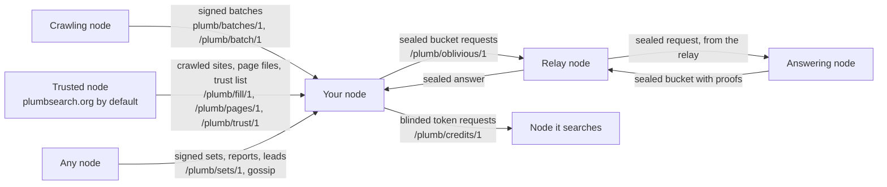
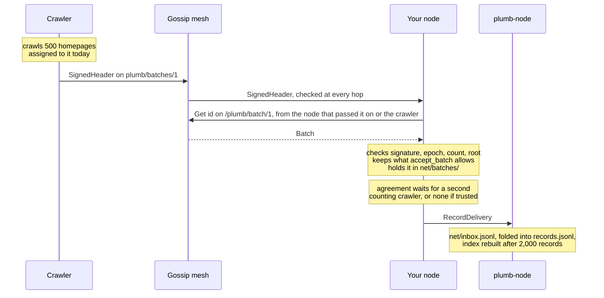
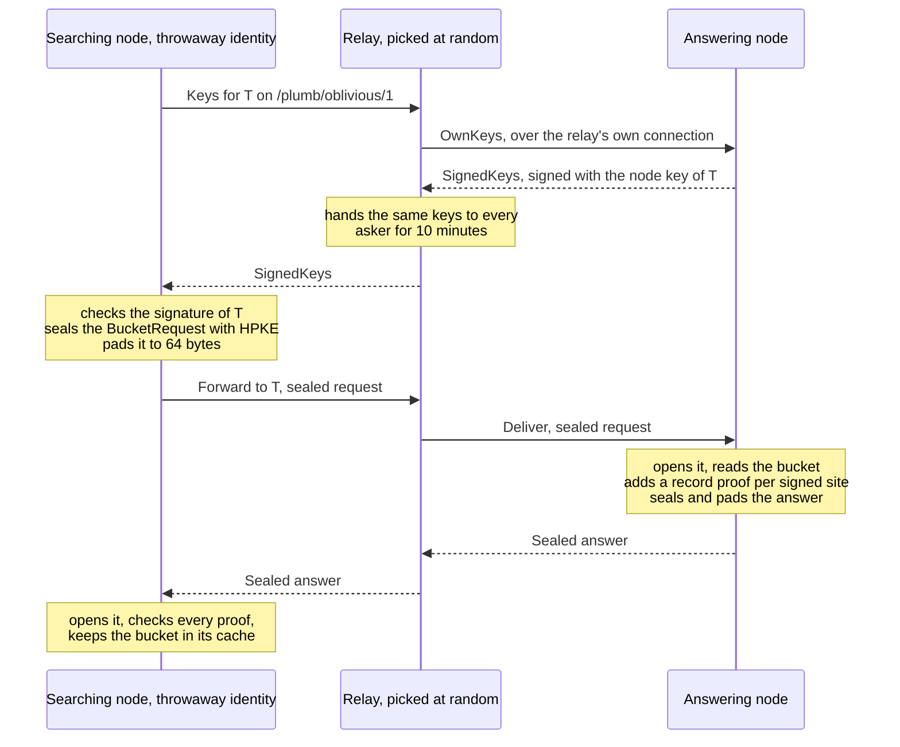

# The Plumb network

How Plumb nodes split the crawling between them, check each other's crawls, search each other without sending the query, and pass on the project's data. This page is for operators running a node in the network and for contributors changing [plumb-net](../crates/plumb-net/README.md), the crate that does it.

The Docker image and the desktop app join the network by default; `plumb run` joins with `--network`. A node started without it works on its own.

- [Overview](#overview)
- [Protocols and topics](#protocols-and-topics)
- [Getting connected](#getting-connected)
- [Crawl assignments](#crawl-assignments)
- [Crawl batches](#crawl-batches)
- [Agreement between crawlers](#agreement-between-crawlers)
- [Filling free space](#filling-free-space)
- [Signed sets](#signed-sets)
- [Network search](#network-search)
- [Popularity sharing](#popularity-sharing)
- [Shared findings](#shared-findings)
- [Crawl credits](#crawl-credits)
- [Profiles between your nodes](#profiles-between-your-nodes)
- [Running it](#running-it)

## Overview

Each day every node is assigned a random eighth of all sites, by a hash of the day, its node id and the site. It crawls those, signs each batch of results with its node key and announces it. Other nodes fetch the batch, check the signature and the assignment, keep only what a homepage crawl can see, and take a site in once a second crawler they count saw the same thing, or at once from a crawler they trust. To search the network, a node fetches a few hashed buckets of sites from other nodes, each request sealed and passed through a relay under a throwaway identity, and ranks them itself, checking a Merkle proof on every signed site. Nodes behind home routers need no port forwarding: they dial out and reach each other through relays and hole punching.



## Protocols and topics

Every protocol and gossip topic plumb-net defines, from [proto.rs](../crates/plumb-net/src/proto.rs) and [node/swarm.rs](../crates/plumb-net/src/node/swarm.rs). Requests and responses are CBOR; gossip messages are JSON. Size caps are enforced before decoding. Every request times out after 20 seconds, and an idle connection closes after 120 seconds.

| Name | Kind | Carries | Request / answer cap | Other limits |
| --- | --- | --- | --- | --- |
| `/plumb/kad/1.0.0` | Kademlia | Where other nodes are | libp2p's | Refreshed every 5 minutes |
| `/plumb/id/1.0.0` | Identify | Addresses, protocols, agent `plumb/<version>` | libp2p's | Pushes address changes |
| `plumb/batches/1` | Gossip | A new batch's signed header | 16 KiB a message | Checked before it is passed on |
| `plumb/reports/1` | Gossip | A popularity report | 16 KiB a message, 1,024 B a report | 200,000 held a week |
| `plumb/leads/1` | Gossip | A signed lead | 16 KiB a message | 50 a day and 500 held per reporter |
| `/plumb/batch/1` | Request | A batch by id, or the headers since an epoch | 4 KiB / 20 MiB | 4 batch and report requests answered at once; 10,000 headers a list |
| `/plumb/bucket/1` | Request | One bucket's records with proofs, or busy | 1 KiB / 64 MiB | 8 at once free plus 8 for tokens; 120 a minute per source |
| `/plumb/oblivious/1` | Request | Relay keys; sealed requests passed on and answered | 8 KiB / 48 MiB + 1 KiB | 32 passed on at once |
| `/plumb/report/1` | Request | Hand in a report, or list a week's | 8 KiB / 64 MiB | 50,000 reports a list |
| `/plumb/credits/1` | Request | Blinded tokens to sign, or the balance | 16 KiB / 16 KiB | 64 tokens a request |
| `/plumb/fill/1` | Request | Sites from the answerer's ranked list | 1 KiB / 64 MiB | 2 at once, 6 a minute per node; 1,000 sites a page (5,000 with `all`) |
| `/plumb/pages/1` | Request | A piece of a page set file | 1 KiB / 1 MiB + 64 KiB | 4 at once, 120 a minute per node |
| `/plumb/sets/1` | Request | A set's signed manifest, or a piece of a part | 1 KiB / 1 MiB + 64 KiB | 4 at once, 120 a minute per node |
| `/plumb/trust/1` | Request | The nodes the answerer trusts | 64 B / 64 KiB | 256 ids |
| `/plumb/profile/1` | Request | A searcher's profile between linked nodes | 8 MiB / 8 MiB | 4 at once |
| `/plumb/leads/1` | Request | The newest leads the answerer holds | 64 B / 16 MiB | 2,000 leads a list |

A node that does not answer searches (`--crawl-only`) offers neither `/plumb/bucket/1` nor `/plumb/oblivious/1`, and its own swarm never asks for a bucket: bucket requests come from throwaway identities (see [Network search](#network-search)).

## Getting connected

- **Most nodes only dial out**, like a browser. Fetching and announcing batches, and asking for and answering buckets, all work over connections a node opened itself.
- **Reachable nodes** (a server, a VPS, a forwarded port) run with `--public-addr` and `--relay`. They accept connections and relay for nodes behind NAT: at most 1,024 reservations, 256 circuits and 64 circuits per node. Each node and each IP address may open 600 circuits, then one every 100 ms; the relay's own loopback is not limited. libp2p limits each relayed circuit to 2 minutes and 128 KiB.
- **A node behind NAT** takes a reservation on up to 2 relays it is connected to (`MAX_RELAYS`), and is then reachable at `<relay address>/p2p-circuit/p2p/<its id>`. Those addresses go into Kademlia like any other, so nodes behind NAT find each other. Home-network addresses go only to nodes on the same network.
- **Hole punching** (DCUtR): when two nodes meet over a relay, they try to open a direct connection through both NATs and move their traffic there.
- **Same home network** (mDNS): nodes on one network find each other and connect directly. `--no-local-discovery` turns it off.
- **UPnP**: a node asks its home router to forward its port where the router allows it. `--no-upnp` turns it off.
- **Finding nodes**: a node dials its bootstrap nodes, learns of others through Kademlia, and once a minute dials more while it has fewer than 8 connections (`TARGET_PEERS`). It dials the bootstrap nodes again every minute while it has no connections, and every 5 minutes while it has some but none to them.
- **Bootstrap**: every node starts from the relay on plumbsearch.org (`DEFAULT_BOOTSTRAP` in [joining.rs](../crates/plumb-net/src/joining.rs): `/dns4/plumbsearch.org/tcp/4001/p2p/12D3KooWJ2UWUBsxmPfXTfHa8cBBmzifa6kj5pFZKfJXYNQyJ69a`) and any `--bootstrap` nodes, unless given `--no-default-bootstrap`.
- **Transports**: TCP and QUIC on port 4001 (`--p2p-port`), IPv4 and IPv6, Noise encryption, Yamux multiplexing.
- **Connection limits**: 1,024 incoming connections (256 still opening) and 8 with any one node.

## Crawl assignments

[assign.rs](../crates/plumb-net/src/assign.rs). An epoch is one UTC day. A node with id `P` may crawl domain `D` in epoch `E` when the first 8 bytes of `SHA-256("plumb-assign-v1\0" ‖ E ‖ P ‖ "\0" ‖ D)` fall below its share of 2^64. The share is at most one eighth (`MAX_SHARE_PPM`, 125,000 parts per million).

- Nobody picks their own sites, the assignment changes every day, and any node can check a crawler's claim from the batch header alone.
- A key can write at most an eighth of the sites a day, and with dozens of nodes most sites have several crawlers a day.
- A node in the network crawls only among the sites assigned to it today, plus the disputed sites it fetches to settle them (see [One person, many keys](#one-person-many-keys)).
- `--crawl-any-site` lets a node crawl any site, for one person's own nodes. With `--crawl-with <id>` (repeatable), the nodes split the sites by rendezvous hashing (`plumb-slice-v1\0`) among themselves and the named nodes that crawled in the last day. Only nodes that trust such a crawler take its crawls of sites it was not assigned.
- **Weakness:** the epoch is public, so someone after one site can make keys until one is assigned to it. Assignment spreads the work and caps what one key writes; agreement and vouching (below) are what make such a key count for little.

By default a node holds its list of sites steady: its crawls refresh the sites it holds without adding the domains they link to, and other nodes' records only refresh sites already held. `--take-new-sites` lets both add new sites.

## Crawl batches

[batch.rs](../crates/plumb-net/src/batch.rs), [hash.rs](../crates/plumb-net/src/hash.rs). After each crawl batch of 500 homepages (`CRAWL_BATCH_SIZE` in plumb-node), the node signs the records it produced and publishes them:

- A batch holds up to 4,096 lines (`MAX_BATCH_RECORDS`), each at most 16 KiB (`MAX_RECORD_BYTES`), at most 16 MiB in all (`MAX_BATCH_BYTES`). Each line is kept as the exact JSON bytes that were hashed.
- The signed header holds the crawler's public key, the epoch, its share, the time made, the line count and the Merkle root over the lines (SHA-256 with RFC 6962 leaf and node prefixes). It is signed over fixed-width fields after the context `plumb-batch-v1\0`, and the batch id is the hash of those bytes.
- A site's icon and recent headlines travel on lines of their own (`IconLine`, `NewsLine`), which older nodes skip.

A node refuses a batch whose epoch is more than 7 days old (`MAX_BATCH_AGE_EPOCHS`) or more than a day ahead, whose time is more than an hour ahead, whose count or size is out of bounds, whose share is over the cap, or whose lines do not hash to the root.

### What is kept from a batch

| Part of a record | From any crawler (`accept_batch`) | From this node or a trusted crawler |
| --- | --- | --- |
| Title, description, language, aliases, crawl time | Only for a homepage the crawler was assigned that day, crawled within 2 days of the day's start and at most an hour ahead | Any homepage, same time window |
| URL | Only when it is on the site the record names | Same |
| Headings, page text, terms, key pages, outgoing links | Never | Kept |
| Link text | When every linking site it names is a homepage the batch crawled (checked through 64-bit linker sets) | Same |
| Count of linking sites | Capped at the number of homepages the batch crawled | Same |
| Domains the homepages linked to | At most 100 per crawled homepage (`MAX_LINKED_PER_CRAWLED`), with link text and counts only | Same |
| Icons and headlines | Never | Kept |
| Popularity ranks, Wikidata data, crawl attempts | Never | Never |

A node holds a batch from a crawler it does not trust only when at least half its lines are about sites it kept from it (`mostly_kept`), so a few such records cannot bring up to 16 MiB of other lines onto its disk.

### Spreading batches



- Gossipsub runs in strict mode with manual validation: a header is passed on only after the node checked it, so a bad header stops at the first honest node.
- A node fetches at most 16 batches at once (`MAX_FETCHES`), 2 from any one node, and keeps at most 50,000 batch ids waiting.
- A node answers at most 4 batch and report requests of other nodes at once (`MAX_LISTS_SERVING`); more get an empty answer.
- When two nodes meet, each asks the other for the headers of the batches it holds from the last 3 epochs (`CATCH_UP_EPOCHS`) and fetches what it missed. Every 30 minutes (`RELIST_MINUTES`) a node asks the nodes it is connected to again for this epoch's and the last epoch's headers.
- Records agreement releases reach plumb-node as a `RecordDelivery`. It appends them to `DATA/net/inbox.jsonl`, folds the inbox into its records file through the same journal crawls use, and rebuilds its index once 2,000 records came in (`REBUILD_AFTER_RECORDS`), at most every 30 minutes. A delivery not yet saved is sent again after a restart.
- A node keeps the batches it holds for 35 days (`RETAIN_EPOCHS`, `--keep-batches-days`) in `DATA/net/batches/`, serves them to others, and uses them to prove its search answers. With a storage limit, it keeps 14 days unless `--keep-batches-days` sets another number, and other crawlers' batches may take at most 20% of the limit, oldest out first; its own batches always stay.
- `--publish-records PATH` also publishes the homepages crawled into another records file (such as one `plumb-tools crawl` fills): every 30 minutes, those crawled since the last time and within the last 6 days.

## Agreement between crawlers

[agree.rs](../crates/plumb-net/src/agree.rs). A record from the network counts only once 2 different crawlers (`QUORUM`) crawled it and saw the same thing, so one bad node cannot poison the index alone.

- **Homepage facts** (URL, title, description, aliases) are held as one observation per crawler, the node's own crawls included. When at least 2 crawlers' latest crawls agree, the newest of them is released, with only the aliases two of them saw. Until then the node keeps what it had: its own crawl or the seed data.
- **"The same"** is a tolerant comparison, not byte equality: the URLs must be on the same registrable domain, and titles and descriptions must share at least 75% of their words (`TEXT_MATCH`, Jaccard) after the index's text normalization.
- **Link text and new domains** are held per target site and crawler. A new domain is released once two crawlers named it, a piece of link text once two crawlers reported it, and the count of linking sites is the one at least two crawlers reached.
- **Scoring crawlers.** Each confirmation gives every crawler in the agreeing group an agreement, and every other crawler whose crawl of that site was made within 2 days (`JUDGE_WINDOW_SECS`) but did not match a disagreement. A crawl within 2 days of one of the node's own crawls is scored against it at once. A crawler judged at least 10 times (`MIN_JUDGED`) that agrees less than half the time (`MIN_AGREEMENT`) is distrusted: its crawls are still held and scored, but no longer count. The node's own crawls always count.
- **State.** Agreement keeps no file: it is rebuilt at start from the batches held, oldest first, without awarding credits again. Observations older than 14 days (`WINDOW_EPOCHS`) are dropped, so a distrusted crawler can earn its way back.
- **How soon.** Each node is assigned a given site about one day in eight, so with N nodes a site gets about N/8 crawls a day, and over 14 days a site in a network of a few nodes very likely has two crawlers. In a network of one, nothing from the network is ever taken in.

### One person, many keys

A node key costs nothing to make, so one person could run many keys and agree with themselves. Each node instead checks crawlers against fetches it made itself:

- **A key earns its vote.** Once a node holds any crawl of its own, another crawler counts towards a quorum only after its crawls matched the node's own crawls of 3 different sites (`VOUCHES_NEEDED`), and while it is not distrusted. A crawl that matches the node's own crawl of that very site needs no vouching, since that match is the check.
- **Disputes are settled by fetching the site.** A quorum without the node's own or a trusted crawler is held, not released, when another counting crawler saw something else within 2 days, when the node's own crawl saw something else, or when it would overturn the record last confirmed for the site. The site goes on a recheck list (at most 1,000, `MAX_RECHECKS`), and the node's next crawl round fetches up to 100 of them first, whether or not they are assigned to it. Its own crawl then decides: the side it matches is released, and the other side's crawlers each get a disagreement. Other nodes ignore those fetches, since the crawler was not assigned the site, and they are never used as proofs in search answers.
- **Nodes that do not crawl** cannot check anyone, so they count every crawler that is not distrusted, and in a dispute the side with more counting crawlers wins.
- **Gaps.** Someone who runs several keys that crawl honestly for a while can still agree on a site that no node with a crawl of its own has checked and that was never confirmed before.

### Trusted nodes

While the network is small, waiting for two crawlers mostly keeps good crawls out. So a node keeps a list of nodes it trusts: `--trust-peer <id>` (repeatable). Every node trusts the plumbsearch.org node, `12D3KooWEDPBv4sacn42shoToAwu62CreVC89QFiAA31HrWv3xrg` (`DEFAULT_TRUSTED_PEERS`), unless given `--no-default-trust`. This is not the bootstrap relay's id.

- A crawl signed by a trusted node is taken in at once, like the node's own, counts towards any quorum, is not held to the daily assignment, and keeps its homepages' headings, text, icons and headlines.
- Fills and page set files come only from trusted nodes, since they carry no signature per record.
- Being trusted earns a crawler nothing else: it is scored like any other, and matching its crawls vouches for no one.
- Each batch notes how it was delivered (`<id>.delivered-trusted` or `<id>.delivered-agreed` beside it in `net/batches/`), so a crawler newly trusted at start has its held batches taken in again with their text. A newer crawl of a site still wins.

### Who a search asks

[scope.rs](../crates/plumb-net/src/scope.rs). A node's network searches, its background rounds, the sealed requests it relays for private search in the browser, and the leads it lists use only the nodes in its search scope (`--search-from`):

| Scope | Nodes asked |
| --- | --- |
| `trusted` | Its trusted nodes |
| `friends-of-friends` (default) | Those and the nodes they trust |
| `anyone` | Any node |

When a trusted node connects, the node asks it on `/plumb/trust/1` which nodes it trusts (at most 256), keeps the answers in `DATA/net/friends.json` and, under `friends-of-friends`, dials them. Only one hop is followed. A node that starts with a different scope than last time empties its bucket cache.

## Filling free space

A node takes in crawls as they are shared, but one that just joined holds only the last few days of them. So every 10 minutes a node with room asks a node it trusts for its crawled sites over `/plumb/fill/1`, 1,000 at a time, best-ranked first, and takes them in like any shared crawl ([fill.rs](../crates/plumb-net/src/fill.rs), plumb-node's [node/fill.rs](../crates/plumb-node/src/node/fill.rs)). It takes at most 50,000 a round and stops at:

- 90% of the storage limit (`FILL_UP_TO_PERCENT`), so its own crawling keeps room;
- the day's download limit;
- the size of index a build could hold in half the machine's memory, or its container's limit when lower (`BUILD_MEMORY_PERCENT`, about 2,500 bytes a site).

With no storage limit it takes the trusted node's whole list. A node with topics (its focus topics and the interests on its About pages) saves 25% of its limit for them (`FOCUS_SHARE_PERCENT`): it takes the best sites up to 65%, then reads on down the list keeping only sites about a topic. It asks for the same pages either way, so the trusted node learns nothing of the topics. Once through the list, filling rests 7 days (`FILL_AGAIN_AFTER`); shared crawls keep arriving meanwhile. Progress is in `DATA/net/fill.json` and under `fill` in `GET /api/status`. `--no-fill` turns filling off.

A node answers at most 2 fill requests at once and 6 a minute from one node, and only when it answers searches.

**From the set of sites.** The project also publishes its node's list as the signed set `plumb/sites` (`plumb-tools set sites`): a first part of the 50,000 best sites, then parts of 200,000, each site an item. A node that takes the project's sets reads its sites from that set, taken from any node, in place of asking a trusted node, each record kept or refused as a trusted node's would be, under the same limits. It fetches each part when it reaches it, and the first part, which new nodes ask for, and removes the parts it reads past but the first, so a node never holds the whole set. While it reads, it looks for a newer set every 6 hours, and whenever a part it needs is missing, since nodes drop the parts of a set a newer one replaced. It goes on in the newer set from the same place, keeping the parts the two share. A node partway through a trusted node's list reads on to its end first, and moves to the set when it starts over; one that finds no node with the part it needs goes on in a trusted node's list from the same place, to its end. `fill.peer` in `/api/status` is `plumb/sites` while it reads the set. A blackhole node reads each trusted node's own list.

**Staying under the storage limit** ([node/trim.rs](../crates/plumb-node/src/node/trim.rs)):

- At 90% of the limit, a shared crawl only refreshes a site the node holds. A new site is taken in only when it is about one of the node's topics or is an official website.
- Over the limit for 30 minutes, the node drops its least useful sites, lowest link score first, until the data folder is back at 85%, and builds its index without them. Never dropped: the best 100,000 sites, sites about its topics, sites an About page puts first or a searcher opened, official websites, and the network's own site. Filling then rests 7 days, and the node looks again an hour later.
- Dropping a site takes it out of that node's index only. The batches it signed stay in `net/batches/`.

**Blackhole.** `--blackhole` is for a server with disk and memory to spare. It fills from every connected trusted node, going through each one's list again a day after it last did (`fill.lists_done` in `/api/status` counts the lists held); keeps every page set (Wikipedia, GitHub, Stack Overflow, books, papers) in full; keeps the network's batches for good unless `--keep-batches-days` is given; and asks each node it meets for the batches of the last 7 epochs rather than 3. The storage limit, the day's download limit and the memory an index build may take still hold, and the trust rules are the same.

**Crawl only.** `--crawl-only` is for a small server that supports the network and that nobody searches. Its crawl rounds go on and publish their batches, and it still holds, serves and passes on batches, but it builds no search index, keeps no page sets, places or feeds, does not fold in other nodes' crawls, and answers no searches or fill requests. It takes only the `plumb/denylist` and `plumb/site-rules` sets, and the parts of `plumb/sites` filling reads. Starting without the flag again builds a fresh index.

**Setting up from the network.** A new node that trusts a node sets up from the network instead of downloading the seed data (Tranco, Common Crawl, Wikidata, Wikipedia). It first looks for a node that holds the set of sites for 30 seconds, and builds its first index from the set's first part, every site crawled or not. Otherwise it asks the trusted node with `all` set, and the trusted node sends every site of its list, crawled or not, up to 5,000 a page, each with the ranks and facts its own seed gave it. The best 50,000 make the first index, and filling then takes the rest, a round a minute, until the node holds `--sites` of them or runs out of room. When no trusted node answers within the 2 minutes after that, or one sends fewer than 1,000 sites, the node downloads the seed data as before. So does a node given `--seed-from-outside` or `--no-fill`, or one that trusts no one.

**Other data from the network first.** Nodes do not each fetch from Wikimedia and other sources what the network already holds. Page set files come from trusted nodes over `/plumb/pages/1` (see [pages.md](pages.md#nodes-in-the-network)), as do site vectors for search by meaning (`vectors-<model>`) and the adult blocklist safe search uses (`adult-domains`, asked for once the node's copy is a week old). The project's own data also comes as signed sets, from any node (below).

## Signed sets

The project's data reaches nodes as signed sets in the format of [plumb-format](../crates/plumb-format): a set has a name (`plumb/denylist`), a generation, parts named by their SHA-256, and a manifest listing them, signed by the publisher. A node trusts sets signed with the project's key, `ed25519:MMrfl7-ASNz-h2d2f0ru1EWjAws59Ls3D5TbdfJS98c` (`PROJECT_KEY` in [node/signed_sets.rs](../crates/plumb-node/src/node/signed_sets.rs)). `plumb-tools set` writes, signs and checks sets.

Because a node checks a set rather than trusting whoever sends it, it takes sets from any node over `/plumb/sets/1` ([sets.rs](../crates/plumb-net/src/sets.rs)):

1. Every 6 hours it asks up to 8 connected nodes, trusted ones first, for the newest manifest of each set it takes.
2. When one signed by a publisher it trusts is newer than its own, it fetches the parts it lacks from whichever node holds them, a piece of at most 1 MiB at a time, checking each part's size and hash.
3. It checks the whole set as `plumb-tools set check` does, and only then puts it in place of the old one, in `DATA/sets/plumb/<name>/`. A download that stops keeps the parts it got and goes on from there next time.

`plumb/sites` is the exception: filling takes it part by part as it reads it, and checks each item as it reads it (see [Filling free space](#filling-free-space)).

A node serves the sets it holds in turn: 4 requests at once, 120 a minute from one node.

| Set | Taken by | Use |
| --- | --- | --- |
| `plumb/denylist` | Every node | Pages and sites the project accepted a takedown for, applied as soon as it is taken (see below) |
| `plumb/site-rules` | Every node | The public suffix and subsite lists that say which site a host is on; used from the next start |
| `plumb/adult-sites` | Every node that searches | The adult blocklist safe search uses |
| `plumb/sites` | A node that fills, but not with `--blackhole` | The project's node's sites: the first part, and the part filling reads (see [Filling free space](#filling-free-space)) |
| `plumb/map` | A node that keeps a map | The map, under the same `--set-updates`, storage and growth rules as the map file |
| `plumb/<page set id>` | A node that keeps that page set | Item sets such as `plumb/wikipedia-en`, as far as the node keeps pages of it |
| `plumb/vectors-<model>` | A node with search by meaning | Site vectors made with its model |

The denylist applies to search results and everything shown with them (pages, API and MCP answers), to the page and search indexes as they are built, and to crawls, leads, fills and batches before a node keeps or passes them on. A stored batch is signed and cannot be edited, so one that names a denied site is not relayed. `--no-project-denylist` turns the list off, except its entries for child sexual abuse material, which always apply; what they take off is logged by the entry's id, never its address.

## Network search

The query stays on the asking node. It fetches buckets of sites from other nodes and ranks them itself.

- **Where.** `GET /network?q=` shows network results. Ordinary results can include the network with `/search?net=1`. `GET /api/network/search?q=` returns JSON with `buckets`, `asked`, `answered`, `relayed`, `direct`, `rejected`, `cached`, `pending`, `stale` and `hits`, each hit with `verified`, `crawler`, `confirmed` and `answers`. One client may start 20 network searches at once and 20 a minute after that; a node runs at most 4 at once (`MAX_SEARCHES`).
- **Buckets, not queries** ([bucket.rs](../crates/plumb-net/src/bucket.rs), [keys.rs](../crates/plumb-core/src/keys.rs)). A node that answers searches writes a bucket table next to each index it builds (`indexes/<n>/buckets/`). Each site is filed under its keys: the words and joined names of its domain label, title, aliases and top 8 link texts. A key goes to one of 16,384 buckets by `SHA-256("plumb-bucket-v1\0" ‖ key)`, and each key keeps its best 32 sites by link score (`KEY_CAP`).
- **Asking.** The asker turns the query into keys the same way, the whole query first and then its words, longest first, leaving out small joining words ("in", "of", "the") when there are others. The first 4 distinct buckets (`BUCKETS_PER_SEARCH`) are the search's. With rounds on (the default), a search reads them from the bucket cache and the next scheduled round fetches what is missing; see [cache-first-search.md](cache-first-search.md).
- **A round** is always 4 buckets, padded with random ones and shuffled. Each bucket goes to 2 nodes (`NODES_PER_BUCKET`), spread so that no node gets two buckets of one round while others get none. A bucket still short of 2 good answers after a quarter of the wait, or once every request is in, is asked of one more node (hedging). A busy node is asked again with one of its tokens, when the asker holds one.
- **A throwaway identity for every request** ([throwaway.rs](../crates/plumb-net/src/throwaway.rs)): a new key, a swarm of its own and a new connection, dropped after the request, so the answering node cannot tie it to the asker's permanent id or to the round's other buckets.
- **Through a relay, sealed** ([oblivious.rs](../crates/plumb-net/src/oblivious.rs)), the way Oblivious HTTP (RFC 9458) works:



- The relay sees the asker's address and which node it asks, but not the bucket. The answering node sees the bucket, but only the relay's address. Only a relay and an answering node working together can tie an address to a bucket, and each request picks its relay anew.
- Requests are padded to 64 bytes (256 when they carry a token), and answers to the next of 2^k and 1.5 × 2^k bytes, at least 4 KiB, since the relay holds much the same buckets and could otherwise tell the bucket by size. A sealed message is at most 48 MiB.
- Keys use HPKE with X25519, HKDF-SHA256 and AES-128-GCM or ChaCha20-Poly1305 (the `ohttp` crate). The answering node makes them in memory, never on disk, and makes a new one daily; a key expires two days after it was made. The keys are signed with the node key, so a relay cannot swap in its own.
- Every node that answers searches also relays, at most 32 requests at once. A relay that cannot reach the target gets one stand-in (`RELAY_TRIES`). Requests go only to nodes that take them sealed once there are 2 such nodes; a request goes straight to a node only when no other node can relay it, and `direct` counts those.
- What is sealed is Plumb's own CBOR bucket request and answer (or a popularity report), not Binary HTTP, so this is RFC 9458's encapsulation rather than full Oblivious HTTP. The asker's half is `plumb_core::oblivious`, which also builds for WebAssembly: `NetHandle::oblivious_keys` and `NetHandle::oblivious_forward` let a node's web server relay sealed requests from private search in the browser ([private-search.md](private-search.md)).
- **Checking answers.** For every site the answering node holds a signed crawl of, it attaches a record proof: the signed header, the record and its Merkle path, plus a second agreeing crawler's proof when it has one (`also`). The asker checks the signature, the path and the assignment. An answer with a forged proof is dropped whole. An expired proof leaves the site unverified. A site without a proof is shown as unsigned, its link always goes to the domain it names, and its popularity signals are the worst any node reported. Only the first 20,000 records of an answer are read (`MAX_BUCKET_RECORDS`).
- **Confirmed.** A site is confirmed once signed crawls from 2 crawlers this node counts agree, whether one answer carried both or two answers carried one each. Crawls signed by a trusted node are taken whole.
- **Ranking locally.** The asker keeps the sites that match the query's keys, builds a small temporary index of them and ranks them with its own ranking (see [search.md](search.md)). Signed crawls of sites it holds also fill in what its own records lack.

What this hides and what it does not: answering nodes see bucket numbers, and bucket hashes are public, so likely queries can be tested against the buckets seen. Addresses and timing can still link requests when a request goes direct or operators collude. See [cache-first-search.md](cache-first-search.md#what-it-hides-and-what-it-does-not) and the [privacy review](reviews/privacy-security.md).

## Popularity sharing

[popularity.rs](../crates/plumb-net/src/popularity.rs), [reports.rs](../crates/plumb-net/src/reports.rs). With `--share-popularity` (off by default), rankings learn which site people pick for a search without any node learning who searched for what.

- **Noting a pick.** The node's result links go through `/go?q=&d=`, which redirects to the site and notes the pick in `DATA/net/picks.json`, for the current week only. `/go` redirects only to a site the same search returns. Only short, plain queries are noted: normalized, at most 6 words and 64 characters, no `@`, and no run of 4 or more digits.
- **Sending.** At random times 20 to 100 minutes apart, the node turns its most-made pick not yet reported this week into a report, at most 8 a day (`REPORTS_PER_DAY`). A report is threshold-encrypted with STARLite (`sta-rs`): a tag, the encrypted pick and one share of the key. Reports of the same pick in the same week share the tag, and the key comes back only from 10 shares (`REPORT_THRESHOLD`).
- **Travel.** The report goes under a throwaway identity, sealed and padded to 4 KiB, through a relay to a random node, which keeps it and passes it on over `plumb/reports/1` as its own message. Only when there are fewer than 2 relays does it go straight over `/plumb/report/1`. A node that meets another asks it for this week's and last week's reports.
- **Counting.** Every node keeps two weeks of reports (`DATA/net/reports/<week>.jsonl`, at most 200,000 a week) and counts them itself, every 10 minutes while new ones arrive. A group of 10 or more with the same tag gives up its key; the node decrypts the pick and checks it by making the report afresh. A group with a bad share is tried with up to 64 other subsets. Shares made for a lower threshold are refused.
- **Ranking.** Every node in the network, sharing or not, ranks at least 20 results and adds up to 0.15 (`MAX_POPULARITY_BONUS`) to each site picked for the query: the full amount for the site picked most, less in proportion for the others.

Limits: STARLite takes its randomness from the pick itself, so anyone can guess a pick, compute its tag and see whether it was reported (not by whom). Nothing yet stops one machine from sending many reports of one pick under many throwaway identities; the bonus is small and bounded, and a pick counts only for sites the asking node's own search returns.

## Shared findings

[leads.rs](../crates/plumb-net/src/leads.rs). An AI app on a node run with `--share-findings` can share a page it found useful (`report_finding` with `share: true`, see [mcp.md](mcp.md#sharing-a-finding-with-other-nodes)), and an agent searching another node for the same thing is shown that page as a **lead**.

- **What a lead is.** The page's address (at most 2,000 characters), why it helped (at most 300), the search's words as at most 16 keys of 16 bits (the first 2 bytes of `SHA-256("plumb-lead-word-v1\0" ‖ word)`, so many words share each key), when it was reported and when it expires (at most 30 days later), and the reporting node's key and signature. The search as typed only when the agent shares it too (`share_query`). Words that say what is wanted ("latest", "install", "docs") are kept apart from the topic words. A lead matches a search when their topic keys are the same and they share at least 75% of the larger one's keys. A lead names a public http or https page: no user name or password, no private address or local name.
- **Travel.** The reporting node publishes it on `plumb/leads/1`. Every node checks a lead (signature, times, sizes, canonical form, its denylist) before keeping or passing it on, and passes on only leads it took. A node meeting another asks it on `/plumb/leads/1` for the 2,000 newest leads it holds, two nodes at a time, and asks again every 30 minutes.
- **Keeping.** `DATA/net/leads.jsonl` holds at most 20,000 leads, 500 from any one node, and takes at most 50 a day from any one node, its own included. When full, the node holding the most leads loses its oldest. Expired leads are dropped every hour.
- **Listing.** A search lists only leads from nodes in its search scope, each labeled `trusted`, `friend_of_friend` or `other`, closer ones first. Leads are listed apart from results with `verified: false`, never ranked among them, and never taken into a node's records.

Limits: the word keys hide a search from a casual look, not from someone who tries likely words. A lead shows which node shared it, and leads are not sent through a relay. One person with many keys can still share 50 misleading leads a day from each; `--search-from trusted` lists only trusted nodes' leads.

## Crawl credits

[credits.rs](../crates/plumb-net/src/credits.rs), [allowance.rs](../crates/plumb-net/src/allowance.rs), on for every network node. Crawling and answering for the network earn credits, and a node turns them into anonymous one-time tokens it can spend at the node that issued them. Credits cannot be given away, and people who only search on a website never see them.

**Earning.** Each node keeps its own ledger of every crawler it hears from (`DATA/net/credits/ledger.json`):

| Work | Credits |
| --- | --- |
| A homepage crawl that the node itself, or a crawler vouched for by matching its crawls, also made | 1 (2 before 2027-10-01, `FIRST_YEAR_ENDS`) |
| A new crawl taken in from a trusted node | 1 (2 in the first year) |
| A crawl made close in time to two such crawls that does not match them | −5 (`DISAGREE_PENALTY`) |
| A bucket request of this node answered with at least one signed crawl that checked out | 1 (`CREDITS_PER_ANSWER`) |

**Tokens.** A node asks a node it searches (the issuer) for tokens over `/plumb/credits/1`, under its own id, since its balance pays. The issuer gives tokens only to a vouched crawler judged at least 10 times, a node it trusts, or a node that answered at least 10 of its bucket requests, 1 credit each and at most 64 a request. Tokens are signed blind with a VOPRF over ristretto255 (the `voprf` crate, as in Privacy Pass), so the issuer cannot tell which node a token went to when it comes back. The wallet (`DATA/net/credits/wallet.json`) keeps the first key it sees for each issuer and refuses tokens under another. The issuer's key is `DATA/net/credits/token.key`, and spent tokens are in `DATA/net/credits/spent`.

**What tokens buy: priority when busy.** A node answers 8 bucket requests at once for free (`MAX_ANSWERING`) and turns more away as busy. A request carrying one of its tokens gets one of 8 more slots (`PRIORITY_SLOTS`), and the token is spent. Free answers are also shared out: any one address (IPv6 by its /64) or relay gets 120 a minute with bursts of 240 (`FREE_PER_MINUTE`, `FREE_BURST`), and `--answer-per-day` caps free answers a day (UTC; no cap by default). A trusted relay is not rate-limited, and searches on the node's own page never are. A searching node keeps at least 4 tokens from each node it searches, asking for 16 more at most every 30 minutes; `--no-spend-credits` turns that off.

Limits: a token is good only at its issuer. The issuer sees a node ask for tokens and later sees paid requests arrive. An issuer that gives one node its own key from the very first token would go unnoticed; the wallet only catches a key that changes. Credits follow agreement's rules on who counts, so its limits on one person with many keys apply here too.

## Profiles between your nodes

`/plumb/profile/1` carries one searcher's profile (search history, About you, what clicks taught) between nodes they linked with a one-time link code from `/link`, valid for 10 minutes. Linked nodes keep their copies alike every 5 minutes or so; the node with the smaller id asks, and the other asks only when not asked for 10 minutes. A node answers only for a profile linked with the asking node, and nodes that keep no profiles refuse everything. The links are kept in `DATA/history/<id>.sync.json` (see [sync.rs](../crates/plumb-node/src/sync.rs)).

## Running it

```sh
# A node at home: dials out only, and starts from plumbsearch.org.
plumb run --data plumb-data --network

# Also share which result is opened, anonymously.
plumb run --data plumb-data --network --share-popularity

# Also publish what a separate `plumb-tools crawl` fills in.
plumb run --data plumb-data --network --publish-records /path/to/crawl/records.jsonl

# One person's crawlers covering every site between them.
plumb run --data plumb-data --network --crawl-any-site \
  --crawl-with <second node id> --crawl-with <third node id>

# A test network kept apart from the real one.
plumb run --data test-data --network --no-default-bootstrap --no-default-trust \
  --bootstrap /ip4/192.168.1.20/tcp/4001/p2p/<that node id>

# A reachable server that relays for others (open TCP and UDP 4001).
plumb run --data /data --network --relay \
  --public-addr /ip4/203.0.113.7/tcp/4001 \
  --public-addr /ip4/203.0.113.7/udp/4001/quic-v1
```

| Flag | Default | What it does |
| --- | --- | --- |
| `--network` | Off for `plumb run`, on in Docker and the desktop app | Join the network |
| `--p2p-port PORT` | 4001 | Port for TCP and QUIC |
| `--bootstrap MULTIADDR` | The relay on plumbsearch.org | Another node to start from; repeatable |
| `--no-default-bootstrap` | | Start only from `--bootstrap` and local nodes |
| `--public-addr MULTIADDR` | | An address others can reach this node at; repeatable |
| `--relay` | Off | Relay for nodes behind NAT; needs `--public-addr` |
| `--no-upnp`, `--no-local-discovery` | Both on | Turn off UPnP, or mDNS |
| `--trust-peer PEER_ID` | The plumbsearch.org node | Trust a crawler; repeatable |
| `--no-default-trust` | | Trust only `--trust-peer` nodes |
| `--search-from WHO` | `friends-of-friends` | `trusted`, `friends-of-friends` or `anyone` |
| `--round-minutes N` | 10 | Minutes between background rounds; 0 fetches at search time |
| `--keep-batches-days N` | 35 | Days of batches kept |
| `--answer-per-day N` | No cap | Free bucket answers a day for other nodes |
| `--no-spend-credits` | | Never collect tokens |
| `--no-fill` | | Do not fill free space from trusted nodes |
| `--blackhole` | | Collect everything the network offers |
| `--crawl-only` | | Only crawl and publish |
| `--seed-from-outside` | | Download the seed data instead of setting up from a trusted node |
| `--share-popularity` | Off | Send popularity reports |
| `--share-findings` | Off | Let AI apps share findings as leads |
| `--publish-records PATH` | | Also publish homepages crawled into this records file, every 30 minutes |
| `--crawl-any-site`, `--crawl-with PEER_ID` | | Crawl beyond the daily share, split with the named nodes |
| `--take-new-sites` | Off | Let crawls and shared records add sites |
| `--no-project-denylist` | | Do not apply `plumb/denylist`, except its CSAM entries |
| `--set-updates` | `all` | Which page set files to replace: `all`, `off` or a list of sets |

- The node key is `DATA/net/node.key`. Keep it to keep the same id; a server's id is part of the bootstrap address others use. The id is printed at start and shown as `network.peer_id` in `GET /api/status`.
- The Docker image exposes 4001; publish it with `-p 4001:4001/tcp -p 4001:4001/udp` on a server that relays (see [docker.md](docker.md)).
- `GET /api/status` shows the network under `network` ([`NetStatus`](../crates/plumb-net/src/node.rs)): its addresses and NAT status, connected and relaying nodes, batches held, published and received, `agreement` (`pending_sites`, `confirmed_sites`, `distrusted_crawlers`, `vouched_crawlers`, `disputed_sites`, `trusted_peers`), `credits` (with `at_peers`), `rounds`, `search_scope`, `search_peers`, `friends_of_friends`, `requests_relayed`, `reports_held`, `reports_sent`, `popular_picks`, `leads_held`, `leads_shared` and one line per crawler. Filling is under `fill`.
