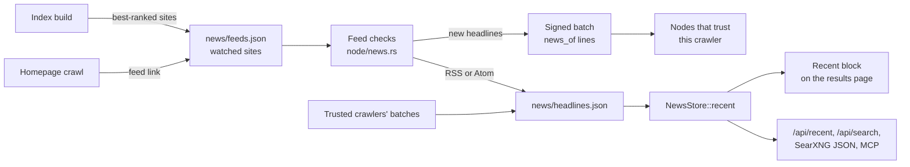

# Recent headlines

Plumb keeps no article text, so it cannot search the news the way a full-text engine does. Instead a node reads the RSS and Atom feeds of its best-ranked sites, keeps each new post's title, link and date for a week, and shows the ones that fit a search in a **Recent** block after the first result. This page is for searchers who want to know what the block shows and for operators who want to know what it costs.



## What a search shows

The block holds one of four things, tried in this order by `NewsStore::recent` in [news.rs](../crates/plumb-node/src/news.rs):

| Search | Block | Example |
|---|---|---|
| Asks for news from a publisher | "Latest from *publisher*": its newest posts, up to 4, about the other words if any | "bbc news", "election news from reuters" |
| Names a site (the top result is the site the search names) | "Latest from *site*": its 4 newest posts from the week | "theverge.com" |
| Has topic words | "Recent": up to 5 newest headlines, at most 2 per site, whose titles hold every topic word | "election", "mars rover news" |
| Asks for news alone | "Recent": the newest headline of each site from the last 3 days, up to 5 | "news", "top headlines" |

Details of each:

- **Publishers.** BBC (bbc.com and bbc.co.uk), CNN and Reuters are known by name ("bbc", "bbc news", "cnn", "reuters"), and any watched site can be asked for with "from" or "by" ("rust news from theverge.com"). Their articles must be on the publisher's own domains. When the publisher has nothing current, the block says "No current indexed headlines available from this publisher's feeds." instead of falling back to other sites.
- **Topic words.** The search's words lose news words (news, latest, recent, today, headlines, breaking, update, updates) and common words (the, of, in and the like), and plurals are folded ("election" finds "Elections"). Quoted phrases must appear in the title as typed. A search with more than 6 topic words gets no block. The block shows only when two or more sites published a match in the last 3 days, unless the search asks for news ("election news"), which looks back the whole week and needs one site.
- **Beside a named site.** When the top result is a site the search names and the search does not ask for news, a topic block is cut to 2 headlines.
- **News alone.** News words alone, or with general words (top, world, international, global, current, events, stories, biggest, major), give the day's news: sites with 3 or more headlines in the last day (newsrooms) first, then the best-ranked sites first.

Every block drops copies (the same words or the same link), applies the search's [operators](searching.md#search-operators) (`site:`, `-word` and the rest) and its safe search setting, and leaves out sites known to write in another language than the one the search asks for. A site the search names is shown whatever its language. Headlines on the node's denylist are dropped when a feed is read and again when they are shown.

### How the block looks

The block comes folded: one line naming it ("Recent" or "Latest from *site*"), how many headlines it holds and how new the newest is. Each headline shows its title, site and age. The **Recent news** setting in the results page's gear changes the fold:

| Setting | Address parameter | Effect |
|---|---|---|
| Folded (default) | none | One line, opened with a click |
| Open | `news=expanded` | Headlines shown unfolded |
| Off | `news=off` | No block |

On a node that keeps [search history](searching.md#search-history), the block also comes open by itself for searches like those where the browser opened its headlines at least half the times it was shown (`OPEN_FROM` in [learn.rs](../crates/plumb-node/src/learn.rs)), and the [edit buttons](searching.md#edit-these-results-and-tune) fold it for one search or for searches like it, or keep it always open.

### Headlines in the APIs

| Address | What it returns |
|---|---|
| `GET /api/recent?q=...` | The block as JSON: `site` (when it is one site's posts), `headlines` (`domain`, `title`, `url`, `at` in Unix seconds), `status`, `sources`. `{"headlines":[]}` when there is none. |
| `GET /api/search?q=...&full=1` | The block as `recent` and `assembled.recent`. |
| `GET /search?q=...&format=json` | Headlines in `recent`, and as results with `category` `news` and `publishedDate`. `categories=news` returns headlines alone; `time_range` (`day`, `week`, `month`, `year`) keeps those in range and puts them first. |
| MCP `search` tool | Headlines with their publication dates. See [mcp.md](mcp.md). |

## Where the headlines come from

**Which sites.** At each index build the node picks its best-ranked sites that answered their last crawl and redirect nowhere: 3,000 for a server, 300 for the desktop app or `--profile desktop`. Set the number with `--news-feeds N`, or `--news-feeds 0` for none. A node started with `--crawl-only` checks no feeds.

**Finding the feed.** A homepage crawl notes the first feed the page names (`<link rel="alternate" type="application/rss+xml">` or `application/atom+xml`). A watched site with no known feed has its homepage fetched once to look for one. A site without a feed is looked at again after 7 days (`NO_FEED_RECHECK_SECS`).

**Checking.** The feed job in [node/news.rs](../crates/plumb-node/src/node/news.rs) looks for due feeds every 10 minutes and checks up to 500 a round (`MAX_PER_ROUND`), best-ranked first, 16 at a time.

- Each feed is checked at most once an hour (`MIN_CHECK_GAP_SECS`). A quiet, unchanged or failing feed waits twice as long each time, up to 12 hours (`MAX_CHECK_GAP_SECS`); a feed with new headlines goes back to hourly.
- Requests send back the feed's `ETag` and `Last-Modified`, so an unchanged feed costs one short answer. They obey robots.txt and its crawl delay, keep the crawler's per-host delays, and never go to private or local addresses.
- A feed is read only up to 2 MiB and 200,000 XML nodes, and one with a DTD is refused. RSS 2.0 and 0.9x, RSS 1.0 and Atom are understood; only each post's title, link and date are read, and a post without a date Plumb understands is skipped.
- Checks wait while the crawl does: background updates off, a pause, outside crawl hours, the day's download limit or the storage limit reached. They count toward the download limit.

**What is kept.** A headline is its title (up to 200 characters), its link (up to 500 bytes, `http` or `https`, on the site's own domain) and its time (a time in the future counts as now). Each site keeps its 10 newest headlines from the last 7 days (`MAX_HEADLINES_PER_SITE`, `NEWS_WINDOW_SECS` in [plumb-core's news.rs](../crates/plumb-core/src/news.rs)).

## Shared with the network

A node in the network publishes its new headlines in a signed batch, each site's on a line of its own after the records and icons:

```json
{"news_of":"example.com","items":[{"title":"...","url":"https://example.com/post","at":1800000000}]}
```

Older nodes skip the line as a record they cannot read. A node that reads it takes headlines only from crawlers it trusts, as it does icons, and checks each one again (on the site, recent, short) before keeping 10 per site at most. Shared headlines go into the headline store, never into site records, and the language a site writes in comes from the receiver's own index. A node with `--news-feeds 0` still keeps and shows headlines that trusted crawlers share. See [network.md](network.md) for batches and trust.

## Files

| File | What it holds |
|---|---|
| `DIR/news/feeds.json` | The watched sites, best-ranked first, and each feed's address and check state |
| `DIR/news/headlines.json` | Headlines by site |
| `DIR/news/languages.json` | The language each site with headlines writes in |

A week of headlines from 3,000 sites takes a few MB.
