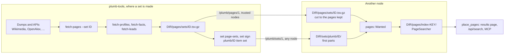

# Page sets

Page sets are the single pages Plumb lists next to sites: Wikipedia articles, GitHub repositories, Stack Overflow questions, books, papers, packages, docs pages and more. Searching "marie curie" lists the article Marie Curie, and "python" lists python.org with the article on the language under it. This page is for node operators and contributors: which sets there are, how many pages a node keeps, how sets reach a node, how to build them, and how their pages are searched and shown.

Places are a page set too, with an index and a map of their own: see [places.md](places.md).

## Contents

- [What a set is](#what-a-set-is)
- [The sets](#the-sets)
- [What each page keeps](#what-each-page-keeps)
- [How many pages a node keeps](#how-many-pages-a-node-keeps)
- [How sets reach a node](#how-sets-reach-a-node)
- [Nodes in the network](#nodes-in-the-network)
- [Building sets with plumb-tools](#building-sets-with-plumb-tools)
- [Software packages](#software-packages)
- [How pages are searched and shown](#how-pages-are-searched-and-shown)
- [Pages a node finds for its own searches](#pages-a-node-finds-for-its-own-searches)
- [Checking a set](#checking-a-set)

## What a set is

A set is one gzipped, tab-separated file, `DIR/pages/sets/<id>.tsv.gz`, most read first, so a node that keeps the top N pages reads only the first N lines. Every set uses the articles file format of [`plumb_core::article`](../crates/plumb-core/src/article.rs):

```text
views  title  description  item  site  aliases          (tab-separated)
81234  Marie Curie  Polish-French physicist ...  Q7186    Maria Curie|Madame Curie
```

A page may be followed by a `profiles` line of extra entries for it (official profiles, facts, a lead, docs sections), which readers that do not know an entry skip. Plumb keeps a page's names and a few facts about it, not its text: pages are found by name, and some kinds also by the words of their title, tags and description. Docs and reference pages are the exception, with a few short passages (see [the table below](#what-each-page-keeps)).

The sets a node knows are `SETS` in [pages.rs](../crates/plumb-node/src/pages.rs). The node indexes the pages it keeps from every set together in one Tantivy index, `DIR/pages/index-<key>/` ([`plumb_index::pages`](../crates/plumb-index/src/pages.rs)). The key names the sets, their files or item sets, how many pages of each and the denylist, so a changed setting or a newer file builds a new index while the old one goes on answering searches. Pages the denylist denies are left out of the index. The index keeps each page as its item of the [data format](../crates/plumb-format/README.md), with the set it came from, and searches read the page back from the item.

## The sets

| Set | Lists | Made from (license) | Default | All of it, about |
| --- | --- | --- | --- | --- |
| `wikipedia-en` | English Wikipedia articles | Wikimedia's dumps (CC BY-SA 4.0) | Automatic | 7M pages, 700 MB |
| `wikipedia-es` | Spanish Wikipedia articles | Wikimedia's dumps (CC BY-SA 4.0) | Off until chosen | 2M, 200 MB |
| `wikipedia-de` | German Wikipedia articles | Wikimedia's dumps (CC BY-SA 4.0) | Off until chosen | 3M, 300 MB |
| `github` | Public repositories with at least 500 stars | GitHub's search API | Automatic | 300k, 45 MB |
| `stackoverflow` | Stack Overflow's most viewed questions | Stack Exchange's data dump (CC BY-SA 4.0) | Automatic | 2M, 240 MB |
| `stackexchange` | Most viewed questions of 33 other Stack Exchange sites | The same dump (CC BY-SA 4.0) | Automatic | 800k, 100 MB |
| `books` | Works readers shelve or rate most | Open Library's dumps (CC0) | Automatic | 1M, 110 MB |
| `podcasts` | Most popular podcasts | Podcast Index's database (free for any use) | Automatic | 300k, 42 MB |
| `music` | Songs and albums listened to most | MusicBrainz's core dump, ListenBrainz (CC0) | Automatic | 180k, 36 MB |
| `films` | Films and TV shows | Wikidata (CC0) | Automatic | 150k, 33 MB |
| `docs` | Pages of 48 software docs sites (MDN, Python, Rust and more) | The sites' sitemaps | Automatic | 400k, 100 MB |
| `reference` | Pages of about 150 reference sites: health, dictionaries, recipes, how-tos, government | The sites' sitemaps | Automatic | 700k, 210 MB |
| `reference2` | The reference pages, listed by stricter title matching | Taken from the network | Off until chosen | 700k, 210 MB |
| `subpages2` | Pages of about 230 universities, companies, agencies, entertainment sites and museums | Sitemaps and homepage links | Automatic | 300k, 90 MB |
| `papers` | Most cited scholarly works | OpenAlex (CC0), with free copies from OpenAlex, arXiv and CORE | Automatic | 2M, 400 MB |
| `packages` | Most used packages of eight registries | ecosyste.ms (CC BY-SA 4.0) | Automatic | 160k, 48 MB |
| `wikidata` | Items with official profiles but no English article | Wikidata (CC0) | Automatic | 100k, 20 MB |
| `wiktionary` | English words and what they mean | kaikki.org's reading of Wiktionary (CC BY-SA 4.0) | Automatic | 1M, 150 MB |
| `places` | Named places from OpenStreetMap | OpenStreetMap (ODbL) | Automatic, own tiers | See [places.md](places.md#how-many) |

The sizes are the panel's estimates (`pages` times `bytes_per_page` in `SETS`), file and index together. The licenses are the ones `plumb-tools set page-sets` writes into each set's signed manifest (`page_set_terms` in [set.rs](../crates/plumb-tools/src/set.rs)); sets read off public pages (`github`, `docs`, `reference`, `subpages2`) carry `LicenseRef-plumb-crawl`.

Two more sets are not files. `wanted` holds the pages a node found for its own searches ([below](#pages-a-node-finds-for-its-own-searches)). `records` are pages a search names by an identifier ("rfc 3339", "pep 8"), built from the identifier and always listed first.

## What each page keeps

| Set | Title and other names | Description | Ranked by | Also kept |
| --- | --- | --- | --- | --- |
| `wikipedia-*` | Title, up to 5 most read redirects | Wikipedia's short description | Page views | Wikidata item, the item's official website |
| `github` | `owner/name`, and the name | Repository description | Stars | Homepage domain |
| `stackoverflow` | Title, up to 3 titles of its duplicates | Its tags | Views | Question number |
| `stackexchange` | As for Stack Overflow | Its tags | Views | Its site |
| `books` | Title, "TITLE AUTHOR" | "Book by AUTHOR, YEAR" | Reading logs and ratings | Open Library work id |
| `podcasts` | Title, "AUTHOR podcast" | "Podcast by AUTHOR" and its first category | Podcast Index's score, then an Apple listing, years run and episodes | Podcast Index id, Apple Podcasts id, website domain |
| `music` | Title, "TITLE ARTIST" | "Song by ARTIST, YEAR" or "Album by ARTIST, YEAR" | ListenBrainz listeners | MusicBrainz id; Genius, Spotify and Apple Music links and music video, as MusicBrainz has them |
| `films` | English name, other English names, original title | "Film by DIRECTOR, YEAR · with CAST" | Wikis with a page on it | Wikidata item, English article, listings: IMDb, Rotten Tomatoes, Metacritic, Letterboxd, TMDB, MyAnimeList, Netflix |
| `papers` | Title, short names ("BERT") | "Paper by AUTHOR et al., YEAR, VENUE" | Citations | DOI or OpenAlex id, address of a free copy |
| `packages` | Name | Package description | Downloads, as a share of its registry's top package | Latest version and date, license, docs, code and homepage addresses |
| `docs` | Page title without the site's name | Page description, or the start of its text | Site weight over page depth | Address, section headings, up to 64 exact API names and 8 passages of 512 characters |
| `reference`, `reference2`, `subpages2` | Page title without the site's name | Page description, or the start of its text | Site weight over page depth | Address; reference pages may carry passages as docs pages do |
| `wikidata` | English name, English aliases | Description | Sitelinks | Official website, profiles |
| `wiktionary` | The word | First sense of up to 3 parts of speech, at most 300 characters | How much Wiktionary says of it | |

Ranks are compared within a set: a page's popularity is `ln(1 + views)` over that of the set's most read page, so stars and page views weigh alike. Lyrics, abstracts, question and answer text, code and READMEs are never kept.

### English Wikipedia's extra entries

Three more `plumb-tools` commands add entries to the `wikipedia-en` file, on its `profiles` lines. Each keeps the others' entries, so they run in any order, after each `fetch-pages`, which writes the file without them.

| Command | Adds | What it is for |
| --- | --- | --- |
| `fetch-profiles` | Official profiles from Wikidata (YouTube, X, Instagram, GitHub, Steam, the app stores and more) and listings (IMDb, Genius, Spotify albums and more); official websites that are inner pages or subdomains of a bigger site; and the `wikidata` set, written beside the file | Info box links; "mrbeast youtube" or "bohemian rhapsody lyrics" show that profile first; "youtube music" shows `music.youtube.com` under youtube.com |
| `fetch-facts` | 25 kinds of Wikidata fact: capital, population, birth and death dates, founders, CEO, height, area and more, best-ranked statements only | "capital of australia" is answered above the results, "From Wikidata" |
| `fetch-leads` | The lead (whole sentences of the first paragraph, up to 300 characters) of the 2,000,000 most read articles, and up to 10 other names that lead to each | "what is a manatee" is answered "From Wikipedia"; "lou gehrig's disease" finds ALS |

Facts are answered only when the search names an article that has the fact; the node never guesses one.

## How many pages a node keeps

The panel's settings (`/app`) have a **Page sets** part with a choice for each set:

| Choice | Pages kept |
| --- | --- |
| Automatic (the default) | Follows the storage limit, below |
| Off | None |
| 100,000 most read | The set's first 100,000 |
| 1,000,000 most read | The set's first 1,000,000 |
| All | Every page |

On Automatic ([`PageSetSize::pages`](../crates/plumb-node/src/pages.rs)):

| Storage limit | Pages of each set | English Wikipedia, about |
| --- | --- | --- |
| None | All | 700 MB |
| Under 1,000 MB | 100,000 most read | 10 MB |
| Under 8,000 MB | 1,000,000 most read | 100 MB |
| 8,000 MB or more | All | 700 MB |

Three sets differ. `wikipedia-es` and `wikipedia-de` keep nothing on Automatic, so pick a number or All to turn them on. `reference2` is Off until chosen; once its copy is complete and holds at least 90% as many pages as the node's `reference` file, it is indexed in place of `reference`. Places follow their own tiers ([places.md](places.md#how-many)).

`plumb run --blackhole` keeps every set left on Automatic in full, and `plumb run --crawl-only` keeps none. The choices are saved in `settings.json` as `page_sets`, a number or `off`, `all` or `auto` for each set id, and the node picks up a change within seconds:

```json
{ "page_sets": { "wikipedia-en": "1000000", "github": "off" } }
```

## How sets reach a node

A set comes to a node one of three ways, and the node reads whichever is newest:

1. **Built on the node.** `plumb-tools fetch-pages --data DIR` writes the set's file into `DIR/pages/sets/`, and a running node indexes it within seconds ([below](#building-sets-with-plumb-tools)).
2. **The project's signed item set**, `plumb/<id>`, from any node over `/plumb/sets/1`, checked against the project's key.
3. **A trusted node's file**, over `/plumb/pages/1`.



[`Wanted::taking`](../crates/plumb-node/src/pages.rs) picks each set's source: the held item set when the node has no file, or when the item set holds as many pages as the node keeps and its generation is no older than the file; otherwise the file. A file's pages are made items as the index is built, as `plumb-tools set from-pages` makes them ([`SetItem::of_page`](../crates/plumb-index/src/pages/stored.rs)), so what a page says is worked out from its set once, at the build.

## Nodes in the network

**Signed item sets.** `plumb-tools set page-sets` writes each whole set file in a node's data folder as the item set `plumb/<id>`, in zstd parts that hold the first 100,000 pages, then up to the first 1,000,000, then the rest (`PART_ENDS` in [set.rs](../crates/plumb-tools/src/set.rs)), with the license above; `plumb-tools set sign` signs it. Every 6 hours a node asks the nodes it meets for the newest manifest of each set it keeps, checks the signature against the project's key, and fetches only the first parts that hold the pages it keeps, each checked against its hash, into `DIR/sets/plumb/<id>/`. Since everything is checked, any node can pass a set on. Parts past those the node needs are removed. See [network.md](network.md#signed-sets) for the format and the keys.

**Files from trusted nodes.** A node that keeps a set but has no copy of it, or fewer pages than it keeps, takes the file from a node it trusts (plumbsearch.org unless `--no-default-trust`) over `/plumb/pages/1`. It reads 1 MiB at a time from the start of the file and stops once it has the pages it keeps, so a node keeping 100,000 articles downloads only the start. Every 6 hours (`CHECK_EVERY` in [newer.rs](../crates/plumb-node/src/node/newer.rs)) it asks its trusted nodes how old their files are, a request for no bytes, and takes the newest file newer than its own when that file:

- was made at least 2 hours ago (`SETTLED_AFTER`), so a set being built in steps is not taken halfway;
- is at least 90% of the size of the node's own whole file (`MIN_SIZE_PERCENT`);
- is at most 125% of it (`MAX_GROWTH_PERCENT`), unless `--set-updates` names the set;
- holds every kind of entry the node's own file does (facts by property, leads, other names, websites, profiles, docs sections), and every quality stage the node's own file completed.

The file it replaces is kept as `<file>.prev`, one step to roll back. A taken file keeps its maker's time, so it is handed on with that time. A node hands on only whole files, never one it cut. A node that holds a set as items takes a file of it only when the file is newer than the items. Each node answers at most 4 such requests at once and 120 a minute from one node.

`plumb run --set-updates` says which sets are replaced by themselves:

| Value | Newer files | A set the node has no copy of |
| --- | --- | --- |
| `all` (default) | Taken, each at most 125% of the node's own | Taken |
| `off` | Not taken; files change only by hand | Not taken (one with too few pages still fills up) |
| `films,wikipedia-en,map` | Only these, with no growth limit | Taken only if named |

`map` in the list is the map file ([places.md](places.md#the-map)).

## Building sets with plumb-tools

`plumb-tools` is the program for everything a node never runs. It is not in the Docker image; build it with `cargo build --release -p plumb-tools`. Every set is made with `fetch-pages`:

```sh
plumb-tools fetch-pages --set SET --work /big/disk/dumps --data /path/to/node-data
```

`--data DIR` writes the set's file where a node picks it up (`DIR/pages/sets/`), and `--out PATH` writes it anywhere else. `--work DIR` is where dumps are downloaded and, for the sets that fetch over time, where progress is kept so a stopped run carries on. A dump younger than `--keep-days` (20) is not downloaded again. The commands and flags are in [cli.rs](../crates/plumb-tools/src/cli.rs), the builders in [build/](../crates/plumb-tools/src/build).

| Set | Downloads or asks | Options (default) |
| --- | --- | --- |
| `wikipedia-en`, `-es`, `-de` | `page`, `page_props` and `redirect` dumps (about 3 GB for English) and about 400 MB of page views a day; needs `--work` or `--dumps` | `--pageview-days` (7), `--official-sites FILE`, `--dumps PAGE PROPS REDIRECT VIEWS...` |
| `github` | GitHub's search API, most starred first: 10 searches a minute, 30 with `GITHUB_TOKEN` | `--min-stars` (500), `--max-repos` (1,000,000) |
| `stackoverflow` | The posts 7z (about 20 GB) and post links; needs `--work` | `--posts FILE`, `--min-score` (1), `--max-questions` (2,000,000) |
| `stackexchange` | Each of the 33 sites' dumps, one at a time; needs `--work` | `--max-per-site` (100,000), `--min-score` (1), `--drop-dumps` |
| `books` | Works, authors, reading log and ratings dumps (about 4 GB); needs `--work` | `--min-shelvings` (3), `--max-books` (1,000,000) |
| `podcasts` | The feeds database (about 1.8 GB, 5 GB unpacked) into `--work` | `--podcast-db FILE`, `--min-podcast-score` (4 of 9), `--max-podcasts` (300,000) |
| `music` | MusicBrainz's core dump (`mbdump.tar.bz2`, about 7 GB), ListenBrainz's canonical dump and popularity API; needs `--work` | `--musicbrainz-dump`, `--listenbrainz-canonical`, `--max-songs` (150,000), `--max-albums` (30,000), `--min-song-releases` (2), `--min-listeners` (20) |
| `films` | Wikidata's query service | `--max-films` (150,000), `--min-film-sitelinks` (3) |
| `papers` | OpenAlex's API (`OPENALEX_API_KEY` if it asks), arXiv, Papers with Code's methods, CORE with `CORE_API_KEY` | `--min-citations` (200), `--max-papers` (2,000,000), `--max-core-requests` (900), `--recent-papers-end DATE` |
| `packages` | ecosyste.ms's API, about 650 of its 5,000 requests an hour | `--registries npm,pypi,...`, `--max-per-registry` (20,000) |
| `docs` | The sites' sitemaps and pages | `--docs-sites python,mdn,...`, `--max-docs-per-site` (20,000) |
| `reference` | As for docs | `--reference-sites HOSTS`, `--max-reference-per-site` (the site's cap, or 5,000) |
| `subpages2` (`--set subpages`) | As for docs, plus pages the homepages link to | `--subpage-sites HOSTS`, `--subpage-kinds university,...`, `--max-subpages-per-site` |
| `wiktionary` | kaikki.org's English dictionary (about 3.3 GB); needs `--work` | |
| `places` | OpenStreetMap; see [places.md](places.md#building-the-places-and-the-map) | `--osm FILE...`, `--articles FILE` |

`fetch-pages` makes neither `wikidata`, which `fetch-profiles` writes, nor `reference2`, which comes from the network.

### English Wikipedia, step by step

```sh
plumb-tools fetch-data --dir seed     # writes seed/wikidata-official-sites.tsv
plumb-tools fetch-pages --set wikipedia-en --work /big/disk/dumps --data DIR \
  --official-sites seed/wikidata-official-sites.tsv
plumb-tools fetch-profiles --data DIR
plumb-tools fetch-facts --data DIR
plumb-tools fetch-leads --data DIR --work /big/disk/leads
```

`--official-sites` lets an article about a site's organization go under that site's result. The enrichment commands take `--articles PATH` in place of `--data DIR` to work on a file elsewhere.

- `fetch-facts` reads on from QLever's copy of Wikidata where Wikidata's query service times out (`--deep-endpoint URL` for another, `--wikidata-only` for none). It writes a report of what it fetched and what failed next to the file (`<file>.facts.json`, or `--report PATH`). `--items Q17 Q408 --properties population capital` repairs a few items without a worldwide scan, and `--retry-facts REPORT` retries the pairs a report lists as failed.
- `fetch-leads` downloads Wikimedia's weekly search-index dump (about 66 files of 600 MB for English) a few files at a time, reads each into `--work` and deletes it, so a stopped run carries on. `--top` (2,000,000) sets how many articles get a lead, `--keep-dumps` keeps the files, and `--dumps FILE...` reads files already downloaded.

### Sets fetched from sites

`docs`, `reference` and `subpages2` are fetched from the sites themselves ([fetch/site_pages.rs](../crates/plumb-tools/src/fetch/site_pages.rs)): the pages their sitemaps and index pages list under each site's roots, the shallowest first, each fetched as a crawl fetches a homepage. robots.txt is obeyed for every address, a host gets one request at a time with the crawler's delay (or a longer `Crawl-delay`), and only redirects on the same site are followed. 32 sites are fetched at once. With `--work`, each site's pages are cached there and reused for `--cache-max-age-days` (7) unless `--force-refresh`.

A new run merges the sites it fetched into the old set, keeping sites it did not fetch or that failed; `--replace-set` starts over, and a site needs `--min-useful-pages` (3) to replace its old pages. These sets and `papers` are first written as a generation in `<file>.generations/<id>/` and then put in place. `--stage-only` stops at the generation, and `--promote-generation DIR` puts one in place later. A set that would grow past 125% of the current file stays staged unless `--allow-set-growth`, and `--max-set-bytes` caps its size.

## Software packages

The `packages` set lists the most used packages of eight registries: npm, PyPI, crates.io, Go modules, RubyGems, Packagist, NuGet and Maven Central, 20,000 of each by default. It is for coding agents, which mostly search to look up a library: its latest version, how to install it and where its docs are.

Each package keeps its name, description, latest version and its date, license, and the addresses of its docs, code and homepage. The install command (`cargo add serde`, `pip install requests`) and the registry page are made from the registry and the name, and docs.rs, pkg.go.dev, rubydoc.info and javadoc.io stand in for docs a package names none of. ecosyste.ms lists packages most downloaded first, or most depended on for Go and Maven, which count no downloads. A package's popularity is its downloads as a share of its registry's most downloaded package, so the top crate weighs as much as the top npm package.

A package is listed only when the search asks for one, so "react" is still the site and the article. A search asks by naming a registry ("serde crate", "react npm", "requests pip"), a language ("requests python", "tokio rust") or a version ("lodash version", "latest version of tokio"). A language or "version" alone finds only well-known packages (popularity at least `WELL_KNOWN_PACKAGE`, 0.6), so "rust book" does not find a crate called `book`. Such a package is listed with a card under its title. The MCP server's `package` tool gives the same card by name ([mcp.md](mcp.md)).

## How pages are searched and shown

Pages are found by name: their title and the other titles that lead to them, plus a little of their description. Questions, papers, docs, reference and subpages pages are also found by most of the words of their title, tags and description, since nobody types a question's title exactly. A page's score is `name × (0.5 + 0.5 × popularity)` (`POPULARITY_SHARE`), where `name` is 1 for its whole title, 0.9 for another of its names and at most 0.6 for part of one. [search.md](search.md) covers how pages and sites are ranked together; the placing rules are `place_pages` in [placing.rs](../crates/plumb-index/src/pages/placing.rs):

- A page about one of the sites listed goes under that site's result: "python" lists python.org with the article under it.
- At most 2 other pages are listed on their own (`MAX_PAGES_LISTED`), 1 when the best site is named by the search too.
- A page the search names comes first ("marie curie" before mariecurie.org), unless the best site is probably the website of what the search names, is official, or is better known than the page is read ("tauri" keeps tauri.app first). Pages named only in part come after 3 sites (`PARTIAL_AFTER`).
- An article that part of the search means is listed like one named in part, though the rest of the search says more than the article does: "how did napoleon become emperor" lists Napoleon, and "hamstring insertion point" Hamstring ([linking.rs](../crates/plumb-index/src/pages/linking.rs)). The part names the article by a title or an alias, and the article is read 3 times as much as any other the part names (`MEANT_READS`), so "mercury" alone means none. The longest part naming a page wins ("aws lambda pricing" is not about Lambda), and the article must say another word of the search, or the part be its plain title and hold the search's rarest word before its last ("chase login" does not list Login). Such an article comes after 3 sites even where the learned ranking would move it up, since it is wrong more often than a page named in part ("cons of drinking coffee" would list Cons first). One the search finds without the link keeps its place: "tylenol formula" still lists Tylenol first.
- A node given page vectors (`--page-vectors`, made by `plumb-tools embed-pages`; for trying out) also lists the page nearest the search in meaning, scored and placed as a linked article: "micro naps" lists Microsleep and "dextocardia" Dextrocardia, which no word names (`PageSearcher::add_meant`). Each file of vectors is searched on its own, and its nearest page counts only when it stands at least 0.05 above its tenth nearest (`LEAST_PAGE_GAP`). Of those, the nearest the page index holds is listed, and none when a page found is named by the whole search, since words find those better. A docs, repository, package or question page is listed only when words found one of those too: their short titles stand nearest many searches about something else ("einwohnerzahl tokio" to tokio-rs/tokio).
- A web address typed as the search lists the page kept at that address first: "github.com/torvalds/linux" lists the repository.

Some sets wait to be asked for, since their titles are often common words:

| Set | Listed when |
| --- | --- |
| `books`, `papers`, `podcasts` | By title alone, never before every site; books and papers also come after an article of the same name ("dune" lists the novel's article, then the book). The title with its author, or with "book", "paper" or "podcast", asks for it, and so does a paper's whole title of four words or more. |
| `music` | Only with its artist, or "song" or "album" ("hey jude beatles", "abbey road album"). "TITLE lyrics" links the song's Genius page; no lyrics are kept. |
| `films` | Its title with a year, a director's or cast member's name, or "movie" or "tv show" ("dune 2021") |
| `packages` | When the search names a registry, a language or a version (above) |
| `reference`, `subpages2` | When the search names its whole title, has most of its title's words, or the page is on one of the search's best sites ("met museum hours") |
| `docs` | By its product and title ("python asyncio", "javascript array.prototype.sort()"), or a name written as code ("useState", "std::vector") |
| `wikidata` | Only under its own website's result |
| `wiktionary` | Never among the results: a search that asks what a word means ("define ephemeral") is answered above them, "From Wiktionary" |

Everything a node shows goes through the denylist, and searchers can ask for more or less of each kind of page, or none, under "Kinds of results" on the About page (`/about`).

## Pages a node finds for its own searches

The page sets hold inner pages of hand-picked sites. With `plumb run --wanted-pages` (on already for `--profile desktop`), a node also goes looking for the inner pages its own searches want, so it grows the pages its people search for ([wanted_pages.rs](../crates/plumb-node/src/wanted_pages.rs)).

After a search on the results page, `/api/search` or the MCP server's `search`, the node notes the search's words for each of the 3 best sites that show no page for them. Every 10 minutes it visits up to 30 such sites, at most 12 pages each, following the links whose text or address has the most of the words, up to four links deep. A page that has the words is kept and searched as the `wanted` set, listed as a site's inner pages are. Fetches obey robots.txt, skip private addresses and anything the denylist or the adult blocklist takes off, count towards the day's download limit and wait while background updates are paused.

The searches' words and the pages found stay in `DIR/wanted`, which only the node's owner can read, and are forgotten 30 days after they were last wanted or found; the sites see only the fetches. At most 2,000 sites and 50,000 pages are kept (5,000 pages under a storage limit below 1,000 MB, 20,000 below 8,000 MB), about 40 MB. Since it keeps what people searched for, leave it off on a public server.

## Checking a set

`plumb-tools eval --pages FILE` lists a set's pages among the sites as a node does, to measure a set or a ranking change against the test searches in `eval/`; `--pages-top N` keeps each set's first N pages, and `--pages-cache DIR` (or `PLUMB_EVAL_PAGES_CACHE`) reuses the page index between runs. `plumb-tools check-labels --pages FILE --queries eval/article_queries.tsv` checks that the pages a test search expects are in the sets. See [search-quality.md](search-quality.md) for how search is doing.

```sh
plumb-tools eval --index data/indexes/000123 --queries eval/repo_queries.tsv \
  --pages data/pages/sets/wikipedia-en.tsv.gz --pages data/pages/sets/github.tsv.gz
```
