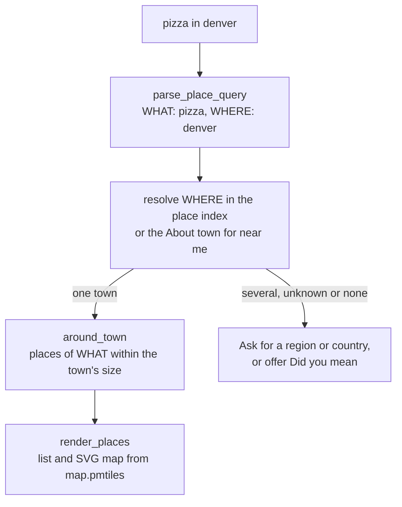

# Places and the map

A search that says where, such as "pizza in denver", "hotels near red rocks amphitheatre" or "coffee near me", lists matching places from OpenStreetMap above the sites, on a small map the node draws itself. This page covers how such a search is read, how "near me" finds your town, how many places a node keeps, the map, how to build the places and map files, and what a node fetches for them. It is for searchers, operators and contributors.

Places are © [OpenStreetMap contributors](https://www.openstreetmap.org/copyright), under the Open Database License (ODbL). Every list of places says so.

## Contents

- [What a place search shows](#what-a-place-search-shows)
- [How a search is read](#how-a-search-is-read)
- [Near me](#near-me)
- [What is kept](#what-is-kept)
- [How many](#how-many)
- [The map](#the-map)
- [Building the places and the map](#building-the-places-and-the-map)
- [What the node fetches](#what-the-node-fetches)
- [The code](#the-code)

## What a place search shows

Up to 8 places (`PLACES_PER_SEARCH`), each with its name, kind ("Pizza restaurant", "Café"), distance, street address, website and a link to it on OpenStreetMap. Distances are in miles for searchers in the US, the UK, Liberia and Myanmar, in kilometers elsewhere. Above the list, a map shows the places as numbered pins with a scale bar, and a link opens the same area on openstreetmap.org.

- The places' own websites lead the sites below them.
- A query that only might say where (no "in" or "near") and is also the name of a site, such as "us bank", keeps the site and lists no places.
- Search operators (`site:` and the rest) list no places, and safe search leaves out adult places and places whose website the adult blocklist names.
- On a node that keeps search history, places a browser seldom opens for searches like the one it makes are folded to one line; opening it brings them back.
- `/api/search?full=1` returns the same list as `places`, with its license and attribution. It has no town for "near me".

The results page loads nothing from any other server: tiles fetched by the browser would tell a tile server where every searcher looks. A node without a map file draws the pins alone.

## How a search is read



[`parse_place_query`](../crates/plumb-index/src/places.rs) splits a search into WHAT is looked for and WHERE:

| Form | Examples |
| --- | --- |
| `WHAT in WHERE`, `near`, `around`, `close to`, `at` | "pizza in denver", "hotels near the eiffel tower" |
| `WHAT near me`, `nearby`, `in my area`, `near here` | "coffee near me", "nearby pharmacy" |
| A kind of place with `open now`, `open late`, `24 hours`, `tonight`, or after `nearest` | "pharmacy open late", "nearest gas station", "pizza tonight" |
| `WHERE WHAT` or `WHAT WHERE`, when WHAT is a kind of place and WHERE a city or borough | "denver pizza", "sushi fort collins" |
| A place's name with its town | "starbucks denver", "hyatt austin" |

- Words like "best", "cheap" and "nearest" are left out of WHAT. WHAT must be in a place's name or among the words for its kind: a café is found by "cafe", "coffee" and "coffee shop".
- Words after "near me" say no more of where: "dentist near me that takes medicaid" is a dentist near me.
- WHERE is a town, village, borough, suburb or neighborhood by its name or another name ("nyc", "philly"), with "st", "ft" and "mt" read either way ("st paul" is Saint Paul). A state, province or country after it narrows it: "portland maine", "paris, france", "denver co", "rome museums italy".
- WHERE can also be another named place: a landmark an English Wikipedia article names plainly ("big ben", "yellowstone"), a national park, an island, a lake, a mountain or a beach. "downtown chicago" is the Downtown in Chicago.
- A query that asks about a town ("time in tokyo", "weather in denver"), asks how or why ("how to merge cells in excel"), or ends in no place ("tallest building in the world", "height in cm") lists no places. Nor does one whose WHAT is no kind of place and finds nothing ("sort a list in python").

**Which town.** Among places of one name, a clearly bigger one wins (cities, then towns and landmarks, then smaller places, bigger populations first). When two are close and more than 30 km apart (`SAME_AREA_KM`), the search lists none and asks for a region or country, naming the choices; namesakes within 30 km are one area, searched around the bigger. The searcher's country orders the choices but never decides between them. Where nothing has the name, a city of 100,000 people or more whose name it mistypes by one slip (two in a name of nine letters or more) is offered: "hotels in cincinatti" asks "Did you mean hotels in Cincinnati, OH?". Names of five letters or fewer are not guessed from.

**How far.** Places are listed within the town's size of its center ([`town_size`](../crates/plumb-core/src/place.rs)), and three times as far when fewer than 3 are found:

| Around | Distance |
| --- | --- |
| City | 12 km |
| Town | 6 km |
| Village, borough, suburb | 3 km |
| Quarter, neighborhood | 1.5 km |
| National park, nature reserve, island, lake, mountain, volcano, beach | 10 km |
| Any other named place | 3 km |

Places of the kind asked for come before those that only have the words in their name (sushi bars before an office called Sushi Tech), then nearest first; a place with a website, a brand or a Wikidata item counts as up to half again as near. A place mapped twice (a shop and the pharmacy in it) is listed once.

**The time in a town.** "time in boulder" is answered for any city, town or borough the places locate, by the clock its country keeps (in the US, Canada and Australia, its state's or province's). In another country that keeps several, a town takes the nearest zone's clock only when every other zone is at least 3 times as far; otherwise there is no answer rather than a wrong one.

## Near me

"Near me" is the town you give on the **About you** page (`/about`) or the welcome page. The page looks it up as a search would and shows what it found ("Denver, CO, US"), or asks you to add a state or country. On a node that keeps search history, the town is kept with your browser's profile on the node; on one that keeps none (a public server), your browser keeps it in a cookie and sends it with each search. It is never part of a search sent to other nodes.

Plumb never works out where you are from your address or anything else. Without a town, a "near me" search says where to give one. "Weather" and "what time is it" use the same town.

## What is kept

Each place keeps its name (up to 100 characters), its kind (an OpenStreetMap tag such as `amenity=cafe`), a few more kinds such as `cuisine=pizza`, its coordinates, street address, town, region, country, website and OpenStreetMap id, and up to 8 other names ([`plumb_core::place`](../crates/plumb-core/src/place.rs)). The other names are OpenStreetMap's English, short and local names (a town's other and official names too, and an airport's IATA code), then the title and most read redirects of the English Wikipedia article on its Wikidata item ("Big Ben" for the Elizabeth Tower). A Wikidata item tagged on more than 3 places is a brand's and lends none of them names.

Places are named shops, restaurants, cafés, bars, banks, pharmacies, hospitals, schools, libraries, hotels, museums, attractions, parks, gyms, stations, airports, offices, workshops, castles and the like, plus towns and the lakes, mountains, volcanoes and beaches an English Wikipedia article names plainly. Benches, bins, toilets, vending machines, ATMs and places marked closed are left out.

A town's region is the one most of its places' addresses give, and its country the one most places in that region give, so a town on a border keeps its own side. A place whose address lacks its town, region or country takes those of the nearest town on its side of the border.

The file, `DIR/pages/sets/places.tsv.gz`, is sorted by how notable a place is ([`place_rank`](../crates/plumb-core/src/place.rs)): cities, towns, landmarks (the most read first), places with a Wikidata item, suburbs, places with a website or a brand, villages, neighborhoods, then everything else. So the first N lines are the best known N places.

## How many

Places are a page set with tiers of their own ([`auto_places`](../crates/plumb-node/src/places.rs)). On Automatic:

| Storage limit | Places kept | About |
| --- | --- | --- |
| Under 1,000 MB | None | 0 |
| 1,000 MB or more | The first 1,000,000 (every city and town, and the places with a Wikidata item: museums, sights, stations, stadiums), plus every place within 100 km (`NEAR_KM`) of a town given on one of the node's About pages, and with them specialty places (brewpubs, gyms by their sport) anywhere | 140 MB with the index, plus the places near your towns |
| None | All of them, about 24 million, every café and shop | 4 GB with the file |

A node with a storage limit keeps only those places in its file as well: the file is cut as it is downloaded, and taken again when the towns on its About pages change.

The panel's **Page sets** part can also turn places off or keep a number of them, saved as `places` in `page_sets` (`{"places": "off"}`). See [pages.md](pages.md#how-many-pages-a-node-keeps). The node indexes the places it keeps in `DIR/pages/places-<key>/`, apart from the page index, since places are searched by where they are.

## The map

The node draws each map as SVG from `DIR/pages/sets/map.pmtiles` ([map/](../crates/plumb-node/src/map/mod.rs)), a slim cut of the [Protomaps basemap](https://docs.protomaps.com/basemaps/downloads) of OpenStreetMap. The file keeps land, water, rivers, parks and woods, roads and railways (no tunnels, driveways or footpaths) and the names of towns and neighborhoods, nothing else.

For each map the node picks the zoom whose detail suits the map's size, from a whole city down to every street, and drops to the deepest zoom the file has there, using at most 16 tiles and writing at most 6 names. The file is reopened when it changes, so a new one is used from the next search. A node holding the project's signed map set `plumb/map` reads whichever of the set and the file is newer.

## Building the places and the map

Both come from `plumb-tools` ([pages.md](pages.md#building-sets-with-plumb-tools) says how to build it).

**Places** are read from OpenStreetMap extracts ([build/osm.rs](../crates/plumb-tools/src/build/osm.rs)):

```sh
plumb-tools fetch-pages --set places --osm planet-latest.osm.pbf \
  --articles /path/to/node-data/pages/sets/wikipedia-en.tsv.gz --data /path/to/node-data
```

| Flag | What it does |
| --- | --- |
| `--osm FILE...` | OpenStreetMap extracts (`.osm.pbf`): the whole planet, or countries and states from download.geofabrik.de, which may overlap |
| `--work DIR` | Without `--osm`, downloads the planet (about 90 GB) here |
| `--articles FILE` | The `wikipedia-en` set, for other names, landmarks, and the lakes and mountains it names; without it there are none |
| `--data DIR` or `--out PATH` | Where to write `places.tsv.gz` |

The extract is read on every core, up to three times.

**The map** is cut from the basemap ([map_fetch.rs](../crates/plumb-tools/src/map_fetch.rs)):

```sh
plumb-tools fetch-map --data /path/to/node-data --world-zoom 8 --zoom 14 \
  --near 39.74,-104.99 --near 40.02,-105.27
```

| Flag (default) | What it does |
| --- | --- |
| `--world-zoom` (8) | Keep the whole world up to this zoom: towns and main roads |
| `--zoom` (14) | Keep tiles up to this zoom around each `--near` point: every street |
| `--near LAT,LON` | A point to keep street detail around; repeat for more |
| `--km` (50) | How far around each point |
| `--from FILE_OR_URL` | A `.pmtiles` file or address to cut from, instead of a recent daily build at build.protomaps.com |
| `--dry-run` | Say how many tiles and bytes it would read, by zoom, and stop |
| `--data DIR` or `--out PATH` | Where to write `map.pmtiles` |

`fetch-map` reads the basemap over HTTP with range requests, so only the tiles kept are downloaded, and keeps only what the maps draw from each tile. Each zoom is about twice the size of the one before. `plumb-tools set map --pmtiles FILE --out DIR` writes a map file as the set `plumb/map`, for `plumb-tools set sign` to sign.

**Try them without a node:**

```sh
plumb-tools search --index DIR/indexes/000123 --places places.tsv.gz --town "Boulder, CO" coffee near me
plumb serve --index DIR/indexes/000123 --places places.tsv.gz --map map.pmtiles
```

Each indexes the places file next to it on first use.

## What the node fetches

| What | From | When |
| --- | --- | --- |
| The places file | A trusted node, over `/plumb/pages/1`, cut to the places kept | When the node keeps places and has no file, too few places, or towns that changed; newer files as for other sets ([pages.md](pages.md#nodes-in-the-network)) |
| The map file | A trusted node, whole, over `/plumb/pages/1`; or the signed set `plumb/map` from any node, over `/plumb/sets/1` | With no storage limit, or when it has a map already. Newer maps are taken as set files are: at most 125% of the size of the node's own, unless `--set-updates` names `map` |
| Local sites | The websites of places near the node's towns | In every crawl round ([below](#local-sites)) |

A node with a storage limit and no map takes none; run `plumb-tools fetch-map` to give it one. With `--set-updates off`, or a list without `map`, a node that has a map keeps it as it is. A node that only crawls (`--crawl-only`) keeps no places and no map. Nothing is fetched while a search is answered: places, town lookups and maps all come from the node's own files.

### Local sites

A node also crawls the websites of the places within 50 km of the towns on its About pages, nearest first, up to 5,000 sites ([node/places.rs](../crates/plumb-node/src/node/places.rs)). They are crawled whatever the network assigns the node, up to 100 a round, and again when they come due like any other site. Trimming keeps them, and the denylist still applies. So each node fills in the cafés, shops and clinics of its own area, and its crawls reach the network like any others. A node with no town on an About page has no local sites.

## The code

| Module | What it does |
| --- | --- |
| [`plumb_core::place`](../crates/plumb-core/src/place.rs) | The `Place` record, the places file format, `place_rank`, kinds and their words |
| [`plumb_index::places`](../crates/plumb-index/src/places.rs) | The place index: reading a search, resolving towns, finding places around them |
| [plumb-node `places.rs`](../crates/plumb-node/src/places.rs) | How many places a node keeps, cutting the file, building the index |
| [plumb-node `node/places.rs`](../crates/plumb-node/src/node/places.rs) | Keeping the index in step with settings and towns; local sites |
| [plumb-node `web/places.rs`](../crates/plumb-node/src/web/places.rs) | The places part of the results page and its SVG map |
| [plumb-node `map/`](../crates/plumb-node/src/map/mod.rs) | Reading PMTiles and vector tiles, slimming them, drawing the map |
| [plumb-tools `build/osm.rs`](../crates/plumb-tools/src/build/osm.rs) | Reading OpenStreetMap extracts into the places file |
| [plumb-tools `map_fetch.rs`](../crates/plumb-tools/src/map_fetch.rs) | `fetch-map` |
