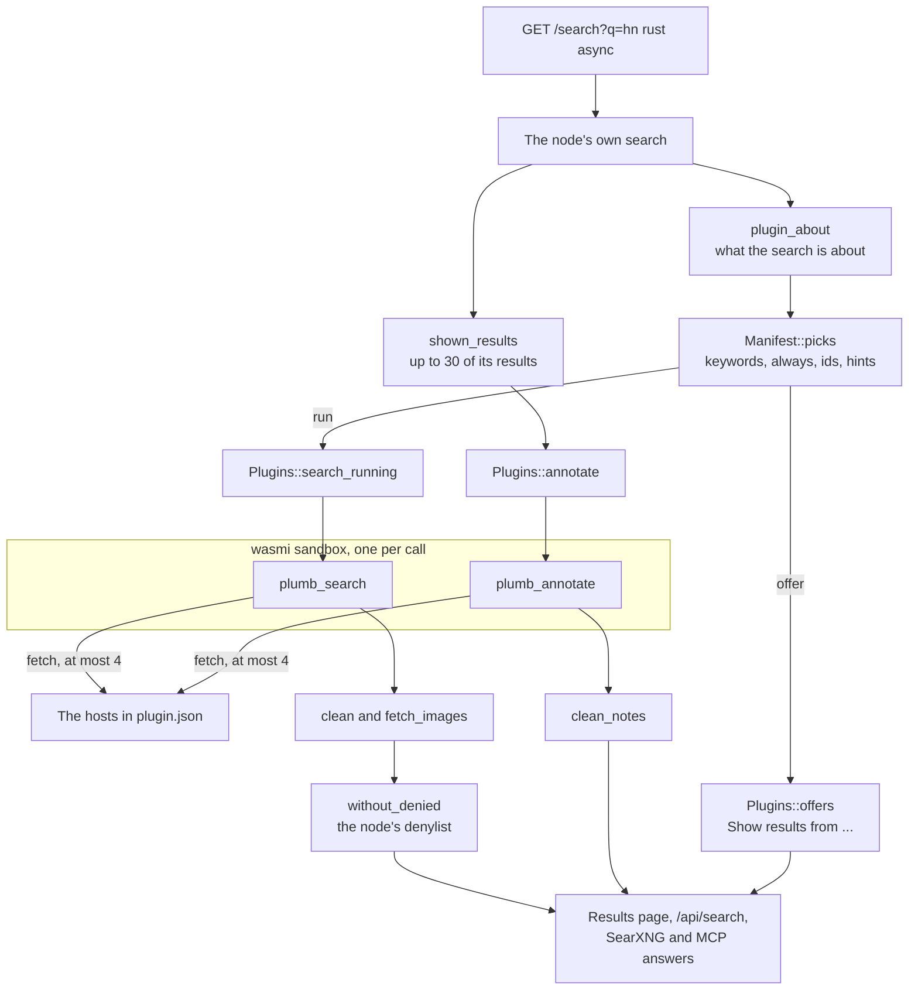

# Plugins

A plugin adds results from a source Plumb does not crawl, such as a site's own search API or an app on your computer. This page is for node owners who install plugins and for anyone who writes one. Plugins are Rust compiled to WebAssembly with the [plumb-plugin](../crates/plumb-plugin/README.md) crate, and a node runs them in a sandbox.

Nodes come with no plugins, and plumbsearch.org runs none. A plugin is the choice of whoever installs it, and so is keeping to its source's terms: prefer a source's official API, with your own key where it needs one, over scraping its pages.

What a plugin finds stays on the node that ran it. It is never shared with other nodes, never kept in the node's records or index, and never sent with a network search.

- [What a plugin can do](#what-a-plugin-can-do)
- [How a search runs plugins](#how-a-search-runs-plugins)
- [When a plugin runs](#when-a-plugin-runs)
- [Marking up the node's results](#marking-up-the-nodes-results)
- [Buttons](#buttons)
- [Page lookups](#page-lookups)
- [The sandbox](#the-sandbox)
- [Install a plugin](#install-a-plugin)
- [Plugins in this repository](#plugins-in-this-repository)
- [Write a plugin](#write-a-plugin)
- [plugin.json](#pluginjson)
- [The interface](#the-interface)

## What a plugin can do

| Ability | The plugin exports | What people see |
| --- | --- | --- |
| Search results | `plumb_search`, from `plugin!(search)` | A "From *name*" block after the first result, marked "plugin on this node" |
| Buttons on its results | `plumb_act`, from `plugin!(search, act)` | Up to 3 buttons per result, for the node's owner only |
| Marking up the node's own results | `plumb_annotate`, from `annotate!(annotate)` or `annotate_only!(annotate)` | A badge such as "Steam: Owned, 25 h", buttons, or the result left off the page |
| Page lookups | `plumb_search`, with `pages` in `plugin.json` | Its results for one page, through `GET /api/plugins/page` |
| Offers | `plumb_search`, with `"suggest": "button"` | A "Show results from *name*" link that runs it |

Plugin results show on the results page and in the node's other answers:

| Where | What it carries |
| --- | --- |
| `/search` | The plugin's block after the first result, its offers, and its notes on the node's results |
| `/api/search?full=1` | `plugins` (each `{plugin, name, results}`), `plugin_notes` (by result address) and `plugin_offers` |
| `/search?format=json` (SearXNG) | Its results after the first result, each with `engine` set to the plugin's folder name |
| MCP `search` tool | `plugins`: each plugin's name and its results' title, address, site, snippet and age |

## How a search runs plugins

The node first runs its own search, so it knows what the search is about. Then it runs the plugins that the search picks, and the plugins that mark up results, side by side. Each call gets a fresh sandbox on a blocking thread.



The host side is [plugins.rs](../crates/plumb-node/src/plugins.rs) (loading, picking, the sandbox, checks and caching) and, in the web layer, [web/search.rs](../crates/plumb-node/src/web/search.rs) (what a search is about), [web/plugin_results.rs](../crates/plumb-node/src/web/plugin_results.rs) (rendering) and [web/plugins.rs](../crates/plumb-node/src/web/plugins.rs) (buttons and page lookups).

## When a plugin runs

**By keyword.** A search that starts or ends with one of the plugin's `keywords` runs it on the rest of the search. With the Hacker News plugin's keywords `hn` and `hacker news`, both `hn rust async` and `rust async hacker news` run it with `terms` set to `rust async`. A keyword alone (`hn`) does not run it, since that is a search for the site.

**Always.** `"always": true` runs it on every search, with the whole search as `terms`. Use it only for a source that allows that many requests, such as an app on your own computer.

**By what the search is about.** When the node recognizes a search as one thing, it tells every plugin it runs as `about` ([`About`](../crates/plumb-plugin/src/lib.rs)): the thing's title, description, Wikidata item and identifiers on other services. The node takes a search to be about the article its info box would show, or else a song or album of its music set listed near the top that the search names, or a well-known song whose title is the whole search. Identifiers use the keys of Plumb's profiles, such as `imdb`, `tmdb-movie`, `tmdb-tv`, `musicbrainz-artist`, `steam` and `github`; a song carries `musicbrainz-recording` and an album `musicbrainz-album`, each with its artist as `by`.

A plugin whose `ids` lists one of those keys fits such a search without a keyword, and can look the thing up by its identifier rather than by its name: with `"ids": ["imdb"]`, a search for `paddington 2` on a node that knows the film runs it with `about.id("imdb")` set to `tt4468740`. `"ids": ["wikidata"]` fits anything with a Wikidata item. A plugin also fits a search that holds one of its `hints` anywhere, such as `lyrics` or `music video`.

**Run it, or offer it.** What a search that fits a plugin does without a keyword is the plugin's `suggest`:

| `suggest` | A search that fits it |
| --- | --- |
| `automatic` (the default) | Runs it, and its results show with the node's |
| `button` | Shows a "Show results from *name*" link instead, which runs it. Suits a source with a small daily quota. An identifier its `run_ids` lists still runs it |
| `keywords` | Does nothing: only its keywords run it |

The node's owner can change this per plugin under **Search & browser → Plugins** in the panel (`/app`). The choice applies from the next search and is kept in `plugins/suggest.json` in the data folder. An offer's link is the same search with `run=<folder name>`, which runs that plugin on the whole search; `/api/search` takes `run` too.

The MCP server's `search` tool runs plugins without knowing what the search is about, so `ids` do not run them there; keywords, `always` and `hints` do.

**Caching.** A plugin's results for the same search, settings and `about` are reused for 10 minutes, or its `cache_seconds`, so a busy node does not ask its source the same thing over and over. A plugin that shows live status sets `"cache_seconds": 0`. Results from a run for a thing in its `run_ids` (a song, say) are kept for that thing for a day, whatever words found it, unless `cache_seconds` is 0.

## Marking up the node's results

A plugin that exports `plumb_annotate` is shown the node's own results for a search, up to 30 (`MAX_SHOWN`), as a [`Shown`](../crates/plumb-plugin/src/lib.rs): each result's `id`, address, title, site and, when the node knows, what it is about, with the same Wikidata item and identifiers as a search's `about`. A Wikipedia article about a film is about that film; a site's result is about what the article it carries is about. The plugin answers with a [`Note`](../crates/plumb-plugin/src/lib.rs) for each result it has something to say about: a badge, buttons, or `hide` to leave the result off the page.

- A plugin with `ids` is shown only the results about something with one of those identifiers, or on a site its `pages` lists, and runs only when there is one. A plugin without `ids` is shown every result of every search, so mind its source's limits.
- It runs beside the plugins' searches, with the same time limit and cache.
- A plugin that only marks up results needs no keywords and no `plumb_search`: use `annotate_only!`.
- Badges show to anyone who can search the node, as "*name*: *badge*". Buttons show only to its owner.
- A hidden result is left off this node's results page for everyone who searches it. Notes are never sent to other nodes, and other nodes' results are not marked up.

`/api/search?full=1` lists the notes, hidden ones included, as `plugin_notes`, by the results' addresses.

## Buttons

A result or note can carry up to 3 buttons ("Add", "Download"). Pressing one runs the plugin's `plumb_act` with the button's data, in the same sandbox with up to 10 seconds, and shows the line it hands back ("Added to your list"). The plugin's cached results and notes are then dropped, since what it shows may have changed. A plugin without `plumb_act` shows no buttons.

Buttons are for the node's owner. They show, and work, only on the computer the node runs on, by the same rule as the panel's settings ([Behind a reverse proxy or tunnel](docker.md#behind-a-reverse-proxy-or-tunnel)): not from another machine, not through a reverse proxy, and not from a page of another site. Each results page's button forms carry a token the node makes when it starts, so another site's page cannot press them. Anyone else who can search the node sees the results without buttons, but still sees everything else a plugin shows (titles, badges, pictures). On a node other people search, install only plugins whose results you are happy for them to see.

| Route | Who calls it | Request | Answer |
| --- | --- | --- | --- |
| `POST /plugins/act` | A results page's button | A form: `plugin`, `data`, `token`, `q`, optionally `run` | A short page saying what the plugin did, which returns to the results |
| `POST /api/plugins/act` | A program, such as a browser extension | JSON: `{"plugin": "<folder name>", "data": <the button's data>}` | `{"message": "..."}`, or `{"error": "..."}` with status 403 or 502 |

`/api/plugins/act` accepts requests from the node's own computer to a local address such as `http://127.0.0.1:8080`, with no forwarding headers, and with no `Origin` or the node's own. Browser extensions' origins (`chrome-extension://`, `moz-extension://`, `safari-web-extension://`) are accepted too.

## Page lookups

A plugin whose `pages` lists sites (`"pages": ["*.example.org"]`) can say something about one of their pages. `GET /api/plugins/page?url=<address>` runs those plugins with `page` set to the address and `terms` empty, with moderate safe search, and answers `{"plugins": [{"plugin", "name", "results": [...]}]}`. A browser extension can ask it about the page open in a tab and show what comes back, buttons included. The node's denylist applies to these results as to a search's.

## The sandbox

Each call runs in a fresh [wasmi](https://github.com/wasmi-labs/wasmi) instance. Inside it a plugin can read its input (the search, its settings and its own `config.json`), send HTTP requests to the hosts its `plugin.json` lists, read their status, headers and body, write lines to the node's log, and hand back its answer. It cannot read or write files, open any other connection, read the clock or the environment, or learn who searched. A module that imports anything but the [`plumb` functions](#the-interface) is refused when the node loads it.

| Limit | Value | Set by |
| --- | --- | --- |
| Time a search waits for a plugin | 4 s, or its `seconds` (1 to 10) | `SEARCH_TIME`, `MAX_SECONDS` |
| Time a button press may take | 10 s | `ACT_TIME` |
| Requests per call | 4 | `MAX_FETCHES` |
| Response body | 2 MB; 100 headers | `MAX_BODY`, `MAX_HEADERS` |
| Request or answer handed over | 1 MB | `MAX_HANDED` |
| Memory | 64 MB | `MAX_MEMORY` |
| Work per call | 2 billion units of wasmi fuel, about as many WebAssembly instructions | `FUEL` |
| Calls of one plugin at once | 4; more searches go without it | `MAX_RUNNING` |

A plugin still running after its time is left out of that search. It is not stopped at once: its requests fail once the time is up, and it computes on in the background until it returns or runs out of fuel. A plugin that fails, runs too long or runs out of fuel is left out, and the node's log says why.

**Requests.** A request must be `http` or `https`, to a host and port its `hosts` allows, with the method `GET`, `POST`, `PUT`, `PATCH`, `DELETE` or `HEAD`. Redirects are followed for up to 5 hops, and only to allowed hosts. Requests carry the user agent `PlumbSearch/<version> plugin <folder name> (+https://github.com/SueHeir/plumb-search)`, connect within 3 seconds and end when the call's time does. They go out directly, not through a system proxy.

Names are looked up through plumb-crawl's resolver ([`Resolver::for_named_hosts`](../crates/plumb-crawl/src/dns.rs)). A name on the web, one under a suffix in the public suffix list such as `api.example.org`, reaches only public addresses, so whoever runs its DNS can't point it at your network. A local name (one label such as `nas` or `localhost`, a suffix the list doesn't know such as `media.lan` or `box.local`, or `home.arpa`) and an address reach what they name: that is how the Zotero plugin reaches `127.0.0.1:23119`. A home name under a real top-level domain, such as `nas.fritz.box`, counts as a name on the web, so list the machine's address or a one-label name instead.

> [!WARNING]
> A plugin that lists `localhost`, a machine on your network or its address can reach the services there. Read `hosts` before you install a plugin.

**What is shown.** The node checks a plugin's results before showing them ([`clean`](../crates/plumb-node/src/plugins.rs)):

| Field | Kept |
| --- | --- |
| Results | The first 10 with a title and an `http`, `https` or `magnet:?xt=` address of up to 2,048 characters |
| `title`, `snippet`, `badge` | Put on one line and cut to 200, 400 and 24 characters |
| Safe search | Results that say they are adult (by site, title, snippet or badge) are left out unless safe search is off |
| `image` | Fetched by the node from one of the plugin's own hosts within its time, kept only if its bytes are a PNG, JPEG, GIF or WebP of up to 256 KB, and put in the page as a `data:` URL, so the searcher's browser asks nobody for it |
| Buttons | Up to 3 per result, labels cut to 30 characters, data up to 4 KB of JSON, and only for a plugin that exports `plumb_act` |
| Denylist | Results the node's denylist takes off are left out |

Everything a plugin returns is escaped like any other text from the web.

## Install a plugin

A plugin is a folder:

```text
hacker-news/
  plugin.json    what it is, the hosts it may reach, what runs it
  plugin.wasm    the plugin itself
  config.json    optional: your settings for it, such as an API key
```

Put the folder in `plugins/` inside the node's data folder, then restart the node:

| Node | Folder | Restart |
| --- | --- | --- |
| `plumb run --data DIR` | `DIR/plugins/hacker-news/` | Stop and start `plumb run` |
| Docker | `/data/plugins/hacker-news/` in the container's volume | `docker compose restart` |
| Desktop app | `plugins/hacker-news/` in the app's data folder ([Where data lives](desktop.md#where-data-lives)) | Quit and reopen the app |
| `plumb serve` | Any folder of plugin folders, given as `--plugins DIR` | Restart `plumb serve` |

With Docker, the node runs as user 10001, so make the `plugins` folder from inside the container before you copy a plugin in:

```sh
docker compose exec plumb mkdir -p /data/plugins
docker compose cp hacker-news plumb:/data/plugins/
docker compose restart
```

Read `plugin.json` before you install a plugin: `hosts` lists everywhere it can send your searches. When the node starts it logs each plugin it loaded with its hosts, and adds a line to the panel's activity list; **AI & plugins** in the panel lists them. A plugin that cannot load is left out with a warning in the log. To remove a plugin, delete its folder and restart.

**Try a plugin first** with `plumb try-plugin`, which runs it once in the same sandbox and prints what it found as JSON, or why it found nothing:

```sh
plumb try-plugin --plugin plugins/hacker-news hn rust async
```

| Form | What it does |
| --- | --- |
| `plumb try-plugin --plugin DIR <search>` | Runs its search, keyword included or not, with moderate safe search |
| `plumb try-plugin --plugin DIR <address>` | A page lookup, for an address on a site its `pages` lists |
| `--act '<json>'` | Presses a button: the `data` of an action in its results |
| `--annotate results.json` | Has it mark up results: a JSON list of `{"id", "url", "title", "site", "about"}` |

A plugin's own log lines are at debug level: run `RUST_LOG=info,plumb_node::plugins=debug plumb try-plugin ...` to see them.

## Plugins in this repository

Each folder in [plugins/](../plugins) is a workspace crate with a `plugin.json`, a README, and, where it needs settings, a `config.example.json` to copy to `config.json`.

| Plugin | What it adds | Needs |
| --- | --- | --- |
| [hacker-news](../plugins/hacker-news/README.md) | `hn rust async`: Hacker News stories | Nothing |
| [github](../plugins/github/README.md) | `gh http client`: repositories with stars, language and last push; star counts and Star buttons on GitHub results with a token | Nothing to search; a GitHub token for the rest |
| [reddit](../plugins/reddit/README.md) | `reddit rust async`: Reddit threads | Your own Reddit app's keys |
| [steam](../plugins/steam/README.md) | `steam portal`: games in your library; "Owned" and "On your wishlist" badges on results about a game | A Steam Web API key and your SteamID64 |
| [youtube-music](../plugins/youtube-music/README.md) | `ytm creep`, `yt rust async`: songs and videos, and the song or album a search is about | A YouTube Data API key |
| [zotero](../plugins/zotero/README.md) | Every search: items from your Zotero library | Zotero 7 or later open on the node's computer |

Build one with:

```sh
rustup target add wasm32-unknown-unknown
cargo build --release -p plumb-plugin-hacker-news --target wasm32-unknown-unknown
cp target/wasm32-unknown-unknown/release/plumb_plugin_hacker_news.wasm plugins/hacker-news/plugin.wasm
```

## Write a plugin

This walk-through builds a plugin that searches a made-up API at `api.example.org`. [plugins/hacker-news](../plugins/hacker-news/src/lib.rs) is a complete small example, and [plugins/github](../plugins/github/src/lib.rs) uses every part of the interface.

**1. Start a library crate.** The `cdylib` is the plugin; the `rlib` lets its tests run on your computer.

```toml
[package]
name = "my-plugin"
version = "0.1.0"
edition = "2021"

[lib]
crate-type = ["cdylib", "rlib"]

[dependencies]
plumb-plugin = { git = "https://github.com/SueHeir/plumb-search", tag = "v0.3.1" }
serde = { version = "1", features = ["derive"] }
serde_json = "1"
```

**2. Write the search** and hand it to `plugin!`. It gets a [`Query`](#what-a-search-gets) and returns a list of [`Item`](#what-it-returns)s.

```rust
use plumb_plugin::{encode, get, Error, Item, Query};
use serde::Deserialize;

#[derive(Deserialize)]
struct Found {
    items: Vec<Article>,
}

#[derive(Deserialize)]
struct Article {
    title: String,
    url: String,
    summary: String,
}

fn search(query: &Query) -> Result<Vec<Item>, Error> {
    let key = query.config["api_key"]
        .as_str()
        .ok_or_else(|| Error::Other("no api_key in config.json".into()))?;
    let url = format!(
        "https://api.example.org/search?q={}&key={}",
        encode(&query.terms),
        encode(key)
    );
    let found: Found = get(&url)?.json()?;
    Ok(found
        .items
        .into_iter()
        .map(|article| Item::new(article.title, article.url).snippet(article.summary))
        .collect())
}

plumb_plugin::plugin!(search);
```

**3. Write its `plugin.json`** ([every field](#pluginjson)) and, for its settings, a `config.json`:

```json
{
  "name": "Example",
  "about": "Articles from example.org, through its search API.",
  "hosts": ["api.example.org"],
  "keywords": ["ex", "example"]
}
```

**4. Build it** and put the module next to `plugin.json` as `plugin.wasm`:

```sh
rustup target add wasm32-unknown-unknown
cargo build --release --target wasm32-unknown-unknown
cp target/wasm32-unknown-unknown/release/my_plugin.wasm plugin.wasm
```

**5. Try it** with `plumb try-plugin --plugin . ex rust async`, then [install it](#install-a-plugin).

**6. Add buttons.** Give results [`Action`](../crates/plumb-plugin/src/lib.rs)s and name an `act` in `plugin!`. `act` gets the pressed button's `data` and the plugin's `config`, does what the button says, and returns a line for the owner.

```rust
use plumb_plugin::{ActInput, Action, Error, Item, Query, Request};

fn search(query: &Query) -> Result<Vec<Item>, Error> {
    // ...
    Ok(vec![Item::new("Big Buck Bunny", "https://example.org/bbb")
        .badge("Not saved")
        .action(Action::new("Save", serde_json::json!({ "id": 42 })))])
}

fn act(input: &ActInput) -> Result<String, Error> {
    let id = input.data["id"]
        .as_u64()
        .ok_or_else(|| Error::Other("no id".into()))?;
    Request::post("https://api.example.org/saved", format!(r#"{{"id":{id}}}"#))
        .header("Content-Type", "application/json")
        .send()?
        .ok()?;
    Ok("Saved.".into())
}

plumb_plugin::plugin!(search, act);
```

**7. Mark up the node's results.** Export an `annotate` with `annotate!` (beside `plugin!`) or `annotate_only!` (alone). Ask the source once for all the results, not once per result. With `"ids": ["wikidata"]` in `plugin.json`, it is shown only results about something with a Wikidata item.

```rust
use plumb_plugin::{get, Action, Error, Note, Shown};

fn annotate(shown: &Shown) -> Result<Vec<Note>, Error> {
    let saved: Vec<String> = get("https://api.example.org/saved")?.json()?;
    Ok(shown
        .results
        .iter()
        .filter_map(|result| {
            let item = result.about.as_ref()?.wikidata.clone()?;
            Some(if saved.contains(&item) {
                Note::new(result.id).badge("Saved")
            } else {
                Note::new(result.id)
                    .badge("Not saved")
                    .action(Action::new("Save", serde_json::json!({ "id": item })))
            })
        })
        .collect())
}

plumb_plugin::annotate!(annotate);
```

**8. Test it.** A plugin's code builds and its tests run on any computer, but outside a node every request fails. Test the code that reads a source's answers on saved answers, as [plugins/reddit](../plugins/reddit/src/lib.rs) does with its `samples/` folder, and run `cargo test`.

### What a search gets

[`Query`](../crates/plumb-plugin/src/lib.rs):

| Field | Meaning |
| --- | --- |
| `text` | The whole search, as typed; for a page lookup, the page's address |
| `terms` | The search without the keyword that ran the plugin; empty for a page lookup |
| `keyword` | That keyword, if one did |
| `safe` | Safe search: `off`, `moderate` or `strict`. Pass it on to sources that filter |
| `language` | The language asked for, such as `en`, if any |
| `config` | The plugin's `config.json`, or `null` |
| `about` | What the node took the search to be about: `title`, `description`, `wikidata`, `ids` (read one with `about.id("imdb")`) and, for a song or album, `by` |
| `page` | For a page lookup, the page's address |

### What it returns

An [`Item`](../crates/plumb-plugin/src/lib.rs) has a `title` and a `url`, and optionally a `snippet`, `published` (Unix seconds), an `image` (a picture's address on one of its hosts), a `badge` (a word or two beside the title, such as "In library" or "45%") and `actions`, its buttons. Build one with `Item::new(title, url)` and the builder methods `snippet`, `published`, `image`, `badge` and `action`.

A call that fails returns an [`Error`](../crates/plumb-plugin/src/lib.rs). The node logs it and shows nothing from that call; a button shows it to the owner.

### Requests

`get(url)` sends a GET. [`Request`](../crates/plumb-plugin/src/lib.rs) builds any other: `Request::post(url, body)`, `Request::put(url, body)`, `Request::delete(url)` or `Request::new(method, url)`, then `.header(name, value)` and `.send()`. A [`Response`](../crates/plumb-plugin/src/lib.rs) has its `status`, `headers` (names in lower case) and `body`:

| Method | Gives |
| --- | --- |
| `ok()` | The response, or `Error::Status` unless its status is 2xx |
| `json::<T>()` | The body read as JSON, when the status is 2xx |
| `text()` | The body as text |
| `header(name)` | The first header of that name, in any case |
| `cookies()` | The cookies it sets, as a `Cookie` header for the next request, for a source that wants a login first |

`encode(text)` percent-encodes text for a query string, and `log(line)` writes a line to the node's log at debug level.

## plugin.json

| Field | Meaning |
| --- | --- |
| `name` | Required. What the results page calls it: "From Example". 1 to 60 characters |
| `about` | One line about where its results come from, shown in the panel |
| `hosts` | Required. The hosts it may fetch from: `api.example.org`; `*.example.org` for every subdomain (not `example.org` itself); a name on your network such as `nas`; or an address such as `127.0.0.1` or `[::1]`. Without a port only ports 80 and 443 are allowed; name one to reach another: `127.0.0.1:7878`, `nas:8989` |
| `keywords` | Words or phrases that run it at the start or end of a search |
| `always` | `true` runs it for every search |
| `ids` | Identifier keys (`imdb`, `steam`, `wikidata`...) whose searches fit it without a keyword; also limits what it is shown to mark up |
| `hints` | Words or phrases that, anywhere in a search, make it fit |
| `run_ids` | Of its `ids`, those that run it even when it is only offered (`"suggest": "button"`) |
| `suggest` | What a search that fits it does without a keyword: `automatic` (the default), `button` or `keywords` |
| `pages` | Sites whose pages it can say something about (`example.org`, `*.example.org`, no port), for page lookups, and whose results it is shown to mark up when it has `ids` |
| `cache_seconds` | How long its results for a search are reused: 0 to 86,400; 600 without it |
| `seconds` | How long a search waits for it: 1 to 10; 4 without it. The results page waits for its slowest plugin |

A plugin needs `keywords`, `always`, `ids`, `hints` or `pages`, unless it marks up results. A `plugin.json` that breaks these rules keeps the plugin from loading, with the reason in the log.

`config.json` is whatever the plugin reads from `query.config`: API keys, account names, switches. It must be valid JSON; the node hands it to the plugin as it is and shows it nowhere. Each plugin's README says what it takes.

## The interface

The plumb-plugin crate covers this; it is here for reference, and for plugins written without it. The node and the plugin exchange JSON through the plugin's memory. A module exports:

| Export | Does |
| --- | --- |
| `memory` | The memory the node reads and writes |
| `plumb_abi() -> i32` | The interface version: `2` today. A node runs versions 1 to 2 |
| `plumb_search()` | Reads a `Query`, outputs `{"results": [...]}` |
| `plumb_act()` | Optional. Reads `{"data", "config"}`, outputs `{"message": "..."}` |
| `plumb_annotate()` | Optional. Reads `{"query", "results": [...], "config"}`, outputs `{"notes": [...]}` |

Any of them may output `{"error": "..."}` instead. It may import only these functions from the `plumb` module:

| Import | Does |
| --- | --- |
| `input_len() -> i32`, `input_read(ptr)` | The call's input, as JSON |
| `fetch(ptr, len) -> i32` | Sends the request at `ptr` (JSON: `method`, `url`, `headers`, `body`). Returns the body's length, or -1 host not allowed, -2 failed, -3 too many requests, -4 too large, -5 time up, -6 bad request |
| `fetch_status() -> i32`, `body_read(ptr)` | The last response's status and body |
| `headers_len() -> i32`, `headers_read(ptr)` | The last response's headers, as JSON: `[["name", "value"], ...]` |
| `output(ptr, len)` | The answer, as JSON |
| `log(ptr, len)` | A line for the node's log, cut to 4 KB |
