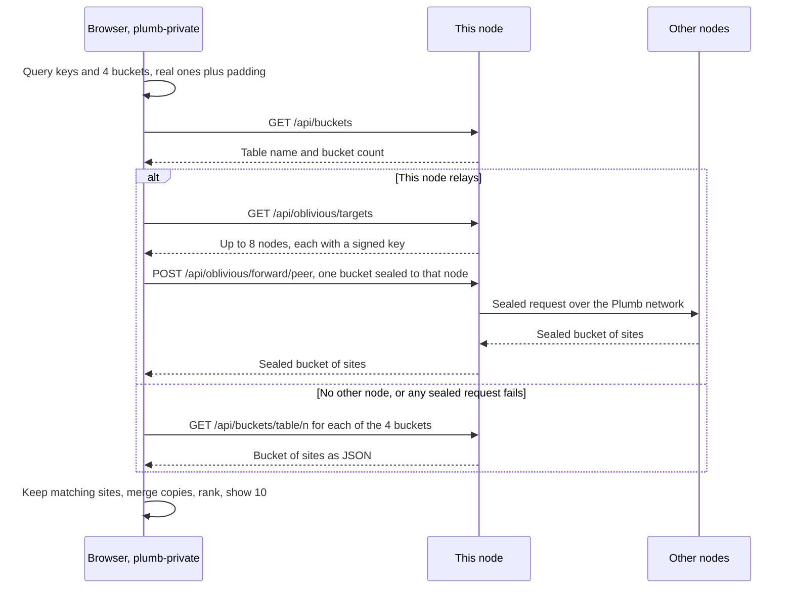

# Private search

A Plumb node can offer a second search page, `/private`, where the query text stays in the browser: the browser fetches a few groups of sites (buckets) and ranks them itself. This page explains how it works, what each party can still learn, how to turn it on and how to build its WebAssembly. It reduces what a search discloses; it is not private information retrieval and not an anonymity guarantee.

Contents:

- [How a private search works](#how-a-private-search-works)
- [What each party sees](#what-each-party-sees)
- [Limits](#limits)
- [Ranking in the browser](#ranking-in-the-browser)
- [Running it](#running-it)
- [Building the page's script](#building-the-pages-script)
- [Addresses](#addresses)

## How a private search works

The page's script is [crates/plumb-private](../crates/plumb-private/), Rust compiled to WebAssembly. A search runs in four steps:

1. **Keys.** The browser works out the query's keys with `query_keys` in [keys.rs](../crates/plumb-core/src/keys.rs): the whole query joined first, then its words, longest first (`us bank` gives `usbank`, `bank`, `us`). Words shorter than 2 characters are skipped, and joining words drop out of a longer query (`weather in denver` gives `weatherindenver`, `weather`, `denver`). Search operators stay in the browser: only the query's words pick keys.
2. **Buckets.** Each key falls in one of 16,384 buckets (`BUCKETS`) by a SHA-256 hash that is the same on every node and in every browser. The browser takes the buckets of the first keys and pads them with random buckets so it always asks for 4 (`BUCKETS_PER_SEARCH`), in random order.
3. **Fetching.** It fetches those 4 buckets, sealed through this node to other nodes when it can, or straight from this node otherwise (see the diagram). A bucket holds the 32 best sites (`KEY_CAP`, by link score) of each key that falls in it, a few hundred sites in all, each as its item trimmed to names, text, top link texts and signals (`slim_site`).
4. **Ranking.** It keeps the sites that match its keys, merges copies of a site, ranks them with [rank.rs](../crates/plumb-private/src/rank.rs) and shows the best 10 (`LIMIT`).

The padding is not drawn fresh each time. It comes from a secret the browser keeps in local storage (`plumb-private-padding`, 32 random bytes) hashed with the query's keys, so the same query from the same browser always asks for the same 4 buckets, and comparing two searches does not single out the real ones. Another browser pads differently. A browser that keeps no local storage makes a new secret on each page load.



### Sealed relaying

A node in the Plumb network relays the requests sealed with RFC 9458's encapsulation (the HPKE sealing of Oblivious HTTP), as nodes do among themselves. What is sealed is Plumb's own CBOR bucket request and answer, not Binary HTTP. The shared code is [plumb_core::oblivious](../crates/plumb-core/src/oblivious.rs); the relay's side is [web/relay.rs](../crates/plumb-node/src/web/relay.rs) and the browser's is [sealed.rs](../crates/plumb-private/src/sealed.rs).

- **Targets.** `GET /api/oblivious/targets` lists up to 8 connected nodes that answer bucket requests (`MAX_TARGETS`), each with an encryption key signed by its node key. The relay fetches the keys itself and hands every browser the same ones for a while, so a target cannot tell askers apart by key. The browser checks each key: signed by the node the peer id names, not expired, and lasting no longer than two key lifetimes (`KEY_LIFETIME`, 24 hours) plus an hour.
- **Sealing.** The browser shuffles the targets and seals each bucket number to two of them (one when only one is listed). A request is padded to 64 bytes (`REQUEST_SIZE`) before encryption. Answers are padded to at least 4 KiB (`MIN_RESPONSE_SIZE`) and otherwise to the next size of 2^k or 1.5 × 2^k, so their size says little about what is in them.
- **Forwarding.** `POST /api/oblivious/forward/{peer}` takes a sealed request of at most 1 KiB, passes it to that node over the network and returns its sealed answer, waiting at most 5 seconds. The browser sends it without cookies and without caching.
- **Opening.** The browser opens each answer, makes each domain canonical, drops a site's URL unless it is on the site's own registrable domain, and merges copies of a site from different nodes keeping each popularity signal's less favorable value (`merge_copies`), so one node alone cannot push its sites up.

If this node lists no other node, or any sealed request fails, the browser fetches all 4 buckets straight from this node. The status line under the search box says which way the buckets came.

### The page

- The query lives in the page's fragment (`/private#q=us%20bank`), which browsers never send to a server, so back, reload and bookmarks still work. The fragment can also carry `country` and `only=1`. A query in the address (`/private?q=...`) is not read.
- The search box has no `name`, so if the script cannot run, the form sends nothing. The page then says private search needs JavaScript and WebAssembly and links to the normal search.
- Its Content-Security-Policy lets it run this site's scripts and WebAssembly and fetch from this site only. Results show a colored first-letter badge instead of the site's icon, since fetching icons would reveal the results.
- The settings gear has Country, Only this country, and the Private search switch back to the normal page. Safe search and language come from the address the switch was opened from. The "Normal search" link carries the query and these settings over.

## What each party sees

| Party | Sees | Does not see |
|---|---|---|
| This node, buckets fetched directly | Your address and the 4 bucket numbers | The query text |
| This node, relaying | Your address and which nodes your browser asks | The bucket numbers |
| An answering node | The bucket number it was asked for, and the relay's address | Your address, the query text |
| A network observer | Timing and sizes of encrypted messages | Their contents |

Operators who control both the relay and an answering node can combine what they see.

## Limits

- **Bucket numbers can reveal the query.** The bucket hash is public, so anyone holding the 4 bucket numbers can hash a dictionary of likely queries and keep those whose buckets are all there. The [privacy review](reviews/privacy-security.md#bucket-inference) narrows a list of brand queries to `us bank` this way. A query with 4 or more keys gets no padding at all.
- **Falls back to direct.** Any failure on the sealed path (no targets, a bad key, one request failing) sends the browser to fetch directly from this node, which then sees both your address and the bucket numbers. There is no strict mode that stops instead, and a relay could cause the fallback on purpose.
- **The relay picks the targets.** A signed key proves which node a key belongs to, not that its operator is a different person from the relay's.
- **Sites are not proven.** The browser does not check crawl proofs, and when only one target is listed every bucket comes from that one node.
- **The site serves the code.** The script comes from the site you search, so a site's operator could change it to send the query.
- **No background rounds.** The browser does not use the node's scheduled rounds or disk cache ([cache-first-search.md](cache-first-search.md)). Its direct fetches use the browser's HTTP cache; sealed fetches run on each search.

## Ranking in the browser

The node ranks with a Tantivy index, which does not build for WebAssembly. A private search has only a few hundred candidates, so [rank.rs](../crates/plumb-private/src/rank.rs) scores them directly with the node's formula and defaults: name matches, trust against look-alikes, kinds ("banks") and the home country work as in the index. The differences:

- The text match is simpler: each query word scores the boost of every field it is in, without BM25's word frequencies. Accents are not folded, so `nestle` does not find `Nestlé`.
- Kind searches ("banks") find only sites that also carry the word in their names, since buckets hold sites by their names.
- Safe search applies the same rules as the node except its blocklist of adult sites. The language filter, its exceptions and search operators work as on the node.
- The instant answer is worked out in the browser, without currency rates or times in other places. There are no page sets, places, headlines or search by meaning.
- The home country comes from the node, as for normal search.

The tests in [tests.rs](../crates/plumb-private/src/tests.rs) check that the first results agree with the index on a set of queries, and that filters, operators, padding and merged copies behave as described. `the_browser_and_a_node_understand_each_other` in [web/relay.rs](../crates/plumb-node/src/web/relay.rs) checks that the browser's sealed messages match the network's.

## Running it

A node offers private search when its build holds the page's script and its index has buckets. It builds buckets when it answers other nodes' searches (any node started with `--network`, by default) or when started with `--private-search`:

```sh
plumb run --data DIR --private-search
```

Each index build then also writes its buckets to `indexes/NNNNNN/buckets/`, taking about as much disk again as the records file. A node whose current index has no buckets rebuilds it once on start. `--crawl-only` turns private search off. Relaying needs the node to be in the network; off the network, browsers fetch buckets directly.

Once the buckets are there, the settings gear on the search pages shows a Private search switch. It is a link to `/private` (and back), so turning it on never sends what was typed. The node's panel shows the state under "Private browser search": Ready, Unavailable in this build, Off until this node joins the Plumb network, or Preparing index.

## Building the page's script

`crates/plumb-private` builds for the browser with the `wasm32-unknown-unknown` target and `wasm-bindgen`, whose version must match the one the crate pins (0.2.108):

```sh
rustup target add wasm32-unknown-unknown
cargo install wasm-bindgen-cli --version 0.2.108 --locked
cargo build -p plumb-private --target wasm32-unknown-unknown --profile wasm
wasm-bindgen --target web --no-typescript --out-dir target/private \
    target/wasm32-unknown-unknown/wasm/plumb_private.wasm
cargo build --release -p plumb-node
```

The `wasm` profile in the workspace `Cargo.toml` optimizes for size, since every visitor downloads the module. `plumb-node`'s [build.rs](../crates/plumb-node/build.rs) embeds `plumb_private.js` and `plumb_private_bg.wasm` from `target/private/`, or from the folder in `PLUMB_PRIVATE_DIR` (relative to `crates/plumb-node`). Without them the node still builds and serves buckets, but `/private` says private search is not available. When `PLUMB_PRIVATE_DIR` is set and the files are missing, the build fails. The Docker image always builds the script.

To check the crate and the node with the script embedded:

```sh
cargo clippy -p plumb-private --target wasm32-unknown-unknown -- -D warnings
PLUMB_PRIVATE_DIR=../../target/private cargo test -p plumb-node private
```

The script is served under a hash of the build, `/private/{hash}/...`, so browsers cache it for good.

## Addresses

| Address | What it does |
|---|---|
| `GET /private` | The page. 503 with a note when this node does not offer private search. |
| `GET /private/{hash}/{file}` | The page's script: `boot.js`, `plumb_private.js`, `plumb_private_bg.wasm`. Cached for a year. |
| `GET /api/buckets` | `{"table": "...", "buckets": 16384}`, or 503 when the node serves no buckets. Never cached. |
| `GET /api/buckets/{table}/{n}` | Bucket `n` of that table: a JSON list of sites' items, trimmed. Earlier versions answered with trimmed site records, which the page still reads from the browser's cache. Cached for a year; 404 once a newer index replaced the table. |
| `GET /api/oblivious/targets` | `{"targets": [{"peer": "...", "keys": {...}}]}`: up to 8 nodes to seal bucket requests to. Empty when the node is not in the network. |
| `POST /api/oblivious/forward/{peer}` | A sealed bucket request for that node (at most 1 KiB), answered with its sealed answer. 404 for a node that does not answer bucket requests, 413 when too large, 502 or 504 when the node does not answer. |
