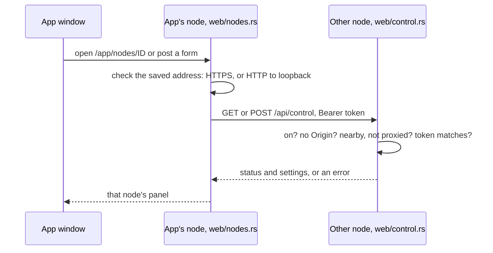

# Remote control security

Remote control lets the [desktop app](desktop.md) show and change the settings of another node, such as a [Docker container](docker.md#control-it-from-the-desktop-app) or a homelab server. This page says what the token can do, who may use it, and how the app keeps it off the wire in the clear. It is for operators deciding how to expose a node.

## How it works

Remote control is off until the node's owner turns it on. The desktop app's own node then makes every request, with the token as `Authorization: Bearer <token>`; the app's window never sees the token.



## Turning it on and off

On the node's own computer, either open the panel's **Remote control** section and click **Turn on and make a token**, or run:

| Command | What it does |
| --- | --- |
| `plumb remote-control on` | Makes a new token, prints it once with the HTTPS certificate's fingerprint, and replaces any earlier token |
| `plumb remote-control on --allow-public` | The same, and also takes requests from public addresses and through reverse proxies |
| `plumb remote-control off` | Turns it off: no token works any more |
| `plumb remote-control status` | Says whether it is on and from where, and prints the fingerprint |

Each takes `--data DIR`, the node's data folder (default: the current folder, which is `/data` in the Docker image). A token is `plumb_` and 64 hex digits. The node keeps only its SHA-256, in `remote-control.json` in the data folder, and compares hashes in constant time. It reads that file on every request, so each change takes effect at once, without a restart.

## What the token can do

The control API ([web/control.rs](../crates/plumb-node/src/web/control.rs)) reads the node's status and changes its settings, features and refreshes, nothing else:

| Route | What it does |
| --- | --- |
| `GET /api/control` | The status, settings, running and saved features, data folder and activity log |
| `POST /api/control/settings` | Puts resource settings in force at once |
| `POST /api/control/features` | Saves features for the node's next start |
| `POST /api/control/refresh` | Starts a refresh now |
| `POST /api/control/reconnect` | Tries the network's bootstrap nodes again now |
| `POST /api/control/retry` | Tries failed work again now |

Connecting from the app also adds each node to the other's trusted nodes, from their next start, so each takes in the other's crawls without waiting for a second crawler to agree. To undo that, remove the other node's id from **Trusted nodes** (under **Advanced** in the panel's Network & privacy section).

## Who may use the token

The node checks each request in this order:

| Check | Refused with |
| --- | --- |
| Remote control is on | `404`, as if the API were not there |
| No `Origin` header: web pages cannot use it, and the API sends no CORS headers | `403` |
| Unless `--allow-public`: the request comes from a nearby address, with no `Forwarded`, `X-Forwarded-For` or `X-Real-IP` header | `403` |
| The token matches | `401` |

Nearby means this computer (`127.0.0.0/8`, `::1`), a private network (`10.0.0.0/8`, `172.16.0.0/12`, `192.168.0.0/16`, `fc00::/7`), a link-local address (`169.254.0.0/16`, `fe80::/10`) or the `100.64.0.0/10` range Tailscale uses ([node/control.rs](../crates/plumb-node/src/node/control.rs)). Docker's own networks are private, so a container takes requests from its host. A reverse proxy that adds a forwarding header (Caddy and Traefik do; nginx with the lines in [Behind a reverse proxy or tunnel](docker.md#behind-a-reverse-proxy-or-tunnel)) has its requests refused, so putting a node behind it on the internet does not expose remote control. A proxy on the same machine that adds no such header looks like this computer, so set one up as that section says. `--allow-public` lifts both limits; use it only with HTTPS in front of the node, since the token goes with every request.

## HTTPS off this computer

The app's node ([web/nodes.rs](../crates/plumb-node/src/web/nodes.rs)) sends the token over plain HTTP only to this computer. Every other address, private networks, Docker networks and VPNs included, needs HTTPS:

- An address typed without a scheme becomes `https://`, except a loopback address, which becomes `http://`.
- `http://` is accepted only for the exact name `localhost`, a `127.x.x.x` address or `[::1]`. For HTTP, `localhost` is replaced with `127.0.0.1` before connecting, so DNS or a hosts file cannot send the token to another computer. `node.localhost`, `localhost.` and other names that resolve to loopback get no exception.
- An address is an origin only: no user name or password, path, query or fragment.
- The client follows no redirects and uses no system proxy.
- HTTPS needs either a certificate this computer trusts, or the node's own certificate pinned by its fingerprint (below).

### A node's own certificate

A node started with `--https-bind` also serves HTTPS, with the same pages and APIs under the same rules, using a certificate it makes for itself the first time:

```sh
plumb run --data DIR --bind 0.0.0.0:8080 --https-bind 0.0.0.0:8443
```

The certificate is `DIR/remote-control-cert.der`, its key `DIR/remote-control-key.der` (readable by its owner only, on Unix). No authority signs it, so the app pins it instead: `plumb remote-control on` and `status` print its SHA-256 fingerprint (`SHA256:3F:A1:...`), and so does the panel's new-token page on a node run with `--https-bind`. In **Connect to a node**, enter `https://<node-address>:8443`, the token and the fingerprint. `--https-bind` must use another port than `--bind`.

A pinned connection trusts exactly one certificate at that address and checks nothing else about it: no name, no expiry date, no authority, only that the server holds the certificate's key ([tls.rs](../crates/plumb-node/src/tls.rs)). A different certificate, such as another machine answering at that address, fails the handshake before the token is sent. The app takes a fingerprint only for an HTTPS address. Copy it from the node itself (its terminal or its own panel), not from a message anyone else could have changed.

The certificate is kept across restarts and new tokens. Deleting both files makes a new pair at the next start; saved connections then stop with an explanation until you connect again with the new fingerprint.

### An SSH tunnel instead

A node without HTTPS can be reached over SSH, with host-key checking left on:

```sh
ssh -N -L 127.0.0.1:18080:127.0.0.1:8080 user@node-host
```

Then connect the app to `http://127.0.0.1:18080` with that node's token. The token crosses the network inside SSH, and the node sees the request come from its own computer.

## Saved connections

Saved nodes, with their tokens and fingerprints, are in `remote-nodes.json` in the app's data folder, readable only by its owner. Every saved address is checked again before each request, under the rules above. A connection saved by an older version over plain HTTP to another computer stays listed so you can forget it, but it cannot fetch a panel or change settings, and its page says how to connect securely. The app never upgrades a saved HTTP address to HTTPS by itself, nor turns certificate checks off. Connecting to the same address again replaces its token.

## What this does not cover

- These rules protect the requests the desktop app makes. The control API still takes plain HTTP from nearby addresses, so anything on a shared network that can watch the node's HTTP port can see a token another client sends there. Give the node HTTPS, keep its HTTP port to trusted networks, and make a new token if one was ever sent in the clear or shown to someone.
- HTTP to loopback assumes this computer is trusted: a compromised local program can read what the app's node sends.
- Nothing here deploys nodes or rotates tokens for you: `plumb remote-control on` makes a new token when you run it.
