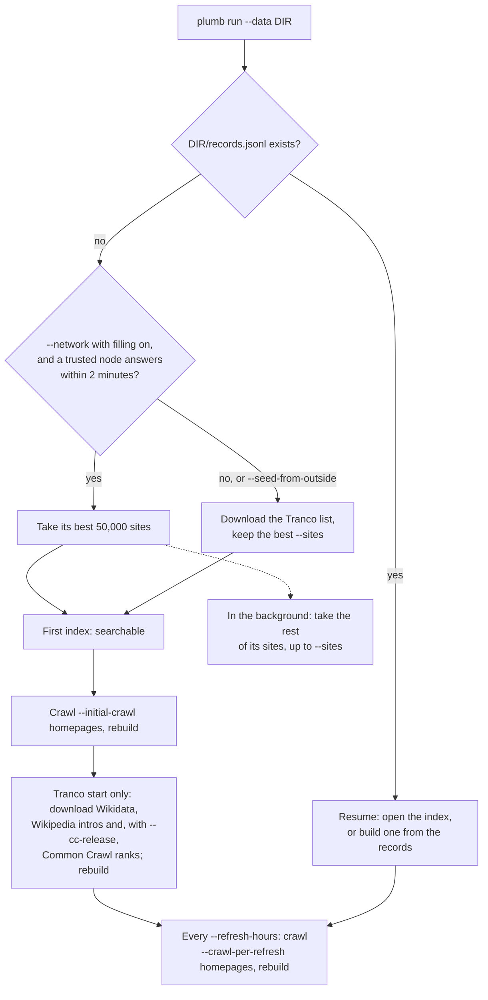

# Running a node

How to run `plumb run` yourself, built from source: what a new node does, its settings, its data folder, upgrades and health checks, and how to build an index by hand. For the Docker image see [docker.md](docker.md); for the desktop app see [desktop.md](desktop.md). Both run the same node.

- [Build from source](#build-from-source)
- [First start](#first-start)
- [Profiles and defaults](#profiles-and-defaults)
- [Flags](#flags)
- [The panel and saved settings](#the-panel-and-saved-settings)
- [Storage limits and focus topics](#storage-limits-and-focus-topics)
- [The data folder and backups](#the-data-folder-and-backups)
- [Proxies](#proxies)
- [Health checks and logs](#health-checks-and-logs)
- [Stopping and upgrading](#stopping-and-upgrading)
- [Remote control](#remote-control)
- [Try it offline on the test data](#try-it-offline-on-the-test-data)
- [Build an index by hand from real data](#build-an-index-by-hand-from-real-data)
- [What the crawler fetches](#what-the-crawler-fetches)

## Build from source

You need a current stable Rust toolchain ([rustup](https://rustup.rs)).

```sh
git clone https://github.com/SueHeir/plumb-search.git
cd plumb-search
cargo build --release -p plumb-node      # target/release/plumb
./target/release/plumb run --data plumb-data --network
```

Then open http://127.0.0.1:8080. `plumb run --help` lists every setting. `cargo build --release` also builds `plumb-tools`, the commands a node never runs (building an index by hand, evals, page sets).

Private search (`/private`) needs its WebAssembly script built before `plumb-node`, or `/private` says private search is not available. [Building the page's script](private-search.md#building-the-pages-script) has the steps.

## First start

A node needs a records file (`DIR/records.jsonl`, one line per site) before it can search. On first start it makes one in one of two ways.



- **From a trusted node** (with `--network`): the node waits up to 2 minutes for a node it trusts (the plumbsearch.org node unless `--no-default-trust`), takes its best 50,000 sites (about a minute and a half), which already carry what the seed downloads give, and builds a first index from them. It downloads no seed data. Filling then takes the rest of the trusted node's list in the background, a round every minute, up to `--sites`. When no trusted node answers, or one sends fewer than 1,000 sites, the node uses the seed downloads instead.
- **From the seed data**: the node downloads the Tranco list alone, keeps its best `--sites` sites and builds a first index, searchable a minute or two after starting. After the initial crawl it downloads the rest: Wikidata's official websites, the sites of banks, credit unions and other kinds of organizations, their countries and kinds, the first sentences of Wikipedia's articles about the best-known ones, and with `--cc-release` the top rows of Common Crawl's domain ranks. Wikidata can take half an hour or more. Until it arrives, `/api/status` says `"wikidata_missing": true` and official sites get no boost over look-alikes; a failure is retried while other work goes on.

Until the first index is ready, `/` and `/search` show what the node is doing and reload every 5 seconds. Setup and crawling need internet access; searching does not. A `records.jsonl` you put in the folder before the first start (see [building an index by hand](#build-an-index-by-hand-from-real-data)) skips setup.

## Profiles and defaults

`--profile` picks the starting point; flags given on top win.

| | `server` (default) | `desktop` |
| --- | --- | --- |
| Sites kept on first start (`--sites`) | 1,000,000 | 250,000 |
| Homepages crawled after the first index (`--initial-crawl`) | 10,000 | 2,000 |
| Time between refreshes (`--refresh-hours`) | 1 hour | 12 hours |
| Homepages per refresh (`--crawl-per-refresh`) | 5,000 | 1,000 |
| Feeds watched for "Recent" (`--news-feeds`) | 3,000 | 300 |
| Search by meaning, search history, wanted pages | off | on |
| Workload, download limit, storage limit (panel) | Custom, none, none | Balanced, 500 MB a day, 2,000 MB |
| Fills free space before the panel's "Set up my node" choice | yes | no |
| Controls other nodes from its panel | no | yes |

Both listen on `127.0.0.1:8080` unless `--bind` says otherwise. A refresh crawls its homepages half from sites never tried and half from sites due again (30 days after their last visit, sooner for sites that could not be reached), best link score first in each half. In the network it picks only from the sites assigned to it that day, unless `--crawl-any-site`. During a long crawl the node puts an index of what it crawled so far in service every 15 minutes.

The Docker image runs `plumb run --data /data --bind 0.0.0.0:8080 --network --search-by-meaning`.

## Flags

Every flag of `plumb run`, grouped. Defaults are in brackets, and those in the profile table above come from `--profile`.

**Basics**

| Flag | What it does |
| --- | --- |
| `--data DIR` | The data folder (required). One node per folder |
| `--bind ADDR` [127.0.0.1:8080] | Where the web page listens. `0.0.0.0:8080` serves other machines; the search page has no login |
| `--https-bind ADDR` | Also serve HTTPS here, such as `0.0.0.0:8443`, with a certificate the node makes, for [remote control](#remote-control) |
| `--profile server\|desktop` [server] | The defaults above |

**Size and crawling**

| Flag | What it does |
| --- | --- |
| `--sites N` | Best-ranked sites to keep from the seed data on first start |
| `--initial-crawl N` | Homepages to crawl once the first index is built; 0 for none |
| `--refresh-hours H` | Hours between refreshes, such as 24 or 0.5 |
| `--crawl-per-refresh N` | Homepages per refresh |
| `--no-refresh` | Never refresh after the initial crawl |
| `--crawl-concurrency N` [16] | Homepages fetched at once; the panel's workload presets set their own |
| `--focus TOPIC` | A topic to crawl first and twice as often; repeatable ([below](#storage-limits-and-focus-topics)) |
| `--take-new-sites` | Add sites the records do not hold yet: domains crawls find, new sites in other nodes' crawls. Off: crawls only refresh the sites held |
| `--drop-dead-sites` | Take sites that look dead out of the index: no crawl has reached them for 60 days, after 6 tries in a row with no answer. Never the best 10,000 or official sites; one comes back when a crawl reaches it |
| `--crawl-only` | Crawl and publish batches but build no index, for a server nobody searches. Not with `--search-by-meaning`, `--private-search` or `--blackhole` |
| `--use-system-proxy` | Crawl through the proxy in `HTTP_PROXY`, `HTTPS_PROXY` or `ALL_PROXY` ([Proxies](#proxies)) |

**Seed data and data files**

| Flag | What it does |
| --- | --- |
| `--cc-release NAME` | Add Common Crawl domain ranks on first start from this [web graph release](https://commoncrawl.org/web-graphs), such as `cc-main-2025-26-nov-dec-jan`; only the top rows are downloaded |
| `--seed-from-outside` | In the network, download the seed data anyway instead of taking a trusted node's sites |
| `--reseed` | Fold the files in `DIR/seed` into the records again before starting, downloading those over a week old. Use it once |
| `--set-updates all\|off\|SETS` [all] | Which page set files to replace when a trusted node has a newer one: `all` (each may grow a quarter at a time), `off`, or a comma list such as `films,map` with no growth limit |
| `--no-project-denylist` | Don't apply the project's denylist; its entries for child sexual abuse material apply anyway |

**Search**

| Flag | What it does |
| --- | --- |
| `--country CODE` [auto] | Home country whose sites rank a little higher: `US`, `DE`..., `any`, or `auto` (from the browser's language, then this computer's region, then the US) |
| `--only-country` | Start the search pages with "Only this country" on |
| `--lang CODE` | Language of the sites searches show when they pick none [the browser's first language the settings gear offers, else `en`] |
| `--web-search ENGINE` [off] | A "Search the web with" link: `duckduckgo`, `google`, `bing`, `brave`, `startpage` or `off` |
| `--alpha A` | Weight of the popularity prior in ranking, 0 to 1 [the index's default] |
| `--news-feeds N` | Feeds of the best-ranked sites watched for "Recent", each checked at most hourly; 0 for none |
| `--search-history` | Keep each browser's past searches and the sites it opened in `DIR/history`, to show them and rank them higher. Each browser sees only its own. Not for a public server |
| `--wanted-pages` | Follow the best sites' links to find inner pages this node's searches wanted; their words are kept 30 days. Not for a public server |
| `--private-search` | Offer private search at `/private` even off the network; buckets take about as much disk again as the records |
| `--search-by-meaning` | Find sites by meaning too: downloads a model (about 130 MB) into `DIR/model` and embeds sites after each build |
| `--meaning-model small\|gemma` [small] | `small` (bge-small-en-v1.5, English) or `gemma` (EmbeddingGemma 2, about 310 MB, many languages, in `DIR/model-gemma`). Needs `--search-by-meaning` |
| `--embed-threads N` | Threads that embed sites [half the CPUs the node may use] |
| `--mcp-read-pages` | Let every `/mcp` client use `read_page`, not only AI apps on this computer. Never on a public node |
| `--mcp-findings` | Let every `/mcp` client keep and see findings, not only AI apps on this computer |

**Network.** `--network` joins the Plumb network; every other flag here needs it. [network.md](network.md) explains what they do.

| Flag | What it does |
| --- | --- |
| `--network` | Share crawl work, search other nodes and answer their searches. No port forwarding needed |
| `--p2p-port PORT` [4001] | Port for node-to-node connections, TCP and QUIC (UDP) |
| `--bootstrap MULTIADDR` | A node to connect to first, ending in `/p2p/<id>`; repeatable. The network's own first nodes are tried too |
| `--no-default-bootstrap` | Skip the network's first nodes on plumbsearch.org, for a test network |
| `--public-addr MULTIADDR` | An address others reach this node at; repeatable |
| `--relay` | Relay connections for nodes behind NAT (needs `--public-addr`) |
| `--no-upnp`, `--no-local-discovery` | No UPnP port forwarding; no mDNS search for nodes on the local network |
| `--trust-peer PEER_ID` | Take this node's crawls without waiting for a second crawler; repeatable |
| `--no-default-trust` | Don't trust the plumbsearch.org node by default |
| `--search-from WHO` [friends-of-friends] | Which nodes network searches ask: `trusted`, `friends-of-friends` or `anyone` |
| `--round-minutes MINUTES` [10] | Minutes between rounds of bucket requests; 0 fetches when searching |
| `--no-fill` | Don't fill free space with trusted nodes' crawled sites |
| `--blackhole` | Collect everything the network offers: every trusted node's sites, every page set in full, all crawl batches. Not with `--no-fill` |
| `--keep-batches-days DAYS` [35] | Days of crawl batches kept on disk |
| `--answer-per-day REQUESTS` | Bucket requests answered free each day for other nodes [no limit] |
| `--no-spend-credits` | Never collect tokens from the nodes this node searches |
| `--share-popularity` | Report which result is opened, anonymously and threshold-encrypted |
| `--share-findings` | Let AI apps on this computer share a finding when they ask to |
| `--publish-records PATH` | Also share and fold in the homepages a separate `plumb-tools crawl` writes to this records file, every half hour |
| `--crawl-any-site` | Crawl any site, not only the day's assignment; only nodes that trust this one take those crawls |
| `--crawl-with PEER_ID` | Another `--crawl-any-site` node to split the sites with by hash; repeatable. Needs `--crawl-any-site` |

## The panel and saved settings

The panel at `/app` shows what the node is doing and holds the settings that have no flag: background updates, workload, download and storage limits, crawl hours, pausing, filling, page sets, focus topics and how much the project's site grades count. It takes changes only from the computer the node runs on (a loopback address, not through a proxy). On a server, reach it through an SSH tunnel (`ssh -L 8080:127.0.0.1:8080 server`, then http://127.0.0.1:8080/app) or use [remote control](#remote-control).

- Settings are saved in `DIR/settings.json` and apply at once. Until you save them, the profile's defaults apply.
- **Site grades** (100% by default) is how far searches push down the sites the project's `plumb/site-grades` set marks: a site a language model judged spam loses 90% of its score at 100%, one of little use 30% (unless the search names it). 0 turns the grades off. See [tools/grades](../tools/grades/README.md).
- Optional features (the network, search by meaning, sharing popularity, search history, bootstrap and trusted nodes, search scope, answer limit, spending credits) are saved in `DIR/features.json` and apply when the node starts again. Once that file exists it wins over `--network`, `--search-by-meaning`, `--share-popularity`, `--search-history`, `--bootstrap`, `--trust-peer` and `--no-default-trust`; the log says when one of the first four is ignored. Delete the file while the node is stopped to go back to flags alone.

## Storage limits and focus topics

The storage limit (MB the data folder may take) and the download limit (MB of crawls a UTC day) are set on the panel under Resources, or by a workload preset:

| Workload | Homepages at once | Download limit | Storage limit |
| --- | --- | --- | --- |
| Light | 4 | 100 MB a day | 1,000 MB |
| Balanced | 16 | 500 MB a day | 2,000 MB |
| Full | 32 | none | none |
| Custom | `--crawl-concurrency` (16) | as set | as set |

Under a storage limit:

- Crawling pauses while the data folder is over the limit; search keeps working.
- Filling from trusted nodes stops at 90% of the limit. Past that, a site another node shares is taken in only when it is about one of the node's topics or an official website.
- After half an hour over the limit, the node drops the sites with the lowest link score until it is back at 85%, and builds the index without them. It never drops the best 100,000 sites, official websites, sites about its topics, sites a searcher opened or put first on About you, or the network's own site. Dropped sites leave only this node's index.
- In the network, it keeps crawl batches 14 days instead of 35, and other crawlers' batches take at most 20% of the limit.

With or without a limit, filling stops before an index build would need more than half the machine's memory (at 2,500 bytes a site, a 4 GB server stops at about 800,000 sites).

**Focus topics** (`--focus games`, repeatable, or the panel's Focus topics; the two add up) make the node crawl sites about those topics first, up to half of each round, and twice as often. With a storage limit, filling keeps a quarter of the limit for sites about its topics and, with search history on, the interests on its browsers' About you pages. Focus topics are public in effect, since other nodes can tell from what this node crawls. Filling asks for the same pages whatever the topics, so the node it asks learns nothing from that.

## The data folder and backups

Everything the node keeps is under `--data DIR`, and only one node may use a folder at a time (`node.lock`). The main pieces:

- `records.jsonl` and `records.jsonl.journal`: every site the node knows and crawl results not yet folded in. Back them up together.
- `indexes/`: search indexes, rebuilt from the records whenever needed.
- `seed/`: first-start downloads, read again by `--reseed`.
- `net/node.key`: the node's identity in the network. Keep it to keep the same node id.
- `settings.json`, `features.json`: what was chosen on the panel.

[The plumb-node README](../crates/plumb-node/README.md#the-data-folder) lists every file and folder.

**Backups.** The panel's Backup section saves what cannot be downloaded again (settings, features, remote control files, the network key and crawl credits) as one JSON file in `DIR/backups/`, keeps the last 10, and lets you download or restore one. A restore finishes when the node starts again. Sites, indexes and seed files are left out; a node rebuilds them.

To copy a whole node, stop it and copy the folder. A folder copied or moved to a new path starts with the network off, even when its `features.json` says on, unless you give `--network`. With it, the copy joins as the same node (the log warns); delete `net/node.key` in the copy to make a separate one.

## Proxies

Seed downloads use the proxy in `HTTPS_PROXY`, `HTTP_PROXY` or `ALL_PROXY` when one is set. The crawler ignores those variables and fetches homepages directly, which lets it refuse sites whose names lead to private networks. On a machine that reaches the internet only through a proxy, add `--use-system-proxy` to crawl through it too (except hosts in `NO_PROXY`). The proxy then looks up the sites' names, so the crawler cannot check where they lead; it still checks the proxy's own name, so give a proxy on a private network as an IP address.

Without it, such a machine's crawls fail: a batch in which nearly every site that should answer fails is not saved, and the error in `/api/status` says the network seems down or blocked and suggests `--use-system-proxy`.

## Health checks and logs

`plumb healthcheck` asks a node's `/api/status` and exits 0 when it answers with success, 1 otherwise. It ignores proxy variables.

```sh
plumb healthcheck --url http://127.0.0.1:8080 --timeout 5   # both are the defaults
curl -s http://127.0.0.1:8080/api/status
```

`/api/status` answers at any time, setup included, with the node's status and build:

| Field | Meaning |
| --- | --- |
| `phase` | `setting_up` until the first index is searchable, then `ready` |
| `step`, `detail`, `progress` | The work under way, in words, and how far it has come |
| `last_error` | The last failure and when it is retried |
| `sites`, `places`, `index` | What the index being searched holds, and its folder |
| `last_refresh`, `next_refresh`, `crawl_left` | The refresh schedule, in Unix seconds, and homepages left in the round |
| `paused`, `disk_used`, `storage_limit`, `downloaded_today` | Why crawling waits, and the limits |
| `network`, `fill` | The network side, when joined |
| `version`, `build` | The version and Git revision running |

The node logs to stderr, filtered by `RUST_LOG` (default `info,tantivy=warn,rustls_platform_verifier=off`), with colors only on a terminal and never with `NO_COLOR` set. The panel's Activity section tells the main events in plain sentences, kept in `DIR/activity.jsonl`.

## Stopping and upgrading

Ctrl-C or SIGTERM stops a node cleanly. A crawl stops between two homepages, giving up the unsaved part of its batch to crawl later; an index build under way finishes first (about a minute for a million sites). A second Ctrl-C stops at once, which is safe: files on disk are always whole, and unfinished work goes on at the next start.

To upgrade, stop the node, then pull, build and start it again with the same `--data`:

```sh
git pull
cargo build --release -p plumb-node
./target/release/plumb run --data plumb-data --network
```

The records, settings and network identity carry over. An index the new version cannot open is deleted and built again from the records, and records made with older lists of sites are folded with the seed data again by themselves. `--reseed` does the same once, for records made before a change to how seed data is read. For Docker, see [docker.md](docker.md#updating).

## Remote control

The desktop app on another computer can show and change a node's settings with a token, over HTTPS with a certificate the node makes for itself:

```sh
plumb run --data plumb-data --https-bind 0.0.0.0:8443
plumb remote-control on --data plumb-data       # prints the token, once, and the fingerprint
plumb remote-control status --data plumb-data
plumb remote-control off --data plumb-data
```

In the app, choose "Connect to a node" and enter the HTTPS address (such as `https://192.168.1.20:8443`), the token and the fingerprint. The token works from this computer, local networks and Tailscale only, unless turned on with `--allow-public`; then put the node behind HTTPS first. The token can read the node's status and change its settings, features and refreshes. Turning remote control on or off takes effect at once, without a restart, and it can also be turned on from the panel. [remote-control-security.md](remote-control-security.md) explains the transport.

## Try it offline on the test data

[fixtures/](../fixtures) holds a small made-up dataset in the formats of the real sources, so the whole pipeline runs without a network:

```sh
cargo build --release
./target/release/plumb ingest --tranco fixtures/tranco.csv \
    --cc-ranks fixtures/cc-domain-ranks.txt \
    --wat fixtures/sample.wat \
    --wikidata fixtures/wikidata-official-sites.tsv \
    --out data/records.jsonl
./target/release/plumb-tools index --records data/records.jsonl --index data/index
./target/release/plumb-tools search --index data/index us bank
./target/release/plumb-tools eval --index data/index --queries fixtures/brand_queries.tsv
./target/release/plumb serve --index data/index        # then open http://127.0.0.1:8080
```

`plumb ingest` and `plumb serve` are node commands; `index`, `search` and `eval` are in `plumb-tools`. `plumb serve` serves one index as it is: no crawling, no panel.

## Build an index by hand from real data

`plumb run` does all of this by itself. By hand, each step can be checked and tuned. The seed data comes from public sources:

| Source | What Plumb takes from it |
| --- | --- |
| [Tranco](https://tranco-list.eu/) top 1M | A popularity rank for each site |
| [Common Crawl web graph](https://commoncrawl.org/web-graphs) domain ranks | Harmonic centrality and PageRank positions |
| Common Crawl WAT files | Homepage titles and descriptions, and link text between sites |
| Wikidata official websites (P856) | Which domain is an organization's real site, its name, country and kind |
| Wikipedia | The first sentences about the best-known of those organizations |

```sh
# 1. Download the seed data. Without --cc-release, Common Crawl is skipped;
#    with it, the whole ranks file is downloaded (gigabytes).
plumb-tools fetch-data --dir data --cc-release <release-name>

# 2. Fold it into records, keeping the best million. fetch-data prints this
#    command with every file it saved. Only twice --top rows of the Common
#    Crawl ranks are read (about 0.9 GB of memory per million rows).
plumb ingest --tranco data/tranco-top-1m.csv.zip \
    --cc-ranks data/<release-name>-domain-ranks.txt.gz \
    --wikidata data/wikidata-official-sites.tsv \
    --wikidata-kinds data/wikidata-kind-sites.tsv \
    --wikidata-facts data/wikidata-site-facts.tsv \
    --wikipedia-intros data/wikipedia-intros.tsv \
    --top 1000000 --out data/records.jsonl
#    Optional: add --wat with Common Crawl WAT files, listed in each crawl's
#    https://data.commoncrawl.org/crawl-data/<CC-MAIN-YYYY-WW>/wat.paths.gz.

# 3. Crawl homepages: half sites never tried, half sites due again,
#    best link score first.
#    Each batch goes to data/records.jsonl.journal at once, so an interrupted
#    crawl keeps what it fetched.
plumb-tools crawl --records data/records.jsonl --top 10000

# 4. Build the index and run the brand-name test.
plumb-tools index --records data/records.jsonl --index data/index
plumb-tools eval --index data/index --queries eval/brand_queries.tsv
```

Then serve it with `plumb serve --index data/index`, or copy `records.jsonl` into a new node's data folder before its first start: the node builds its index from it, skips the seed downloads and keeps crawling.

For search by meaning by hand, embed the sites and give `plumb serve` the vectors:

```sh
plumb-tools embed --records data/records.jsonl --model data/model --vectors data/vectors.bin
plumb serve --index data/index --model data/model --vectors data/vectors.bin
```

To refresh the seed data later, run steps 1 and 2 again with `--records data/records.jsonl` added to step 2. Titles, link text and crawl times carry over, while ranks and official-site marks come only from the new files, so a domain that expired and changed hands does not keep the trust it had.

## What the crawler fetches

The crawler identifies itself as `PlumbSearch/<version> (+https://github.com/SueHeir/plumb-search)` and obeys robots.txt for the token `PlumbSearch`, including `Crawl-delay` up to 30 seconds. For each site it fetches:

- the homepage, starting at `https://<domain>/`, then the address it was last reached at, the `www.` host and plain http;
- robots.txt for each origin it visits;
- the site's icon: up to 3 icons the page links to and `/favicon.ico`, redrawn as a small PNG and served inside results pages, so a searcher's browser never asks the site for it;
- the RSS or Atom feeds of the best-ranked sites (`--news-feeds`), each at most hourly;
- with `--wanted-pages` (on for the desktop profile), inner pages a few links deep on the best sites of a search that found no page for the rest of its words.

It waits 1 second between requests to a host, gives up on a request after 15 seconds and on a site after 2 minutes, reads at most 512 KiB of a page and follows at most 5 redirects. It refuses names that lead to addresses off the public internet: loopback, private, link-local and other special ranges. A site is due again 30 days after its last visit; one that could not be reached is tried again after 1 day, then 2, 4, 8 and so on.

Other requests a node makes: pages an AI app asks it to read with `read_page` go out as `plumb-mcp/<version> (+https://github.com/SueHeir/plumb-search)` without robots.txt, as a browser would; plugins fetch only from the hosts their `plugin.json` lists, as `PlumbSearch/<version> plugin <id>`; currency answers fetch the European Central Bank's daily rates, and weather answers ask Open-Meteo with the town's rounded coordinates.
