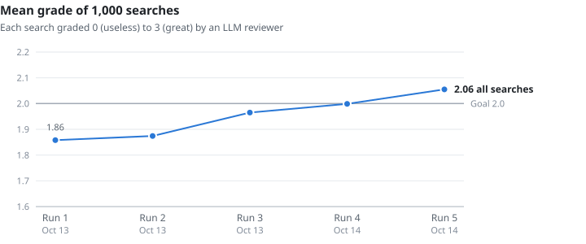
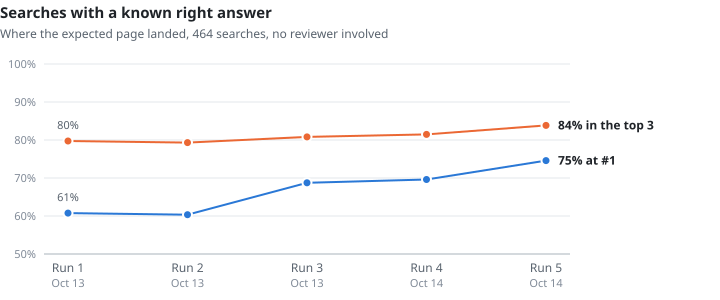
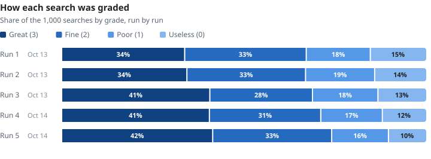
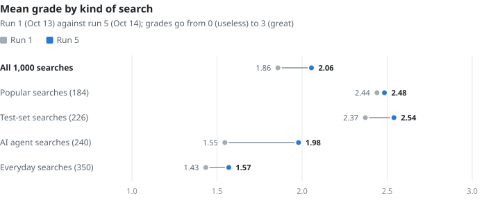
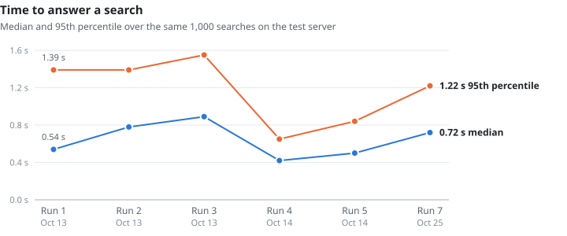

# How search is doing

Plumb's results are measured on 1,000 real searches, graded one by one. This page shows where search stands now, how it got there, and where it still falls short. Every number names the run, the date and the build it was measured on.

- [Now](#now)
- [Over time](#over-time)
- [By kind of search](#by-kind-of-search)
- [Where it falls short](#where-it-falls-short)
- [Speed](#speed)
- [How it is measured](#how-it-is-measured)
- [The index behind it](#the-index-behind-it)
- [Updating this page](#updating-this-page)

## Now

Measured in **run 7**, on 2026-10-25, on build [`1584e58`](https://github.com/SueHeir/plumb-search/commit/1584e58) (version 0.4.0).

| | Run 7 | Run 5 (2026-10-14) | Run 1 (2026-10-13) |
| --- | --- | --- | --- |
| Mean grade, 0 to 3 | **2.08** | 2.06 | 1.86 |
| Searches graded great (3) | **425** of 1,000 | 415 | 338 |
| Searches graded useless (0) | **100** of 1,000 | 102 | 152 |
| Known right answer at #1 | **349** of 464 (75%) | 346 (75%) | 282 (61%) |
| Known right answer in the top 3 | **390** of 464 (84%) | 389 (84%) | 370 (80%) |
| Median time per search | **0.72 s** | 0.50 s | 0.54 s |

Since run 5 the top 3 changed for 296 searches, and 115 graded better and 102 worse: a gain of 0.02, smaller than the reviewer's own drift, so search held its level rather than clearly improving. Since run 1 the gain is clear. Graded side by side by the same reviewer on the same day, run 1's results score 1.87 and run 7's 2.10.

In short: Plumb is good at finding a thing by its name (the official site, the Wikipedia article, the package, the well-known Stack Overflow question) and much weaker when a search describes what it wants in other words.

## Over time

<picture>
  <source media="(prefers-color-scheme: dark)" srcset="search-quality/mean-grade-dark.svg">
  
</picture>

The mean passed the project's goal of 2.0 in run 5 and has stayed above it. The grader itself drifts between runs. Regrading unchanged searches has moved their mean by 0.02 to 0.12 (in run 7, 100 of run 5's searches, shown exactly as then, came out 0.12 lower), so a move of 0.1 or less between two runs may be the grader rather than search. Over all 1,000 searches the drift is small: in run 7 the reviewer regraded every one of run 1's results and gave them 1.87, against 1.86 at the time.

<picture>
  <source media="(prefers-color-scheme: dark)" srcset="search-quality/known-answers-dark.svg">
  
</picture>

464 of the searches have a right answer known in advance. Where it lands needs no grader, so this is the steadiest measure here.

<picture>
  <source media="(prefers-color-scheme: dark)" srcset="search-quality/grades-dark.svg">
  
</picture>

## By kind of search

<picture>
  <source media="(prefers-color-scheme: dark)" srcset="search-quality/lanes-dark.svg">
  
</picture>

| Kind | Searches | What they are | Run 1 | Run 5 | Run 7 |
| --- | ---: | --- | ---: | ---: | ---: |
| Popular | 184 | The most searched names and topics in the US: sites, people, trends, tools | 2.44 | 2.48 | 2.51 |
| Test sets | 226 | Drawn from the project's test files in [`eval/`](../eval/README.md): brands, packages, papers, songs, facts, typos and more | 2.37 | 2.54 | 2.58 |
| AI agent | 240 | What an AI agent looks up while working: official sites, docs, data and long technical searches | 1.55 | 1.98 | 1.98 |
| Everyday | 350 | Real people's searches from ORCAS, a public research set of Bing searches | 1.43 | 1.57 | 1.59 |

For popular searches the reviewer found the best answer at #1 in 169 of 184. Everyday searches, which describe what they want rather than name it, are where Plumb is weakest: it matches names, titles and descriptions, not the full text of pages.

## Where it falls short

Problems the reviewer tagged in run 7, with the number of searches each touched and their mean grade. One search can have several. The counts come from the reviewer's tags and keyword rules over its notes, so they are approximate.

| Problem | Searches | Mean grade | Example |
| --- | ---: | ---: | --- |
| One word of the query pulls in sites named after it | 312 | 1.92 | "Barcomi's Berlin": every result matches only "Berlin" |
| A namesake beats the well-known meaning | 279 | 1.85 | "Wirecutter": the info box describes wire cutters, the pliers |
| The homepage instead of the page asked for | 162 | 1.76 | "IRS 2026 retirement plan contribution limits news release": the IRS homepage |
| The official site is missing | 134 | 0.93 | "MeteoSchweiz": meteoschweiz.admin.ch is not shown |
| Fewer than five results | 135 | 2.63 | |
| Junk or spam among the results | 83 | 2.10 | |
| Results in the wrong language | 35 | 1.86 | "Skyscanner": the Spanish, Italian and Indian sites come before skyscanner.com |
| Typos the spelling fix misses or gets wrong | 29 | 0.45 | "telsa lease": "Did you mean tulsa lease" |

Typos are the worst-graded problem, and a missing official site is the next. To see how a search is answered and ranked, and how to measure a change, read [search.md](search.md).

## Speed

<picture>
  <source media="(prefers-color-scheme: dark)" srcset="search-quality/speed-dark.svg">
  
</picture>

Times are for whole searches through `/api/search` on the project's test server, which holds about 2.8 million sites with page sets and places (places were off in run 1). No search in any run failed. Run 7 is slower than run 5 (median 0.72 s against 0.50); it is the first run on a node given page vectors ([pages.md](pages.md)), 6.9 million of them.

## How it is measured

1. **The searches.** 1,000 searches in the four kinds above, fixed since run 1. Each runs against a node built from the commit being measured, through `/api/search?full=1`.
2. **The grade.** An LLM reviewer (Claude Haiku) reads each search's results as an AI agent receives them, 25 searches at a time, and grades it as the person or agent who typed it would: **3** great (the best answer is #1, or the top 3 are all strong), **2** fine (a good answer in the top 3, some noise), **1** poor (a good answer only at rank 4 to 10, or results only partly useful), **0** useless (nothing shown meets the need). It also tags each problem it sees and writes a one-line note.
3. **Only changes are regraded.** A search whose results match an earlier run keeps that run's grade. To size the reviewer's own drift, unchanged searches are graded again each run: about 50 in runs 2 to 5, and 150 in run 7, which also regraded all 1,000 of run 1's results and the 282 searches it kept grades for.
4. **Known answers.** For the 464 searches with a right answer known in advance, the rank where it lands is counted directly, with no reviewer.

The grades say how good results look to a careful reader, not whether every link is right, and one reviewer's taste is built in. Comparing two builds on the same searches is what the review is good for. For changes to ranking code, the frozen evals in [`eval/`](../eval/README.md) are the stricter check: `plumb-tools eval` must give identical results for a refactor.

| Run | Date | Build | Mean grade | Great | Fine | Poor | Useless |
| ---: | --- | --- | ---: | ---: | ---: | ---: | ---: |
| 1 | 2026-10-13 | `7405be6` | 1.86 | 338 | 334 | 176 | 152 |
| 2 | 2026-10-13 | `7f3e2e0` | 1.87 | 344 | 326 | 190 | 140 |
| 3 | 2026-10-13 | `0e67130` | 1.97 | 407 | 282 | 180 | 131 |
| 4 | 2026-10-14 | `874a662` | 2.00 | 406 | 306 | 169 | 119 |
| 5 | 2026-10-14 | `11bab11` | 2.06 | 415 | 327 | 156 | 102 |
| 7 | 2026-10-25 | `1584e58` | 2.08 | 425 | 326 | 149 | 100 |

Run 6 measured a build that never reached main, so it is left out.

Every number behind the charts is in [`search-quality/runs.tsv`](search-quality/runs.tsv).

## The index behind it

What plumbsearch.org held on 2026-10-14, running 0.3.1 (from its [`/api/status`](https://plumbsearch.org/api/status)):

| | |
| --- | ---: |
| Sites | 2,811,021 |
| Sites with a vector for search by meaning | 2,224,213 |
| Pages from page sets | 13,304,410 |
| Places | 24,014,360 |

## Updating this page

After a new run, add its row to [`search-quality/runs.tsv`](search-quality/runs.tsv), run

```sh
python3 docs/search-quality/charts.py
```

to redraw every chart in light and dark, and update the numbers in the text here and in the [README](../README.md#how-search-is-doing). The script needs only Python 3.
