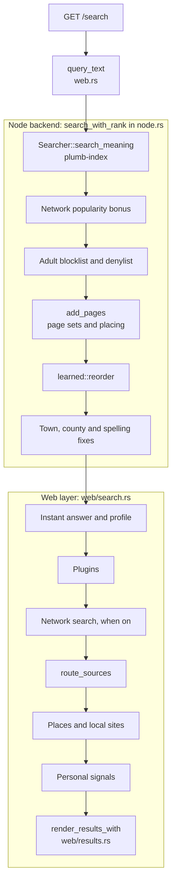
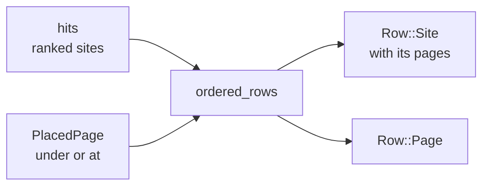

# How search works

This page follows one search through a node, from the query arriving to the rows on the results page, and explains how sites and pages are ranked. It is for contributors who want to change ranking or what a search shows. For using the search page and the API, see [Searching](searching.md); for how search is doing, see [Search quality](search-quality.md).

## Contents

- [The pipeline](#the-pipeline)
- [Where a search comes in](#where-a-search-comes-in)
- [Reading the query](#reading-the-query)
- [Finding candidate sites](#finding-candidate-sites)
- [Scoring sites](#scoring-sites)
- [Cleaning up the site list](#cleaning-up-the-site-list)
- [Spelling](#spelling)
- [Pages and the node's own steps](#pages-and-the-nodes-own-steps)
- [The learned ranking](#the-learned-ranking)
- [Building the results](#building-the-results)
- [Personal signals](#personal-signals)
- [Trying a ranking change](#trying-a-ranking-change)
- [Where the code is](#where-the-code-is)

## The pipeline

A search passes through three layers. The web layer of [plumb-node](../crates/plumb-node/README.md) reads the request and assembles the answer. The node's backend (`search_with_rank` in [node.rs](../crates/plumb-node/src/node.rs)) runs the site search, filters it and adds pages. [plumb-index](../crates/plumb-index/README.md) finds and ranks the sites. The diagram follows `/search`, the results page.



`/api/search`, the MCP `search` tool and the SearXNG adapter run the same backend and most of the same web steps, without personal signals or network search, and lay out the answer with the shared rules in [assembly.rs](../crates/plumb-node/src/assembly.rs).

## Where a search comes in

| Route | Answers with | Personal signals | Experiments |
| --- | --- | --- | --- |
| `/search` | the results page | yes | yes |
| `/api/search` | JSON hits; the whole answer with `full=1` | no | no |
| `/search?format=json`, `POST /api/websearch` | SearXNG-style JSON ([searxng.rs](../crates/plumb-node/src/web/searxng.rs)) | no | no |
| `/mcp` | the `search` tool's answer ([mcp/search.rs](../crates/plumb-node/src/mcp/search.rs)) | no | no |

Every route first cleans the query with `query_text` in [web.rs](../crates/plumb-node/src/web.rs): text garbled by a wrong charset is read back as it was written (`plumb_core::unmangled`), whitespace is collapsed, and the query is cut to 200 characters (`MAX_QUERY_CHARS`). Results default to 10 (`DEFAULT_LIMIT`) and go up to 100 (`MAX_LIMIT`).

On `/search`, a bang such as `!g` or `!w` at the start or end of the query redirects to that engine before anything is searched ([websearch.rs](../crates/plumb-node/src/websearch.rs)). The page's settings become a `SearchOptions` (country, only that country, exact, safe search, language) that every later step reads. The search itself runs on a blocking thread, since it reads the index from disk.

## Reading the query

All text, in the index and in the query, goes through `plumb_core::normalize_text` and is then ASCII-folded ([analysis.rs](../crates/plumb-index/src/analysis.rs)), so `U.S. Bank`, `us bank` and `US BANK` are the same query and `nestle` finds `Nestlé`.

### Operators

`Operators::parse` in [plumb-core's operators.rs](../crates/plumb-core/src/operators.rs) takes the operators out of the query before the words are searched.

| Operator | Effect |
| --- | --- |
| `site:example.com` | only that site and its subdomains; `site:gov` or `site:.de` for a top-level domain |
| `-site:example.com` | leaves that site out |
| `"exact phrase"` | sites whose text has the phrase; curly quotes work, an unclosed quote runs to the end |
| `-word`, `-"a phrase"` | leaves out sites with the word (its plural or singular too) or phrase; the host name counts, so `-amazon` drops amazon.com |

Words like `--save-dev`, `-b`, `spider-man`, a lone `-` and `site:` with nothing after it stay ordinary words. A query with operators is searched exactly: no typo correction, no places, no tool or health sources, and no info box unless the only operators are quoted phrases. Its words are ranked as usual for 5 times the results asked (`OPERATOR_WIDENING`, at least 200), and the operators then filter them (`Operators::allows`). A site that `site:` names is listed after what matched on it, with a link into its own search for the words.

### Words and fields

[query.rs](../crates/plumb-index/src/query.rs) turns the words into a Tantivy query over the site fields, each with its own BM25 boost:

| Field | Holds | Boost |
| --- | --- | --- |
| `label` | the domain label, its hyphen-split words and joined form | 4.0 |
| `joined` | label, title, aliases and top link texts, one token per name | 4.0 |
| `aliases` | other names, such as Wikidata's | 2.5 |
| `title` | the homepage title | 2.0 |
| `about` | Wikidata's description of the organization | 2.0 |
| `anchors` | the text of links to the site | 1.5 |
| `terms` | search terms picked from the homepage | 1.0 (`RankConfig::terms_boost`) |
| `description` | the homepage's meta description | 0.5 |
| `headings` | the homepage's `<h1>` and `<h2>` texts | 0.5 |

Matches on the label and on a joined name are divided by the number of query words. On top of the word matches, the whole query joined (`us bank` as `usbank`) matching a joined name or label gets a boost of 6.0 (`WHOLE_QUERY_BOOST`), and a query that is a host name or URL of an indexed domain gets 10.0 on that domain (`DOMAIN_BOOST`). A word's other number ("video" for "videos") gets 0.8 of its boost in the text fields (`OTHER_NUMBER_SHARE`). At most 16 distinct words are used (`MAX_QUERY_WORDS`).

Some words are read for what they say rather than matched as names:

- **Filler words** (`FILLER_WORDS` in [lib.rs](../crates/plumb-index/src/lib.rs)): words that ask or want ("how", "best", "login", "near", "official") never match a name on their own in a query of two words or more, so who.int is not found for "who wrote hamlet". The whole query joined still names a site ("best buy").
- **Comparison words**: "vs" and "versus" between other words are matched nowhere.
- **Intent words** (`INTENT_WORDS` in [names.rs](../crates/plumb-index/src/names.rs)): a query ending in "login", "docs", "tracking", "careers" and the like is also searched without them, so "paypal login" finds paypal.com rather than paypal-login.us. See [cleaning up the site list](#cleaning-up-the-site-list).
- **Questions**: a question of three words or more names no site by its words (`questions_name_nothing`), except by a text most links use as a site's name: netflix.com stays in "how to cancel netflix".

## Finding candidate sites

`rank_traced` in [rank.rs](../crates/plumb-index/src/rank.rs) gathers the sites to score from several sources. A site can come from more than one.

| Source | Sites | Set by |
| --- | --- | --- |
| Words | the first 200 sites by BM25 (or the limit, if higher) | `RankConfig::candidates` |
| Popular | the 50 most linked sites with any of the query's words | `POPULAR_CANDIDATES` |
| Named | sites the query names by its first words or all of them: label, official and linked names, a typed host name ([names.rs](../crates/plumb-index/src/names.rs)) | |
| Kind | for a query that is a kind of thing ("banks", "airlines"), every site of that kind | |
| Meaning | the 50 sites nearest the query in meaning, and the 50 most popular of the rest of the 1,000 nearest | `NEAREST_RANKED`, `NEAREST_POPULAR` |

`Searcher::candidate_pool` returns these lists for a query, and `plumb-tools eval --recall` uses it to measure whether the right site is among the candidates at all: a site the ranking never looks at cannot be found, however it is scored.

### Search by meaning

A node started with `plumb run --search-by-meaning` downloads an embedding model and embeds each site's text in the background after every index build ([meaning.rs](../crates/plumb-node/src/meaning.rs)). `--meaning-model small` (the default) is bge-small-en-v1.5, about 130 MB, English; `--meaning-model gemma` is EmbeddingGemma 2, about 310 MB, many languages. `plumb serve`, `plumb-tools search` and `plumb-tools eval` take vectors made by `plumb-tools embed` with `--model DIR --vectors FILE`.

At search time the node embeds the query and finds the 1,000 nearest sites by cosine (`NEAREST`). Closeness is spread over them: 1 for the nearest, 0 for the last and anything farther. When the nearest stands less than 0.15 above the last (`LEAST_SPREAD`), nothing is really near and closeness stays below 1. Meaning is skipped when the model cannot read the query (mostly tokens it does not know, as in a script it was not trained on) and when the query names a kind of site or a site in full. With the small model the query is embedded twice by default: after the model's search instruction, which ranks the sites, and alone, which decides only whether a page goes before the sites (`Hit::placing_text_score`). A node given page vectors also lists the page nearest the query by the first of these ([pages.md](pages.md)).

## Scoring sites

Each candidate gets one score:

```text
score = alpha * prior + trust * ((1 - alpha) * text_score + name_bonus) + country_bonus
```

Sites are then sorted by score, then link score, then domain. The parts, with their defaults in `RankConfig` ([lib.rs](../crates/plumb-index/src/lib.rs)):

- **`alpha`** weighs popularity against the text match. It is 0.35 (`alpha`, set by `plumb run --alpha`) for a navigational query: one that names a site or a kind of site in full, types a domain, or starts with the name of a well-known site. For any other query it is 0.5 (`described_alpha`), which `--alpha` does not change.
- **`prior`** is the site's link score, `plumb_core::link_score` in [plumb-core](../crates/plumb-core/README.md). It is in 0 to 1: the best of the site's Tranco, Common Crawl harmonic centrality and PageRank ranks on a log scale counts for 75%, the number of linking domains on a log scale for 25%, an official website in Wikidata gets 0.15 plus up to 0.05 for how widely known its organization is, and a site whose stated facts were checked against Wikidata gains or loses up to 0.1. For a site the query does not name, the prior is scaled down when its text matches weakly: `link_score * min(text_score / floor, 1)`, with a floor of 0.05 for navigational queries (`navigational_relevance`), 0.04 for others (`described_relevance`), at least 0.3 for questions (`question_relevance`), and 0.35 for a site only meaning found (`meaning_only_relevance`). So a big site that barely matches cannot win on popularity alone.
- **`text_score`** is the BM25 score divided by the best candidate's, in 0 to 1. A site the whole query names by its label or by what most links call it, or a site of the kind the query names, gets a full 1.0, so popularity decides among the sites a query names: aa.com, officially "American Airlines", beats americanairlines.com. With search by meaning, the text score blends words and closeness: `0.3 * words + 0.7 * closeness` (`meaning_weight`).
- **`name_bonus`** rewards a site the query starts by naming. A label equal to the first `k` of the query's `n` words gets `k / n` of 0.25 (`exact_label_bonus`), so "irs refund" gives irs.gov half and "us bank" gives usbank.com all of it. An alias gets `k / n` of 0.1 (`exact_alias_bonus`), and a text most links to the site use as its name (`link_names`, `LINK_NAME_SHARE` 0.5) gets `k / n` of 0.4 (`link_name_bonus`), or of the label bonus when it names only part of the query. A site of the kind the query names gets at least 0.25 (`kind_bonus`).
- **`trust`** guards brand-plus-intent queries ("us bank login") against look-alikes that stuff every query word into their domains and titles. When the query is a site's name followed by more words, a site needs a link score of 0.2 (`trusted_link_score`, or the named site's own if lower) for its text match and name bonus to count in full; below that, trust falls linearly to 0.5 (`untrusted_share`) at a link score of 0. In such a query, a site the whole query names that nothing else speaks for (never crawled, no other names, no links naming it) is only a spelling of the query and also gets 0.5: youtube.com wins "youtube music" over you-tubemusic.com. Trust is 1 for a typed host name and for a query that is just a name.
- **`country_bonus`** is +0.06 (`country_boost`) for a site of the searcher's home country, -0.06 for a site of another country, and 0 for global sites. "Only this country" drops other countries' sites instead.

Two filters run while scoring:

- **Safe search** (`SafeSearch` in [plumb-core's safe.rs](../crates/plumb-core/src/safe.rs)) reads each site's adult level from the index. `moderate`, the default, leaves out plainly adult sites; `strict` also leaves out suggestive ones. The node also drops the domains of an adult blocklist after ranking.
- **Language**: with a language chosen, a site in another language is skipped unless the query names it (typed, named in full, or a well-known site named by two words or more). `Searcher::language_for` ([language.rs](../crates/plumb-index/src/language.rs)) turns the filter off for a query written in another script, or whose words are mostly on sites declaring another language.

## Cleaning up the site list

After sorting, [rank.rs](../crates/plumb-index/src/rank.rs) removes what is no answer and moves untitled sites down, in this order:


- A site matching only a word or two of a longer query, named by nothing and not close to it in meaning (`partial_closeness`, 0.5), goes: hbo.com is no answer to "paschen series".
- A number shared with a query of other words is no match ("glastonbury 2026").
- When the first site is a well-known site the query names, sites the query does not name that score under 0.4 of it are filler (`named_share`).
- [junk.rs](../crates/plumb-index/src/junk.rs) leaves out sites unless the query names them: test domains, pill shops, little-known sign-in pages, gambling spam, parked or held domains, APK download sites, fake help lines and name servers' abuse contacts ("Abuse" on nspmanaged.com). [bot_check.rs](../crates/plumb-core/src/bot_check.rs) reads a homepage whose whole text is an address to report abuse to (servidorlinux5.com's "In case of abuse write to: abuse@…") as a stand-in for the site, as it does a server's default page, so the site keeps no words to be found by once its index is built again.
- `look_alikes` ([hits.rs](../crates/plumb-index/src/hits.rs)) drops sites built to pass for one listed with them (gmail.co, yout-ube.com, paypal-login.us). `without_near_copies` and `without_copies` drop scraped copies and spam networks that share a listed site's homepage text (by its simhash fingerprint) or title.

[search.rs](../crates/plumb-index/src/search.rs) then finishes the site list in `Searcher::search_meaning`:

- **Site search.** When the query's first words name the first result and words are left over, the results offer to search that site for them through its own search address (`SiteSearch`): "github plumb search".
- **News sites.** A query asking only for the news ("world news") lists the well-known news sites, by popularity and home country ([topics.rs](../crates/plumb-index/src/topics.rs), `news_sites`).
- **Intent words.** A query ending in intent words is ranked again without them; a well-known site that name alone names keeps the better of its two scores, look-alikes go, and a docs site goes first for a docs query ("postgres docs").
- **Health.** For a medical query, health authorities go above other sites ([health.rs](../crates/plumb-index/src/health.rs), `health_authorities`), and their pages above other sites' pages ([pages.md](pages.md#how-pages-are-searched-and-shown)).

## Spelling

[spell.rs](../crates/plumb-index/src/spell.rs) checks a query for typos unless it names a kind of site, or names a site in full that has some popularity of its own (a link score of 0.4, `KEEPS_ITS_NAME_LINK_SCORE`). Names are matched within an edit distance that grows with length (none up to 3 letters, 1 up to 7, then 2), and only a site with a link score of 0.3 or more (`MIN_FIX_LINK_SCORE`) can be the correction, so a typo never leads to a look-alike. A word the index hardly knows is replaced by a far commoner one nearby, and a word it knows is left alone unless it is part of a well-known site's name ("capitol one"). With the spelling model the index learns from its own words ([spell_model.rs](../crates/plumb-index/src/spell_model.rs)), candidates are ranked by a noisy channel: how likely the slip is against how common the correction is.

The results stay those of the query as typed unless nothing else works:

| Case | Shown |
| --- | --- |
| Nothing found has every typed word, and the correction's best site does | results for the correction: "Showing results for ..." (`Spelling::applied`) |
| The correction finds something | results as typed and "Did you mean ...?"; when it fixes a site's name, that site goes second |
| The query names a little-known site in full | a suggestion only when the correction is well known and 0.3 more popular (`TYPO_POPULARITY_MARGIN`) |
| A typed domain is a slip of a site 0.3 more popular | that site first if no site has the typed address, else second |
| The correction finds nothing | results as typed, no suggestion |

On a node with page sets, the pages' names check the suggestion again: a query the pages know as typed drops it, results for a correction are searched as typed again when the pages know the typed words, and words of things rather than sites ("photosynthsis") get a suggestion from the page titles. A word no page and no site has is taken for a slip of the likeliest near word of the titles however few pages have it ("rhinoplasy" is rhinoplasty), since the web does not know it either. A suggestion is shown in place of the results ("Showing results for", searched as spelled) when it is sure (`PageSearcher::sure_spelling`): each word it changes is one the pages neither know nor are named by and fewer than 20 sites have, no site of the results as typed is named by the query or by that word, and the spelling names a page: "ballrat" shows Ballarat's results, but "corvel website for providers" stays as typed, since corvel.com is listed. A search of one word shorter than seven letters stays as typed too, since such a word is a slip of too many others ("sinze" of size as much as since), and so does a word typed with letters outside a-z ("Edlén equation"), which the speller reads without its accents.

## Pages and the node's own steps

The node backend, `search_with_rank` in [node.rs](../crates/plumb-node/src/node.rs), wraps the index search:

1. **Network popularity.** In the network, the node ranks at least 20 sites (`POPULARITY_CANDIDATES`) and adds `PopularityTable::bonus`: up to 0.15 (`MAX_POPULARITY_BONUS`) for the site picked most for the query, in proportion for others. The table comes from anonymous reports nodes share; see [Network](network.md).
2. **Blocklists.** With safe search on, sites on the adult blocklist are dropped; sites on the node's denylist are dropped for everyone. The node ranks 10 more sites for each list in use (`adult::MARGIN`, `denylist::MARGIN`) so the page stays full.
3. **Pages.** `add_pages` in [node/pages.rs](../crates/plumb-node/src/node/pages.rs) searches the page sets (Wikipedia articles, Stack Overflow questions, packages, papers and more; see [Page sets](pages.md)) and places pages among the sites. It runs only on a node with a page index.

Pages are found by name: their title, aliases and the other titles that lead to them. Questions, papers, docs, reference and subpages pages are also found by most of the words of their title, tags and description (`QUESTION_SHARE`), and Wikipedia articles by the words of their description and lead (`LEAD_MATCH`). Pages are scored by how well the query names them and how much they are read ([pages.rs](../crates/plumb-index/src/pages.rs)):

```text
page score = name * (1 - 0.5 + 0.5 * popularity)
```

`name` is 1 when the query is the page's title, 0.9 when it is an alias (`ALIAS_MATCH`), and otherwise, when one holds every word of the other, the share of the title's words the query has times 0.6 (`PARTIAL_MATCH`); `popularity` is `ln(1 + views) / ln(1 + most views)` within the page's set.

Before placing pages, `add_pages` lets them correct the site list: the official site of the article the query names is added when missing (`add_named_site`: "better call saul" adds amc.com) and lifted first when among the first five (`lift_named_sites`: "youtube music" puts youtube.com above youtube.de), and when the query is an article's name, sites found only by one of its later words go (`drop_far_namesakes`: mini.com for "ipad mini"). `place_pages` in [pages/placing.rs](../crates/plumb-index/src/pages/placing.rs) then decides where each page goes:

- A page about a listed site goes under that site: "python" lists python.org with the article under it.
- A page the query names comes first ("marie curie" lists the article before mariecurie.org), unless the best site is probably the website of what the page is about, an official website, or better known than the page is read.
- At most 2 other pages are listed (`MAX_PAGES_LISTED`), and partial matches only after the third site (`PARTIAL_AFTER`).

Then the learned ranking reorders the first rows, and `after_learned_order` puts back what it does not know about: a county search ending in its state lists that state's county first (`asked_state_first`), a town search lists sites of namesake towns last (`namesakes_last`, using the places index to tell which town is meant), the site and page a spelling suggests stay second, untitled sites take their article's title, and a pasted address lists the page at it.

## The learned ranking

[learned.rs](../crates/plumb-index/src/learned.rs) holds a small model that puts the first 10 rows (`LEARNED_ROWS`), sites and pages listed on their own together, in a better order. The model is gradient-boosted trees trained with LambdaMART; the one nodes use is built in from [learned_model.json](../crates/plumb-index/src/learned_model.json). It is on by default (`RankConfig::learned`).

The model reads 45 signals per row (`FEATURES`): the row's place, query length and whether it is a question, whether it is a page and of which set, a page's name match and popularity, a site's score, text and link scores and how far they are below the best site's, whether it is named or official, its country, the pages under it, how many of the query's main words its title, address and description hold, and how the site matched (`CandidateEvidence` in [query_evidence.rs](../crates/plumb-index/src/query_evidence.rs)). `Model::from_json` refuses a model trained on other features.

A second model, built in from [learned_sites_model.json](../crates/plumb-index/src/learned_sites_model.json), puts the first 100 sites (`LEARNED_SITES`) in order before pages are placed (`reorder_sites`, `RankConfig::learned_sites`; the `sites` line of [eval/sweeps/learned.tsv](../eval/sweeps/learned.tsv) measures with it). It is off by default: in replays of hpc's site rows it put sites in a better order (graded NDCG@10 0.837 to 0.855 on the review's searches), but on a node, where pages and the sites a query names are placed as well, the Batch evals found it no better (162 of the review's searches better and 192 worse, top-1 399 to 397). The blend often finds the site a described search wants but lists it far down, where the first 10 rows never reach: "photo sharing app" has instagram.com below the tenth. It reads the same signals, follows the same guards, and is trained on deeper rows (`eval --limit 100 --features-out`, `train-rank --rows 100`): the sites the test searches expect, and an LLM's grades of the sites listed for the searches the first model learned from. Trained on the expected sites alone, it lifted big sites over small ones that matched better ("pacers.com" put packers.com first). It runs only when the node has the sites' vectors, since it learned from searches where nearly every site has a closeness in meaning, and not for a search that asks only for the news, whose news sites are listed by popularity and home country with nothing of the query for it to read ("news" put buzzfeed.com before news.google.com). A site lacking some of the query's words cannot pass one that has them all but no vector. A site the query names, whole or among other words by its domain label or an alias, or whose domain it typed, ends no lower than the hand-made ranking put it (it put capitalone.com before creditonebank.com for "credit one bank official"), and `official_site`, `check_lookalike` and `site_info` look names up without the site model (`SearchBackend::search_names`): it orders sites by how well they serve a search, not by whose they are, and put any-video-converter.com before converter.app for "converter". When it has run (`SearchResults::sites_ordered`), the first model only places pages among the sites, which keep the site model's order: trained on the hand-made order, it undid much of the site model's work when it moved them again. When it hasn't, the first model orders the sites too, as before.

The model only reorders. Guards in `reorder` keep the hand-made ranking's say where the model is known to go wrong:

- A record the query names by its identifier ("rfc 3339") stays first; the model never saw one.
- The page nearest the search in meaning, which a node given page vectors lists ([pages.md](pages.md)), is not read and stays where placing put it, after the third site. The model reads each row's place, so listing one moved the sites below it too: "calories in a shot" put davidprotein.com second.
- A site with nothing but popularity behind it cannot jump over a site placed above it.
- A site lacking some of the query's words cannot pass a site the whole query names.
- A site's inner page cannot pass a page above it on popularity alone, and a docs page stays below the best site.
- Moved sites trade scores so scores still go down the list, since later steps sort by score.

To train it again:

```sh
plumb-tools eval --index DIR --queries eval/ai_queries.tsv --pages PAGES \
  --limit 30 --features-out features.jsonl
plumb-tools train-rank --features features.jsonl \
  --out crates/plumb-index/src/learned_model.json
```

`--features-out` writes the hand-made order, so the model never learns from its own output. `train-rank` trains on the tune half of the searches (`--half tune`) and reports top-1, top-3, MRR and NDCG@10 on both halves before and after; `--judge builtin` measures the built-in model without training. Options pick the learner (`--learner trees|net`), the loss (`--objective`) and the trees' size. The labels are the expected answers in `eval/` and graded results of other searches; [eval/README.md](../eval/README.md) has the full recipe. To compare with the hand-made order in an eval, add a sweep line `hand	{"learned": false}`.

## Building the results

Once the backend returns sites and placed pages, the web layer adds what a search shows besides them.

| Part | Where | Notes |
| --- | --- | --- |
| Instant answer | `extras` in [web/search.rs](../crates/plumb-node/src/web/search.rs), [plumb-answer](../crates/plumb-answer/README.md) | sums, conversions, the time and weather in a town, a fact asked about something, a definition; tried again with a spelling suggestion |
| Profile | [web/answers.rs](../crates/plumb-node/src/web/answers.rs) | an official profile asked for ("mrbeast youtube"), or a song's lyrics page |
| Plugins | [plugins.rs](../crates/plumb-node/src/plugins.rs) | the node's plugins run with the query and what it is about, and may note or hide results; see [Plugins](plugins.md) |
| Network results | [web/network.rs](../crates/plumb-node/src/web/network.rs) | with `net=1`: the query's buckets from other nodes, ranked in a temporary index with this node's ranking |
| Tool sources | `route_sources` in [assembly.rs](../crates/plumb-node/src/assembly.rs), [sources.rs](../crates/plumb-node/src/sources.rs) | for "weather", "20 usd to eur", "define ephemeral": sites that do the job go first; otherwise a health source the query names leads |
| Places | `places` and `local_first` in [assembly.rs](../crates/plumb-node/src/assembly.rs) | for queries that say where: up to 8 places (`MAX_PLACES`), and their own sites first among the results; see [Places](places.md) |
| Info box | `info_box` in [web/answers.rs](../crates/plumb-node/src/web/answers.rs) | the article the query is clearly about, or the article of the official site it names |
| Recent | `recent` in [assembly.rs](../crates/plumb-node/src/assembly.rs) | headlines from the news feeds, at most 5; see [News](news.md) |

The node's denylist also applies to the pages, places, headlines, network results and plugin results, and with safe search on the adult blocklist applies to places and network results too.

The API, MCP and SearXNG answers lay out the list with `ordered_rows` in [assembly.rs](../crates/plumb-node/src/assembly.rs): each row is a site with the pages placed under it, or a page on its own (`Row::Site`, `Row::Page`). A page placed at site `i` goes just before it, and pages placed past the last site go after. The results page lays out the same lists itself in [web/results.rs](../crates/plumb-node/src/web/results.rs): network results merge with the node's own by score (a site both found shows once, as the node's), places go above the sites, and "Recent" headlines and plugin results go after the first result.



On `/search`, `debug=1` shows each result's score, with its text and link scores on hover.

## Personal signals

Only the results page applies personal signals, after ranking and mostly to the sites. They are kept for each browser, on the node (or, for About you on a node without history, in the browser's cookie), and are never part of a search sent to other nodes ([about.rs](../crates/plumb-node/src/about.rs), [history.rs](../crates/plumb-node/src/history.rs), [learn.rs](../crates/plumb-node/src/learn.rs)).

| Signal | Effect | Kept |
| --- | --- | --- |
| About you | sites never shown are left out, sites always first get +0.5, a matching interest +0.1; the kinds of pages wanted (off, less, more) move pages | with history in `DIR/history`, else in the `plumb_about` cookie |
| History | sites opened before move up: +0.3 for the same search, less for searches sharing words | `DIR/history/<id>.json`, with `plumb run --search-history` |
| Clicks | sites passed over again and again move down (at most -0.1); unused places and news boxes fold | the browser's history file |
| Tastes and verdicts | traits learned on `/tune` (up to ±0.2), and results put higher (+0.4), lower (-0.3) or hidden for one search in edit mode (`/search?edit=1`) | the browser's history file |

`/search` applies them in `Visitor::rank` ([web/history.rs](../crates/plumb-node/src/web/history.rs)): About you, then history and clicks, then tastes, then verdicts, each re-sorting by score.

Network popularity is different: it is the same for every searcher and applies inside the backend, before pages. A node shares picks only when started with `--share-popularity`, as threshold-encrypted reports that no node can read until many report the same pick ([plumb-net's popularity.rs](../crates/plumb-net/src/popularity.rs)). Browsers that opt in can also keep their searches as training examples, which `plumb click-labels` writes out, corrected for how far down each result was ([clicks.rs](../crates/plumb-node/src/clicks.rs)).

## Trying a ranking change

A change that can move results is measured with `plumb-tools eval` before it merges, and a refactor of ranking code must leave eval results identical on the same index.

### Offline: plumb-tools eval

`plumb-tools eval` runs the test searches in [eval/](../eval/README.md) against an index and reports where each expected answer lands. Each file holds one kind of search (brands, typos, AI agents' lookups, described sites, articles, facts, questions, packages, papers and more), so a change that helps one kind and hurts another shows. Each query is in a tune or a held-out half by a hash of its words: tune on one, check on the other.

```sh
plumb-tools eval --index DIR --queries eval/brand_queries.tsv --half tune
plumb-tools eval --index DIR --queries eval/brand_queries.tsv \
  --rank '{"alpha": 0.4}' --half held-out
```

| Flag | Use |
| --- | --- |
| `--rank JSON` | any `RankConfig` knobs, as a node's experiments take them |
| `--sweep FILE` | one ranking per line (`name<TAB>JSON`), compared side by side; see `eval/sweeps/` |
| `--pages FILE` | page sets to search, for the files that expect pages |
| `--model DIR --vectors FILE` | search by meaning |
| `--follow-suggestions` | follow "Did you mean" for typo queries |
| `--explain`, `--recall` | for each miss, how the first site and the expected one scored; whether the answer was a candidate at all |
| `--report FILE --eval-time UNIX` | a reproducible JSONL report of every query, to compare runs |
| `--features-out FILE` | rows for `train-rank` |

The eval runs the node's pipeline in [eval.rs](../crates/plumb-tools/src/eval.rs): the site search, then the page steps and the learned order. It has no places, network popularity, blocklists or personal signals, and skips the town and county steps. When you change a step both run, change both, or the eval measures something the node does not serve.

The private search in the browser ranks a few hundred sites with its own copy of the formula and constants in [plumb-private's rank.rs](../crates/plumb-private/src/rank.rs), checked against plumb-index by tests. A change to the formula or its defaults needs the same change there; see [Private search](private-search.md).

### Online: experiments.json

A node tries ranking changes on a share of real searches when its data directory holds `experiments.json`, read at start ([experiments.rs](../crates/plumb-node/src/experiments.rs)):

```json
{"layers": [
  {"name": "ranking", "diversion": "query", "experiments": [
    {"name": "control", "percent": 10},
    {"name": "more-popularity", "percent": 10, "rank": {"alpha": 0.5}}
  ]}
]}
```

- `rank` takes the same JSON as `plumb-tools eval --rank`. The control is the experiment named `control`, else the first that changes nothing.
- Each search falls into one of 1,000 buckets in each layer (`BUCKETS`), and each experiment takes `percent` of them, so experiments in one layer never share a search. Layers overlap independently; a knob belongs to one layer.
- `diversion` is `query` (the same search always gets the same ranking) or `browser` (a browser's history profile sees one ranking throughout; browsers without one are left out).
- Only `/search` takes part, not tuning or edit mode. Results link through `/go`, and the node counts searches, searches with a result opened, and opens at each of the first 10 places in `DIR/experiments-results.json`. No search, site or browser is kept.

`plumb experiments --data DIR` compares each experiment with its layer's control: the share of searches with a result opened and the mean reciprocal place of the first one, with 95% confidence intervals, once both have 100 searches (`MIN_SEARCHES`). Run a control against a copy of itself first; its intervals should take in 0.

> [!NOTE]
> Experiments change the site ranking only. The page-stage knobs `learned`, `add_named_site` and `drop_namesakes` are read from the node's own ranking settings, so an experiment that sets them has no effect on the results page.

## Where the code is

| Step | Code |
| --- | --- |
| Routes, query cleaning | [web.rs](../crates/plumb-node/src/web.rs), [web/params.rs](../crates/plumb-node/src/web/params.rs) |
| Results page flow | [web/search.rs](../crates/plumb-node/src/web/search.rs), [web/results.rs](../crates/plumb-node/src/web/results.rs) |
| JSON answers | [web/api.rs](../crates/plumb-node/src/web/api.rs), [assembly.rs](../crates/plumb-node/src/assembly.rs) |
| Backend: popularity, blocklists, pages | [node.rs](../crates/plumb-node/src/node.rs), [node/pages.rs](../crates/plumb-node/src/node/pages.rs), [node/network.rs](../crates/plumb-node/src/node/network.rs) |
| Operators | [plumb-core/src/operators.rs](../crates/plumb-core/src/operators.rs) |
| Site search entry, spelling decisions | [plumb-index/src/search.rs](../crates/plumb-index/src/search.rs) |
| Candidates and scoring | [plumb-index/src/rank.rs](../crates/plumb-index/src/rank.rs), [query.rs](../crates/plumb-index/src/query.rs), [names.rs](../crates/plumb-index/src/names.rs) |
| Knobs and defaults | `RankConfig` in [plumb-index/src/lib.rs](../crates/plumb-index/src/lib.rs) |
| Pages | [plumb-index/src/pages.rs](../crates/plumb-index/src/pages.rs), [pages/placing.rs](../crates/plumb-index/src/pages/placing.rs) |
| Learned ranking | [learned.rs](../crates/plumb-index/src/learned.rs), [train_rank.rs](../crates/plumb-tools/src/train_rank.rs) |
| Personal signals | [web/history.rs](../crates/plumb-node/src/web/history.rs), [about.rs](../crates/plumb-node/src/about.rs), [learn.rs](../crates/plumb-node/src/learn.rs) |
| Experiments | [experiments.rs](../crates/plumb-node/src/experiments.rs) |
| Evals | [eval.rs](../crates/plumb-tools/src/eval.rs), [eval/](../eval/README.md) |
