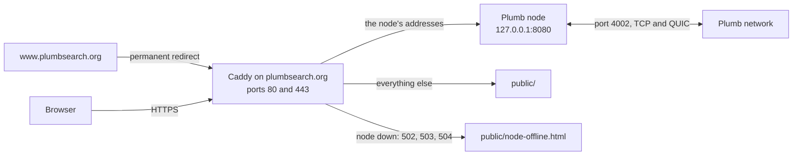

# plumbsearch.org

The website at https://plumbsearch.org and the server setup behind it: a static site, Caddy in front of it, and a Plumb node that answers the site's searches. This page is for whoever runs the server, or wants to run a site like it.

- [What is here](#what-is-here)
- [How a request is served](#how-a-request-is-served)
- [What Caddy passes to the node](#what-caddy-passes-to-the-node)
- [Headers and logs](#headers-and-logs)
- [The compose file](#the-compose-file)
- [Deploy](#deploy)
- [Update](#update)
- [Try it locally](#try-it-locally)

## What is here

| Path | What it is |
| --- | --- |
| [public/](public) | The static site, served as it is in the checkout |
| [Caddyfile](Caddyfile) | Caddy's configuration: HTTPS, headers, which addresses go to the node, error pages and logging |
| [docker-compose.yml](docker-compose.yml) | Caddy, and with the `node` profile, the Plumb node |
| `local/` | Extra Caddy routes kept only on the server; ignored by git ([.gitignore](.gitignore)) |

The static pages in `public/`:

| File | Served at | What it is |
| --- | --- | --- |
| `index.html` | `/` | What Plumb Search is, a search box with the settings gear, and links to the code and the installers |
| `privacy.html` | `/privacy` | What the server keeps, when a search leaves the server, and what it fetches by itself |
| `credits.html` | `/credits` | The open data Plumb is built from |
| `404.html` | Any address with nothing at it | "There's nothing at this address." |
| `node-offline.html` | Any of the node's addresses while the node is down | "Search isn't available here right now." |
| `opensearch.xml` | `/opensearch.xml` | Lets browsers add Plumb as a search engine, searching `https://plumbsearch.org/search?q=...` |
| `storage.js` | `/storage.js` | Shows on the front page how many items the node searches and how much disk they take, from the node's `/api/status`, every 30 seconds while the page is visible |
| `style.css`, `favicon.svg` | `/style.css`, `/favicon.svg` | The static pages' style and icon |

## How a request is served



Caddy gets and renews the HTTPS certificates itself, and sends plain HTTP and `www.plumbsearch.org` to `https://plumbsearch.org`. Any address that is not one of the node's goes to `public/`, where `/privacy` serves `privacy.html` and so on. When Caddy cannot reach the node, the node's addresses show `node-offline.html`; any other error shows `404.html`.

## What Caddy passes to the node

The `@node` matcher in the Caddyfile lists every address that reaches the node:

| Addresses | What they are |
| --- | --- |
| `/search`, `/api/search`, `/api/recent` | The search page, its JSON API, and the results page's Recent block |
| `/mcp` | The MCP server for AI apps ([docs/mcp.md](../docs/mcp.md)) |
| `/api/status` | The node's status, which `storage.js` reads |
| `/about`, `/welcome`, `/welcome/*` | About you, and its first-run version; kept in the visitor's own cookie |
| `/private`, `/private/*`, `/api/buckets`, `/api/buckets/*`, `/api/oblivious/targets`, `/api/oblivious/forward/*` | Private search: the page, its WebAssembly, the buckets the browser fetches, and requests sealed to other nodes ([docs/private-search.md](../docs/private-search.md)) |
| `/network`, `/api/network/search` | Search across the Plumb network |

`/opensearch.xml` comes from `public/`, not from the node. Nothing else of the node's is passed: its panel at `/app` stays private to the server. Neither is `/go`, which the node's results link through only when it notes which results people open (shared popularity, search history or ranking experiments), so those stay off on a node behind this Caddyfile, or `/go` goes into `@node`.

The Caddyfile imports `/site/local/*.caddy`, for routes kept only on the server, such as one to another node. It is a glob, so with no such file nothing is imported.

## Headers and logs

The Caddyfile's `header` block sets `Strict-Transport-Security: max-age=31536000`, `X-Content-Type-Options: nosniff` and `Referrer-Policy: no-referrer` (searches are in the address, so it is not passed on to the sites people click through to), and removes the `Server` header. The static pages also get a `Content-Security-Policy` that allows only this site's scripts, styles, images and fetches, forms only to this site, and no framing.

Answers are compressed with zstd or gzip.

No access log is configured, so Caddy keeps no record of visitors or of what they search for. Caddy logs a request that fails, such as a search while the node is down, with the visitor's address and the search in it, so the Caddyfile leaves those messages (`http.log.error`) and the proxy's own (`http.handlers.reverse_proxy`) out of its log.

## The compose file

| Service | What it runs |
| --- | --- |
| `caddy` | `caddy:2` with host networking, so it can reach the node on 127.0.0.1:8080 and a host firewall applies to ports 80 and 443 as usual. It mounts this whole folder read-only at `/site` (a file mounted by itself keeps its old contents after `git pull` replaces it), and keeps certificates and its ACME account in the `caddy-data` volume, which should be kept: without it Caddy requests new certificates and can run into Let's Encrypt's rate limits |
| `plumb` (profile `node`) | `ghcr.io/sueheir/plumb-search:main`, the newest build of `main` (`latest` is the newest release), with its data in the `plumb-data` volume. It listens on 127.0.0.1:8080, so only Caddy serves it to the internet, and on port 4002 (TCP and UDP) for the Plumb network. Docker opens that published port itself, past a host firewall such as ufw. It may use 3 CPUs, and gets five minutes to stop |

The node's command replaces the image's default (`run --data /data --bind 0.0.0.0:8080 --network --search-by-meaning`):

| Flags | What they do |
| --- | --- |
| `--private-search` | Serves private search at `/private` |
| `--search-by-meaning`, `--embed-threads 1` | Finds sites by meaning, embedding them with one thread so searches do not wait behind it |
| `--network`, `--p2p-port 4002`, `--public-addr` (twice) | Joins the Plumb network on port 4002 and gives the server's public address over TCP and QUIC |
| `--bootstrap /dns4/host.docker.internal/tcp/4001/p2p/...`, `--no-default-bootstrap` | Joins through the network's relay, which runs on the same machine outside this compose file and has port 4001. It is reached through the Docker host (`extra_hosts`), since a container cannot reach its machine's own public address |
| `--no-upnp`, `--no-local-discovery` | No asking a router to forward the port, and no looking for nodes on the local network |
| `--search-from anyone` | Network searches from the public page may ask any node, not only trusted ones and the nodes they trust |
| `--country US`, `--only-country`, `--lang en` | The search pages start with the United States, only its sites, and English; the settings gear changes them. The JSON API and `/mcp` still search every country unless asked with `only=1` |
| `--drop-dead-sites` | Takes out of the index sites no crawl has reached for 60 days; they come back when a crawl reaches them again |
| `--set-updates off` | Page set files are not replaced by newer ones from trusted nodes; they change here only by hand |
| `--trust-peer` (five times) | The project's crawlers, whose crawls count as soon as they are signed |

The node crawls at the server default, 5,000 homepages every hour. [docs/running-a-node.md](../docs/running-a-node.md) and `plumb run --help` describe every flag.

## Deploy

On a machine with Docker, and DNS records for `plumbsearch.org` and `www.plumbsearch.org` pointing at it:

```sh
git clone https://github.com/SueHeir/plumb-search.git /opt/plumb-search
cd /opt/plumb-search/site
docker compose up -d                     # the website only
docker compose --profile node up -d      # the website and the node
```

To build the node from source on the server instead, for an image that is not published yet or another branch, name the repository and branch in `.env` next to the compose file:

```sh
echo 'PLUMB_SOURCE=https://github.com/SueHeir/plumb-search.git#main' > .env
docker compose --profile node build plumb
docker compose --profile node up -d
```

On its first start the node downloads its seed data and builds its index, which takes a while; `docker compose logs -f plumb` shows how far it is.

## Update

```sh
cd /opt/plumb-search && git pull
cd site
docker compose --profile node pull    # newer images, if any
docker compose --profile node up -d
```

Changes to `public/` show at once, since Caddy serves the checkout. After the `Caddyfile` changes, reload it:

```sh
docker compose exec caddy caddy reload --config /site/Caddyfile --adapter caddyfile
```

## Try it locally

With [Caddy](https://caddyserver.com/docs/install) installed, from this folder:

```sh
sed -e 's|^www.plumbsearch.org {|http://www.localhost:9080 {|' \
    -e 's|^plumbsearch.org {|http://localhost:9080 {|' \
    -e "s|/site/public|$PWD/public|" Caddyfile > /tmp/Caddyfile.local
caddy run --config /tmp/Caddyfile.local --adapter caddyfile
```

Then open http://localhost:9080. To try the search box as well, run a node on 127.0.0.1:8080, the address `plumb run --data <folder>` serves at by default.
